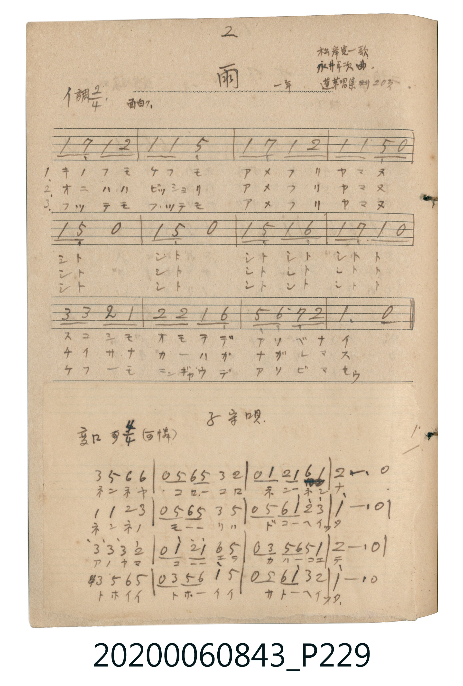

# 雨（雨）

> Re:Shōka 使用 AI 協助辨識與重建樂譜，可能會有錯誤。歡迎回報。

- **鋼琴伴奏版**：<br><audio controls src="ame.mp3"></audio>
- **NEUTRINO 歌聲合成版**：<br><audio controls src="ame_neutrino.mp3"></audio>

- 詞：松岸寛一
- 曲：永井幸次
- 唱歌帖 P229a (一年 / 蓬莱唱集ヨリ 20頁)

## 說明

> [!NOTE]
> **原頁資訊與歌詞全文**（對應 `P229.jpg` 上半頁）：
> - **出處與標註**：頁頂標示曲號「`2`」、曲名「`雨`」、學年「`一年`」，右上角記「`松岸寛一歌`」「`永井幸次曲.`」「`蓬莱唱集ヨリ 20頁`」（抄自臺灣教育會或相關教材所據《蓬萊唱歌集》第 20 頁）。
> - **調性與拍號**：左上角記「`イ調 2/4,`」「`面白ク,`」（A 大調，`?= A`，`<2/4>`）。
> - **校訂與手抄原貌說明（依 Editorial Policy A 校訂）**：
>   1. **低音點漏記**：手抄簡譜於第 8 小節第 2 音 `7`、第 10 小節第 4 音 `6` 及第 11 小節第 3 音 `7` 漏點下方低八度圓點（第 11 小節 `6_` 與 `7` 之間另有一微小墨點）；依前後級進旋律線條（`A4–G#4–A4`、`B4–B4–A4–F#4`、`E4–F#4–G#4–B4`）校訂補齊為 `7_`、`6_`、`7_`。
>   2. **末小節（第 12 小節）時值**：原抄本明確記作附點四分音符加八分休止符 `1.  0_`（3 + 1 個八分音符），據此修正舊轉錄之 `1 - 0 -` 為 `| 1 - - 0 |`。
>   3. **第 10 小節第 3 段字音對位**：原抄本於四個八分音符 `2 2 1 6_` 下方分四欄對齊寫作「`ニン`｜`ギャ`｜`ウ`｜`デ`」（與第 1 段「`オ モ テ デ`」、第 2 段「`カ ー ハ ガ`」四欄垂直對齊），據原譜四欄配置錄入。
>
> **1.**
> キノフモ　ケフモ　アメフリ　ヤマヌ
> シト　シト　シトシト　シトト
> スコシモ　オモテデ　アソベナイ
>
> **2.**
> オニハハ　ビッショリ　アメフリ　ヤマヌ
> シト　シト　シトシト　シトト
> チイサナ　カーハガ　ナガレマス
>
> **3.**
> フッテモ　フッテモ　アメフリ　ヤマヌ
> シト　シト　シトシト　シトト
> ケフーモ　ニンギャウデ　アソビマセウ


## 歌詞

```text
（TMD 檔案未包含歌詞註解）
```

## ABC

<div class="abc-score" data-abc-src="ame.abc" aria-label="五線譜載入中"></div>

[下載 ABC 原始檔](ame.abc)

## TMD 檔案連結

- [主旋律 TMD 檔案](ame.tmd) [[在 TMD Studio 編輯](https://tmdlang.github.io/Tmd-TS/#tmd=s7IKdvYPcrWy4qpTUCpJTLdSSM7PyUlNLsnMz7MqzsjPTkzOyFeCS5bl55TmploBqXgDc4RwcX5pUXJqfEFieqpVgJGRZSK6FNyo-Lz8ktSk_PxsDBUZ-UWJmfFgdcUZpQjpgqL8stS8xDygktzEvNLi5KLMgpL45PyCSoSa1LLMlFSQiuLkxLz4stSizLTM1BQkZ6cWFYM9BHFnSVFiHsQcoCBCVX5RSUZ-elFiQUalVUZmcUl-UWZyYk58dmIekn9KMlKBAVCemghkFKELF-QkIrkKqD89M8-qJDET6CuQz8oT43MTM_NyEvOAbtPSUng5e8X7PR1gslNBS4tL0VbB0MCEy95WwZHLxkjfxA5k1NMpG5-t7Xm6Y5oCOGQVNJ7saHi6c4uCvsKLyWte9G0Eyr-c3fa4ecXj5lUKRgYvFzRqgp3wYuW893tmPZu77-mmHU_XzwbqAgs_m70JJLxhx5NdU5_u3PFszUIlLi59LQVbagEuBQUFO4VoRT__ENdYCEdL62nffKDDXmxuf7Gi60VHO9BDQOc9bV3xbFq7lhYwDJ5u6H3W3qmQAPKiXlZBeoLCkx1dT3u7gJqAYQN0MMQgXZBR7btezJwKMmTFzBcrdoO0zwIqe7mgCSjwfMkuoAdfzJz_uKEnwSjhcUPv44ZGoMjTCUBGTwIwqKFiT9fuAAYiSAwSnCDh93t6nvZvBlr8YvmkFytmgCSRgw_oaIhmoDBS8AFN14OJ44oRiOkdz7paXrSvetG-63nj4mdTZ75o2vRsTvOzjmnPZ-94OX0OUOTZ3AnPOhueTZ71uKELZNaELkjsg4xr6H6-Zg3QOAVImDxuaEKEyYtV-581LAeFSXcv0PPgMHm6fRmKVx43LQEqUwAmKx2Yc1_OXfR85t7HTevBIkAHOio8XbIcqAoYEgmgVJgAYoBTIpCFauWzBQtfrGgCWdnZDfQXMIJfbOp5sWrVsxl9QIOe7Jur4JqSCcpCiTkKAfk5mcmVCo4KEE1Ao8AuhBimoGCoBzTvyd6-l_M3v9w979mefqCLwQogRj_fsPDF2jnPpu0B-d9C4emG_ufrG8BhoQDUoZBgDnR8I4hvaIAkaQKRNEtQeNrfBZY1RJI1hmlVAFoHtPTJju5n03YC3fC0dfXTXcuezpkMFAT6A0Uj0LT4BAWgl8Ean-zsfjlt8tP-Zc_mdILS0L51QFVPF60AawQm2dnAMHja2ft0X8_zLbNeNmx6Nr376b7u59tnPVs0F2hygqPJo4bJ7sog0tEE5IUEJxAbTIDl3JQhwq5QDly5kwkoNqARsHjOy71dz5t2Ad0UD1YOdCOIAvOg8aWgYAQK4mdzVkM8AvOYEdRjINNmNj1t2ANJOH3zgaH-bM4aYFQ-X7QLGBlP9s55ObMF6LGns2c_7WgDBt3zNcuedi0ABVZH25M9E5-tXQQUUUgAxqSCQTzQdR3GCtoKwHBr6IaogWgBh0sPMHk_W7vkyf51z9YuftHR9WJv58ueFmBoArUDU5aBgm6CAtg_NUADdMEiNcheMQZ5BSO6jRWerdv6dO10oEXAsuTJ3l40r0zbA3I7qnMUEoyAachQARSrkAQAlAIqe7amBWgGMFifrl8N9Do48zR3P27enPB-7xxgPlr3uHkxlLkMQje3QzMQMHGAnQZyDSTTrVJ43LwIiNuAGKwKmliNEEpWA6X2AHG_wuOmNSAlUDfMa3o-ewvEJfCQA-WztXMgCl629j7fuw4YeE9bl8ICCFbgGuoB6xMw-3HT2sfNfY-bpwLd8bih4XHTRiT2osfNC8HcVSBu85LHzfMeN_fANG5_3NwBVobKQOM2d8DU73zctBksCDF8FYjRDCwI26F2Ne193DzzcXMXsChCcawRkmOBmoBB3Q9CIBdNftzcDDZyOdSN1HVycyPQLY-btoIcBZJdDYwJkNVNa8CGA1265nEzEM0Deg7FycYIJ4Pc0gz2J9jbaFwqBzEk8oBuhNgFSpWQBAlMi6gBDQw5oKt3A8VBeimv16FAQUufi8sR2NYJyEzMy3eoMaipBpmvYGOhBQ4cBVC2NY8HEkZgpqGCaTwwE2MTBWZssA4fwxpQKgWGZB8oNMEZBiSyEc4D6Qf6C8heCBVbBRJpXgLE84C4B2GWEUglKNN1Q3IUEINUgtIRJLiXg3WTYKIxSBykAmgAOBuDXQeOZrgAccbBwwfseUigoDJBhREirFADaDvQnA6oYuw8GI0kAlaDHDQUmwIKDopMgYaCMRCCSt8aIAkphYFMYBAAaaDnIckEWvwjBcJOIN4MNRKSSlAKWFg0NO0F8mYCcRdYZAmqSaCAaG4EiwPzPlzVaqAaaCkMjrwuMAuY_8GRCLEdxRxwUEBSKUgnJF2AsiRQGJQngdQyDFdNhpsGyptwA2u5uHTtFIAZSwFIKXMBAA)]
- [鋼琴伴奏 TMD 檔案](ame_piano.tmd) [[在 TMD Studio 編輯](https://tmdlang.github.io/Tmd-TS/#tmd=s7IKdvYPcrWy4qpTUCpJTLdSSM7PyUlNLsnMz7MqzsjPTkzOyFeCS5bl55TmploBqXgDc4RwcX5pUXJqfEFieqpVgJGRZSK6FNyo-Lz8ktSk_PxsDBUZ-UWJmfFgdcUZpQjpgqL8stS8xDygktzEvNLi5KLMgpL45PyCSoSa1LLMlFSQiuLkxLz4stSizLTM1BQkZ6cWFYM9BHFnSVFiHsQcoCBCVX5RSUZ-elFiQUalVUZmcUl-UWZyYk58dmIekn8Si4Ca01NzU_NKrAoyE_Py4xOTk_NzCxLzMkFiCIUlGUBFVuWpiUBGEbpwQU4ikvOBFqVn5lmVJGYCvQ8KgvLE-NzEzLycxDygJ7S0FF7OXvF-TweY7FTQ0uJStFUwNDDhsrdVcOSyMdI3sQMZ9XTKxmdre57umKYAjgIFjSc7Gp7u3KKgr_Bi8poXfRuB8i9ntz1uXvG4eZWCkcHLBY2aYCe8WDnv_Z5Zz-bue7ppx9P1s4G6wMLPZm8CCW_Y8WTX1Kc7dzxbs1CJi8szr6Qo3yoA5O8gD4cag5pqLgUgsDHRsgMzahSqC2oVog1jFXSB7GiTWIVo01iFGq5aFK0-2LUaxoN1mcTHK5gCMViXIzCwwHqQdFggdCiYxwMJIzDTEKgLbACmqAHQMJAOH8MahcdNaxUeN_cB8VQgXgRU9LhpI5wH0v-4aRGQvRAqtgok0rwEiOcBcQ_CLCOQylVAsW4g7gdjkMrJj5ubgRLbHzcvB-smwURjkDhIBdCA5jaY65qnIgsQZxw8fMCehwQKKtNQwQwYxLCwQg2g7UBzOqCKsfNgNJIIWA1y0FBsCig4KDIFGgrGQGgE9GQNkATRYI8DgwBIAz0PSSa6QIgaCDuBeDPUSEgqAcU1KOBBEdEOi4amvUDeTCDuAossQTUJFBDNjWDxx01b4apWA9WA00zTGnDkdYFZj5tBeB5YxU5Uc8BBAUmlIJ2QdNH9uBnkwHWPmxcDqWUYrpoMN203SBpmIHKuQsnEiHxVnQvMxcbx2sBMFK8NDCMw0yReGxRWYDaYgGY3YtTBPAIpH8BCQCmIBFYuNJbQzUYyJzcNaJC2MRibgqwEKwAVH0A2mIC5BjW-wWqhJmMLEpTCCamogRRKUArMN4YWVGBH45VGmGEAITDYIMWggg-EQY6FG4eiGyoGUgxMzFBFZijaYKUn3BlI5gC96ZqXkpmXjr8EB0V-tFEutOyGlebounEU4jBXwYpzkDZdOwVw6a8AZADDOdoHZCKUaYRgGoOZEDtALGUuAA)]

## 分析

```text
================================================================================
📊 TMD Song Profile: [ 雨（雨） ]
================================================================================
⏱  Duration:       0:13 (13.8s), 12 measures total
🎼 Key & Tempo:    首調基準 A, != 104.0 BPM, <2/4>
   - 分析範圍：      由實際發聲的音符與和弦推測調性；播放脈絡另行呈現
🎤 人聲音域:    E4 (MIDI 64) – C#5 (MIDI 73) [跨度: 9 個半音 / 0.8 個八度, 難度: easy]
   - 最低音:  E4 in [Ame #1 @ m.2, 0:01]
   - 最高音: C#5 in [Ame #1 @ m.9, 0:09]
   - 適合: soprano, mezzo-soprano, contralto, tenor, baritone, bass
🏛  結構:      Ame (13.8s)
⚡ 編曲密度:        Peak 1 軌道同時演奏
🗝  調性診斷：       A 大調（純淨自然大調，未偵測到可信轉調）
   - 風格氣質:    純淨自然大調（陽光明朗、易唱易記，無明顯調外色彩）
   - 轉調歷程:    全曲維持單一推測調性（未偵測到可信轉調）
   - 核心骨幹音:  A, E, B, G#, F#
   - 調性數值:    A 大調 [相關度: 0.83, 穩定度: High, 自然音純度: 100.0%]
   - 候選調性 (K-S): A 大調 (0.83), A 小調 (0.66), E 大調 (0.57)
   - 五度圈歷程:   +3
   - 各段落調性細節:
     • [Ame #1]: A 大調 (r: 0.83, 自然音純度: 100.0%)

  [ 五度圈游移軌跡 ]
               C  
         F            G  
      Bb               D  
      Eb              [A ]*
         Ab           E  
            Db       B  
               F# 
     (* = active key center)

  [ 十二半音累積音高分佈 ]
     C  :                            0.0%
     C# : ███                        4.9%
     D  :                            0.0%
     D# :                            0.0%
     E  : █████████                 17.1%
     F  :                            0.0%
     F# : ████                       7.3%
     G  :                            0.0%
     G# : █████                      9.8%
     A  : ████████████████████████  46.3%
     A# :                            0.0%
     B  : ████████                  14.6%
--------------------------------------------------------------------------------
Assignment 軌道音域：
  - Piano         : E4 – C#5 (9 個半音 / 0.8 個八度, 38 個音符)
================================================================================
```


## 原書掃描頁




