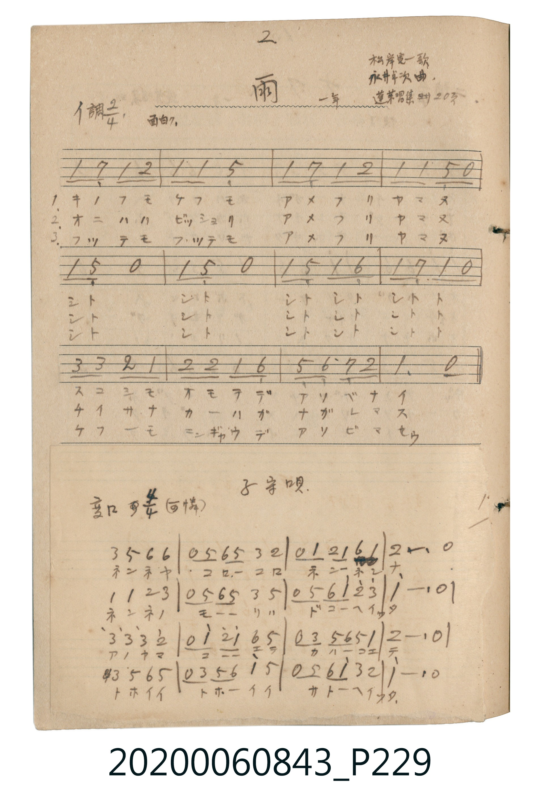

# 雨（雨）

> Re:Shoka 使用 AI 辨識樂譜，可能會有錯誤。歡迎回報。

<audio controls src="ame.mp3"></audio>

- 詞：松岸寛一
- 曲：永井幸次
- 唱歌帖 P229a (一年 / 蓬萊唱集 20頁)

## 說明

雨（雨）
Source: 唱歌帖 (2020.006.0843), P229.jpg (top)
Marginal notes: 2 / 松岸寛一歌 / 永井幸次曲 / 一年 / 蓬萊唱集 24 20頁
Key: イ調 (A major), Time: 2/4, Tempo: 面白ク

## 跨冊／重複收錄參照

> 同名異曲（各冊收錄之不同詞曲版本）

- **[同名異曲]** 《新定兒童唱歌》尋常科第一學年用（2020.006.0847.0001）：[**〈アメ〉**](../../../shintei_jido_shoka/grade_1_2020.006.0847.0001/4_05_ame/index.md)（`F` / `2/4` — [原始 TMD](../../../shintei_jido_shoka/grade_1_2020.006.0847.0001/4_05_ame/ame.tmd)）
- **[同名異曲]** 楊金土手抄《唱歌帖》第 3 冊・I（2020.006.0843）：[**〈雨〉**](../../vol_03/p036_ame/index.md)（`F` / `2/4` — [原始 TMD](../../vol_03/p036_ame/ame.tmd)）
- 總表：[跨冊重複與同名歌曲總索引](../../../duplicate_songs.md)

## 歌詞

```text
1. キノフモ ケフモ アメフリ ヤマヌ
シト シト シトシト シトト
スコシモ オモテデ アソベナイ
2. オニハハ ビッショリ アメフリ ヤマヌ
シト シト シトシト シトト
チイサナ カーハガ ナガレマス
3. フッテモ フッテモ アメフリ ヤマヌ
シト シト シトシト シトト
ケフーモ ニンギャウデ アソビマセウ
```

## ABC

```abc
X:1
T:雨（雨）
C:曲：永井幸次
M:2/4
L:1/16
Q:1/4=104
K:A
V:V1 name="Vocal" snm="Voc"
[V:V1]
A2 G2 A2 B2 | A2 A2 E4 | A2 G2 A2 B2 | A2 A2 E2 z2 |
A2 E2 z4 | A2 E2 z4 | A2 E2 A2 F2 | A2 G2 A2 z2 |
c2 c2 B2 A2 | B2 B2 A2 F2 | E2 F2 G2 B2 | A4 z4 |
A2 G2 A2 B2 | A2 A2 E4 | A2 G2 A2 B2 | A2 A2 E2 z2 |
A2 E2 z4 | A2 E2 z4 | A2 E2 A2 F2 | A2 G2 A2 z2 |
c2 c2 B2 A2 | B2 B2 A2 F2 | E2 F2 G2 B2 | A4 z4 |
A2 G2 A2 B2 | A2 A2 E4 | A2 G2 A2 B2 | A2 A2 E2 z2 |
A2 E2 z4 | A2 E2 z4 | A2 E2 A2 F2 | A2 G2 A2 z2 |
c2 c2 B2 A2 | B2 B2 A2 F2 | E2 F2 G2 B2 | A4 z4 |
```

## TMD 檔案連結

- [主旋律 TMD 檔案](ame.tmd) [[在 TMD Studio 編輯](https://tmdlang.github.io/Tmd-TS/#tmd=s7IKdvYPcrWy4qpTUCpJTLdSSM7PyUlNLsnMz7MqzsjPTkzOyFeCS5bl55TmploBqXgDc4RwcX5pUXJqfEFieqpVgJGRZSK6FNyo-Lz8ktSk_PxsDBUZ-UWJmfFgdcUZpQjpgqL8stS8xDygktzEvNLi5KLMgpL45PyCSoSa1LLMlFSQitSUzJL8oszEHCQnpxYVgz0DcWNJUWIexAygIEJVSUYq0F_lqYlARpESl5aWwsvZK97v6QCTnQpaWlyKtgqGBiZc9rYKjlw2RvomdiC9T6dsfLa25-mOaQpgbytoPNnR8HTnFgV9hReT17yY0AWUfzm7TcHI4OWCRk2wbS9Wznu_Z9azufuebtrxdP1soHqw8LPZm0DCG3Y82TX16c4dz9YsVOLi0tdSsKUW4FJQQPESiB8MCXkFhC80jAyMDPQMDMz0DCxMjDV1wN7SyypIV9AoyS_QBGnyTSxKz8xLzFEAxWSxlYIR0LPI3gGaBBJB8gnQb0ARHCFjAgkckMneqZVWCo-blrxYtV9Bw1EhNzErvwjohJBMYMwoAEMcyEzNLci3Ung5d9HzmXsfN60H6fKpLMpMLrYCMQ31gNrXPm7ue9w89XHzIiBnI5y16HHzQjBnlcLj5iWPm-c9bu4B6XnctP1xcwcqhcpp7oCo2_m4aTNYCGTcKiD1uLntcXM72OymvY-bZz5u7gK6HqTYCOQQoJLux839QAS0cfLj5maw5uVgF1DunOZGoF2Pm7YCLQXKrH7cvAdkV9MaoAzQFWseNwPRPKCjQYqNgc4B2dUMdjHQ-SgcKgQNJJiBLgCZDfQ0MJzWPW5e_LhpGXIAAcMA6KLdQFGQLsqTNBQoaOlzcTkC00hYfnJijkONQY1CNcgCBRsLLTswo0bBUME8HkgYgZmGCqbxCrpYRQ0UasA6gDnPIQecsGwVlIBpCuitPlCwATE4WSGxQV5eCOWDAxCI5wFxjxLIYaiGxRuBjQMp6wZiUMKAJQ5IkC6HGEKaocYgQ8FRClTRBnFW8x5oLCOEiDAUFA7gUICEDirTUMEsHhFoOEJqO9A8cPLATzd34A4diowAhwUZRtQoGAOhEdBjNUASRIM9C_Q2kAZ6GJJGdCHhgc3jO4HGboYaDS4goPEACnxwFgDivUD2TCAG5dglOAOguREkDcRboUpXQ6MTmFQg-RtKgzAw_pp24g4IWEIFaQfnTSAGuRKaO9HcNhlqICiLgs2s5eLStVMA5i0FDEqZCwA)]
- [鋼琴伴奏 TMD 檔案](ame_piano.tmd) [[在 TMD Studio 編輯](https://tmdlang.github.io/Tmd-TS/#tmd=s7IKdvYPcrWy4tLSUng5e8X7PR1gslNBS4tL0VbB0MCEy95WwZHLxkjfxI6rTkHp6ZSNz9b2PN0xTSHAyMgyUUHjyY6Gpzu3KOgrvJi85sWELqD8y9ltCkYGLxc0aiqBdLxYOe_9nlnP5u57umnH0_WzgerBws9mbwIJb9jxZNfUpzt3PFuzUImLS19LwZZagEtBAdVLjxqmKARkJublKzgmJ-fnFiTmZeam5pWA1AXnlxYlp1opIHynYWRgZKBnYGCmZ2BhYqypA_auXlZBuoJGSX6BJkiTb2JRemZeYo5CXn5JarGVghEwEJC9CTQJJILkQ6CfgSI4QswEEmggkyn3PBQoaOlzcTnmplqF5Scn5jjUGNQoVIMsULCx0LIDM2oUDBXM44GEEZhpqGAar6CLVdRAoQasAxhHDjmVRZnJxbYKSo-b1io8bu4D4qlAvEjhcdNGJDYQNy-E8lcB8RIgngfEPUogh6EaFm8ENg6krBuI-6F48uPmZqBJ2x83L4cYQoShICeDHQzxCCrTUMEsHuE_HJ7aDjSvA2Qtfrq5A7dHSDeiRsEYCI2ArqoBkiAa7FKgm4E00LWQuNCFeAabq3cCjd0MNRoU_KDQAYVWGxC3Q0KuaS-QPROIu4DsJThd39wIkgbirVClq4H0HkiUNK2BioFoEAYGftNOsFG1kMQGzmRBHtiTW3VuQa2Ccbw2MG3FawN9BWaaxGuDfAdmgwloKiRGHSwKgUYDTQYLAaUgEli50HBFNxvJnNw0oEHaxmBsCrISrKAGYj2YgLkGNYbAaqEmw-IJOUx8cISJIUgr0GEQCsw3BjJAHLCr8UojzDCAEBhskGITKAa5Fm4cim6oGEgxMP1BFZmhaAOxYNqR9YDMAfrTM6-kKB9b7JsgYh8YRdGGseDIjTaJVYg2jcXQixpKCL1Ai0DaTEDWQjS55qVk5qUTsBGU3qKNcqF2wWxH147LUiOIbVDLQbp07RTAjlUAMoAxi0lBjAWxlLkA)]

## 分析

```text
================================================================================
📊 TMD Song Profile: [ 雨（雨） ]
================================================================================
⏱  Duration:       0:41 (41.5s), 36 measures total
🎼 Key & Tempo:    首調基準 A, != 104.0 BPM, <2/4>
   - 分析範圍：      由實際發聲的音符與和弦推測調性；播放脈絡另行呈現
🎤 人聲音域:    E4 (MIDI 64) – C#5 (MIDI 73) [跨度: 9 個半音 / 0.8 個八度, 難度: easy]
   - 最低音:  E4 in [Ame #1 @ m.2, 0:01]
   - 最高音: C#5 in [Ame #1 @ m.9, 0:09]
   - 適合: soprano, mezzo-soprano, contralto, tenor, baritone, bass
🏛  結構:      Ame (13.8s) -> Ame (13.8s) -> Ame (13.8s)
⚡ 編曲密度:        Peak 1 軌道同時演奏
🗝  調性診斷：       A 大調（純淨自然大調，未偵測到可信轉調）
   - 風格氣質:    純淨自然大調（陽光明朗、易唱易記，無明顯調外色彩）
   - 轉調歷程:    全曲維持單一推測調性（未偵測到可信轉調）
   - 核心骨幹音:  A, E, B, G#, F#
   - 調性數值:    A 大調 [相關度: 0.83, 穩定度: High, 自然音純度: 100.0%]
   - 候選調性 (K-S): A 大調 (0.83), A 小調 (0.66), E 大調 (0.59)
   - 五度圈歷程:   +3 -> +3 -> +3
   - 各段落調性細節:
     • [Ame #1]: A 大調 (r: 0.83, 自然音純度: 100.0%)
     • [Ame #2]: A 大調 (r: 0.83, 自然音純度: 100.0%)
     • [Ame #3]: A 大調 (r: 0.83, 自然音純度: 100.0%)

  [ 五度圈游移軌跡 ]
               C  
         F            G  
      Bb               D  
      Eb              [A ]*
         Ab           E  
            Db       B  
               F# 
     (* = active key center)

  [ 十二半音累積音高分佈 ]
     C  :                            0.0%
     C# : ███                        5.0%
     D  :                            0.0%
     D# :                            0.0%
     E  : █████████                 17.5%
     F  :                            0.0%
     F# : ████                       7.5%
     G  :                            0.0%
     G# : █████                     10.0%
     A  : ████████████████████████  45.0%
     A# :                            0.0%
     B  : ████████                  15.0%
--------------------------------------------------------------------------------
Assignment 軌道音域：
  - Vocal         : E4 – C#5 (9 個半音 / 0.8 個八度, 114 個音符)
================================================================================
```


## 原書掃描頁




