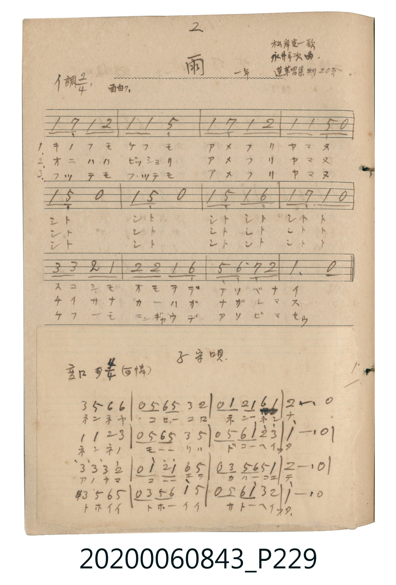

# 子守唄（搖籃曲）

> Re:Shōka 使用 AI 協助辨識與重建樂譜，可能會有錯誤。歡迎回報。

- **鋼琴伴奏版**：<br><audio controls src="komoriuta.mp3"></audio>

- 唱歌帖 P229b

## 說明

子守唄（搖籃曲）
Source: 唱歌帖 (2020.006.0843), P229.jpg (bottom)
Marginal notes: 変ロ調 4/4 （可憐）
Key: 変ロ調 (Bb major), Time: 4/4, Tempo: 可憐


## 歌詞

```text
ネンネヤ コロコロ ネンネン ナ
ネンネノ モリハ ドコヘイッタ
アノヤマ コエテ カハコエテ
トホイ トホイ サトヘイッタ
```

## ABC

<div class="abc-score" data-abc-src="komoriuta.abc" aria-label="五線譜載入中"></div>

[下載 ABC 原始檔](komoriuta.abc)

## TMD 檔案連結

- [主旋律 TMD 檔案](komoriuta.tmd) [[在 TMD Studio 編輯](https://tmdlang.github.io/Tmd-TS/#tmd=s7IKdvYPcrWy4qpTUCpJTLdSSM7PyUlNLsnMz7MqzsjPTkzOyFeCS5bl55TmploBqXgDc4RwcX5pUXJqfEFieqpVgJGRZRK6FNyo-Lz8ktSk_PxsDBUZ-UWJmfFgdcUZpQjpgqL8stS8xDygktzEvNLi5KLMgpL45PyCSoSa1LLMlFSQitSUzJL8oszEHCQnpxYVgz0DcWNJUWIexAygIEIVUFN6Zp5VaR7IoJLMtMzUFCUuLS2Fp2snPF3X8XRKy_s9Hc8mTHu-sfnZ7E3v93QqaGlxKdoqmJtx2dsqOOlw2Zjom9iBTHs6ZeOztT1Pd0xTgAYEl76Wgi21AJeCAk4ngeSCIWGpgHCFhpGBkYGegYGZnoGFibGmDthZelkF6QoaSfklJfm5miB9volFQO8n5iiAoqcYqH9J5-PmtS9W7VcA-ksBaNHT_vXP2iZAbfFOrURWouGUpJCbmJVfBDQ9JBOYPECagMzU3IJ8oDqwTpA2n8qizORiKxDzcXPv4-bNYHKJwuMmIGsthESW2QzkdKGp7gNyFj1uXvW4uR_I6gRrmvG4acnj5ubHTfvBipuA8n1Acx83zwMb3bTicXMbkLUaqAfOhxjb8bh5NlAzMqtpK5iDaiblEQcFClr6XFze-bnA5FZakmgVkJmYl-9QY1BTDbJFwcZCyw7MqFEwVtBVMAViMyiuUTAA8s2AGCRjBBUxBLIMFczigVxDsBBIAgYNQCJg43xqQEEI5ILCFERC2EvAWuJBgQTkgYJ-D5gNklsLkwOqRdUFYoPM60KyCuSAGi6o00EuAWGQW0CORXU6yFMwEcM4BaM4kCoQAdQIooh2fR_chYvAGoCJAkz2w8U74b6ZASLBEQpxfNN-XI4HOwVBgJ0HDmmwU4EkKDJgfjCG-otw6DeB3AhxMyTcQYkTEfpg9zetAIu3wcVXQ30D9QVYHhQWIBWo1mBJNKhuBActWtAjEhLI9TjCvQPsptmQ8IOTkPDtwCXTtBWuE2_IQ-yq5eLStVOottc1NKpVALLg2QPEUeYCAA)]
- [鋼琴伴奏 TMD 檔案](komoriuta_piano.tmd) [[在 TMD Studio 編輯](https://tmdlang.github.io/Tmd-TS/#tmd=s7IKdvYPcrWy4tLSUni6dsLTdR1Pp7S839PxbMK05xubn83e9H5Pp4KWFpeirYK5GZe9rYKTDpeNib6JHVedgtLTKRufre15umOaQoCRkWWSEheXvpaCLbUAl4ICbic9apiiEJCZmJev4JicnJ9bkJiXmZuaVwLSE5xfWpScaqWAcJ2GkYGRgZ6BgZmegYWJsaYO2Ll6WQXpChpJ-SUl-bmaIH2-iUXpmXmJOQp5-SWpxUD9SzofN699sWq_AtC_CkAHPO1f_6xtAtB2kGrK_QcFClr6XFze-bn5RZmlJYlWYfnJiTkONQY11SBbFGwstOzAjBoFYwVdBVMgNoPiGgUDIN8MiEEyRlARQyDLUMEsHsg1BAuBJGDQACQCNs6nRuFxcy-Q-7h5M5iEsJeAtcQrPG7aDOStBeI9YDZIbi1MDqgWVReIDTKvC8kqkANquKBOB7kEhEFuATkW1ekgT8FEDOMUjOJAqkAEUCOIItr1fXAXLgJreNy8Ckz2w8U74b6ZASKbljxuboY4vmk_LseDnYIgwM4DhzTYqUASFBkwPxhD_UU49JtAboS4GRLuj5vnIYU-2P1NK8DibXDx1VDfQH0BlgeFBUgFqjVYEg2qG8FBixb0iIQEcj2OcO8Au2k2JPzgJCR8O3DJNG2F68Qb8hC7apFzBDibB3lgzRPVBbUKhtogZxtqgwNdG-RRCAn0BFAGEh0QNabx2hDfARmGmDkFKGoOUQGCYB6K76H6wFJQCqQYYjambRAXIcSB4WuqDU49ptrQ5G2sDU_gxmDVKJZBVKFT0PQH1gpPgjB_I2yE2gkJFSK9hy0k0U2EOhmb5-JhgQy1BujIeG1oWBGKXx_s8WsYDzQPSpqAGRASVQZIGoMYEAyVgwqDdECwGRSDQiJewQisE0xiBANcO8xIoDIoD8NiuPU1CAcC0xRQGKIZuy4sFkJJFLfVgB0MNBxKgbwBVIawEGojkihIJTiAiPEkVA_E4ThNRfEiXA5kESx8sAU9Wnx75pUU5WPJyyYoeTnaMBaqsUYh2iw3ViHaBIhNQYLopqCkGIQpcJtBYQfyGdD1UM2ueSmZeen43ZALcoQR0GJdmLXIbkI3BcUNRnBTIMEOdQtYk66dQrW9rqFRrQKQBfYEiAHPAyAOxFwQS5kLAA)]

## 分析

```text
================================================================================
📊 TMD Song Profile: [ 子守唄（搖籃曲） ]
================================================================================
⏱  Duration:       0:50 (50.5s), 16 measures total
🎼 Key & Tempo:    首調基準 B,, != 76.0 BPM, <4/4>
   - 分析範圍：      由實際發聲的音符與和弦推測調性；播放脈絡另行呈現
🎤 人聲音域:    G3 (MIDI 55) – D5 (MIDI 74) [跨度: 19 個半音 / 1.6 個八度, 難度: challenging]
   - 最低音:  G3 in [Komoriuta #1 @ m.3, 0:07]
   - 最高音: D5 in [Komoriuta #1 @ m.7, 0:21]
   - 適合: mezzo-soprano, contralto, tenor, baritone, bass
🏛  結構:      Komoriuta (50.5s)
⚡ 編曲密度:        Peak 1 軌道同時演奏
🗝  調性診斷：       A# 大調（純淨自然大調，未偵測到可信轉調）
   - 風格氣質:    純淨自然大調（陽光明朗、易唱易記，無明顯調外色彩）
   - 轉調歷程:    全曲維持單一推測調性（未偵測到可信轉調）
   - 核心骨幹音:  A#, C, D, F, G
   - 調性數值:    A# 大調 [相關度: 0.82, 穩定度: Moderate, 自然音純度: 100.0%]
   - 候選調性 (K-S): A# 大調 (0.82), F 大調 (0.73), G 小調 (0.63)
   - 五度圈歷程:   -2
   - 各段落調性細節:
     • [Komoriuta #1]: A# 大調 (r: 0.82, 自然音純度: 100.0%)

  [ 五度圈游移軌跡 ]
               C  
         F            G  
     [Bb]*              D  
      Eb               A  
         Ab           E  
            Db       B  
               F# 
     (* = active key center)

  [ 十二半音累積音高分佈 ]
     C  : █████████████████████     21.4%
     C# :                            0.0%
     D  : ███████████████████       19.6%
     D# :                            0.0%
     E  :                            0.0%
     F  : ███████████████████       19.6%
     F# :                            0.0%
     G  : ██████████████            14.3%
     G# :                            0.0%
     A  :                            0.0%
     A# : ████████████████████████  25.0%
     B  :                            0.0%
--------------------------------------------------------------------------------
Assignment 軌道音域：
  - Piano         : G3 – D5 (19 個半音 / 1.6 個八度, 60 個音符)
================================================================================
```


## 原書掃描頁




