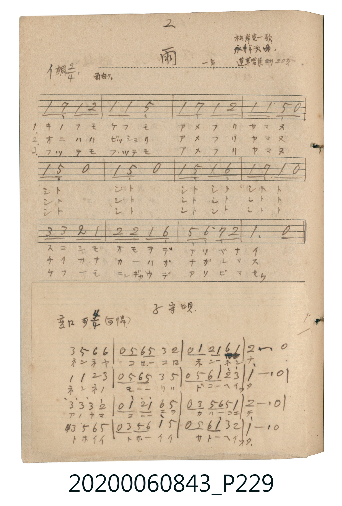

# 子守唄（搖籃曲）

> Re:Shōka 使用 AI 協助辨識與重建樂譜，可能會有錯誤。歡迎[回報](https://github.com/TMDLang/reshoka/issues)。

- **鋼琴伴奏版**：<br><audio controls src="komoriuta.mp3"></audio>
- **NEUTRINO 歌聲合成版**：<br><audio controls src="komoriuta_neutrino.mp3"></audio>

- 唱歌帖 P229b

## 說明


- 出處：唱歌帖 P229b
- 調性與拍號：調號 ?= B,，拍號 <4/4>，速度 != 76


## 歌詞

```text
（TMD 檔案未包含歌詞註解）
```

## ABC

<div class="abc-score" data-abc-src="komoriuta.abc" aria-label="五線譜載入中"></div>

[下載 ABC 原始檔](komoriuta.abc)

## TMD 檔案連結

- [主旋律 TMD 檔案](komoriuta.tmd) [[在 TMD Studio 編輯](https://tmdlang.github.io/Tmd-TS/#tmd=s7IKdvYPcrWy4qpTUCpJTLdSSM7PyUlNLsnMz7MqzsjPTkzOyFeCS5bl55TmploBqXgDc4RwcX5pUXJqfEFieqpVgJGRZRK6FNyo-Lz8ktSk_PxshIqCovyy1LzEPKCq3MS80uLkosyCkvjk_IJKhJrUssyUVJCK4uTEvPiy1KLMtMzUFCR3pRYVg10McUhJUWIexBygIEJVflFJRn56UWJBRqVVRmZxSX5RZnJiTnx2Yl4iQlFJRirQh2mJuZk5SA4AKk3PzLMqzQO5owRqu5aWwtO1E56u63g6peX9no5nE6Y939j8bPam93s6FbS0uBRtFczNuOxtFZx0uGxM9E3sQKY9nbLx2dqepzumKUADiktfS8GWWoBLQUHBTiFa0c8_xDUWwtHSeto3_-WCxheb21-s6HrR0Q60_sXKeU9bVzyb1q6lBXT30w29z9o7FRJADtLLKkhPUHiyo_tpbxdQE9An7_fMghikCzTq2YqZLxf2gAxZMfPFit0g7bOAHn46offFihmPG3oS4OGhl_C4off9np6n25c92dH1YvkkmIIlnY-b175YtV8BGCIKINv71z9rmwC0CKKh4-XMXgUnhadLlgPVAPUngMMvAcQChyGQNftZd--LmfOfdrQBbVNIMElQeDan82V777P-_if71z1bu_j59Kkvti8EGvm4oQnh9qetq5_uWvZy_uan8-e_WLH26bpZYOcnhOSmBJdnppWAvL1WAWqfwpOd3U_n73q2a5pCgmGCwvOmXQoJTo9mrjUBueRF99LnrctfrJ3zcu6ip2ung0iw2c9nb3mxdv3TDe0vV8942ThFIcHFDOTcJ7u7nuyb-6J91fOWbaC4n7IR4gigwic7dr9cPQXolGfT9gAtilcAWg60xRgYFo0JhlAeyM4OUHzN3gTRqJDgbvyoYbKLKcgxQCNeLGsESfQ2QNyIkHu2vvvlgo6nS6Y97VqgkFBtr2toVAv0zPLdwLB91tP-ZPcS9EB6tmDhixVNoAju7H7W1QJMOi829bxYterZjD6gI4DeUHBNyQRlnMQchYD8nMzkSgVHBYgmoFHgAIUYpqBgqAc07_maNQrGQM8YGio83dD_fH3D011Tn2-f9WLVkqe7twGtebpw-rMpOyHpaM4aUFJq3PZs6g6QDDhVPp24B0RCtM7eBQqpvoXAdAQK8I62J3smPlu76PmaZQrawMjrfNrQDREHhgZE8GnrSpDg7NlwQUgiSzBQqADDGiBWqACGVSfIgqX9T-d1A2MM6G2g54EOAjsf6nKQmze0P5uz-smuHqBZCglm8QrApPEEGO9TVwPT-NNp6yCeAwXUjingGDUD56Vn03ZCvT1zKjCpPtvf_HTRCpDPu3bCkyowtkCWIcKpExgC7UAhkG2Nk1GCrX0z0LNgJ5gqmCmYwuwAJQZwUgPmD2gYghPN860bn-xogPsPElsvm0CRC_cNMIGjhhI0TSgoGMGi0RAWEJA4g7gcHHMgWROFF8CCYWHPy2XTgP5HUQ_0HVAU7F7jBAVggfC0cQswGJ62djxdvxqcf5_u6wEa-rJrOzDXPV_bBvQmxHQkZxjDnWECNRaUyeZvfrl73rM9_cDCBewSlIiDq3yyd44CMMaNFUDBZQgMMGhgmyqAHQWMRIgRwEgEBiPcXFDW3Tf3ya4pLxpBGe_lrD5QSbaw59n07qf7ukHR0QGKIAVDU6g9IEvAVsQB7TICemtDL7CcAOVDSK5aPOfp7HlA4yGlBbzkBSX8VcDSAugOW0QpA8-XkBB43Nz7uHkzmFzyuKHhcROQvRZKArkI2c1gbheGrj6w-KLHzaseN_eD2Z1g7TMeNy153Nz8uGk_VEsTUE0fyJbmeVCLmlY8bm4Ds1eD9MJEYFZ0PG6eDTIEZCYSu2krmItqPuVVHBQoaOlzcXnn5wKLotKSRKuAzMS8fIcag5pqkC0KNhZa4HAD5m_jeGDBZgoigPkVStQoACMqHsQGkmAFRjBhYBkMZANJs3iQEJABEgdLw6ABSAhsuk8NKISBXGAgg0kIewnULGBIAXlrQWJAFkgGxAbLAFWi6gGxQaZ1YVgE9QfYJWAC7BiwqzH9AfYoQthQwQikFixmSIoX-uAOXQTWAEw2YLIfLt4J99QMsAdBkQzxQ9N-XH4AOQSGQQ4DBziQZQiJFrjjgV6Be4uYOGgCORLiaEjoA9MuUhyAPdC0AizeBhdfDfUO1BtgeVBggFRgdz1qSsJ0LSiEMSIAOXmBfYIjDjrAzpsNCUs4CQnrDlwyTVvhOomIhVouLl07BXimUQBylLkA)]
- [鋼琴伴奏 TMD 檔案](komoriuta_piano.tmd) [[在 TMD Studio 編輯](https://tmdlang.github.io/Tmd-TS/#tmd=s7IKdvYPcrWy4qpTUCpJTLdSSM7PyUlNLsnMz7MqzsjPTkzOyFeCS5bl55TmploBqXgDc4RwcX5pUXJqfEFieqpVgJGRZRK6FNyo-Lz8ktSk_PxshIqCovyy1LzEPKCq3MS80uLkosyCkvjk_IJKhJrUssyUVJCK4uTEvPiy1KLMtMzUFCR3pRYVg10McUhJUWIexBygIEJVflFJRn56UWJBRqVVRmZxSX5RZnJiTnx2Yl4iQlFiEVBzempual6JVUFmYl5-fGJycn5uQWJeJkgMobAkA6jIKi0xNzMHyaVAM9Mz86xK80AOLoE6U0tL4enaCU_XdTyd0vJ-T8ezCdOeb2x-NnvT-z2dClpaXIq2CuZmXPa2Ck46XDYm-iZ2INOeTtn4bG3P0x3TFKAhyuWZV1KUbxUAclOQh0ONQU01lwIQ2Jho2YEZNQrVBbUKxvHapvHahgq6YFgD4pvFK5iASSOQHEiUqxbFOB_sxhnGgxRDjDGLB3JMQIQpiICa4Z2fC_RwaUkixBwkUyzgphiDVIOtBboAStQoGICEgGwgCVZgBBM2BDkTRAJtBAoBGSBxsDQMGoCtB5nuU6PwuLkXyH3cvBlMQthLoGY9btoM5K0FiQFZIBkQGywDVImqB8QGmdaFYRE8NGDOATsG7GpMf0DCFy5sqGAEUgsWg8UJUV7ogzt0EVjD4-ZVYLIfLt4J99QMsAeXPG5uhvihaT8uP4AcAsMgh4EDHMgyhEQL3PFAr8C9RUwcNIEcCXE0JPQfN89DigOwB5pWgMXb4OKrod6BegMsDwoMkArsrkdNSZiuBYUwRgQgJy-wT3DEQQfYebMhYQknIWHdgUumaStcJxGxgJljUDIyIs-AMrJhvDbY6UAaGgugLIygQb4BqYBHFEwDMINqQ_0LYgL9jD1PgSTNYWpBECqAEjRwMyDScAZYE8xGnE6BuR1VgSGQ1gYlPyAFyRrAQgqWO8DlF4YTwOowKEgSBmuGpGKkMEKxF2E1PDBJCQI8UYHdGqh_cHsfKarg9oN8AtIADWVCSQel0EYkHVChDTQDTgPLbDAbRmOqANFAmyEFO5iAq4FLQst-MAGuCsAEOABBaQtiEJTGDD0ksxCWgFTDRbC7Ctl1CBUgn4ASMogNMw6fKVhdA6cxfACt60B2whlgf4N0YHcNsgxYDySgSQgcuHZ047BbhDdgkAMZZ5yipS3XvJTMvHT8jYtcYKEEbkfA8q45Ug5EbnOgG4ijeQEKEXAWgOYQmKPA-nXtFMANFAUgA57wQRyIwSCWMhcA)]

## 分析

```text
================================================================================
📊 TMD Song Profile: [ 子守唄（搖籃曲） ]
================================================================================
⏱  Duration:       0:50 (50.5s), 16 measures total
🎼 Key & Tempo:    首調基準 B,, != 76.0 BPM, <4/4>
   - 分析範圍：      由實際發聲的音符與和弦推測調性；播放脈絡另行呈現
🎤 人聲音域:    G3 (MIDI 55) – D5 (MIDI 74) [跨度: 19 個半音 / 1.6 個八度, 難度: challenging]
   - 最低音:  G3 in [Komoriuta #1 @ m.3, 0:07]
   - 最高音: D5 in [Komoriuta #1 @ m.7, 0:21]
   - 適合: mezzo-soprano, contralto, tenor, baritone, bass
🏛  結構:      Komoriuta (50.5s)
⚡ 編曲密度:        Peak 1 軌道同時演奏
🗝  調性診斷：       A# 大調（純淨自然大調，未偵測到可信轉調）
   - 風格氣質:    純淨自然大調（陽光明朗、易唱易記，無明顯調外色彩）
   - 轉調歷程:    全曲維持單一推測調性（未偵測到可信轉調）
   - 核心骨幹音:  A#, C, D, F, G
   - 調性數值:    A# 大調 [相關度: 0.82, 穩定度: Moderate, 自然音純度: 100.0%]
   - 候選調性 (K-S): A# 大調 (0.82), F 大調 (0.73), G 小調 (0.63)
   - 五度圈歷程:   -2
   - 各段落調性細節:
     • [Komoriuta #1]: A# 大調 (r: 0.82, 自然音純度: 100.0%)

  [ 五度圈游移軌跡 ]
               C  
         F            G  
     [Bb]*              D  
      Eb               A  
         Ab           E  
            Db       B  
               F# 
     (* = active key center)

  [ 十二半音累積音高分佈 ]
     C  : █████████████████████     21.4%
     C# :                            0.0%
     D  : ███████████████████       19.6%
     D# :                            0.0%
     E  :                            0.0%
     F  : ███████████████████       19.6%
     F# :                            0.0%
     G  : ██████████████            14.3%
     G# :                            0.0%
     A  :                            0.0%
     A# : ████████████████████████  25.0%
     B  :                            0.0%
--------------------------------------------------------------------------------
Assignment 軌道音域：
  - Piano         : G3 – D5 (19 個半音 / 1.6 個八度, 60 個音符)
================================================================================
```


## 原書掃描頁




