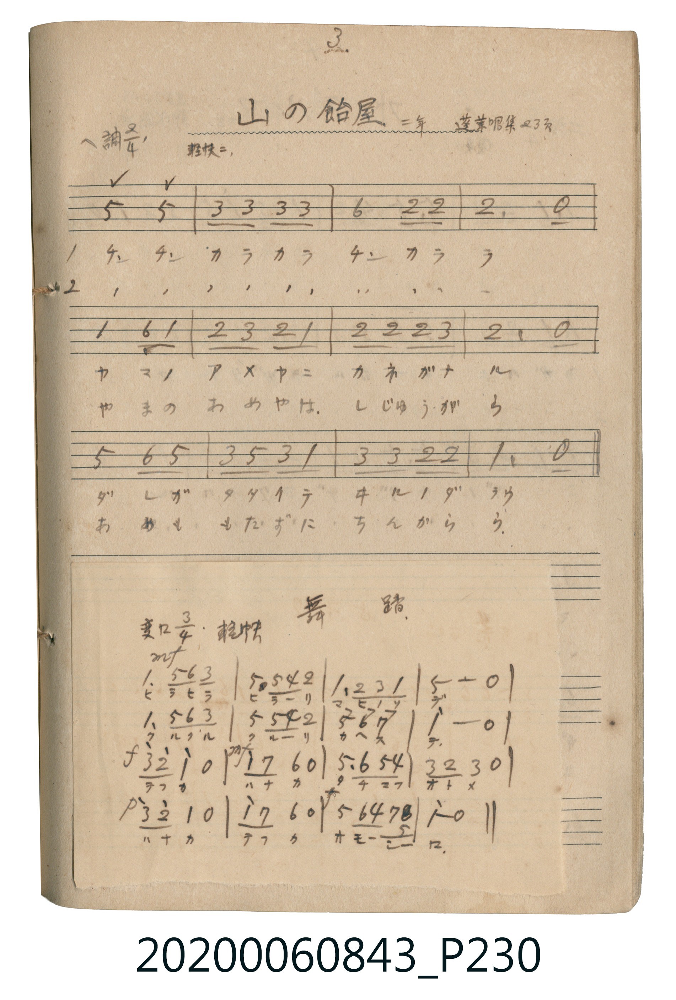

# 山の飴屋（山上的糖果店）

> Re:Shōka 使用 AI 協助辨識與重建樂譜，可能會有錯誤。歡迎[回報](https://github.com/TMDLang/reshoka/issues)。

- **鋼琴伴奏版**：<br><audio controls src="yama_no_ameya.mp3"></audio>
- **NEUTRINO 歌聲合成版**：<br><audio controls src="yama_no_ameya_neutrino.mp3"></audio>

- 唱歌帖 P230a (二年 / 蓬萊唱集 23頁)

## 說明

山の飴屋（山上的糖果店）
Source: 唱歌帖 (2020.006.0843), P230.jpg (top)
Marginal notes: 3. / 二年 / 蓬萊唱集 23頁
Key: ヘ調 (F major), Time: 2/4, Tempo: 軽快ニ


## 歌詞

```text
1. チン チン カラカラ チンカララ
ヤマノ アメヤニ カネガナル
ダレガ タタイテ ヰルノダラウ
2. チン チン カラカラ チンカララ
やまの あめやは しじゅうがら
あめも もたずに ちんからら
```

## ABC

<div class="abc-score" data-abc-src="yama_no_ameya.abc" aria-label="五線譜載入中"></div>

[下載 ABC 原始檔](yama_no_ameya.abc)

## TMD 檔案連結

- [主旋律 TMD 檔案](yama_no_ameya.tmd) [[在 TMD Studio 編輯](https://tmdlang.github.io/Tmd-TS/#tmd=s7IKdvYPcrWy4qpTUCpJTLdSSM7PyUlNLsnMz7MqzsjPTkzOyFeCS5bl55TmploBqXgDc4RwcX5pUXJqfEFieqpVgJGxQSK6FNyo-Lz8ktSk_PxsDBUZ-UWJmfFgdcUZpQjpgqL8stS8xDygktzEvNLi5KLMgpL45PyCSoSa1LLMlFSQitSUzJL8oszEHCQnpxYVgz0DcWNJUWIexAygIEJVSUYq0F95iSWlRakIUaBR6Zl5ViWJmUB3gdxWnhifm5iZl5OYl4KsqiQjP70osSCj0iojsxjkgOTEnPjsxDxgOGhpKTzduPFx47qXi7c83dj9fk8HkPtkR9fzWS3PN097Nm_O013T3-_pVNDS4lK0VTA0sOCyt1Vw47Ix0jexA9nwdMrGZ2t7nu6YpgAOWAWNJ7t6nu7coqCv8GLymhcTuoDyL2e3KRgZv1zQqKnExaWvpWBLLcCloECU40HqgiGxqIBwr4aRgZGBnoGBmZ6BhYmxpg7YA3pZBekKGiX5BZogTb6JRcDwTcxRAKWKYisFYz2gv_B4EKTHO7XSSuFx84wXq_YraLgp5CZm5RcBDQ_JBMafAjDUgMzU3IJ8K4UXu_c-3b_6cXM3SJdPJTBSiq1ATEM9oPbGx82b4VQTUNVKCAkVgwo1rwRpeNy85HHzvMfNfUCVix43LwTzuyHaeh83rXnc3PW4eTVEZcPj5jVAIaDkfjACqmwDCm8AKgAaAJYH2rQMpNiIZHc0tTxu3AeMDYXHjU2PmxrB_PVAzvTHjTMeN7U-bmx73NjzuAkcHzAlTUBtTY8b5z9unPW4cTVQeOHjpsmPG7uByqAqKU8nUKCgpc_FFZmYm-iX75ibWploFZCZmJfvUGNQUw2yR8HGQssOzKhRMFXQBeMaBWMorFEwA_KNgLAGiHUVDECyYNU-hjWwENJFMIBiTUDvgEIKSiOrQhJaCeTHIwwzoqJhNQqGQLZZPJACOdoYiCEsEAR5CZtHloAtngfEfWB7FwFZC8HioEQFc0kvkAamouYusLWrMf3Q1AIyp3EfEK8DqWkERXQjWByUKEAi04EYlC6AFDANNvaADe-EG4UUFWZAEhQVpkAM8gEoQiBRAfIgug8awD4ApfE1YCP3QzHIB21g924AuxmcY4CqwQEHTPSYngA6GhS-IGc3gY0CeqJxPhDPAuLVYE8Ag6ZpMpAG5bdONB_UcnHp2ikgpTgFIFeZCwA)]
- [鋼琴伴奏 TMD 檔案](yama_no_ameya_piano.tmd) [[在 TMD Studio 編輯](https://tmdlang.github.io/Tmd-TS/#tmd=s7IKdvYPcrWy4qpTUCpJTLdSyC8qychPL0osyKi0ysgsLskvykxOzInPTsxLVIIrKs4vLUpOjS9ITE-1CjAyNkDIlGSk5qZapaaUJieWZObnKXFpaSk83bjxceO6l4u3PN3Y_X5PB5D7ZEfX81ktzzdPezZvztNd09_v6VTQ0uJStFUwNLDgsrdVcOOyMdI3sQOZ-nTKxmdre57umKYAsihRQePJrp6nO7co6Cu8mLzmxYQuoPzL2W0KRsYvFzRqKnFx6Wsp2FILcCkoEOf4Rw1TFAIyE_PyFRyTk_NzCxLzMnNT80pA-oPBQWWlgPCHhpGBkYGegYGZnoGFibGmDthjelkF6QoaJfkFmiBNvolF6Zl5iTkKefklqcVWCsZ6QP_i8ThID-XehQIFLX0ursjE3ES_fMfc1MpEK7DPHGoMaqpB9ijYWGjZgRk1CqYKumBco2AMhTUKZkC-ERDWALGuggFIFqzax7BG4XFz4-PmzUAhOAMo1rQayF0Jp5FVIQmtBPLjEYYZUdGwGgVDINssHkiBHG0MxBAWCIK8hM0jS8AWzwPiPrC9i4CshWDxx83dcJf0Auk1QLoLbO1qTD80tYDMadwHxOtAahqbgGKNYPHHjevBItOBeMbjplYg1QbEPWDDO-FGIUWFGZAERYUpEIN8AIoQSFSAPIjugwawD4CuA7oQZOR-KAb5oA3s3g1gN4N8CFINDrjHTcswPQF0NCh8Qc5uAhsF9ETjfCCeBcSrwZ4ABk3TZCDdDXY7qg9qsSS3IA-sCa46N61WwVAb5FkICfSaNtCzSBgkAkqDZvHaRhACGDjx2uYgFnIgAIMnXhsp4oFqjEAEMPhALLAkQhRBgGzAbh7MXWZgFsxlphAaogvERFBgM2A02D0gObip2MLFB3u4GMYDzQH6A0Jh8k0gHCMgBWKC3ALigSkDhAcgAmYQxRBFKMYg6YIrwGUK1EpktxjDDUHGyCpApgC97ZlXUpSPJSGYoCaEaMNYhWiTWCA32igXyDQFMtG0o4QXQjvQKhOQzWDHQzS55qVk5qXjtxRkpxnIJoilQPtATsDQjsNSYEIDWwq0ERQwIF26dgpgxyoAGUhxHe0DNBZdyAgsBLEHxFLmAgA)]

## 分析

```text
================================================================================
📊 TMD Song Profile: [ 山の飴屋（山上的糖果店） ]
================================================================================
⏱  Duration:       0:13 (13.3s), 12 measures total
🎼 Key & Tempo:    首調基準 F, != 108.0 BPM, <2/4>
   - 分析範圍：      由實際發聲的音符與和弦推測調性；播放脈絡另行呈現
🎤 人聲音域:    D4 (MIDI 62) – D5 (MIDI 74) [跨度: 12 個半音 / 1.0 個八度, 難度: easy]
   - 最低音:  D4 in [YamaNoAmeya #1 @ m.5, 0:05]
   - 最高音: D5 in [YamaNoAmeya #1 @ m.3, 0:02]
   - 適合: soprano, mezzo-soprano, contralto, tenor, baritone, bass
🏛  結構:      YamaNoAmeya (13.3s)
⚡ 編曲密度:        Peak 1 軌道同時演奏
🗝  調性診斷：       C 大調（純淨自然大調，未偵測到可信轉調）
   - 風格氣質:    純淨自然大調（陽光明朗、易唱易記，無明顯調外色彩）
   - 轉調歷程:    全曲維持單一推測調性（未偵測到可信轉調）
   - 核心骨幹音:  G, A, C, F, D
   - 調性數值:    C 大調 [相關度: 0.74, 穩定度: Moderate, 自然音純度: 100.0%]
   - 候選調性 (K-S): C 大調 (0.74), F 大調 (0.63), G 大調 (0.59)
   - 五度圈歷程:   +0
   - 各段落調性細節:
     • [YamaNoAmeya #1]: C 大調 (r: 0.74, 自然音純度: 100.0%)

  [ 五度圈游移軌跡 ]
              [C ]*
         F            G  
      Bb               D  
      Eb               A  
         Ab           E  
            Db       B  
               F# 
     (* = active key center)

  [ 十二半音累積音高分佈 ]
     C  : ███████████████           19.0%
     C# :                            0.0%
     D  : ███████                    9.5%
     D# :                            0.0%
     E  :                            0.0%
     F  : █████████████             16.7%
     F# :                            0.0%
     G  : ████████████████████████  31.0%
     G# :                            0.0%
     A  : ██████████████████        23.8%
     A# :                            0.0%
     B  :                            0.0%
--------------------------------------------------------------------------------
Assignment 軌道音域：
  - Piano         : D4 – D5 (12 個半音 / 1.0 個八度, 34 個音符)
================================================================================
```


## 原書掃描頁




