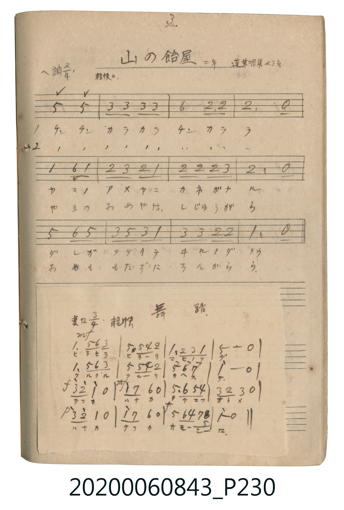

# 山の飴屋（山上的糖果店）

> Re:Shōka 使用 AI 協助辨識與重建樂譜，可能會有錯誤。歡迎回報。

- **鋼琴伴奏版**：<br><audio controls src="yama_no_ameya.mp3"></audio>

- 唱歌帖 P230a (二年 / 蓬萊唱集 23頁)

## 說明

山の飴屋（山上的糖果店）
Source: 唱歌帖 (2020.006.0843), P230.jpg (top)
Marginal notes: 3. / 二年 / 蓬萊唱集 23頁
Key: ヘ調 (F major), Time: 2/4, Tempo: 軽快ニ


## 歌詞

```text
1. チン チン カラカラ チンカララ
ヤマノ アメヤニ カネガナル
ダレガ タタイテ ヰルノダラウ
2. チン チン カラカラ チンカララ
やまの あめやは しじゅうがら
あめも もたずに ちんからら
```

## ABC

```abc
X:1
T:山の飴屋（山上的糖果店）
M:2/4
L:1/16
Q:1/4=108
K:F
V:V1 name="Vocal" snm="Voc"
[V:V1]
c4 c4 | A2 A2 A2 A2 | d4 G2 G2 | G4 z4 |
F4 D2 F2 | G2 A2 G2 F2 | G2 G2 G2 A2 | G4 z4 |
c4 d2 c2 | A2 c2 A2 F2 | A2 A2 G2 G2 | F4 z4 |
```

## TMD 檔案連結

- [主旋律 TMD 檔案](yama_no_ameya.tmd) [[在 TMD Studio 編輯](https://tmdlang.github.io/Tmd-TS/#tmd=s7IKdvYPcrWy4qpTUCpJTLdSSM7PyUlNLsnMz7MqzsjPTkzOyFeCS5bl55TmploBqXgDc4RwcX5pUXJqfEFieqpVgJGxQSK6FNyo-Lz8ktSk_PxsDBUZ-UWJmfFgdcUZpQjpgqL8stS8xDygktzEvNLi5KLMgpL45PyCSoSa1LLMlFSQitSUzJL8oszEHCQnpxYVgz0DcWNJUWIexAygIEJVSUYq0F95iSWlRakIUaBR6Zl5ViWJmUB3gdxWnhifm5iZl5OYl6LEpaWl8HTjxseN614u3vJ0Y_f7PR1A7pMdXc9ntTzfPO3ZvDlPd01_v6dTQUuLS9FWwdDAgsveVsGNy8ZI38QOZMXTKRufre15umOaAjjMFDSe7Op5unOLgr7Ci8lrXkzoAsq_nN2mYGT8ckGjphIXl76Wgi21AJeCAlGOB6kLhkSQAsK9GkYGRgZ6BgZmegYWJsaaOmAP6GUVpCtolOQXaII0-SYWAYMuMUcBFOHFVgrGekB_4fEgSI93aqWVwuPmGS9W7VfQcFPITczKLwIaHpIJjBoFYKgBmam5BflWCi927326f_Xj5m6QLp_KoszkYisQ01APqL3xcfNmONUEVLUSQkLFoELNK0EaHjcvedw873FzH1DlosfNC8H8boi23sdNax43dz1uXg1R2fC4eQ1QCCi5H4yAKtuAwhuACoAGgOWBNi0DKTYi2R1NLY8b9wFjQ-FxY9PjpkYwfz2QM_1x44zHTa2PG9seN_Y8bgLHB0xJE1Bb0-PG-Y8bZz1uXA0UXvi4afLjxm6gMqhKytMJFCho6XNxRSbmJvrlO-amViZaheUnJ-Y41BjUKFSDLFKwsdCyAzNqFEwVdMG4RsEYCmsUzIB8IyCsAWJdBQOQLFg1MEk75IDjz1ZBCRguwLABhxmEbgJ6ChReMBpdvHmlEshhqAbFG1FoVI2CIdB9ZvFACuRcYyCGsEAQ5Bm8XlgCNGseEINTFJBeCEpjQAxOVEC6F0gD01BzFxCvxun8phZgdO4DYnCCAGoBOhcsBk4TQAxNFEBWD1CmE8nxoKA3A5Kg4DcFYpDbQZEACX6Q13C6vQHoJlD6BqdxKAa5HZzMQe6F-AusDpTUcTof7mRwEgU6cj4QzwJicCoFik0G0qAQ6YQ7vpaLS9dOASmJKQC5ylwA)]
- [鋼琴伴奏 TMD 檔案](yama_no_ameya_piano.tmd) [[在 TMD Studio 編輯](https://tmdlang.github.io/Tmd-TS/#tmd=s7IKdvYPcrWy4tLSUni6cePjxnUvF295urH7_Z4OIPfJjq7ns1qeb572bN6cp7umv9_TqaClxaVoq2BoYMFlb6vgxmVjpG9ix1WnoPR0ysZna3ue7pimEGBkbJCooPFkV8_TnVsU9BVeTF7zYkIXUP7l7DYFI-OXCxo1lbi49LUUbKkFuBQUiHP8o4YpCgGZiXn5Co7Jyfm5BYl5mbmpeSUg_cH5pUXJqVYKCH9oGBkYGegZGJjpGViYGGvqgD2ml1WQrqBRkl-gCdLkm1iUnpmXmKOQl1-SWmylYKwH9C8ej4P0UO5dKFDQ0ufiikzMTfTLd8xNrUy0CstPTsxxqDGoUagGWaRgY6FlB2bUKJgq6IJxjYIxFNYomAH5RkBYA8S6CgYgWbBqYMw45FQWZSYX2yooPW5uVHjcvBmIoXTTaiC9EkGjizevVAI5DNWgeCMKjapRMAS6zyweSIGcawzEEBYIgjyD1wtLgGbNA-I-oNmLgPRCIAaJdUPt6gXSa4B0FxCvxun8phaFx437gHgdEDcBtQCdCxZbD8TTgXjG46bWx41tQFYPUKYTyfGgoDcDkqDgNwVikNtBkQAJfpDXcLq9AegmoNtA7mvaD8UgtwOtad4Aci_EX2B1Kx83LcPpfLiTQTQQN84H4llADDShERgiTZOBNChEOuGOr0VNX-CcE-SBPYVV56bVKhhqg3wKIYH-0gb6FAmDRECJzixe2whCAEMmXtscxEIOAWDYxGsjxTdQjRGIAIYdiAWWRIgiCJAN2M2DucsMzIK5zBRCQ3SBmAgKbAaMBrsHJAc3FVvA-OAIGMN4oEFAj0AoTL4JhGMEpEBMkGNAPDBlgPABRMAMohiiCMUYJF1wBbhMgVqJ7BZjuCHIGFkFyBSgvz3zSorysSUFE9SkEG0YqxBtEgvkRhvlApmmQCaaftQQQ-gHWmYCshvsfIgu17yUzLx0AtaCbDUD2QWxFmgjyBEY-nFZC0xtYGuBdoICB6RN104B7F4FIAMpwrFwIRaAWMpcAA)]

## 分析

```text
================================================================================
📊 TMD Song Profile: [ 山の飴屋（山上的糖果店） ]
================================================================================
⏱  Duration:       0:13 (13.3s), 12 measures total
🎼 Key & Tempo:    首調基準 F, != 108.0 BPM, <2/4>
   - 分析範圍：      由實際發聲的音符與和弦推測調性；播放脈絡另行呈現
🎤 人聲音域:    D4 (MIDI 62) – D5 (MIDI 74) [跨度: 12 個半音 / 1.0 個八度, 難度: easy]
   - 最低音:  D4 in [YamaNoAmeya #1 @ m.5, 0:05]
   - 最高音: D5 in [YamaNoAmeya #1 @ m.3, 0:02]
   - 適合: soprano, mezzo-soprano, contralto, tenor, baritone, bass
🏛  結構:      YamaNoAmeya (13.3s)
⚡ 編曲密度:        Peak 1 軌道同時演奏
🗝  調性診斷：       C 大調（純淨自然大調，未偵測到可信轉調）
   - 風格氣質:    純淨自然大調（陽光明朗、易唱易記，無明顯調外色彩）
   - 轉調歷程:    全曲維持單一推測調性（未偵測到可信轉調）
   - 核心骨幹音:  G, A, C, F, D
   - 調性數值:    C 大調 [相關度: 0.74, 穩定度: Moderate, 自然音純度: 100.0%]
   - 候選調性 (K-S): C 大調 (0.74), F 大調 (0.63), G 大調 (0.59)
   - 五度圈歷程:   +0
   - 各段落調性細節:
     • [YamaNoAmeya #1]: C 大調 (r: 0.74, 自然音純度: 100.0%)

  [ 五度圈游移軌跡 ]
              [C ]*
         F            G  
      Bb               D  
      Eb               A  
         Ab           E  
            Db       B  
               F# 
     (* = active key center)

  [ 十二半音累積音高分佈 ]
     C  : ███████████████           19.0%
     C# :                            0.0%
     D  : ███████                    9.5%
     D# :                            0.0%
     E  :                            0.0%
     F  : █████████████             16.7%
     F# :                            0.0%
     G  : ████████████████████████  31.0%
     G# :                            0.0%
     A  : ██████████████████        23.8%
     A# :                            0.0%
     B  :                            0.0%
--------------------------------------------------------------------------------
Assignment 軌道音域：
  - Vocal         : D4 – D5 (12 個半音 / 1.0 個八度, 34 個音符)
================================================================================
```


## 原書掃描頁




