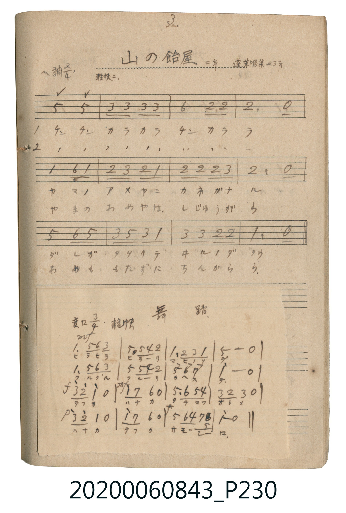

# 舞踏（舞蹈）

> Re:Shōka 使用 AI 協助辨識與重建樂譜，可能會有錯誤。歡迎回報。

- **鋼琴伴奏版**：<br><audio controls src="buto.mp3"></audio>
- **NEUTRINO 歌聲合成版**：<br><audio controls src="buto_neutrino.mp3"></audio>

- 唱歌帖 P230b

## 說明


- 出處：唱歌帖 P230b
- 調性與拍號：調號 ?= B,，拍號 <3/4>，速度 != 120


## 歌詞

```text
（TMD 檔案未包含歌詞註解）
```

## ABC

<div class="abc-score" data-abc-src="buto.abc" aria-label="五線譜載入中"></div>

[下載 ABC 原始檔](buto.abc)

## TMD 檔案連結

- [主旋律 TMD 檔案](buto.tmd) [[在 TMD Studio 編輯](https://tmdlang.github.io/Tmd-TS/#tmd=s7IKdvYPcrWy4qpTUCpJTLdSSM7PyUlNLsnMz7MqzsjPTkzOyFeCS5bl55TmploBqXgDc4RwcX5pUXJqfEFieqpVgJGxQRK6FNyo-Lz8ktSk_PxshIqCovyy1LzEPKCq3MS80uLkosyCkvjk_IJKhJrUssyUVJCK4uTEvPiy1KLMtMzUFCR3pRYVg10McUhJUWIexBygIEJVflFJRn56UWJBRqVVRmZxSX5RZnJiTnx2Yl4iQlFJRirQhwU5iUjWAxWmZ-ZZleaBXFECtVtLS-FFx7wXO_rf7-kAMXZ2vN_TqaClxaVoq2BoZMBlb6vgpMNlY6xvYgcy6OmUjc_W9jzdMU0BGkJc-loKttQCXAoKCnYK0Yp-_iGusRCOltbTvvkvFzS-2Nz-YkXXi452oPUvVs572rri2bR2LS2gq59u6H3W3qmQAHKQXlZBeoLCkx3dT3u7Xmza83zLzGed3c-6Wl6snQP01vs9syCG6gKNfbZi5suFPSADV8x8sWI3yKhZEC1PdnQ9m7bzxYoZz2Zvejqh93FDTwIkiPQSHjf0vt_T83T7MqCaF8snAdWAZJ8u6XzcvFYBGEYKh7YrvNi99-n-1RClHS9n9io4KTxdsvzFqv1AnQng4EwAscBBCmQBXdXzZMeylzNbnnbNfrprGdDMFzPnKyTkpgElO56vWaNg-Lih0dBA4emG_ufrG4AagNwEuKQlSNIUVbIArtMYWaIJ4fmnrauBVr2cv_np_PkvVqx9um4W2P8JIbkpweWZaSWgMFyrAHWtwtP5u57tmqaQYJig8Lxpl0KC06OZa02AdswG8p6vWfZ0QseL9lXPW7aBUsaUjSBTe4E2doDVGT9qmOxiCvXn89lbnvUtfbJ7KdCseAWg4SAFwJBqTDCE8kwSFEABAIqunmfru18u6Hi6ZNrTrgUKCdX2uoZGtUAXLN8NDMtnPe1Pdi9B8dOzBQtfrGgCRSg4yoHJ5sWmnherVj2b0Qd0zJN9cxVcUzJBuSUxRyEgPyczuVLBUQGiCeg6sP8hhikoGOoBzQMFoDk0_ICx83L3PCDj6dJ-sEqg6UA7ns1ZAzT9-aJdQDc_2Tvn6ezZTzvagP4HBopCginIYxCNqBJmoHTUCIoChJh5PCjOnk5b93TX1OfbZ0GC69nMpqcNe8BBbqigDXSVKZA00DNNUHjWDUqHzybPerZ2yZP9656tXfyio-vF3s6XPS1PdnY_2dEJVPB0bjvQAqA7gKFjBsTmCrrQ-KtRMI0HCYIIoHi8Qg3QQdCQVFAwgnneAup5SI4DJvTHTasfN8943LTzcXMbMHmDAwIcSsA4hikGBfvKeUBrgOpf7J_yuBGUA6HZBh5m0_Ygmw_KQkATwbnraf9mYO4FZi1gqD2b0_m0f-mLdQ1ANrh0agdmyGdzVoNTthmK5rVgzc9n73g6oQcSdvDweLFqCdAIoIOe7W8EGgTyRnM7xEFPdncBQw7iVpALQGYgBYQxOCDWtj1fvf7FllagXqALINEDNPPp7m2oCQGWU42A2BiITUEZ0xCWfpZNA8UIUjIA5Q9gfnrWAcxX4OwB9_nTHduAPn-5YDLQaoi94BJiCswCDMORUxLEfU8nTAQaB3Hli3ag-BpokkByANAyYCkHLSiMoEYpJAAz4NP-ZSAHtPc-6-9_Pn3qi-0LwUE6G5SFoMWWwtM5k4FlIig-VswElg2QnPF0HjCmeyCWAFPqk109EKcB2RBBSJmY8GjmSoVHM1cD8UqQzyF58GUTKMsiBb8JLB3CS7GXq2cA3Q5KGXv6QaVERztYGlb6QVwMT5VwbQoJxnEKRnEKhgoGwAwADgugMeDiDGIQpMCHmw6pU563LgeXr7BAntAD9N6zFU3AJAk3MA5k4ovFwIwP1AQKIhT3AJMqKMyBGQIYEetXAzO5ggWo6AcVTutXv2hofT5129MFW4C5QSHBAlxrAV3xbMpOoCQ4m4KSRUeCmYIJMOsC8_zL2TORY_r51hakUh0SaI-bJz1uXgklGxpg3D2Pm1eBufPAIn2Pm_YC8wBUS9P6x82roSRQDYQB14KU42FWtD1ungoSBxnY_7i5C8pu2v-4uRFsxVQwd9Xj5o7HzQthupBUIpsAUrYIZF3TdrCla0HqKW9IQIGClj4Xl1NpSb5VQGZiXr5DjUFNNcgCBRsLLXCQKdQoVOem1SoAayNdUKEILBKNQUxoCQkkTOIVjCAiYDVANlABmAlVA4IGIC7YPJ8aUCQAucCAB7NANEgtQhREroKKzQPzQKr6gDGxFyrajmIs1J3EOBG9WAcmeWwObFoPtnY1mAWiwdbCRZEc2AThzQAbAkwGYOe1YXNeNTAUjYHlCMhGsAQ0YEHuALsIIghzIcTZIBGgZyCBihGMbUA8FeoGiG5gMgLiLlSxpv1gNzaCgxOkAyK6CsjuAOKFGC4tQHcpuiNBfoE5FOhKoCSQhyswsTkJm9OBDgI5cxE4ILdD1a1FMbKWi0vXTgGUXhWAtDIXAA)]
- [鋼琴伴奏 TMD 檔案](buto_piano.tmd) [[在 TMD Studio 編輯](https://tmdlang.github.io/Tmd-TS/#tmd=s7IKdvYPcrWy4qpTUCpJTLdSSM7PyUlNLsnMz7MqzsjPTkzOyFeCS5bl55TmploBqXgDc4RwcX5pUXJqfEFieqpVgJGxQRK6FNyo-Lz8ktSk_PxshIqCovyy1LzEPKCq3MS80uLkosyCkvjk_IJKhJrUssyUVJCK4uTEvPiy1KLMtMzUFCR3pRYVg10McUhJUWIexBygIEJVflFJRn56UWJBRqVVRmZxSX5RZnJiTnx2Yl4iQlFiEVBzempual6JVUFmYl5-fGJycn5uQWJeJkgMobAkA6jIqiAnEcmdQBPTM_OsSvNAzi2BOlJLS-FFx7wXO_rf7-kAMXZ2vN_TqaClxaVoq2BoZMBlb6vgpMNlY6xvYgcy6OmUjc_W9jzdMU0BGpRcnnklRflWASDHBHk41BjUVHMpAIGNiZYdmFGjUJ2bVqtgHK9tGq9tqKCrYBKvbQZi1SgYgcXM44GCMOkarloUI32wG2kYD9JkAiRrFEzBbJAIWLNTaQlUL5JOC1THGIJ0mMYrmMUDLQYyQYZAREziga4Ci4DVANlABWAmVA0IGoC4YPN8ahQeN08Cch83rwSzQDRILUIURK6Cis0D80Cq-hQeN-2FirajGAv3IWEngkWACkCagaEI1ITVgU3rwdauBrNANNhauCiSA5sgvBlgQx437QQ7rw2b86pBUapgBLYRLAENWJA7wC6CCMJcCHE2SAToGUigYgRjGxBPhboBovtxcz8Qd6GKNe0Hu7ERHJwgHRDRVUB2BxAvxHBpAbpL0R0J8gvMoUBXAiWBPFyBic1J2JwOdBDImYvAAbkdqm4tipEoiRUl7-BOrobx2tDkYB4PyjLwJAHi4ky5EEmIcmQ2wmsoCY44SyASQBqaAoGGghMhIqejhh4i0QBVYEs3MKMg4nCrIcnHDMhFSUIwR6JYAI1rFAuwmA1yCMwDqJGOzfEo8YRSICHiCVIgQYoiYzAJLpggMQGVggUckSrJNBlUKILcDtKBpBtWRmI3GCoDCmWEGTBBFNsgJHUMRnYwmi9QQt81LyUzLx1_HQOMUVjFAq9W4JUKSrRiGImjjgG5C-QJcM0CdxZYt66dAriOUgAyQEkDRENMBLGUuQA)]

## 分析

```text
================================================================================
📊 TMD Song Profile: [ 舞踏（舞蹈） ]
================================================================================
⏱  Duration:       0:24 (24.0s), 16 measures total
🎼 Key & Tempo:    首調基準 B,, != 120.0 BPM, <3/4>
   - 分析範圍：      由實際發聲的音符與和弦推測調性；播放脈絡另行呈現
🎤 人聲音域:    A#3 (MIDI 58) – D5 (MIDI 74) [跨度: 16 個半音 / 1.3 個八度, 難度: moderate]
   - 最低音:  A#3 in [Buto #1 @ m.1, 0:00]
   - 最高音: D5 in [Buto #1 @ m.9, 0:12]
   - 適合: soprano, mezzo-soprano, contralto, tenor, baritone, bass
🏛  結構:      Buto (24.0s)
⚡ 編曲密度:        Peak 1 軌道同時演奏
🗝  調性診斷：       A# 大調（純淨自然大調，未偵測到可信轉調）
   - 風格氣質:    純淨自然大調（陽光明朗、易唱易記，無明顯調外色彩）
   - 轉調歷程:    全曲維持單一推測調性（未偵測到可信轉調）
   - 核心骨幹音:  A#, F, G, D, C
   - 調性數值:    A# 大調 [相關度: 0.96, 穩定度: High, 自然音純度: 100.0%]
   - 候選調性 (K-S): A# 大調 (0.96), F 大調 (0.74), G 小調 (0.65)
   - 五度圈歷程:   -2
   - 各段落調性細節:
     • [Buto #1]: A# 大調 (r: 0.96, 自然音純度: 100.0%)

  [ 五度圈游移軌跡 ]
               C  
         F            G  
     [Bb]*              D  
      Eb               A  
         Ab           E  
            Db       B  
               F# 
     (* = active key center)

  [ 十二半音累積音高分佈 ]
     C  : █████████                 10.0%
     C# :                            0.0%
     D  : ███████████               12.5%
     D# : █████                      6.2%
     E  :                            0.0%
     F  : ██████████████████████    25.0%
     F# :                            0.0%
     G  : ████████████              13.7%
     G# :                            0.0%
     A  : ████                       5.0%
     A# : ████████████████████████  27.5%
     B  :                            0.0%
--------------------------------------------------------------------------------
Assignment 軌道音域：
  - Piano         : A#3 – D5 (16 個半音 / 1.3 個八度, 50 個音符)
================================================================================
```


## 原書掃描頁




