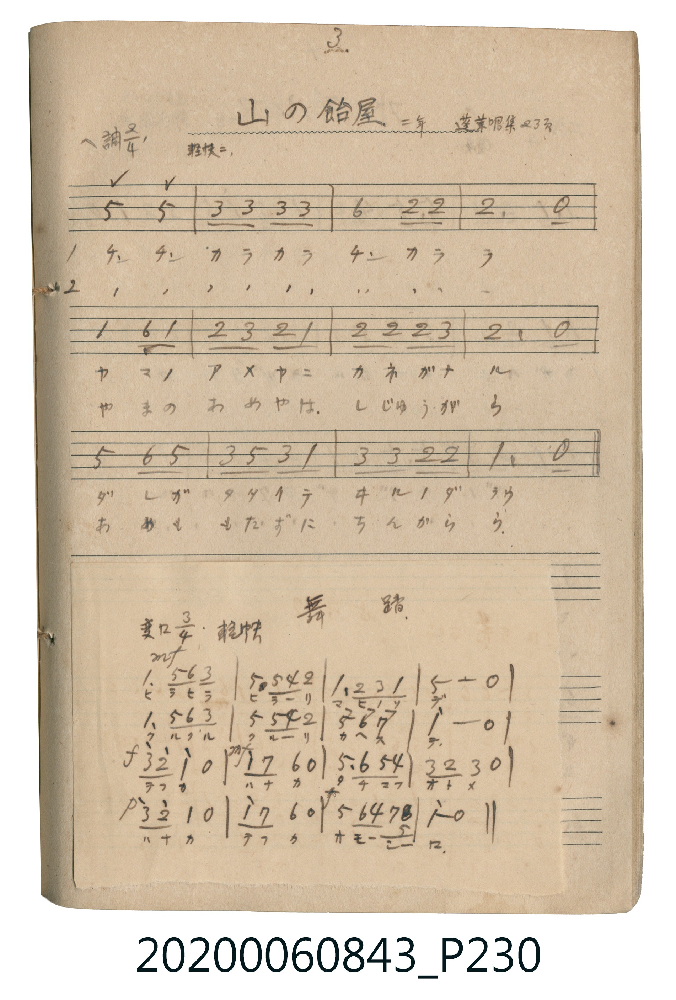

# 舞踏（舞蹈）

<audio controls src="buto.mp3"></audio>

- 唱歌帖 P230b

## 說明

舞踏（舞蹈）
Source: 唱歌帖 (2020.006.0843), P230.jpg (bottom pasted slip)
Marginal notes: 変ロ 3/4 軽快
Key: 変ロ調 (Bb major), Time: 3/4, Tempo: 軽快

## 跨冊／重複收錄參照

> 同曲＋同名異曲（《唱歌帖》P040〈無題・三拍子曲〉與 P171〈舞踏〉為同曲；《新定兒童唱歌》五年級、高女用及《唱歌帖》P230b 為同名異曲）

- **[同名異曲]** 《新定兒童唱歌》尋常科第五學年用（2020.006.0847.0005）：[**〈舞踏〉**](../../../shintei_jido_shoka/grade_5_2020.006.0847.0005/4_02_buto/index.md)（`G` / `3/4` — [原始 TMD](../../../shintei_jido_shoka/grade_5_2020.006.0847.0005/4_02_buto/buto.tmd)）
- **[同名異曲]** 《新定兒童唱歌》高等科女子用（2020.006.0849）：[**〈舞踏〉**](../../../shintei_jido_shoka/koto_girls_2020.006.0849/1_3_05_buto/index.md)（`G` / `4/4` — [原始 TMD](../../../shintei_jido_shoka/koto_girls_2020.006.0849/1_3_05_buto/buto.tmd)）
- **[同名異曲]** 楊金土手抄《唱歌帖》第 3 冊・I（2020.006.0843）：[**〈無題・三拍子曲〉**](../../vol_03/p040_mudai/index.md)（`F` / `3/4` — [原始 TMD](../../vol_03/p040_mudai/mudai.tmd)）
- **[同名異曲]** 楊金土手抄《唱歌帖》第 1 冊（2020.006.0843）：[**〈舞踏〉**](../../vol_01/p171_buto/index.md)（`F` / `3/4` — [原始 TMD](../../vol_01/p171_buto/buto.tmd)）
- 總表：[跨冊重複與同名歌曲總索引](../../../duplicate_songs.md)

## 歌詞

```text
ヒラヒラ ヒラーリ マヒノソデ
クルクル クルーリ カヘスデ
テフカ ハナカ タチマフ オトメ
ハナカ テフカ オモーシーロ
```

## ABC

```abc
X:1
T:舞踏（舞蹈）
M:3/4
L:1/16
Q:1/4=120
K:Bb
V:V1 name="Vocal" snm="Voc"
[V:V1]
!mf! B4 f2 g2 d4 | f4 f2 e2 c4 | B4 c2 d2 B4 | f8 z4 |
B4 f2 g2 d4 | f4 f2 e2 c4 | f4 g4 a4 | b8 z4 |
!f! d'2 c'2 b4 z4 | !mf! b2 a2 g4 z4 | f4 g2 f2 e4 | d2 c2 d4 z4 |
!p! d'2 c'2 b4 z4 | b2 a2 g4 z4 | !f! f4 g2 e2 a2 f2 | b8 z4 |
```

## TMD 檔案連結

- [主旋律 TMD 檔案](buto.tmd) [[在 TMD Studio 編輯](https://tmdlang.github.io/Tmd-TS/#tmd=s7IKdvYPcrWy4tLSUnjRMe_Fjv73ezpAjJ0d7_d0KmhpcSnaKhgaGXDZ2yo46XDZGOub2HHVKSg9nbLx2dqepzumKQQYGRskKXFx6Wsp2FILcCkoYHENSDQ4v7QoOdVKAWG_hpGBkYGegYGZnoGFibGmDthBelkF6QoaSfklJfm5CgWJxSWpKQrFOZkFmiAzfBOL0jPzEnMU8vJLUouBZi3pfNy8VgHoNYUXu_c-3b8apMg7tRIm82LVfgUNpySF3MSs_CKgBSGZuUAXAJUDmam5BflWSNp8Kosyk4utQMzHzZMeN6-EkHDOnsfNq4CceWB-3-OmvY-b28GKm9Y_bl4NIWEcqOImIGvG46adMJXNbY-bpwJFgaz-x81dYFbT_sfNjWBjpwI5qx43dzxuXghRDVeD0AdSsAhkfNN2sCVrQSopjzUoUNDS5-JyKi3JtwrLT07McagxqFGoBtmgYGOhZQdmAAVy02oVDBV0FUwVzBSMgXQNkAXimSgYgXkgOSOgDIiGyIGgAYgHNgKY3BxywIFtq6AEDE2g_8ChjEbvAWJwgEPF-oC-3wuk25VAzoS4BZ8zQDwzIDaHOCqOgDua1gPNBkcgKg1zBzgeZgDpnWhuqAYGh3GcglEcxA6w-dBAigNaDnICRAziIJADQTxjcBjhCZc2oD2gJAFOLUDcBWE37QeyG6HhAk4yQLoDiBciu6kAi5vQnANyN8RJJkBxU2LCCNkdyO4Du2ERJKyatkPDbC3YPbVcXLp2CqA0pQCklbkA)]
- [鋼琴伴奏 TMD 檔案](buto_piano.tmd) [[在 TMD Studio 編輯](https://tmdlang.github.io/Tmd-TS/#tmd=s7IKdvYPcrWy4tLSUnjRMe_Fjv73ezpAjJ0d7_d0KmhpcSnaKhgaGXDZ2yo46XDZGOub2HHVKSg9nbLx2dqepzumKQQYGRskKXFx6Wsp2FILcCkoYHPNo4YpCgGZiXn5Co7Jyfm5BYl5mbmpeSUg1cH5pUXJqVYKCHdpGBkYGegZGJjpGViYGGvqgB2ql1WQrqCRlF9Skp-rUJBYXJKaolCck1mgCTLDN7EoPTMvMUchL78ktRho1pLOx81rFYBeVnixe-_T_atBiij3HBQoaOlzcTmVluRbheUnJ-Y41BjUKFSDbFCwsdCyAzOAArlptQqGCroKpgpmCsZAugbIAvFMFIzAPJCcEVAGREPkQNAAxAMbAYwVh5zKoszkYlsFpcfNkxQeN68EYnR6DxCvAuJ5ULE-hcdNe4F0uxLImRC34HMGiGcGxOYQR8URcEfTeqDZq4F2oNEwdzSB2DOA9E40N1QDg8M4TsEoDmIH2HxoIMUBLQc5ASIGcRDIgSCeMTiM8IRLG9CeqVB7-4G4C8Ju2g9kN0LDBSQPCqMOIF6I7KYCLG5Ccw7I3RAnmQDFTYkJI2R3ILsP7IZFkLBq2g4Ns7Vg99RCExQ4jwR5EJGkDLUhsWkerw2LUCATW9ICCYPVwBkIhyPSBl7zwEJG2qBQMdKGpBRjbVNtLCGBHNHGEAXoUW0INgciCrUNFN9AJiLKIa5BMRYeVyjGYpgIsh7iXkSMYXErSoD7oAS4CTzADeMVTMEImCrjEWyIsDFM2AjEBXLwawIqN0HWHw-iUPWABECKgDSQxGInkXqQ7AF5F-xZXTsFkH8VgLQyFwA)]

## 分析

```text
================================================================================
📊 TMD Song Profile: [ 舞踏（舞蹈） ]
================================================================================
⏱  Duration:       0:24 (24.0s), 16 measures total
🎼 Key & Tempo:    首調基準 B,, != 120.0 BPM, <3/4>
   - 分析範圍：      由實際發聲的音符與和弦推測調性；播放脈絡另行呈現
🎤 人聲音域:    A#4 (MIDI 70) – D6 (MIDI 86) [跨度: 16 個半音 / 1.3 個八度, 難度: moderate]
   - 最低音:  A#4 in [Buto #1 @ m.1, 0:00]
   - 最高音: D6 in [Buto #1 @ m.9, 0:12]
   - 適合: soprano, tenor
🏛  結構:      Buto (24.0s)
⚡ 編曲密度:        Peak 1 軌道同時演奏
🗝  調性診斷：       A# 大調（純淨自然大調，未偵測到可信轉調）
   - 風格氣質:    純淨自然大調（陽光明朗、易唱易記，無明顯調外色彩）
   - 轉調歷程:    全曲維持單一推測調性（未偵測到可信轉調）
   - 核心骨幹音:  A#, F, D, G, C
   - 調性數值:    A# 大調 [相關度: 0.96, 穩定度: High, 自然音純度: 100.0%]
   - 候選調性 (K-S): A# 大調 (0.96), F 大調 (0.75), G 小調 (0.63)
   - 五度圈歷程:   -2
   - 各段落調性細節:
     • [Buto #1]: A# 大調 (r: 0.96, 自然音純度: 100.0%)

  [ 五度圈游移軌跡 ]
               C  
         F            G  
     [Bb]*              D  
      Eb               A  
         Ab           E  
            Db       B  
               F# 
     (* = active key center)

  [ 十二半音累積音高分佈 ]
     C  : █████████                 10.0%
     C# :                            0.0%
     D  : ███████████               12.5%
     D# : █████                      6.2%
     E  :                            0.0%
     F  : ██████████████████████    25.0%
     F# :                            0.0%
     G  : ███████████               12.5%
     G# :                            0.0%
     A  : █████                      6.2%
     A# : ████████████████████████  27.5%
     B  :                            0.0%
--------------------------------------------------------------------------------
Assignment 軌道音域：
  - Vocal         : A#4 – D6 (16 個半音 / 1.3 個八度, 50 個音符)
================================================================================
```


## 原書掃描頁




