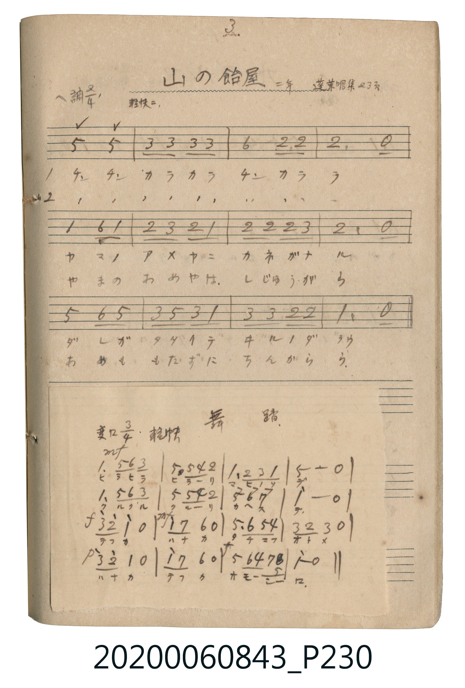

# 舞踏（舞蹈）

> Re:Shōka 使用 AI 協助辨識與重建樂譜，可能會有錯誤。歡迎回報。

- **鋼琴伴奏版**：<br><audio controls src="buto.mp3"></audio>

- 唱歌帖 P230b

## 說明

舞踏（舞蹈）
Source: 唱歌帖 (2020.006.0843), P230.jpg (bottom pasted slip)
Marginal notes: 変ロ 3/4 軽快
Key: 変ロ調 (Bb major), Time: 3/4, Tempo: 軽快


## 歌詞

```text
ヒラヒラ ヒラーリ マヒノソデ
クルクル クルーリ カヘスデ
テフカ ハナカ タチマフ オトメ
ハナカ テフカ オモーシーロ
```

## ABC

<div class="abc-score" data-abc-src="buto.abc" aria-label="五線譜載入中"></div>

[下載 ABC 原始檔](buto.abc)

## TMD 檔案連結

- [主旋律 TMD 檔案](buto.tmd) [[在 TMD Studio 編輯](https://tmdlang.github.io/Tmd-TS/#tmd=s7IKdvYPcrWy4qpTUCpJTLdSSM7PyUlNLsnMz7MqzsjPTkzOyFeCS5bl55TmploBqXgDc4RwcX5pUXJqfEFieqpVgJGxQRK6FNyo-Lz8ktSk_PxsDBUZ-UWJmfFgdcUZpQjpgqL8stS8xDygktzEvNLi5KLMgpL45PyCSoSa1LLMlFSQitSUzJL8oszEHCQnpxYVgz0DcWNJUWIexAygIEIVUFN6Zp5VaR7IoJLMtMzUFCUuLS2FFx3zXuzof7-nA8TY2fF-T6eClhaXoq2CoZEBl72tgpMOl42xvokdyKCnUzY-W9vzdMc0BWgYcOlrKdhSC3ApKGBxDUg0GBKACgj7NYwMjAz0DAzM9AwsTIw1dcAO0ssqSFfQSMovKcnPVShILC5JTVEozsks0ASZ4ZtYBPR_Yo4CKH6KgWYt6XzcvFYB6DWFF7v3Pt2_GqTIO7USJvNi1X4FDackhdzErPwioAUhmcBkAVIOZKbmFuRbIWnzqSzKTC62AjEfN0963LwSQsI5ex43rwJy5oH5fY-b9j5ubgcrblr_uHk1hIRxoIqbgKwZj5t2wlQ2tz1ungoUBbL6Hzd3gVlN-x83N4KNnQrkrHrc3PG4eSFENVwNQh9IwSKQ8U3bwZasBamkPNagQEFLn4vLqbQk3yosPzkxx6HGoKYaZIGCjYWWHZhRo1Cdm1arYKigq2CqYKZgDKRrgCwQz0TBCMwDyRkBZUA0RA4EDUA8sBHA1OaQAw5rWwUlYGACvQcOZDR6DxCDwxsq1gf0_F4g3a4EciXELficAeKZAbE5xFFxBNzRtB5oNjj-UGmYO8DRMANI70RzQzUwOIzjFIziIHaAzYcGUhzQcpATIGIQB4EcCOIZg8MIT7i0Ae0BpQhwYgHiLgi7aT-Q3QgNF3CKAdIdQLwQ2U0FWNyE5hyQuyFOMgGKmxITRsjuQHYf2A2LIGHVtB0aZmvB7qnl4tK1UwAlKQUgrcwFAA)]
- [鋼琴伴奏 TMD 檔案](buto_piano.tmd) [[在 TMD Studio 編輯](https://tmdlang.github.io/Tmd-TS/#tmd=s7IKdvYPcrWy4tLSUnjRMe_Fjv73ezpAjJ0d7_d0KmhpcSnaKhgaGXDZ2yo46XDZGOub2HHVKSg9nbLx2dqepzumKQQYGRskKXFx6Wsp2FILcCkoYHPNo4YpCgGZiXn5Co7Jyfm5BYl5mbmpeSUg1cH5pUXJqVYKCHdpGBkYGegZGJjpGViYGGvqgB2ql1WQrqCRlF9Skp-rUJBYXJKaolCck1mgCTLDN7EoPTMvMUchL78ktRho1pLOx81rFYBeVnixe-_T_atBiij3HBQoaOlzcTmVluRbheUnJ-Y41BjUVIMsULCx0LIDM2oUqnPTahUMFXQVTBXMFIyBdA2QBeKZKBiBeSA5I6AMiIbIgaABiAc2AhgpDjmVRZnJxbYKSo-bJyk8bl4JxOj0HiBeBcTzoGJ9Co-b9gLpdiWQKyFuwecMEM8MiM0hjooj4I6m9UCzVwPtQKNh7mgCsWcA6Z1obqgGBodxnIJRHMQOsPnQQIoDWg5yAkQM4iCQA0E8Y3AY4QmXNqA9U6H29gNxF4TdtB_IboSGC0geFEYdQLwQ2U0FWNyE5hyQuyFOMgGKmxITRsjuQHYf2A2LIGHVtB0aZmvB7qmFpidwFgnyIJyiDLUhkWkerw2LTyATW8oCCYPVwBkIdyOSBl7zwEJG2qBAMdKGJBRjbVNtLAGBHM_GEAXoMW0INgciCrUNFN1AJiLGIa5BMRYeVSjGYpgIsh7iXkSEYXErSnj7IIe3CTy8DeMVTMEImCbjEWyIsDFM2AjEBXLwawIqN0HWHw-iUPWABECKgDSQxGInkXqQ7AH5FuxXz7ySImyJC-FZcPxEG8YC9USbxAIFok3BbKAIugm4g0sX5gogC-xWoEbXvJTMvHT8doOsBloKshJsIdQh0IhCNgGH3RA_g0MD7AyoTl07BbC7FYAMUHSDaIhpIJYyFwA)]

## 分析

```text
================================================================================
📊 TMD Song Profile: [ 舞踏（舞蹈） ]
================================================================================
⏱  Duration:       0:24 (24.0s), 16 measures total
🎼 Key & Tempo:    首調基準 B,, != 120.0 BPM, <3/4>
   - 分析範圍：      由實際發聲的音符與和弦推測調性；播放脈絡另行呈現
🎤 人聲音域:    A#4 (MIDI 70) – D6 (MIDI 86) [跨度: 16 個半音 / 1.3 個八度, 難度: moderate]
   - 最低音:  A#4 in [Buto #1 @ m.1, 0:00]
   - 最高音: D6 in [Buto #1 @ m.9, 0:12]
   - 適合: soprano, tenor
🏛  結構:      Buto (24.0s)
⚡ 編曲密度:        Peak 1 軌道同時演奏
🗝  調性診斷：       A# 大調（純淨自然大調，未偵測到可信轉調）
   - 風格氣質:    純淨自然大調（陽光明朗、易唱易記，無明顯調外色彩）
   - 轉調歷程:    全曲維持單一推測調性（未偵測到可信轉調）
   - 核心骨幹音:  A#, F, D, G, C
   - 調性數值:    A# 大調 [相關度: 0.96, 穩定度: High, 自然音純度: 100.0%]
   - 候選調性 (K-S): A# 大調 (0.96), F 大調 (0.75), G 小調 (0.63)
   - 五度圈歷程:   -2
   - 各段落調性細節:
     • [Buto #1]: A# 大調 (r: 0.96, 自然音純度: 100.0%)

  [ 五度圈游移軌跡 ]
               C  
         F            G  
     [Bb]*              D  
      Eb               A  
         Ab           E  
            Db       B  
               F# 
     (* = active key center)

  [ 十二半音累積音高分佈 ]
     C  : █████████                 10.0%
     C# :                            0.0%
     D  : ███████████               12.5%
     D# : █████                      6.2%
     E  :                            0.0%
     F  : ██████████████████████    25.0%
     F# :                            0.0%
     G  : ███████████               12.5%
     G# :                            0.0%
     A  : █████                      6.2%
     A# : ████████████████████████  27.5%
     B  :                            0.0%
--------------------------------------------------------------------------------
Assignment 軌道音域：
  - Vocal         : A#4 – D6 (16 個半音 / 1.3 個八度, 50 個音符)
================================================================================
```


## 原書掃描頁




