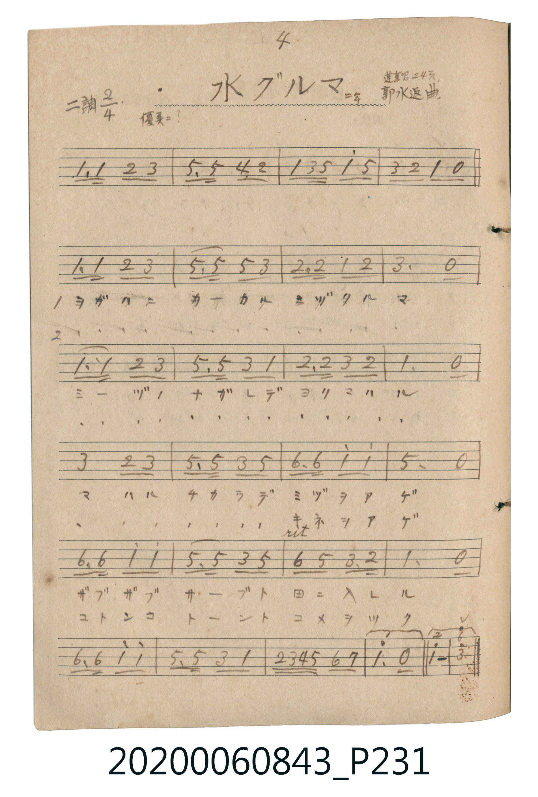

# 水グルマ（水車）

<audio controls src="mizuguruma.mp3"></audio>

- 曲：郭水返
- 唱歌帖 P231 (二年 / 蓬萊唱集 24頁)

## 說明

水グルマ（水車）
Source: 唱歌帖 (2020.006.0843), P231.jpg
Marginal notes: 4 / 二年 / 蓬萊唱 24頁 / 郭水返曲 / 優美ニ？
Key: ニ調 (D major), Time: 2/4, Tempo: 優美ニ？

## 跨冊／重複收錄參照

> 同名異曲（各冊收錄之不同詞曲版本）

- **[同名異曲]** 《新定兒童唱歌》尋常科第二學年用（2020.006.0847.0002）：[**〈水グルマ〉**](../../../shintei_jido_shoka/grade_2_2020.006.0847.0002/1_03_mizuguruma/index.md)（`F` / `2/4` — [原始 TMD](../../../shintei_jido_shoka/grade_2_2020.006.0847.0002/1_03_mizuguruma/mizuguruma.tmd)）
- 總表：[跨冊重複與同名歌曲總索引](../../../duplicate_songs.md)

## 歌詞

```text
1. ヲガハニ カカル ミヅグルマ
ミヅノ ナガレデ ユリマハル
マハル チカラデ ミヅヲアゲ
ザブザブ サーブト 田ニ入レル
2. ヲガハニ カカル ミヅグルマ
ミヅノ ナガレデ ユリマハル
マハル チカラデ キネヲアゲ
コトンコ トーント コメヲツク
```

## ABC

```abc
X:1
T:水グルマ（水車）
C:曲：郭水返
M:2/4
L:1/16
Q:1/4=96
K:D
V:V1 name="Vocal" snm="Voc"
[V:V1]
D3 D E2 F2 | A3 A G3 E | D2 F A d2 A2 | F2 E2 D2 z2 |
D3 D E2 F2 | A3 A A2 F2 | E3 E D2 E2 | F6 z2 |
D3 D E2 F2 | A3 A F2 D2 | E3 E F2 E2 | D6 z2 |
F4 E2 F2 | A3 A F2 A2 | B3 B d2 d2 | A6 z2 |
B3 B d2 d2 | A3 A F2 A2 | B2 A2 F3 E | D6 z2 |
B3 B d2 d2 | A3 A F2 D2 | E F G A B2 c2 | d4 z4 |
```

## TMD 檔案連結

- [主旋律 TMD 檔案](mizuguruma.tmd) [[在 TMD Studio 編輯](https://tmdlang.github.io/Tmd-TS/#tmd=s7IKdvYPcrWy4tLSUni2Ycvjpg2Pm1c_bp73fk8HkPtid9f7PZ0KWlpcirYKlmZc9rYKLlw2Rvomdlx1CkpPp2x8trbn6Y5pCgFGxoYKGk929TzduUVBX-HF5DUvJnQBpV_OblMwMnm5oFFTCaTh2exN7_fMetm8FmT0_ilKXFz6Wgq21AJcCgo4vQCSC84vLUpOtVJAOFvDyMDIQM_AwEzPwMLEWFMH7A-9rIJ0kHLfxKL0zLzEHIW8_JLUYisFE6DHMH0I8R5QBO4roCeB3Kctq57v63vc3P1-z3yQad6plVYKQO6LVfsVNFwUchOz8ouAFoZk5gJdBAxQIDM1tyAf6Do0jT6VRZnJxVYgpqEe0IRNj5vWPG7uBypQeNy0GoSaVwOF5z9uboX7HKQYKtTcB2R1gfUAUTuQs-xx8yqgGrAZqyEqoRwgqxFs4EqISogBQAsXPW7aBFbZtO1x8zQICeRsfdy8B8Rv7lB4PgVodffT1qVga8DGGtHXtU1rHzf3orl2M9Bpj5s3AxlAxUAW0LUgIYjMQpDi5pbHTetBiilPflCgoKXPxeWbWVWaXlpUmptoFZafnJjjUGNQo1ANskfBxtBMyw7MqlEwVNAFQkMFIyBpDMQ1CqZgEVNgYgPRRlA1xkARwziwBEgRSClIC0jKACRC0DgQDREByYF0g9SC2BDTYBBhGjBjOuSAk56tghIwpIBhtgYYiP2gNAyKSiC9B0qDIxSIW4H8DVD-PCVQOKAaFG9EoVH4fAjigWQRPoSFEkwXAR-CrAU6A2Q1JBVCnQnC4IQIxKtAzoE6fTVuH5JvFCI2sPsQEv9mYBEzSJIAEzBVBPwItxCUd6BBvhLqKGiwg6NnERBvwu0_PMY0rQXSvViNwedudN_B0isiCxDyW9M2oKWgQglGb4VGApANyvGNQP81Ah3a2AKU6wHibpz-g5QWQAyk4WyQUVA2WGwhxI_NIOPWk-BHWBo1BmZxU7Bqc0gaBSmFeRAEa7hqubh07RQQRYkCkKfMBQA)]
- [鋼琴伴奏 TMD 檔案](mizuguruma_piano.tmd) [[在 TMD Studio 編輯](https://tmdlang.github.io/Tmd-TS/#tmd=s7IKdvYPcrWy4tLSUni2Ycvjpg2Pm1c_bp73fk8HkPtid9f7PZ0KWlpcirYKlmZc9rYKLlw2Rvomdlx1CkpPp2x8trbn6Y5pCgFGxoYKGk929TzduUVBX-HF5DUvJnQBpV_OblMwMnm5oFFTCaTh2exN7_fMetm8FmT0_ilKXFz6Wgq21AJcCgq4vfCoYYpCQGZiXr6CY3Jyfm5BYl5mbmpeCUhPcH5pUXKqlQLCOxpGBkYGegYGZnoGFibGmjpg_-llFaSDlPsmFqVn5iXmKOTll6QWWymYAD2M6XOIt4EicN8CPQ_kPm1Z9Xxf3-Pm7vd75oNMo9zbUKCgpc_F5ZtZVZpeWlSam2gVlp-cmONQY1CjUA2yR8HG0EzLDsyqUTBQ0AVDGE2mCNQ0QzDPUMEISBqDVZqCRUzBNEQEJKcLJEFqQewasDgMgkyEmAZMDw45lUWZycW2CkqPmzcpPG5ao_C4uR-Iu4Hs1UB6D5QG4flA3Arkb4Dy5ymBggHVoHgjCo3C50MQDySL8CFIBOJDiC4CPgRZC3QGyOrmPiDugjoThNuBeBkQrwI5B-r01bh9SL5RiNjA7kMQu0bBDCxipmAYB_I0iICpIuBHuIVA3AgN8pVQR0GDHRw9i4B4E27_4TGmaS2Q7sVqDD53o_sOll5B4UBc_DVtA1o6DWghjN4KjQQgu7lD4XEj0H-NQIc2tgDleoC4G6f_mjZDtDQDaTgbZBSUDRZbCPFjM8i49Uh-pFaOrkUpQ8AFZpAHjlKkOregFk_WMEEJSGOgCDjsIaENyyUgKUTYYstphtowAyEsiKh5vDZmkWKoDUvGEBbxBiOyMZLBiJxsGq-NPTEg24nbZIiXDbVhCdFYGxwSUApsBlQHNvNx68JtC0QO6BdEasbjh-rctFqCuQRWyhkDI9YUrNocLAJ0OsRFBBOSD0pCsoCnI8N4oOOACEzh4BpDeRDheJCoASKMsOkAkkBNEB1GEFkghSRLun4QhkqTYoIJmAkkzXDYj0MBkmb8tuPTD3Q6UALqOLAkLO6BMeSZV1KUjy2Xm6Bm8mjDWIVo49xYID_aBMg0BbLQ9KNGLkI_kj9AQQPS5ZqXkpmXTshaYJKMNgNaGW0EsRdoJ8gZGCbgshgYFuD4hoQFWJuunQLYxQpABiJxgngQA0EsZS4A)]

## 分析

```text
================================================================================
📊 TMD Song Profile: [ 水グルマ（水車） ]
================================================================================
⏱  Duration:       0:30 (30.0s), 24 measures total
🎼 Key & Tempo:    首調基準 D, != 96.0 BPM, <2/4>
   - 分析範圍：      由實際發聲的音符與和弦推測調性；播放脈絡另行呈現
🎤 人聲音域:    D4 (MIDI 62) – D5 (MIDI 74) [跨度: 12 個半音 / 1.0 個八度, 難度: easy]
   - 最低音:  D4 in [Mizuguruma #1 @ m.1, 0:00]
   - 最高音: D5 in [Mizuguruma #1 @ m.3, 0:03]
   - 適合: soprano, mezzo-soprano, contralto, tenor, baritone, bass
🏛  結構:      Mizuguruma (30.0s)
⚡ 編曲密度:        Peak 1 軌道同時演奏
🗝  調性診斷：       D 大調（純淨自然大調，未偵測到可信轉調）
   - 風格氣質:    純淨自然大調（陽光明朗、易唱易記，無明顯調外色彩）
   - 轉調歷程:    全曲維持單一推測調性（未偵測到可信轉調）
   - 核心骨幹音:  D, A, F#, E, B
   - 調性數值:    D 大調 [相關度: 0.92, 穩定度: High, 自然音純度: 100.0%]
   - 候選調性 (K-S): D 大調 (0.92), A 大調 (0.71), F# 小調 (0.65)
   - 五度圈歷程:   +2
   - 各段落調性細節:
     • [Mizuguruma #1]: D 大調 (r: 0.92, 自然音純度: 100.0%)

  [ 五度圈游移軌跡 ]
               C  
         F            G  
      Bb              [D ]*
      Eb               A  
         Ab           E  
            Db       B  
               F# 
     (* = active key center)

  [ 十二半音累積音高分佈 ]
     C  :                            0.0%
     C# : █                          1.1%
     D  : ████████████████████████  29.2%
     D# :                            0.0%
     E  : ████████████              14.0%
     F  :                            0.0%
     F# : █████████████████         20.8%
     G  : ██                         2.2%
     G# :                            0.0%
     A  : ███████████████████       23.6%
     A# :                            0.0%
     B  : ███████                    9.0%
--------------------------------------------------------------------------------
Assignment 軌道音域：
  - Vocal         : D4 – D5 (12 個半音 / 1.0 個八度, 82 個音符)
================================================================================
```


## 原書掃描頁




