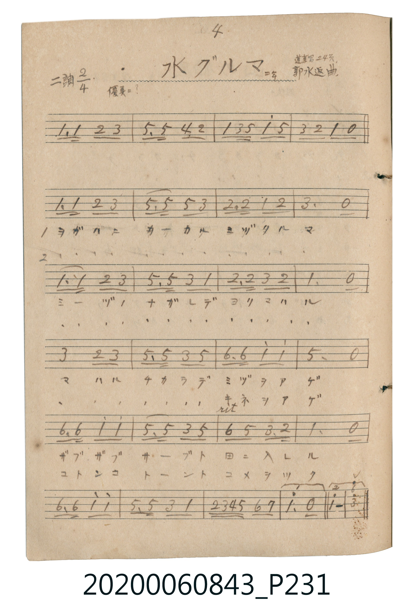

# 水グルマ（水車）

> Re:Shōka 使用 AI 協助辨識與重建樂譜，可能會有錯誤。歡迎[回報](https://github.com/TMDLang/reshoka/issues)。

- **鋼琴伴奏版**：<br><audio controls src="mizuguruma.mp3"></audio>
- **NEUTRINO 歌聲合成版**：<br><audio controls src="mizuguruma_neutrino.mp3"></audio>

- 曲：郭水返（後改名郭明峯）
- 唱歌帖 P231（二年／蓬萊唱 24頁）

## 說明

> [!NOTE]
> **原頁資訊與歌詞全文**（對應 `P231.jpg`）：
> - **標題與出處註記**：頁頂記「`4`」，標題「`水グルマ 二年`」，右上註「`蓬萊唱 24頁.`」「`郭水返曲`」，左上註「`ニ調 2/4.`」「`優美ニ？`」。
> - **作曲者考證**：原譜署名「郭水返曲」。經比對《臺灣總督府職員錄系統》，郭水返大正 8 年（1919）畢業於總督府國語學校師範部乙科，大正 12–14 年（1923–1925）任職於臺北市蓬萊公學校訓導（與陳英聲同校共事），大正 15 年（1926）正式改名為「郭明峯」，其後於昭和 4 年（1929）創作出傳世名作〈水牛〉（收錄於《臺灣の歌》、《公學校唱歌》）。〈水車〉與〈水牛〉兩首臺灣風物名曲實出自同一人之手。
> - **曲式結構**：
>   - 第一行（4 小節）：器樂前奏（無歌詞）。
>   - 第二至五行（16 小節）：歌唱主旋律（第五行第 3 小節上方標有 `rit`）。
>   - 第六行（間奏／尾奏）：3 小節過門後接一括號 `| 1^. 0_ :||` 反覆進入第二段，二括號以 `| 1^ - | 3+5+1^. 0_ ||`（標延音記號）收束。
> - **字面校勘**：第三行第 3 小節歌詞抄作「`ヨ ク マ ハ | ル`」（「よくまはる」，舊轉錄誤讀為「ユリマハル」）；第五行第 3 小節第 1 段以漢字混寫「`田 ニ 入 レ | ル`」。
>
> **一、**
> ヲガハニ　カカル　ミヅクルマ
> ミヅノ　ナガレデ　ヨクマハル
> マハル　チカラデ　ミヅヲアゲ
> ザブザブ　サーブト　田ニ入レル
>
> **二、**
> （ヲガハニ　カカル　ミヅクルマ
> ミヅノ　ナガレデ　ヨクマハル
> マハル　チカラデ）　キネヲアゲ
> コトンコ　トーント　コメヲツク


## 歌詞

```text
（TMD 檔案未包含歌詞註解）
```

## ABC

<div class="abc-score" data-abc-src="mizuguruma.abc" aria-label="五線譜載入中"></div>

[下載 ABC 原始檔](mizuguruma.abc)

## TMD 檔案連結

- [主旋律 TMD 檔案](mizuguruma.tmd) [[在 TMD Studio 編輯](https://tmdlang.github.io/Tmd-TS/#tmd=s7IKdvYPcrWy4qpTUCpJTLdSSM7PyUlNLsnMz7MqzsjPTkzOyFeCS5bl55TmploBqXgDc4RwcX5pUXJqfEFieqpVgJGxIboM3KT4vPyS1KT8_GwMFRn5RYmZ8WB1xRmlCOmCovyy1LzEPKCS3MS80uLkosyCkvjk_IJKhJrUssyUVJCK4uTEvPiy1KLMtMzUFCRXpxYVg_0DcWZJUWIexBygIEJVflFJRn56UWJBRqVVRmZxSX5RZnJiTnx2Yl4iQlFJRirQ_-WJJalF6IKJ6UANpTklpUWpyIZmpmfmWZUkZpYDnZaflpaZnJmYg0u-JBUYSCCTtbQUnm3Y8rhpw-Pm1Y-b573f0wHkvtjd9X5Pp4KWFpeirYKlGZe9rYILl42RvokdyLinUzY-W9vzdMc0BVAMAHU82dXzdOeW93v6X0xe82JCF1Bewcjk5YJGoBlg-5_N3vR-z6yXzWtBRu-fAtTxdF_Psyk7n07oBQnO6Hu6eT1YLZe-loIttQCXgoKCnUK0op9_iGsshKOl9bRvPtBhLza3v1jR9aKjHeiPFyvnPW1d8Wxau5YWyGEbep-1dyokgHyml1WQngB0F9DtEO26QAOerZj5cmEPUOvT9l0vZk59sWL3ixUzQFpnAc19uaAJyHvc0JNgkvC4off9nh6IcpAIcigrQEIMquZp_-YnO7qAJoGUoQWhHkgNSBweesDAhOnbvgyh73Fz94tV-xWAcQTX8rRl1fN9fUCJ93vmQ8SaEP54sncO0KQXDa0vGppfrO0E-wAYOC_Wznm-dxMwYoAGIFsJ0f582-Rn66cAw-hxQ9eL9l3PGxc_37H3-dzFT3fNedG4_enkhS97Wp5v3v1868bHDUBbESY8XbL82drFChYK4HTSYWhpaAkM2OdTFz1buvbZtD1wU57OAfpi3tO1O54tWPh0x-rn61teNq94snPm8-UTQR6GmGJo9KhhsqEJ3CwjYxDf0sgUaOST3buBLgEaCXTe057pT3c0QQO0dQ3E1BcrJj_d0AfUB4zClzM3v-je-KIR6N8ekIWtG5_sAjobGOFwq0wRtpgBZYBiT_f0Q5Lu86Zd0EACJ2BonLRuA6XtaXuezVj7dFKPApIrQT5-2rkVGPDApPO0CRjn04CmALmPG0B57nnn7McNQKs7nk3ZBgxGoBHwQH7cuA6YUIFB-rihESgI9wskI4KDuhMYOxBzgHkXaA7Qd8jGPm1d-XLZNIhpLxeteN65Emg1MFqfrl8GSsftq4Ah8GRHw5Ndu57s7H7WCbQIKamA1O3pf751wrPl3eB0ApFSAEo-X7MGqO3Fwh6gu4Fe3dD_fH0DJMc8nbni2Yqmp529T5f2AyWftyyE5DWIU1FN2NXzon3zk11TIOYYmqEYBCpqpmx8smP3s-ndT_cBvdoB1gJSDGQoGEMVA3PCs2k7gdnt2Rxg9i3KLAHlXHSbnrauhdjxctpksLv6n27YB2aAbIIZ9bKx7-W0BlA09i0F-u5Z95oXM-crJNQoGMbpKRjEK1jV1CQoPO3vfbGs7WXDpqetSyF-eLZuKzABgBhgDU92L4XoAVpdo2CsbaoN1Q7UDYrlFTOf7t72cv5mYIEBVA1KW1O2PZs7HyXkn66d_nLuIlBMd0PKGHB4d6J5HRKwz7pawGkJVBSsUHjctF4BVNA8bu4H2g4sdSBlRgdQ_nFTx-PG_seN-x43rn_cBIxqULp90dH1Ym8nMN29WLXkxboGSNp-3LzscfMqoDFAU0AFF0glMKBmY40AENtQARgIQI8_27MI6PRn27c_XQ_U1ZPwfMoGoBu6FYBhBaTXIFwE8y2seAYGNzCNA-sdMP9x86bHTWvAlgOd2fC4aTUIgRzS8Lh5_uPmVqAvIQUqTD1YsLkPrKALrBeIgDkByF0BVgz1Ckw93GdABY1gw1fC1EOMAjpg0eOmTVD1TdseN0-DkiD3bH3cvAfEbgaGawPQk0B3Ar0IthRiBdxfu4DZFO4vUDwMkNfAmQJo3drHzb0YvtsM8kjzZhADpAvIBvoOLAjSAmQsBGlpbgFaB9JCeRUNBQpa-lxcnnklRflWAZmJefkONQY11SAbFGwMzbTAgQhMMobALKELJI2ApDE4U5mCRUyBhSyINoKqMQaKgHMdSBqY88BSII26CgYgEa5aLi7fzKrS9NKi0txE8mwE0RARkBzIApBaEBtiIQxCLASZ5mMISvSbwKLA2ANnTCALmClAeoDxA9UBYQEjDiLePB8i2twKztLIMvOQ7IlH2GNEe3sIBg-IB5JFBA8sFmC6sAcPxBEQZ4DIPqgTupC8swYs0w6VWQGVgZR2IBmQd8HlC57goa090OCBpQPswQNJnGZgETNIeoVWFRBV2AMIFhewWIXFUSPUeauB7JUoDkeKV3CqAOZ4iEwTJI1gDyCS7WlaC1XfS4Q90ADC7Xn0IIJlN0QmxxFATdugzpgGZYNYEGdshXsJJAIs1CDijaAAetwIzgyNLWCH90B1gLIMjgBq2gw1qwOIQWyICCiIQOZC5MDiMHvA8sASFEyCA6gZZBtIBpTdUO0BllD-pcDi0BBf6UQo-GAZ0BhYPpqCVZuDRcBKUcMPZp8Rze0DQVhrCJszdO0UwBWBApCBKKSjfQxjQSKQQEGXM0LIAfOanYIyFwA)]
- [鋼琴伴奏 TMD 檔案](mizuguruma_piano.tmd) [[在 TMD Studio 編輯](https://tmdlang.github.io/Tmd-TS/#tmd=s7IKdvYPcrWy4qpTUCpJTLdSyC8qychPL0osyKi0ysgsLskvykxOzInPTsxLVIIrKs4vLUpOjS9ITE-1CjAyNkTIlGSk5qZapaaUJieWZObnKXFpaSk827DlcdOGx82rHzfPe7-nA8h9sbvrcfPul917nk_Y8mTPlqdL-593drzf06mgpcWlaKtgacZlb6vgwmVjpG9iBzL66ZSNz9b2PN0xTQFkG9CMJ7t6nu7c8n5P_4vJa15M6ALKKxiZvFzQCDQD7JZnsze93zPrZfNakGX7pwB1PN3X82zKzqcTekGCM_qebl4PVsvlmVdSlG8VkJmYlx_k4VBjUFPNpQAENoZmWnZgVo1CdW5BrYKhgi4QGioYAUljIK5RMAWLmCqYgGkjoAhIjTFQxDAOLAFSBFIK0gKSMgCJcNWi2OmDbKcF3ErDeAXTeCgJ45nGo3BhkhBhMN8AYrxvZlVpemlRaW4ifn_h9hKIhoiA5EA-AKkFsSE-gkGIj0Cm-RjWKDxu3gQWfdy0BsjuB7Gau8F6HjethuqAsIBpASLePB8i2twKlFmPIjMPyZ54hD1GtLeHYPCAeCBZRPDAohmmC3vwQBwBcQaI7IM6oQvJO2vAMu1QmRVQmfVQh0K8C5KBeRRb8NDWHmjwwNIB9uCBpH4zsIgZJEOACZgq7AEEiwtYrMLiqBHqvNVA9koUhyPFKzhVPG5aBJFpgqQR7AFEsj1Na6Hqe4mwBxpAuD2PHkSw7IYoRXAEUNM2qDOmQdkgFsQZW-FeAok8bu6AiDeCAuhxIzgzNLaAHd4D1QHKMjgCqGkz1KwOIAaxISKgIAKZC5EDi8PsAcs_bl4IJsEB1AyyDSQDym6o9mApo0goB4GkMazgM4IViyjSoHKQXP1YDcAsesEmmEBUgygzXC7ArQbZCKjV6G4ABpR_KbCuMCRUQaXVEkxusALLGFhhmYJVm4NFjLVNtcHKUdMcmtU44oeA74DBawIPQLAkxAKE8UY09BmKr0CQoGehrqGWZ1GTHpLXde0UwG0ABSADkROifQxjQSKQcEeXM0LIAYtcOwVlLgA)]

## 分析

```text
================================================================================
📊 TMD Song Profile: [ 水グルマ（水車） ]
================================================================================
⏱  Duration:       0:56 (56.2s), 45 measures total
🎼 Key & Tempo:    首調基準 D, != 96.0 BPM, <2/4>
   - 分析範圍：      由實際發聲的音符與和弦推測調性；播放脈絡另行呈現
🎤 人聲音域:    D4 (MIDI 62) – D5 (MIDI 74) [跨度: 12 個半音 / 1.0 個八度, 難度: easy]
   - 最低音:  D4 in [Intro #1 @ m.1, 0:00]
   - 最高音: D5 in [Intro #1 @ m.3, 0:03]
   - 適合: soprano, mezzo-soprano, contralto, tenor, baritone, bass
🏛  結構:      Intro (5.0s) -> Mizuguruma[L1] (20.0s) -> Outro1 (5.0s) -> Mizuguruma[L2] (20.0s) -> Outro2 (6.2s)
⚡ 編曲密度:        Peak 1 軌道同時演奏
🗝  調性診斷：       D 大調（純淨自然大調，未偵測到可信轉調）
   - 風格氣質:    純淨自然大調（陽光明朗、易唱易記，無明顯調外色彩）
   - 轉調歷程:    全曲維持單一推測調性（未偵測到可信轉調）
   - 核心骨幹音:  D, A, F#, E, B
   - 調性數值:    D 大調 [相關度: 0.92, 穩定度: High, 自然音純度: 100.0%]
   - 候選調性 (K-S): D 大調 (0.92), A 大調 (0.69), F# 小調 (0.66)
   - 五度圈歷程:   +2 -> +2 -> +2 -> +2 -> +2
   - 各段落調性細節:
     • [Intro #1]: D 大調 (r: 0.93, 自然音純度: 100.0%)
     • [Mizuguruma[L1] #1]: D 大調 (r: 0.87, 自然音純度: 100.0%)
     • [Outro1 #1]: D 大調 (r: 0.88, 自然音純度: 100.0%)
     • [Mizuguruma[L2] #1]: D 大調 (r: 0.87, 自然音純度: 100.0%)
     • [Outro2 #1]: D 大調 (r: 0.93, 自然音純度: 100.0%)

  [ 五度圈游移軌跡 ]
               C  
         F            G  
      Bb              [D ]*
      Eb               A  
         Ab           E  
            Db       B  
               F# 
     (* = active key center)

  [ 十二半音累積音高分佈 ]
     C  :                            0.0%
     C# : █                          1.1%
     D  : ████████████████████████  30.3%
     D# :                            0.0%
     E  : ██████████                12.9%
     F  :                            0.0%
     F# : █████████████████         21.4%
     G  : █                          1.4%
     G# :                            0.0%
     A  : ███████████████████       23.7%
     A# :                            0.0%
     B  : ███████                    9.1%
--------------------------------------------------------------------------------
Assignment 軌道音域：
  - Piano         : D4 – D5 (12 個半音 / 1.0 個八度, 151 個音符)
================================================================================
```


## 原書掃描頁




