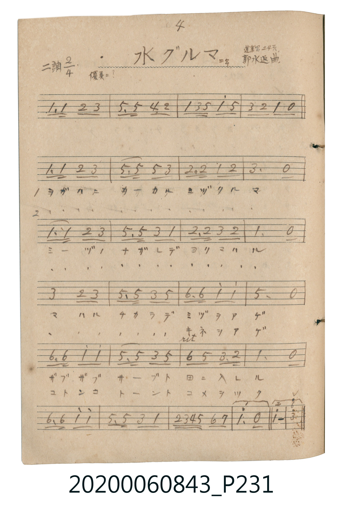

# 水グルマ（水車）

> Re:Shōka 使用 AI 協助辨識與重建樂譜，可能會有錯誤。歡迎回報。

- **鋼琴伴奏版**：<br><audio controls src="mizuguruma.mp3"></audio>
- **NEUTRINO 歌聲合成版**：<br><audio controls src="mizuguruma_neutrino.mp3"></audio>

- 曲：郭水返
- 唱歌帖 P231（二年／蓬萊唱 24頁）

## 說明

> [!NOTE]
> **原頁資訊與歌詞全文**（對應 `P231.jpg`）：
> - **標題與出處註記**：頁頂記「`4`」，標題「`水グルマ 二年`」，右上註「`蓬萊唱 24頁.`」「`郭水返曲`」，左上註「`ニ調 2/4.`」「`優美ニ？`」。
> - **曲式結構**：
>   - 第一行（4 小節）：器樂前奏（無歌詞）。
>   - 第二至五行（16 小節）：歌唱主旋律（第五行第 3 小節上方標有 `rit`）。
>   - 第六行（間奏／尾奏）：3 小節過門後接一括號 `| 1^. 0_ :||` 反覆進入第二段，二括號以 `| 1^ - | 3+5+1^. 0_ ||`（標延音記號）收束。
> - **字面校勘**：第三行第 3 小節歌詞抄作「`ヨ ク マ ハ | ル`」（「よくまはる」，舊轉錄誤讀為「ユリマハル」）；第五行第 3 小節第 1 段以漢字混寫「`田 ニ 入 レ | ル`」。
>
> **一、**
> ヲガハニ　カカル　ミヅクルマ
> ミヅノ　ナガレデ　ヨクマハル
> マハル　チカラデ　ミヅヲアゲ
> ザブザブ　サーブト　田ニ入レル
>
> **二、**
> （ヲガハニ　カカル　ミヅクルマ
> ミヅノ　ナガレデ　ヨクマハル
> マハル　チカラデ）　キネヲアゲ
> コトンコ　トーント　コメヲツク


## 歌詞

```text
（TMD 檔案未包含歌詞註解）
```

## ABC

<div class="abc-score" data-abc-src="mizuguruma.abc" aria-label="五線譜載入中"></div>

[下載 ABC 原始檔](mizuguruma.abc)

## TMD 檔案連結

- [主旋律 TMD 檔案](mizuguruma.tmd) [[在 TMD Studio 編輯](https://tmdlang.github.io/Tmd-TS/#tmd=s7IKdvYPcrWy4qpTUCpJTLdSSM7PyUlNLsnMz7MqzsjPTkzOyFeCS5bl55TmploBqXgDc4RwcX5pUXJqfEFieqpVgJGxIboM3KT4vPyS1KT8_GwMFRn5RYmZ8WB1xRmlCOmCovyy1LzEPKCS3MS80uLkosyCkvjk_IJKhJrUssyUVJCK4uTEvPiy1KLMtMzUFCRXpxYVg_0DcWZJUWIexBygIEJVflFJRn56UWJBRqVVRmZxSX5RZnJiTnx2Yl4iQlFJRirQ_-WJJalF6IKJ6UANpTklpUWpyIZmpmfmWZUkZpYDnZaflpaZnJmYg0u-JBUYSCCTtbQUnm3Y8rhpw-Pm1Y-b573f0wHkvtjd9X5Pp4KWFpeirYKlGZe9rYILl42RvokdyLinUzY-W9vzdMc0BVAMAHU82dXzdOeW93v6X0xe82JCF1Bewcjk5YJGoBlg-5_N3vR-z6yXzWtBRu-fosTFpa-lYEstwKWgoGCnEK3o5x_iGgvhaGk97ZsPdMCLze0vVnS96GgHuvfFynlPW1c8m9aupQV08tMNvc_aOxUSQD7QyypITwC6FehGiHZdoAHPVsx8ubAHqPVp-64XM6e-WLH7xYoZIK2zgOa-XNAE5D1u6EkwSXjc0Pt-Tw9EOUgEOTQVICEDVfO0f_OTHV1Ak0DK0IJKD6QGJA4PJWCgwfRtX4bQ97i5-8Wq_QrAuIBredqy6vm-PqDE-z3zIWJNSP6Yvenpnv7nWyc8W94Ndj5ESgEo-XzNmic7Gl4s7AGGh4nC0w39z9c3QILh6cwVz1Y0Pe3sfbq0Hyj5vGUhJACBsnDDYSbs6nnRvvnJrikQcwzNUAwCpZMpG5_s2P1sevfTfUAHdoC1gBQDGQrGUMVA7z2bthMYhs_mAOOkKLMEFB3oNj1tXQux4-W0yWB39T_dsA_MANkEM-plY9_LaQ1P9_U861sK9N2z7jUvZs5XSKhRMIzTUzCIV7CqqUlQeNrf-2JZ28uGTU9bl0L88GzdVmBIgxhgDU92L4XoAVpdo2CsbaoN1Q7UDcoiK2Y-3b3t5fzNwFQAVA10wbMp257NnY8S8k_XTn85d9GzBQufdkMSDji8O9G8DgnYZ10tT_bOgcTvCoXHTesVQKnncXM_0HZgUoIkhA6g_OOmjseN_Y8b9z1uXP-4qRuSQF50dL3Y2_myp-XFqiUv1jU8b9oFUtm87HHzKqAxQFNAqRGkEhhQs7FGAIhtqAAMBKDHn-1ZBHT6s-3bn64H6upJeD5lA9AN3QrAsALSaxAugvkWlueAwf24oRFYaID5j5s3PW5aA7Yc6MyGx02rQQjkkIbHzfMfN7cCfQnJJTD1YMHmPrCCLrBeIGoHc1eAFUO9AlMP9xlQQSPY8JUw9RCjgA5Y9LhpE1R907bHzdOgJMg9Wx837wGxm4Hh2gD0JNCdQC-CLYVYAffXLmDGhvsLFA8D5DVwpgBat_Zxcy-G7zaDPNK8GcQA6QKygb4DC4K0ABkLQVqaW4DWgbRQXu5CgYKWPheXZ15JUb5VQGZiXr5DjUFNNcgGBRtDMy1wIAKTjCEwS-gCSSMgaQzOVKZgEVMFEzBtBFVjDBQB5zqQNDDngaVAGnUVDEAiXLVcXL6ZVaXppUWluYnk2QiiISIgOZAFILUgNsRCGIRYCDLNxxCU6DeBRYGxB86YQBYwU4D0AOMHqgPCAkYcRLx5PkS0uRWcpZFl5iHZE4-wx4j29hAMHhAPJIsIHlgswHRhDx6IIyDOAJF9UCd0IXlnDVimHSqzAioDKe1AMiDvgssXPMFDW3ugwQNLB9iDB5I4zcAiZpD0Cq0qIKqwBxAsLmCxCoujRqjzVgPZK1EcjhSv4FQBzPEQmSZIGsEeQCTb07QWqr6XCHugAYTb8-hBBMtuiEyOI4CatkGdMQ3KBrEgztgK9xJIBFioQcQbQQH0uBGcGRpbwA7vgeoAZRkcAdS0GWpWBxCD2BARUBCBzIXIgcVh9oDlgSUomAQHUDPINpAMKLuh2gMsofxLgcWhIb7SiVDwwTKgMbB8NAWrNgeLgJWihh_MPiOa2weCsNYQNmfo2imAKwIFIANRSEf7GMaCRCCBgi5nhJAD5jU7BWUuAA)]
- [鋼琴伴奏 TMD 檔案](mizuguruma_piano.tmd) [[在 TMD Studio 編輯](https://tmdlang.github.io/Tmd-TS/#tmd=s7IKdvYPcrWy4tLSUni2Ycvjpg2Pm1c_bp73fk8HkPtid9fj5t0vu_c8n7DlyZ4tT5f2P-_seL-nU0FLi0vRVsHSjMveVsGFy8ZI38SOq05B6emUjc_W9jzdMU0hwMjYEGjGk109T3dueb-n_8XkNS8mdAHlFYxMXi5oBJqhBNLwbPam93tmvWxeC7Js_xQlLi7PvJKifKuAzMS8_CAPhxqDmmouBSCwMTTTsgOzahSqcwtqFQwVdIHQUMEISBoDcY2CKVjEVMEETBsBRUBqjIEihnFgCZAikFKQFpCUAUiEqxbFTh9kOy3gVhrGK5jGQ0kYzzQehQuThAiD-QYQ430zq0rTS4tKcxPx-wu3l0A0RAQkB_IBSC2IDfERDEJ8BDLNx7BG4XHzJrDo46Y1QHY_iNXcDdbzuGk1VAeEBYxziHjzfIhocytQZj2KzDwke-IR9hjR3h6CwQPigWQRwQOLZpgu7MEDcQTEGSCyD-qELiTvrAHLtENlVkBl1kMdCvEuSAbmUWzBQ1t7oMEDSwfYgweS-s3AImaQDAEmYKqwBxAsLmCxCoujRqjzVgPZK1EcjhSv4FTxuGkRRKYJkkawBxDJ9jStharvJcIeaADh9jx6EMGyG6IUwRFATdugzpgGZYNYEGdshXsJJPK4uQMi3ggKoMeN4MzQ2AJ2eA9UByjL4Aigps1QszqAGMSGiICCCGQuRA4sDrMHLP-4eSGYBAdQM8g2kAwou6Hag6WMIqEcBJLGsILPCFYsokiDykFy9WM1ALPoBZtgAlENosxwuQC3GmQjoFajuwEYUP6lwLrCkFAFlVZLMLnBCixjYIVlClZtDhYx1jbVBitHTXNoVuOIHwK-AwavCTwAwZIQCxDGG9HQZyi-AkGCnoW6hlqeRU16SF7XtVMAtwEUgAxEToj2MYwFiUDCHV3OCCEHLHLtFJS5AA)]

## 分析

```text
================================================================================
📊 TMD Song Profile: [ 水グルマ（水車） ]
================================================================================
⏱  Duration:       0:56 (56.2s), 45 measures total
🎼 Key & Tempo:    首調基準 D, != 96.0 BPM, <2/4>
   - 分析範圍：      由實際發聲的音符與和弦推測調性；播放脈絡另行呈現
🎤 人聲音域:    D4 (MIDI 62) – D5 (MIDI 74) [跨度: 12 個半音 / 1.0 個八度, 難度: easy]
   - 最低音:  D4 in [Intro #1 @ m.1, 0:00]
   - 最高音: D5 in [Intro #1 @ m.3, 0:03]
   - 適合: soprano, mezzo-soprano, contralto, tenor, baritone, bass
🏛  結構:      Intro (5.0s) -> Mizuguruma[L1] (20.0s) -> Outro1 (5.0s) -> Mizuguruma[L2] (20.0s) -> Outro2 (6.2s)
⚡ 編曲密度:        Peak 1 軌道同時演奏
🗝  調性診斷：       D 大調（純淨自然大調，未偵測到可信轉調）
   - 風格氣質:    純淨自然大調（陽光明朗、易唱易記，無明顯調外色彩）
   - 轉調歷程:    全曲維持單一推測調性（未偵測到可信轉調）
   - 核心骨幹音:  D, A, F#, E, B
   - 調性數值:    D 大調 [相關度: 0.92, 穩定度: High, 自然音純度: 100.0%]
   - 候選調性 (K-S): D 大調 (0.92), A 大調 (0.69), F# 小調 (0.66)
   - 五度圈歷程:   +2 -> +2 -> +2 -> +2 -> +2
   - 各段落調性細節:
     • [Intro #1]: D 大調 (r: 0.93, 自然音純度: 100.0%)
     • [Mizuguruma[L1] #1]: D 大調 (r: 0.87, 自然音純度: 100.0%)
     • [Outro1 #1]: D 大調 (r: 0.88, 自然音純度: 100.0%)
     • [Mizuguruma[L2] #1]: D 大調 (r: 0.87, 自然音純度: 100.0%)
     • [Outro2 #1]: D 大調 (r: 0.93, 自然音純度: 100.0%)

  [ 五度圈游移軌跡 ]
               C  
         F            G  
      Bb              [D ]*
      Eb               A  
         Ab           E  
            Db       B  
               F# 
     (* = active key center)

  [ 十二半音累積音高分佈 ]
     C  :                            0.0%
     C# : █                          1.1%
     D  : ████████████████████████  30.3%
     D# :                            0.0%
     E  : ██████████                12.9%
     F  :                            0.0%
     F# : █████████████████         21.4%
     G  : █                          1.4%
     G# :                            0.0%
     A  : ███████████████████       23.7%
     A# :                            0.0%
     B  : ███████                    9.1%
--------------------------------------------------------------------------------
Assignment 軌道音域：
  - Piano         : D4 – D5 (12 個半音 / 1.0 個八度, 151 個音符)
================================================================================
```


## 原書掃描頁




