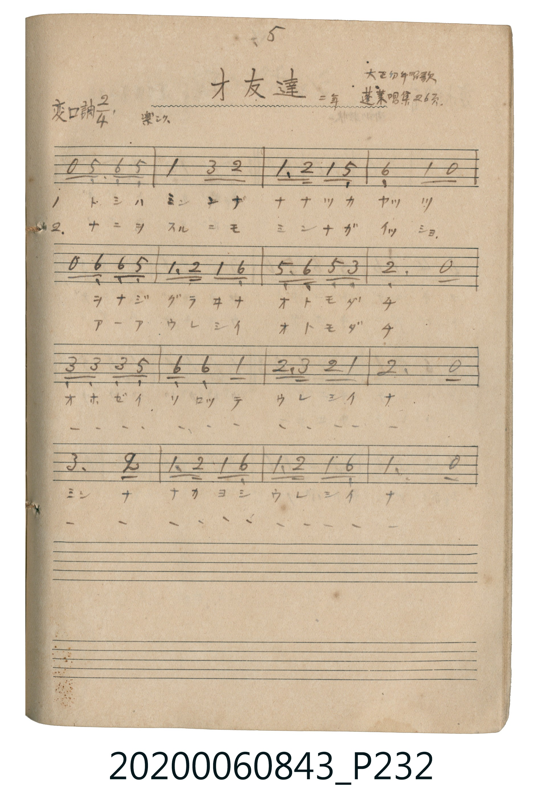

# オ友達（好朋友）

> Re:Shōka 使用 AI 協助辨識與重建樂譜，可能會有錯誤。歡迎回報。

- **鋼琴伴奏版**：<br><audio controls src="otomodachi.mp3"></audio>
- **NEUTRINO 歌聲合成版**：<br><audio controls src="otomodachi_neutrino.mp3"></audio>

- 詞：葛原しげる
- 曲：梁田貞
- 唱歌帖 P232 (二年 / 大正幼年唱歌 / 蓬萊唱集 26頁)

## 說明

オ友達（好朋友）
Source: 唱歌帖 (2020.006.0843), P232.jpg
Marginal notes: 5 / 二年 / 大正幼年唱歌 / 蓬萊唱集 26頁 / 楽シク
Key: 変ロ調 (Bb major), Time: 2/4, Tempo: 楽シク
- Reference Audio: [大正幼年唱歌チャンネル (YouTube)](https://www.youtube.com/@%E5%A4%A7%E6%AD%A3%E5%B9%BC%E5%B9%B4%E5%94%B1%E6%AD%8C%E3%83%81%E3%83%A3%E3%83%B3%E3%83%8D%E3%83%AB/videos)


## 歌詞

```text
1. トシハ ミンナ ナナツカ ヤッツ
ヲナジ グラヰナ オトモダチ
オホゼイ ソロッテ ウレシイ ナ
ミンナ ナカヨシ ウレシイ ナ
2. ナニヲ スルニモ ミンナガ イッショ
アーア ウレシイ オトモダチ
オホゼイ ソロッテ ウレシイ ナ
ミンナ ナカヨシ ウレシイ ナ

考證資訊：作詞：葛原しげる／作曲：梁田貞。原曲出自《大正少年唱歌 第一集》（大正7年）及《大正幼年唱歌》系列。
```

## ABC

<div class="abc-score" data-abc-src="otomodachi.abc" aria-label="五線譜載入中"></div>

[下載 ABC 原始檔](otomodachi.abc)

## TMD 檔案連結

- [主旋律 TMD 檔案](otomodachi.tmd) [[在 TMD Studio 編輯](https://tmdlang.github.io/Tmd-TS/#tmd=s7IKdvYPcrWy4qpTUCpJTLdSSM7PyUlNLsnMz7MqzsjPTkzOyFeCS5bl55TmploBqXgDc4RwcX5pUXJqfEFieqpVgJGxEboM3KT4vPyS1KT8_GwMFRn5RYmZ8WB1xRmlCOmCovyy1LzEPKCS3MS80uLkosyCkvjk_IJKhJrUssyUVJCK1JTMkvyizMQcJBenFhWD_QJxYklRYh7EDKAgQlVJRirQW2mJuZk5SOZCRYsyU_NSijMyCxAyQEvSM_OsclMzszLjS1IrSlD9BJUuScwEegjkqfLE-NzEzLycxLwUZFUlGfnpRYkFGZVWGZnFIJcnJ-bEZyfmJSpxaWkpPG5a9bS_-2XjlPd7Op4u3ftsTjeQ-35Pp4KWFpeirYKhgQWXva2Ckw6XjZG-iR3I2KdTNj5b2_N0xzQFUCwoaDzZ1fN05xYFfYWnS5Y_W7v46c49QC5EEVDwxeQ1LyZ0AbkvZ7cpGJm9XNCoCXbci5Xz3u-Z9WLi7Kd98x83Tn_cOOlxUzdY5tnsTUCZZ4san0_Z8GLTPCUuLn0tBVtqAS4FBZx-BskFQ1KKAsKXGkYGRgZ6BgZmegYWJsaaOmBv62UVpIOU-yYWASMhMUcBlOaKrRRMgV4mNUCAgs-W7n3ctP1x03qQmd6plUD7l3Q-bl77YtV-BQ2nJIXcxKz8IqDVIZnAtKIAjAkgMzW3IN8KVefj5t1BqWmpRaB0quBYmpIJVBCN6YrHzY2Pmxc_bt78uLn3cfNqBY3I_NKQ0qRUzViNjJKSgmIrff3y8nK9yvzSEqCoXnJ-rr6DqqupqqOJqqO5qquZqqOLqqMxSMTJUtXJGcYwATEsTVSdDKFqLIBSxqoWQAQUATNAusAMJxjDwgUm5aQPymH5xZpcIK_4VAITarEViGmoB_RYB8iXzf1A1nyww7uArC4wannctBrIWfK4uRnIgQTDJpBM0w5gTG943LzycTOQBGpoWgUyp3nR4-YGYBBAU8Lj5tmPm_Y8bloC5OwFBjnYmDYgZ9nj5jXgoAXKNHdBzEW2u2n14-YVQAVYlRqB3Ax0XDfQLUAFO4HBDOYsQhjyuGkNUAbsbJDXlkPcA3Qc0DFAZSiG0svlILUvGppfrO18sbn9xYouYEZ8sncO1rz6fk8_UAotsz5uaAKqAQo-bd_1on3V44YuaOrbMBGRB56vWfNkRwMw-T9uAJrSAVFhDpQHZsGn_V0ITchJtqH7-ebdTzumA20AOZLyggAKFLT0ubj8S_Jz81OAdUemVUBmYl6-Q41BTTXIGgUbCy07MKNGwUDBNF7BLB5E1igYKugqGCsYgVlGQAwWBErqAtkGCjVgLT6GNQrxoKQLDGdgWAMTbw0oIoBqgHEBCm4wHxwlQNwCVLUaLAJKEmBFLUDtUKOMIEaBFHaD0jdIIThVgRWChBZBTYeZDUpeIEUw08BpDG4gyDtA5yK8A_IEkFeD8KQxkGME1KmL4SFgigZbsANswQYgbyUQg2iwl5pWQTwNTuwNYGc1opoD8Q0wlYPcBXZ40zKgKlB-ACXKJXhNQXjBGAxNISEPRKBIAbkZFDGGWF0PMXU2kN4Dt2cvUASUd4BUG9gALI4BegzZapAHqGQUyBcgPiIpgWMBhYnhC3BuBgsjpSJwKbgCbBXRfqDUoFouLl07BUT2UQDylLkA)]
- [鋼琴伴奏 TMD 檔案](otomodachi_piano.tmd) [[在 TMD Studio 編輯](https://tmdlang.github.io/Tmd-TS/#tmd=s7IKdvYPcrWy4qpTUCpJTLdSyC8qychPL0osyKi0ysgsLskvykxOzInPTsxLVIIrKs4vLUpOjS9ITE-1CjAyNkLIlGSk5qZapaaUJieWZObnKXFpaSk8blr1tL_7ZeOU93s6ni7d-2xON5D7fk-ngpYWl6KtgqGBBZe9rYKTDpeNkb6JHciop1M2Plvb83THNAWQ6QoaT3b1PN25RUFf4emS5c_WLn66cw-QC1EEFHwxec2LCV1A7svZbQpGZi8XNGqCHfRi5bz3e2a9mDj7ad_8x43THzdOetzUDZZ5NnsTUObZosbnUza82DRPiYtLX0vBllqAS0EBt58fNUxRCMhMzMtXcExOzs8tSMzLzE3NKwHpCQaHqpUCwvcaRgZGBnoGBmZ6BhYmxpo64ODQyypIByn3TSxKz8xLzFHIyy9JLbZSMAUGBakBBRR8tnTv46btj5vWg53dvDsoNS21KDUvOVXBsTQlM99KIRrTrMfNjY-bFz9u3vy4ufdx82oFjcj80pDSpFTNWI2MkpKCYit9_fLycr3K_NISoKge0J_6DqqupqqOJqqO5qquZqqOLqqOxiARJ0tVJ2cYwwTEsDRRdTKEqrEAShmrWgARUATMAOkCM5xgDAsXmJSTfllmSmp-sSYXyCsvGppfrO18sbn9xYouYGQ_2TsHa3p4v6cfKIWWIB43NAHVAAWftu960b7qcUMXNAw2TESE5_M1a57saAAG5eMGoCkdEBXmQHlgND_t70JoQg64hu7nm3c_7ZgOtAHkSMoTGxQoaOlzcfmX5OfmpyQmZ2RagZOYQ41BTTXIGgUbCy07MKNGwUDBNF7BLB5E1igYKugqGCsYgVlGQAwWBErqAtkGCjVgLT6GNQrxwJTRAUzU24F0P1DJ4-b5QDXABADEXWB-FxS3AFWtBossedzcDFbUAtQONcoIYhRIYTcQbwIpbNoJSkIghSChRVDTYWY_bloDVgQzDZhUm5fDDQR5B-hchHdAngDyahCeNAZyjIA6dTE8tAlqwQ6wBRuAvJVADKLBXmpaBfE00EmPmxvAzmpENQfim6ZFYHeBHd60DKhqDSSgmpbgNQXhBWMwNIWEPBCBIgXkZlDEGGJ1PcTU2UB6D9yevUCRtaBAetzcBjYAi2OAHkO2GuQBKhkF8gWIj0hK4FhAYWL4onk-KJZBwkipCJh6HjevAFtFtB8oNagWM-8EeSDlHkMzePapzk2rVTCO1wamLF1Q8tKFZBcwC5TqtCH-BGYgbVCIAAVA0QeXAXFANFS9Sbw2WDsIQlUYgCRgYQq1B6wGiz0w08BS4DSPrAziArBic4gzYBDZDogqVNIUxXEwGslzYEPBtiP7EqqAOBuRvIwrkODeQlYF5cEcBQ0kuMsQlmGJVB_kSEUUiYagggKY7yAUPr4xmG8CJEEYKABLzzg1wdSCBaCaIKaAZI0girCZgmEVxFgkO4AUQVNwuAXEQ8bIWkDGAMPOM6-kKB9LXjBBZIWCWoVow1iFaLPcWCA32gTINAWy0HSjBDpCN9AmcLlgAim7QZpc81Iy89Lx2wnKfmCbgBYD7TQCWg23FFk_DluBtoGDDRxkEF26dgpg1yoAGYgEE-0DtABNxAgsArEFxFLmAgA)]

## 分析

```text
================================================================================
📊 TMD Song Profile: [ オ友達（好朋友） ]
================================================================================
⏱  Duration:       0:17 (17.8s), 16 measures total
🎼 Key & Tempo:    首調基準 B,, != 108.0 BPM, <2/4>
   - 分析範圍：      由實際發聲的音符與和弦推測調性；播放脈絡另行呈現
🎤 人聲音域:    F4 (MIDI 65) – F5 (MIDI 77) [跨度: 12 個半音 / 1.0 個八度, 難度: easy]
   - 最低音:  F4 in [Otomodachi #1 @ m.1, 0:00]
   - 最高音: F5 in [Otomodachi #1 @ m.9, 0:09]
   - 適合: soprano, mezzo-soprano, contralto, tenor, baritone, bass
🏛  結構:      Otomodachi (17.8s)
⚡ 編曲密度:        Peak 1 軌道同時演奏
🗝  調性診斷：       A# 大調（純淨自然大調，未偵測到可信轉調）
   - 風格氣質:    純淨自然大調（陽光明朗、易唱易記，無明顯調外色彩）
   - 轉調歷程:    全曲維持單一推測調性（未偵測到可信轉調）
   - 核心骨幹音:  A#, C, G, D, F
   - 調性數值:    A# 大調 [相關度: 0.76, 穩定度: Moderate, 自然音純度: 100.0%]
   - 候選調性 (K-S): A# 大調 (0.76), G 小調 (0.72), F 大調 (0.60)
   - 五度圈歷程:   -2
   - 各段落調性細節:
     • [Otomodachi #1]: A# 大調 (r: 0.76, 自然音純度: 100.0%)

  [ 五度圈游移軌跡 ]
               C  
         F            G  
     [Bb]*              D  
      Eb               A  
         Ab           E  
            Db       B  
               F# 
     (* = active key center)

  [ 十二半音累積音高分佈 ]
     C  : ████████████████████      24.1%
     C# :                            0.0%
     D  : █████████████             15.5%
     D# :                            0.0%
     E  :                            0.0%
     F  : ██████████                12.1%
     F# :                            0.0%
     G  : ████████████████          19.0%
     G# :                            0.0%
     A  :                            0.0%
     A# : ████████████████████████  29.3%
     B  :                            0.0%
--------------------------------------------------------------------------------
Assignment 軌道音域：
  - Piano         : F4 – F5 (12 個半音 / 1.0 個八度, 47 個音符)
================================================================================
```


## 原書掃描頁




