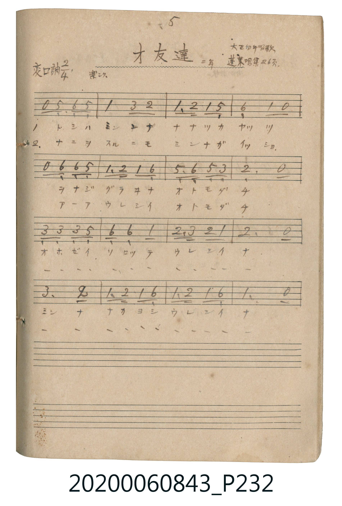

# オ友達（好朋友）

<audio controls src="otomodachi.mp3"></audio>

- 唱歌帖 P232 (二年 / 大正幼年唱歌 / 蓬萊唱集 26頁)

## 說明

オ友達（好朋友）
Source: 唱歌帖 (2020.006.0843), P232.jpg
Marginal notes: 5 / 二年 / 大正幼年唱歌 / 蓬萊唱集 26頁 / 楽シク
Key: 変ロ調 (Bb major), Time: 2/4, Tempo: 楽シク

## 歌詞

```text
1. トシハ ミンナ ナナツカ ヤッツ
ヲナジ グラヰナ オトモダチ
オホゼイ ソロッテ ウレシイ ナ
ミンナ ナカヨシ ウレシイ ナ
2. ナニヲ スルニモ ミンナガ イッショ
アーア ウレシイ オトモダチ
オホゼイ ソロッテ ウレシイ ナ
ミンナ ナカヨシ ウレシイ ナ
```

## ABC

```abc
X:1
T:オ友達（好朋友）
M:2/4
L:1/16
Q:1/4=108
K:Bb
V:V1 name="Vocal" snm="Voc"
[V:V1]
z2 F2 G2 F2 | B4 d2 c2 | B2 c2 B2 F2 | G4 B2 z2 |
z2 G2 G2 F2 | B2 c2 B2 G2 | F2 G2 F2 d2 | c6 z2 |
d2 d2 d2 f2 | G2 G2 B4 | c2 d2 c2 B2 | c6 z2 |
d6 c2 | B2 c2 B2 G2 | B2 c2 B2 G2 | B6 z2 |
```

## TMD 檔案連結

- [主旋律 TMD 檔案](otomodachi.tmd) [[在 TMD Studio 編輯](https://tmdlang.github.io/Tmd-TS/#tmd=s7IKdvYPcrWy4tLSUnjctOppf_fLxinv93Q8Xbr32ZxuIPf9nk4FLS0uRVsFQwMLLntbBScdLhsjfRM7rjoFpadTNj5b2_N0xzSFACNjIwWNJ7t6nu7coqCv8HTJ8mdrFz_duQfIhSgCCr6YvObFhC4g9-XsNgUjs5cLGjWVuLj0tRRsqQW4FBRw-gIkF5xfWpScaqWAcLeGkYGRgZ6BgZmegYWJsaYO2CN6WQXpIOW-iUXpmXmJOQp5-SWpxVYKpkBPkOpFoOCzpXsfN21_3LQeZKZ3aiXQ_iWdj5vXvli1X0HDKUkhNzErvwhodUhmLtBtwLAFMlNzC_KtUHX6VBZlJhdbgZiGegqPmztAUs39QNb8x82bHzd3AVldYNTyuGk1kLPkcXMzkAMOlOZNIJmmHcDg2fC4eeXjZiAJ1NC0CmRO86LHzQ2Pmxuhwfe4efbjpj2Pm5YAOXuB7gQb0wbkLHvcvAbsHqBMcxfEXGS7m1Y_bl4BVIBVqRHIzUDHdQPdAlSw83EzUDWQswhhyOOmNUAZsLNBXlsOcQ_QcUDHAJWhGEpHl1OeLqFAQUufi8u_JD83PyUxOSPTKiw_OTHHocagRqEaZI-CjaGZlh2YVaNgoKCrYBoPJMxABJhVo2AIJEHQGIiN4CIgFoiGKgJrAEGQGMiYGrCRwHzmkANOQrYKSsCwA3oV6F1I-gHizSDfIuEWoDwsEYG4SiDHo5oTbwQ2CaS6G5TCQLEKpEG6QHxwxCJMhsctyGJg5MINhPgV7Gp0v8J8BhavQQ8PUCjUgNXAIE7fAt0GdgM4_QPZK4EYRIOzACgvQd3bAMSNOL0KSoTNe0BJEpROgGyQl0BpBpwecRpTA3YpDJsiIglMwOIU4hNYzIJEifMb2OLZQAeAHAZO-EA-KOUDKXDSR3Vncxdu75FtEsSHMIiZMqHxh0OIYOyhpU9wulwBdQjx3iPDmFouLl07BUSOVQDylLkA)]
- [鋼琴伴奏 TMD 檔案](otomodachi_piano.tmd) [[在 TMD Studio 編輯](https://tmdlang.github.io/Tmd-TS/#tmd=s7IKdvYPcrWy4tLSUnjctOppf_fLxinv93Q8Xbr32ZxuIPf9nk4FLS0uRVsFQwMLLntbBScdLhsjfRM7rjoFpadTNj5b2_N0xzSFACNjIwWNJ7t6nu7coqCv8HTJ8mdrFz_duQfIhSgCCr6YvObFhC4g9-XsNgUjs5cLGjWVuLj0tRRsqQW4FBRw--JRwxSFgMzEvHwFx-Tk_NyCxLzM3NS8EpCe4PzSouRUKwWEfzSMDIwM9AwMzPQMLEyMNXXAHtTLKkgHKfdNLErPzEvMUcjLL0kttlIwBXqOVK8DBZ8t3fu4afvjpvUgMyn3PBQoaOlzcfmX5OfmpyQmZ2RaheUnJ-Y41BjUKFSD7FGwMTTTsgOzahQMFHQVTOOBhBmIALNqFAyBJAgaA7ERXATEAtFQRWANIAgSAxlTAzYSGJkOOZVFmcnFtgpKj5s7gLGxXeFxcz8QzwfizUDchYRbgPKrgfSSx83NIK4SyPGo5sQbgU0Cqe4G4k1AHTuBNEgXiL8I1eSmNUAMMQ0Yss3L4QZC_Ap2NbpfYT4Di9eghwcoFGrAamAQp2-BbgO7YQcQbwCyVwIxiAaJrQLSwNAAu7cBiBtxerUJpGQPUAuQbloGZIO8BAzEpiV4jakBuxSGTRGRBCZgcQrxCSxmQaLE-Q1s8WygA0AOAzlkL5C_FhJrbZjubO7C7T2yTYL4EAYxUyY0_nAIEYw9tPQJTpcroA4h3ntkGFOLkl3BJVSQB44MW52bVqtgHK8NTpoYOdc0XhvmVUNtcDKI14aEE1QGLRObxGvD8zFUBSJ4gMENtQcj16CZhj3jQFwAVmwOcQZmFACjBqwKlYQkXpjjYDSS58CGgm1H9iVUAXE2InkZVyDBvYWsCsqDOQoaSHCXISzDEqs-KLFqAY9Uw3igsfEwCh_fGMw3AZIgDBQwQHgLuyaYWrAAVBPEFJCsEUQRNlMwrIIYi2QHkCJoCg63gHjIGFkLyBhg4OnaKSDCTwHIU-YCAA)]

## 分析

```text
================================================================================
📊 TMD Song Profile: [ オ友達（好朋友） ]
================================================================================
⏱  Duration:       0:17 (17.8s), 16 measures total
🎼 Key & Tempo:    首調基準 B,, != 108.0 BPM, <2/4>
   - 分析範圍：      由實際發聲的音符與和弦推測調性；播放脈絡另行呈現
🎤 人聲音域:    F4 (MIDI 65) – F5 (MIDI 77) [跨度: 12 個半音 / 1.0 個八度, 難度: easy]
   - 最低音:  F4 in [Otomodachi #1 @ m.1, 0:00]
   - 最高音: F5 in [Otomodachi #1 @ m.9, 0:09]
   - 適合: soprano, mezzo-soprano, contralto, tenor, baritone, bass
🏛  結構:      Otomodachi (17.8s)
⚡ 編曲密度:        Peak 1 軌道同時演奏
🗝  調性診斷：       A# 大調（純淨自然大調，未偵測到可信轉調）
   - 風格氣質:    純淨自然大調（陽光明朗、易唱易記，無明顯調外色彩）
   - 轉調歷程:    全曲維持單一推測調性（未偵測到可信轉調）
   - 核心骨幹音:  A#, C, G, D, F
   - 調性數值:    A# 大調 [相關度: 0.76, 穩定度: Moderate, 自然音純度: 100.0%]
   - 候選調性 (K-S): A# 大調 (0.76), G 小調 (0.72), F 大調 (0.60)
   - 五度圈歷程:   -2
   - 各段落調性細節:
     • [Otomodachi #1]: A# 大調 (r: 0.76, 自然音純度: 100.0%)

  [ 五度圈游移軌跡 ]
               C  
         F            G  
     [Bb]*              D  
      Eb               A  
         Ab           E  
            Db       B  
               F# 
     (* = active key center)

  [ 十二半音累積音高分佈 ]
     C  : ████████████████████      24.1%
     C# :                            0.0%
     D  : █████████████             15.5%
     D# :                            0.0%
     E  :                            0.0%
     F  : ██████████                12.1%
     F# :                            0.0%
     G  : ████████████████          19.0%
     G# :                            0.0%
     A  :                            0.0%
     A# : ████████████████████████  29.3%
     B  :                            0.0%
--------------------------------------------------------------------------------
Assignment 軌道音域：
  - Vocal         : F4 – F5 (12 個半音 / 1.0 個八度, 47 個音符)
================================================================================
```


## 原書掃描頁




