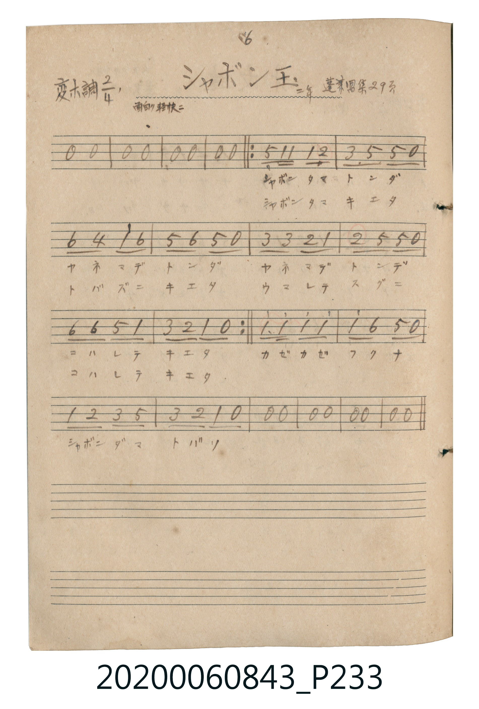

# シャボン玉（肥皂泡）

> Re:Shōka 使用 AI 協助辨識與重建樂譜，可能會有錯誤。歡迎回報。

- **鋼琴伴奏版**：<br><audio controls src="shabondama.mp3"></audio>

- 詞：野口雨情
- 曲：中山晋平
- 唱歌帖 P233 (二年 / 蓬萊唱集 29頁)

## 說明

シャボン玉（肥皂泡）
Source: 唱歌帖 (2020.006.0843), P233.jpg
Marginal notes: 6 / 二年 / 蓬萊唱集 29頁 / 面白ク軽快ニ
Key: 変ホ調 (Eb major), Time: 2/4, Tempo: 面白ク軽快ニ


## 歌詞

```text
1. シャボンタマ トンダ
ヤネマデ トンダ
ヤネマデ トンデ
コハレテ キエタ
2. シャボンタマ キエタ
トバズニ キエタ
ウマレテ スグニ
コハレテ キエタ
カゼ カゼ フクナ
シャボンダマ トバソ
```

## ABC

<div class="abc-score" data-abc-src="shabondama.abc" aria-label="五線譜載入中"></div>

[下載 ABC 原始檔](shabondama.abc)

## TMD 檔案連結

- [主旋律 TMD 檔案](shabondama.tmd) [[在 TMD Studio 編輯](https://tmdlang.github.io/Tmd-TS/#tmd=s7IKdvYPcrWy4qpTUCpJTLdSSM7PyUlNLsnMz7MqzsjPTkzOyFeCS5bl55TmploBqXgDc4RwcX5pUXJqfEFieqpVgJGxMboM3KT4vPyS1KT8_GwMFRn5RYmZ8WB1xRmlCOmCovyy1LzEPKCS3MS80uLkosyCkvjk_IJKhJrUssyUVJCK1JTMkvyizMQcJBenFhWD_QJxYklRYh7EDKAgQhVQU3pmnlVJYibQBSBXlCfG5yZm5uUk5qUocWlpKTxu2v64efHj5jmPmzc_7-t8v6fjRdPS57Oanm1e-H5Pp4KWFpeirYKhgQWXva2Cqw6XjZG-iR3I9KdTNj5b2_N0xzQFULgoaDzZ1fN05xYFfYUXk9e8mNAFlH45u03ByPLlgkZNsHNerJz3fs-sl-19T_sXv5y94llzK1j42exNQOEnO9Y-3bjx2czupzs3K3Fx6Wsp2FILcCkoEPAkSEUwJLIUEN7SMDIwMtAzMDDTM7AwMdbUAftTL6sgHaTcN7EIGKyJOQqgaC-2UjADehxPCAAFX85d9Hzm3sdN61_s3vt0_-rHzd0gc7xTK4F2Lul83Dz7xar9ChquSQq5iVn5RUDrQjKB6VEBGNxAZmpuQb4VDiN8Kosyk4utQExDPRSfPm7a_7h5nsLj5g4Qp7kBHBLNSx439wKFHze3EyHTDgk9IKv_cfOax81tQM7ax00rgEaDZIywW4isBGzShMdNu4DORZNpWga2DWrszsdNG6Bewm3h46bVj5v2wKnmqcDQeNzchR7HQC_BfQ60ey9InvKUBAUKWvpcXMEZiUn5eSmJuYlWYfnJiTkONQY11SBrFGwMzbTswKwaBQMFXTCE0WSKQE0zjQdyDMFQV8EIrNQYSJpCMUh5DTAl6iqYgNTFAQkQB6gPyoIrApsHzGMOOeC0Y6ugBAk8YIDNAeLNwLDcD6TBAQjhNzeA0gcQ90LFwUkEJqcEChJUM-ON8JjatBaIV0D5IFMmANm7gDQ4hcDk4KZCvAnCIE-DPF8DZqF5HBQ6YAIaTrDwgWnC5XWc_gKym0B0PxCvAWJwWsRwHYafl0GNgmnZCcQboJ4jbFwN2K3A2IMgaEQCRWHxifAxLBnAEgFx3m1aDbQPnIUgdPNUIL0eSHdBsxAivsCxDksFoDjai-RMaqXtWi4uXTsFRH5SAPKUuQA)]
- [鋼琴伴奏 TMD 檔案](shabondama_piano.tmd) [[在 TMD Studio 編輯](https://tmdlang.github.io/Tmd-TS/#tmd=s7IKdvYPcrWy4tLSUnjctP1x8-LHzXMeN29-3tf5fk_Hi6alz2c1Pdu88P2eTgUtLS5FWwVDAwsue1sFVx0uGyN9EzuuOgWlp1M2Plvb83THNIUAI2NjBY0nu3qe7tyioK_wYvKaFxO6gNIvZ7cpGFm-XNCoqQTS8GLlvPd7Zr1s73vav_jl7BXPmlvBws9mbwIKP9mx9unGjc9mdj_duVmJi0tfS8GWWoBLQYGQJx81TFEIyEzMy1dwTE7Ozy1IzMvMTc0rAekMzi8tSk61UkB4V8PIwMhAz8DATM_AwsRYUwfsf72sgnSQct_EovTMvMQchbz8ktRiKwUzYIDgCRmg4Mu5i57P3Pu4af2L3Xuf7l_9uLkbZA7l3oYCBS19Lq7gjMSk_LyUxNxEq7D85MQchxqDmmqQNQo2hmZadmBWjYKBgi4YwmgyRaCmmcYDOYZgqKtgBFZqDCRNoRikvAYYPLoKJiB1cUACxAHqg7LgisDmAROEQ05lUWZysa2CEiQ2FYDRCcSbgZG7H0jPA-IOCL-5AYiXAHEvVLwdWU4JFCSoZsYb4TG1aS0Qr4DyQaZMALJ3AeluZDm4qRBvgjDI0yDP14BZaB4HhQ6YgIYTLHxgmnB5Hae_gOwmEN0PxGuAuA2r6zD8vAxqFEzLTiDeAPUcYeNqwG4Fxh4EQSMSKAqLT4SPYckAlgiI827TaqB9e4AYSjdPBdLrgXQXNE8j4gsc67BUAIqjvUjOpFbarkXJTOAyI8gDe3aqzk2rpX7wYM1YhtogxYbaII0QEmqoNsgSQ21QFjPWhrgALASSgiiGKEDNbAgDwa6J1wan33htSCqF8s3jwbqgFJ5UDVQPNQaoFuxFoBaIYShWwtyIIOCOBgYGsutRvAgLJaQgIMlOCmMH3WAsCcQHOYFYwNOHYTwolCBkjYIJmAnmgbhQBpAyBnFBbCjfAOF6uBiSHqgSqHkQEiwFYWLohpoAscIIwofoB2mBugC_EzD9ADKAaB-QFwTAcPbMKynKx5IHTRBZsKBWIdowFhxh0Wa5sQrRxkACXTNK_CA0Ay2CpmmQ_SA9rnkpmXnp-G3MBVlpArTJCGSTQrQpkAl0AYZ-HJYCwwAYCeBMDooVkC5dOwWwYxWADETSAvEg5oFYylwA)]

## 分析

```text
================================================================================
📊 TMD Song Profile: [ シャボン玉（肥皂泡） ]
================================================================================
⏱  Duration:       0:22 (22.2s), 20 measures total
🎼 Key & Tempo:    首調基準 E,, != 108.0 BPM, <2/4>
   - 分析範圍：      由實際發聲的音符與和弦推測調性；播放脈絡另行呈現
🎤 人聲音域:    A#3 (MIDI 58) – D#5 (MIDI 75) [跨度: 17 個半音 / 1.4 個八度, 難度: challenging]
   - 最低音:  A#3 in [Shabondama #1 @ m.5, 0:04]
   - 最高音: D#5 in [Shabondama #1 @ m.7, 0:07]
   - 適合: soprano, mezzo-soprano, contralto, tenor, baritone, bass
🏛  結構:      Shabondama (22.2s)
⚡ 編曲密度:        Peak 1 軌道同時演奏
🗝  調性診斷：       D# 大調（純淨自然大調，未偵測到可信轉調）
   - 風格氣質:    純淨自然大調（陽光明朗、易唱易記，無明顯調外色彩）
   - 轉調歷程:    全曲維持單一推測調性（未偵測到可信轉調）
   - 核心骨幹音:  D#, A#, C, F, G
   - 調性數值:    D# 大調 [相關度: 0.92, 穩定度: High, 自然音純度: 100.0%]
   - 候選調性 (K-S): D# 大調 (0.92), A# 大調 (0.70), C 小調 (0.64)
   - 五度圈歷程:   -3
   - 各段落調性細節:
     • [Shabondama #1]: D# 大調 (r: 0.92, 自然音純度: 100.0%)

  [ 五度圈游移軌跡 ]
               C  
         F            G  
      Bb               D  
     [Eb]*              A  
         Ab           E  
            Db       B  
               F# 
     (* = active key center)

  [ 十二半音累積音高分佈 ]
     C  : ███████████               14.3%
     C# :                            0.0%
     D  :                            0.0%
     D# : ████████████████████████  31.0%
     E  :                            0.0%
     F  : ███████████               14.3%
     F# :                            0.0%
     G  : ███████████               14.3%
     G# : ██                         2.4%
     A  :                            0.0%
     A# : ██████████████████        23.8%
     B  :                            0.0%
--------------------------------------------------------------------------------
Assignment 軌道音域：
  - Vocal         : A#3 – D#5 (17 個半音 / 1.4 個八度, 44 個音符)
================================================================================
```


## 原書掃描頁




