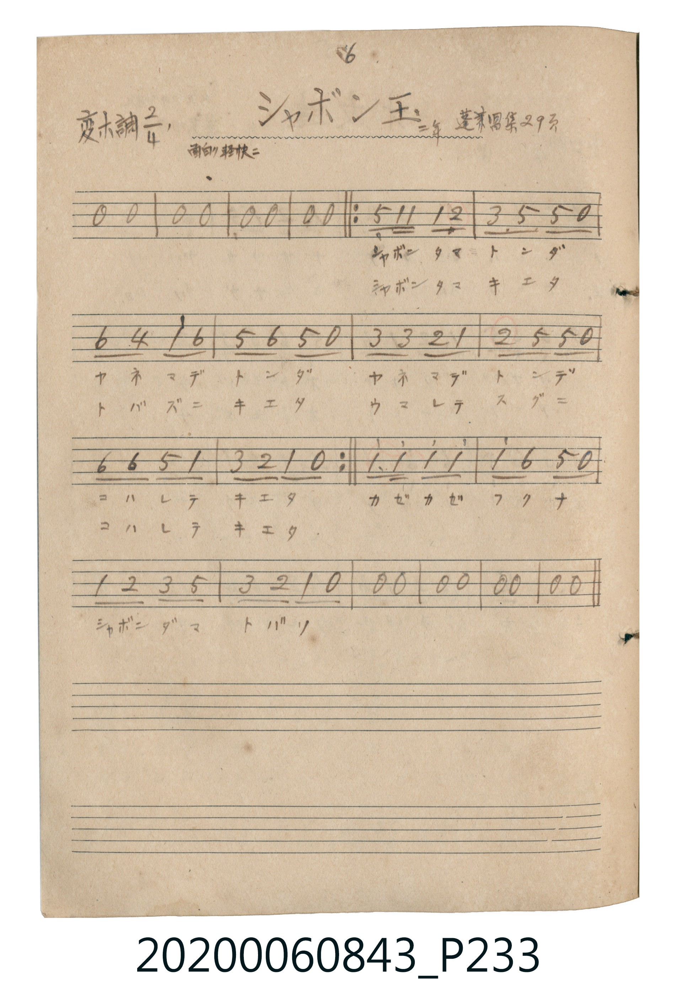

# シャボン玉（肥皂泡）

<audio controls src="shabondama.mp3"></audio>

- 詞：野口雨情
- 曲：中山晋平
- 唱歌帖 P233 (二年 / 蓬萊唱集 29頁)

## 說明

シャボン玉（肥皂泡）
Source: 唱歌帖 (2020.006.0843), P233.jpg
Marginal notes: 6 / 二年 / 蓬萊唱集 29頁 / 面白ク軽快ニ
Key: 変ホ調 (Eb major), Time: 2/4, Tempo: 面白ク軽快ニ

## 跨冊／重複收錄參照

> 同名異曲（各冊收錄之不同詞曲版本）

- **[同名異曲]** 《新定兒童唱歌》尋常科第二學年用（2020.006.0847.0002）：[**〈シヤボンダマ〉**](../../../shintei_jido_shoka/grade_2_2020.006.0847.0002/1_08_shabondama/index.md)（`C` / `2/4` — [原始 TMD](../../../shintei_jido_shoka/grade_2_2020.006.0847.0002/1_08_shabondama/shabondama.tmd)）
- **[同名異曲]** 楊金土手抄《唱歌帖》第 7 冊・VII（2020.006.0843）：[**〈しゃぼん玉 (肥皂泡)〉**](../p252_shabondama/index.md)（`E,` / `2/4` — [原始 TMD](../p252_shabondama/shabondama.tmd)）
- 總表：[跨冊重複與同名歌曲總索引](../../../duplicate_songs.md)

## 歌詞

```text
1. シャボンタマ トンダ
ヤネマデ トンダ
ヤネマデ トンデ
コハレテ キエタ
2. シャボンタマ キエタ
トバズニ キエタ
ウマレテ スグニ
コハレテ キエタ
カゼ カゼ フクナ
シャボンダマ トバソ
```

## ABC

```abc
X:1
T:シャボン玉（肥皂泡）
C:曲：中山晋平
M:2/4
L:1/16
Q:1/4=108
K:Eb
V:V1 name="Vocal" snm="Voc"
[V:V1]
z4 z4 | z4 z4 | z4 z4 | z4 z4 |
B,2 E E E2 F2 | G2 B2 B2 z2 | c2 A2 e2 c2 | B2 c2 B2 z2 |
G2 G2 F2 E2 | F2 B2 B2 z2 | C2 C2 B,2 E2 | G2 F2 E2 z2 |
E2 e e e2 e2 | e2 c2 B2 z2 | E2 F2 G2 B2 | G2 F2 E2 z2 |
z4 z4 | z4 z4 | z4 z4 | z4 z4 |
```

## TMD 檔案連結

- [主旋律 TMD 檔案](shabondama.tmd) [[在 TMD Studio 編輯](https://tmdlang.github.io/Tmd-TS/#tmd=s7IKdvYPcrWy4tLSUnjctP1x8-LHzXMeN29-3tf5fk_Hi6alz2c1Pdu88P2eTgUtLS5FWwVDAwsue1sFVx0uGyN9EzuuOgWlp1M2Plvb83THNIUAI2NjBY0nu3qe7tyioK_wYvKaFxO6gNIvZ7cpGFm-XNCoqQTS8GLlvPd7Zr1s73vav_jl7BXPmlvBws9mbwIKP9mx9unGjc9mdj_duVmJi0tfS8GWWoBLQYGAJ0EqgvNLi5JTrRQQ3tIwMjAy0DMwMNMzsDAx1tQB-1MvqyAdpNw3sSg9My8xRyEvvyS12ErBDOhxPCEAFHw5d9HzmXsfN61_sXvv0_2rHzd3g8zxTq0E2rmk83Hz7Ber9itouCYp5CZm5RcBrQvJzAW6BxjcQGZqbkG-FQ4jfCqLMpOLrUBMQz0Unz5u2v-4eZ7C4-YOEKe5ARwSzUseN_cChR83txMh0w4JPSCr_3HzmsfNbUDO2sdNK4BGg2SMsFuIrARs0oTHTbuAzkWTaVoGtg1q7M7HTRugXsJt4eOm1Y-b9sCp5qnA0Hjc3IUex0AvwX0OtHsvSJ7ylAQFClr6XFzBGYlJ-XkpibmJVmH5yYk5DjUGNQrVIHsUbAzNtOzArBoFAwVdMITRZIpATTONB3IMwVBXwQis1BhImkIxSHkNMCnqKpiA1MUBCRAHqA_KgisCmwfMZA454MRjq6AECT1giM0B4s3AwNwPpMEhCOE3N4ASCBD3QsXBaQQmpwQKE1Qz443wmNq0FohXQPkgUyYA2buANDiJwOTgpkK8CcIgT4M8XwNmoXkcFDpgAhpOsPCBacLldZz-ArKbQHQ_EK8BYnBixHAdhp-XQY2CadkJxBugniNsXA3YrcDYgyBoRAJFYfGJ8DEsGcASAXHebVoNtA-chyB081QgvR5Id0HzECK-wLEOSwWgONqL5Exqpe1aLi5dOwVEhlIA8pS5AA)]
- [鋼琴伴奏 TMD 檔案](shabondama_piano.tmd) [[在 TMD Studio 編輯](https://tmdlang.github.io/Tmd-TS/#tmd=s7IKdvYPcrWy4tLSUnjctP1x8-LHzXMeN29-3tf5fk_Hi6alz2c1Pdu88P2eTgUtLS5FWwVDAwsue1sFVx0uGyN9EzuuOgWlp1M2Plvb83THNIUAI2NjBY0nu3qe7tyioK_wYvKaFxO6gNIvZ7cpGFm-XNCoqQTS8GLlvPd7Zr1s73vav_jl7BXPmlvBws9mbwIKP9mx9unGjc9mdj_duVmJi0tfS8GWWoBLQYGQJx81TFEIyEzMy1dwTE7Ozy1IzMvMTc0rAekMzi8tSk61UkB4V8PIwMhAz8DATM_AwsRYUwfsf72sgnSQct_EovTMvMQchbz8ktRiKwUzYIDgCRmg4Mu5i57P3Pu4af2L3Xuf7l_9uLkbZA7l3oYCBS19Lq7gjMSk_LyUxNxEq7D85MQchxqDGoVqkD0KNoZmWnZgVo2CgYIuGMJoMkWgppnGAzmGYKirYARWagwkTaEYpLwGGD66CiYgdXFAAsQB6oOy4IrA5gFThENOZVFmcrGtghIkOhWA8QnEm4Gxux9IzwPiDgi_uQGIlwBxL1S8HVlOCRQmqGbGG-ExtWktEK-A8kGmTACydwHpbmQ5uKkQb4IwyNMgz9eAWWgeB4UOmICGEyx8YJpweR2nv4DsJhDdD8RrgLgNq-sw_LwMahRMy04g3gD1HGHjasBuBcYeBEEjEigKi0-Ej2HJAJYIiPNu02qgfXuAGEo3TwXS64F0FzRTI-ILHOuwVACKo71IzqRW2q5FyU3gQiPIA0d-qs5Nq6V--GDNWYbaIMWG2iCNEBJqqDbIEkNtUB4z1oa4ACwEkoIohihAzW0IA8GuidcGJ-B4bUgyhfLN48G6oBSeZA1UDzUGqBbsRaAWiGEoVsLciCDgjgYGBrLrUbwICyWkICDJTgpjB91gLCnEByWFWMATiGE8KJggZI2CCZgJ5oG4UAaQMgZxQWwo3wDhfLgYkh6oEqh5EBIsBWFi6IaaALHCCMKH6AdpgboAvxMw_QAygGgfkBcEwID2zCspyseWC00QmbCgViHaMBYcZdFmubEK0cZAAl03agwhdAOtgiZrkAtAmlzzUjLz0gnYmQuy1ARolxHILoVoUyAT6AYMA3BZCwwHYESAczooZkDadO0UwO5VADIQ6QvEgxgIYilzAQA)]

## 分析

```text
================================================================================
📊 TMD Song Profile: [ シャボン玉（肥皂泡） ]
================================================================================
⏱  Duration:       0:22 (22.2s), 20 measures total
🎼 Key & Tempo:    首調基準 E,, != 108.0 BPM, <2/4>
   - 分析範圍：      由實際發聲的音符與和弦推測調性；播放脈絡另行呈現
🎤 人聲音域:    A#3 (MIDI 58) – D#5 (MIDI 75) [跨度: 17 個半音 / 1.4 個八度, 難度: challenging]
   - 最低音:  A#3 in [Shabondama #1 @ m.5, 0:04]
   - 最高音: D#5 in [Shabondama #1 @ m.7, 0:07]
   - 適合: soprano, mezzo-soprano, contralto, tenor, baritone, bass
🏛  結構:      Shabondama (22.2s)
⚡ 編曲密度:        Peak 1 軌道同時演奏
🗝  調性診斷：       D# 大調（純淨自然大調，未偵測到可信轉調）
   - 風格氣質:    純淨自然大調（陽光明朗、易唱易記，無明顯調外色彩）
   - 轉調歷程:    全曲維持單一推測調性（未偵測到可信轉調）
   - 核心骨幹音:  D#, A#, C, F, G
   - 調性數值:    D# 大調 [相關度: 0.92, 穩定度: High, 自然音純度: 100.0%]
   - 候選調性 (K-S): D# 大調 (0.92), A# 大調 (0.70), C 小調 (0.64)
   - 五度圈歷程:   -3
   - 各段落調性細節:
     • [Shabondama #1]: D# 大調 (r: 0.92, 自然音純度: 100.0%)

  [ 五度圈游移軌跡 ]
               C  
         F            G  
      Bb               D  
     [Eb]*              A  
         Ab           E  
            Db       B  
               F# 
     (* = active key center)

  [ 十二半音累積音高分佈 ]
     C  : ███████████               14.3%
     C# :                            0.0%
     D  :                            0.0%
     D# : ████████████████████████  31.0%
     E  :                            0.0%
     F  : ███████████               14.3%
     F# :                            0.0%
     G  : ███████████               14.3%
     G# : ██                         2.4%
     A  :                            0.0%
     A# : ██████████████████        23.8%
     B  :                            0.0%
--------------------------------------------------------------------------------
Assignment 軌道音域：
  - Vocal         : A#3 – D#5 (17 個半音 / 1.4 個八度, 44 個音符)
================================================================================
```


## 原書掃描頁




