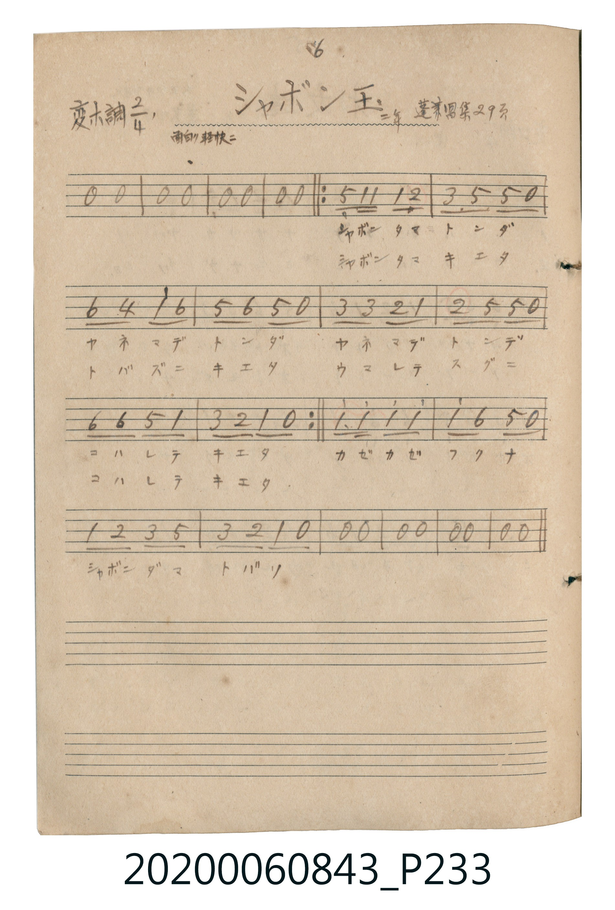

# シャボン玉（肥皂泡）

> Re:Shōka 使用 AI 協助辨識與重建樂譜，可能會有錯誤。歡迎[回報](https://github.com/TMDLang/reshoka/issues)。

- **鋼琴伴奏版**：<br><audio controls src="shabondama.mp3"></audio>
- **NEUTRINO 歌聲合成版**：<br><audio controls src="shabondama_neutrino.mp3"></audio>

- 詞：野口雨情
- 曲：中山晋平
- 唱歌帖 P233 (二年 / 蓬莱唱集 29頁)

## 說明


- 出處：唱歌帖 P233 (二年 / 蓬莱唱集 29頁)
- 調性與拍號：調號 ?= E,，拍號 <2/4>，速度 != 108


## 歌詞

```text
> [!NOTE]
> **原頁資訊與歌詞全文**（對應 `P233.jpg`）：
> - **出處與詞曲考證**：頁頂標示曲號「`6`」、曲名「`シャボン玉`」、學年「`二年`」、出處「`蓬莱唱集 29頁`」（抄自《蓬萊唱歌集》第 29 頁），左上角記「`変ホ調 2/4,`」「`面白ク軽快ニ`」（降 E 大調，`?= E,`，`<2/4>`）。本曲為野口雨情作詞、中山晉平作曲之大正 11 年（1922）童謠名作〈シャボン玉〉。
> - **反覆記號與前後奏結構**：原抄本第 1–4 小節與第 17–20 小節各記有 4 小節空拍 `| 0 0 | 0 0 | 0 0 | 0 0 |`（對應原曲 4 小節鋼琴前奏與 4 小節後奏，已完整編入 `shabondama_piano.tmd`）；歌唱主體於第 5–12 小節設反覆記號 `||: ... :||`，譜下並列上下兩排歌詞（第 1 遍與第 2 遍），反覆唱畢後接第 13–16 小節結句「カゼ カゼ フクナ／シャボンダマ トバソ」。
> - **校訂與手抄原貌說明（依 Editorial Policy A 校訂）**：
>   1. **歌唱第 7 小節（原譜第 11 小節「コハレテ」）音高**：原抄本明確記為中音八分音符 `6 6 5 1`（無低音點），舊轉錄誤植低八度 `6_ 6_ 5_ 1`，今依原譜還原為 `| 6 - 6 - 5 - 1 - |`。
>   2. **歌唱第 9 小節（原譜第 13 小節「カゼカゼ」）高音點漏記**：原抄本首音 `1.` 漏標上方高音點（後三音皆標有高音點 `1^ 1^ 1^`），依中山晉平旋律同音反覆句型校訂補回為 `| 1^ - - 1^ 1^ - 1^ - |`。
>   3. **濁點異同保留**：原抄本第 5 小節兩排歌詞均作無濁點之「`シャボン タマ`」，第 15 小節則作帶濁點之「`シャボン ダマ`」，依歷史文獻原貌如實保留。
>
> **（第一遍）**
> シャボンタマ　トンダ
> ヤネマデ　トンダ
> ヤネマデ　トンデ
> コハレテ　キエタ
>
> **（第二遍）**
> シャボンタマ　キエタ
> トバズニ　キエタ
> ウマレテ　スグニ
> コハレテ　キエタ
>
> **（結句）**
> カゼ　カゼ　フクナ
> シャボンダマ　トバソ
```

## ABC

<div class="abc-score" data-abc-src="shabondama.abc" aria-label="五線譜載入中"></div>

[下載 ABC 原始檔](shabondama.abc)

## TMD 檔案連結

- [主旋律 TMD 檔案](shabondama.tmd) [[在 TMD Studio 編輯](https://tmdlang.github.io/Tmd-TS/#tmd=s7IKdvYPcrWy4qpTUCpJTLdSSM7PyUlNLsnMz7MqzsjPTkzOyFeCS5bl55TmploBqXgDc4RwcX5pUXJqfEFieqpVgJGxMboM3KT4vPyS1KT8_GwMFRn5RYmZ8WB1xRmlCOmCovyy1LzEPKCS3MS80uLkosyCkvjk_IJKhJrUssyUVJCK4uTEvPiy1KLMtMzUFCRXpxYVg_0DcWZJUWIexBygIEJVflFJRn56UWJBRqVVRmZxSX5RZnJiTnx2Yl4iQlFJRirQ_wU5iUjWAxWmZ-ZZlSRmAp0P8kJ5YnxuYmZeTmIe0BFaWgqPm7Y_bl78uHnO4-bNz_s63-_peNG09PmspmebF77f06mgpcWlaKtgaGDBZW-r4KrDZWOkb2IHMv3plI3P1vY83TFNARSoChpPdvU83blFQV_hxeQ1L_o2AqVfzm5TMLJ8uaBRE-ycFyvnvd8z62V739P-xS9nr3jW3AoWfjZ7E1D4yY61TzdufDaz--nOzUpcXPpaCrbUAlwKCgp2CtGKfv4hrrEQjpbW0775QIe92Nz-YkXXi452oE-AznvauuLZtHYtLWAYPN3Q-6y9UyEB5De9rIL0BGBYAJ0J0a4LMqB914uZU4FagfqAXnjR0PxibSdI6yyguS8XND1bMfP5kl0gmZnzHzf0JJglPG7ofdzQCBR5OgHI6ElAC3io_NO1O4DBCJKHBChMGGwdSBgzeEFKgE5-1tXyon3V44YukIoJXZD4ASp63ND9fM0aoFIFoFqwN3qebl_2ZEfXi-WTXqyYATLz6ZLOx82zX6zarwCMXR2IlT0JL-cuej5z7-Om9S927326f_Xj5m6oTS9n9iq4KjxdshyoA2haAjhlAEOoJwGcOkBh9bih6dmcNUDPPm_ahRzlT_bOAQYY0EOwCO8ERjhQEKjyyc5uoJHP1i5WMDRUAPocaJGhpZER0LDnq5e-WLMAGGxAhY8bOtAC7nEDyDakmOnvfbGsDegzYMgD4-dpZ-_TfT1Pl_Y_3zrh2fJucBQBYx8YWkAHggLG8FHDZBOFpxv6n69vAKoHC5kDxYwMoIJPJ7QATXs2p1MBpuz5yl3PunsVEmoUDIAQCwkMAmgSAlk1exNc58vuPc8nbAG5aWk_0DK4OMSJ4KjZ9HRdz7OpW55vX_G0dalCQnFGYlJ-XkpibmJ8QWZiXr5eSW4KJDXOBuW_KRuf7Nj9cvWUZ9P2gFxuCnS4oRHMNyvWIgcG0L01Vgp6enoKVjUgF_a8WDvnyY7uJzuWPe2YDkwPQPbT1pXP-iZBcgPQC-CwUHjZ2AsNFyMQG5qEwAYDrX8-dRHQ8c_6loIVG4PsN4MF09YJT_uXApPS46bVj5v2AIsaCNU8FZioHjd3vd_TjxyXj5sbHjfPA0p3PG6e8LhpLzgZIkXsswULX6xoAuXWzm5g9AFD9sWmnherVj2b0Qd065N9cxVcUzJBJWNijkJAfk5mcqWCowJEE9DN4IiHGKagYKgHMg8cfCBnm0MdDIo1oKlr54D9AkyFYFGwB4Cu63_cvOZxMzA_gYLg5fzNL1fPQE1NQIc8X7QLGNjARA9M30AlT1tXP-1oAzKer1mmkGCmYKZgqmAIShzPWxY-2dsHMmQ3MKBBAfqio-vF3s6XPS0vVi15tgSY1PtAmneBtMUrAJFpPFhnz5PdXUCvQpz5sgkUCkDbQEnRDBhIIGwKxIZAXAPMrdDQU1AwQvWwJVYPGyN7GBRVUBLi4dUzIM59tqcf6EVUn79cNg0oqZBgqJegAJQHFn7A9PRs2k64JpBF-3qe7ACF2_NZbUAFwPwElwVqjFMAI0jK7gH6ELmAeDa9--m-7qcTekBBCkl4_UufzuuGpojFc57OngcNBaApuqAAAJsHptFCwhgcEvsbgdY-n7oBaOaT_XOfT52JWS6YwrImUp54OrcdWAYBIw9iALDIQi_JgYl8PzAVQ0rKHnCwwg3qBGl-umMbHs3gLADVDAyEZ2u3P-3fBKyUnvfuhqT3p8uanq5fBnEzzFewSg2SY5_saIDkUmDVDZZAyWNg1z1uAFoDzGWgLAdV07zkcXMvSKq5nWjZdpj5yJmj4XHT2sdNK4AWYXPbrh5i3IZiArxA2AWsgbDINi0DOwxu-87HTRuAKkl0G7ioQnEYJOkDtcAYsGILi8vB0QYLGVDZBVJDedMFChS09Lm4guH1gKNVAKgicKgxqKkG2aNgY2imBfYMsPoBFhOg7A-CusDyGpj4FYyhhQIIG4BFQMWECSx3gDhAfUilB1gR2DwfwxqoR4FCQL8CMTiFg3nzwBqBXgbzNoPJBrgdwDQDFumFqwUmGHw6IBYaEbawaS2I17QCTIJkYBZCjJ0AFt8FZnfj08EFDTJQ-IAwKLTABSeYhRliKIUrig60ACPS5yAxqNObICL9YHINmGzD63REWC1DsgVV506wng3wgCDXrlrkxOeEL_FhLXwRqQwRnLDECUuaOIMT5KrVYEOhDQgoCxKaU8G89WA_dCH5EJF-kFMZeoqFJJS9yP7UtVNAymfRPoaxCuhCRmhCTiCuMhcA)]
- [鋼琴伴奏 TMD 檔案](shabondama_piano.tmd) [[在 TMD Studio 編輯](https://tmdlang.github.io/Tmd-TS/#tmd=s7IKdvYPcrWy4qpTUCpJTLdSSM7PyUlNLsnMz7MqzsjPTkzOyFeCS5bl55TmploBqXgDc4RwcX5pUXJqfEFieqpVgJGxMboM3KT4vPyS1KT8_GwMFRn5RYmZ8WB1xRmlCOmCovyy1LzEPKCS3MS80uLkosyCkvjk_IJKhJrUssyUVJCK4uTEvPiy1KLMtMzUFCRXpxYVg_0DcWZJUWIexBygIEJVflFJRn56UWJBRqVVRmZxSX5RZnJiTnx2Yl4iQlFiEVBzempual6JVUFmYl5-fGJycn5uQWJeJkgMobAkA6jIqiAnEcmdQBPTM_OsShIzgf4E-bU8MT43MTMvJzEP6FotLYXHTdsfNy9-3DzncfPm532d7_d0vGha-nxW07PNC9_v6VTQ0uJStFUwNLDgsrdVcNXhsjHSN7EDmf50ysZna3ue7pimAAp9BY0nu3qe7tyioK_wYvKaF30bgdIvZ7cpGFm-XNCoCXbOi5Xz3u-Z9bK972n_4pezVzxrbgULP5u9CSj8ZMfapxs3PpvZ_XTnZiUuLs-8kqJ8qwCQZ4M8HGoMaqq5FIDAxtBMyw7MqlGozk2rVTDWNoxT0AVCMAPKg1I1MIaJthlY1BRIGoAlDIGkERAbahuDSZAMUBTMM4_XBkmZxmuDVIHVc9WiuMgH2UUWcAcZxgM1QUkwzwTMM4BJgXnGIDkQG8oHyoJMD85ITMrPS0nMTXSE2IHdz0CTgc4FQ4gHgH4EuRWKIZ4DedYEpA7kdxAHqA_KgisCm-djWAONfaAQMAEA8WagwH4wbx5Y4-PmDjBvM5hsgNvxuHkJWKQXrvZxczs-HRALjQhb2LQWxGtaASZBMjALIcZOAIvvArO78engggYZKHxAGBzdYA3g2MUIMVjwQNQg60ALMCJ9DhKDOr0JItIPJteAyTa8TkeE1TIkW1B17gTr2QAPCHLtwpb4cGe5glpEGoTmECAFSYnImQlCQtwEyX6G2qA0aYKcI0EZFKQMI3_CMhTUQHASR8mVNbBcCqRAuqAUsn3IhkK04M3eGGGAL5NDczk0myNyMjTHQ0jUIgBVO1QLpCQwgvCh-iE6CBYTTviKCWiZCKTALGhpCC8PMMtBWCGCM-GD0s9qsKGPm_ZA2SAWJN1PBfPWg1NbF1JaROR05PIAvWyBZOm92GMD6k9aVQLQ1EBCPYDhNBrUBq55KZl56UTkRVKSOgiiZkbUPARyCFwhyLtgDejOweFbnAkXkktMgCQIwyTAYYAUqLp2CuD6VQHIQMqJ0T6GsRhCRmhCTiAuxIkgljIXAA)]

## 分析

```text
================================================================================
📊 TMD Song Profile: [ シャボン玉（肥皂泡） ]
================================================================================
⏱  Duration:       0:22 (22.2s), 20 measures total
🎼 Key & Tempo:    首調基準 E,, != 108.0 BPM, <2/4>
   - 分析範圍：      由實際發聲的音符與和弦推測調性；播放脈絡另行呈現
🎤 人聲音域:    A#3 (MIDI 58) – D#5 (MIDI 75) [跨度: 17 個半音 / 1.4 個八度, 難度: challenging]
   - 最低音:  A#3 in [ShabondamaA[L1] #1 @ m.1, 0:00]
   - 最高音: D#5 in [ShabondamaA[L1] #1 @ m.3, 0:02]
   - 適合: soprano, mezzo-soprano, contralto, tenor, baritone, bass
🏛  結構:      ShabondamaA[L1] (8.9s) -> ShabondamaA[L2] (8.9s) -> ShabondamaB (4.4s)
⚡ 編曲密度:        Peak 1 軌道同時演奏
🗝  調性診斷：       D# 大調（純淨自然大調，未偵測到可信轉調）
   - 風格氣質:    純淨自然大調（陽光明朗、易唱易記，無明顯調外色彩）
   - 轉調歷程:    全曲維持單一推測調性（未偵測到可信轉調）
   - 核心骨幹音:  D#, A#, C, F, G
   - 調性數值:    D# 大調 [相關度: 0.91, 穩定度: High, 自然音純度: 100.0%]
   - 候選調性 (K-S): D# 大調 (0.91), A# 大調 (0.74), C 小調 (0.64)
   - 五度圈歷程:   -3 -> -3 -> -3
   - 各段落調性細節:
     • [ShabondamaA[L1] #1]: D# 大調 (r: 0.85, 自然音純度: 100.0%)
     • [ShabondamaA[L2] #1]: D# 大調 (r: 0.85, 自然音純度: 100.0%)
     • [ShabondamaB #1]: D# 大調 (r: 0.86, 自然音純度: 100.0%)

  [ 五度圈游移軌跡 ]
               C  
         F            G  
      Bb               D  
     [Eb]*              A  
         Ab           E  
            Db       B  
               F# 
     (* = active key center)

  [ 十二半音累積音高分佈 ]
     C  : ██████████████            15.7%
     C# :                            0.0%
     D  :                            0.0%
     D# : ████████████████████████  27.1%
     E  :                            0.0%
     F  : █████████████             14.3%
     F# :                            0.0%
     G  : █████████████             14.3%
     G# : ███                        2.9%
     A  :                            0.0%
     A# : ███████████████████████   25.7%
     B  :                            0.0%
--------------------------------------------------------------------------------
Assignment 軌道音域：
  - Piano         : A#3 – D#5 (17 個半音 / 1.4 個八度, 72 個音符)
================================================================================
```


## 原書掃描頁




