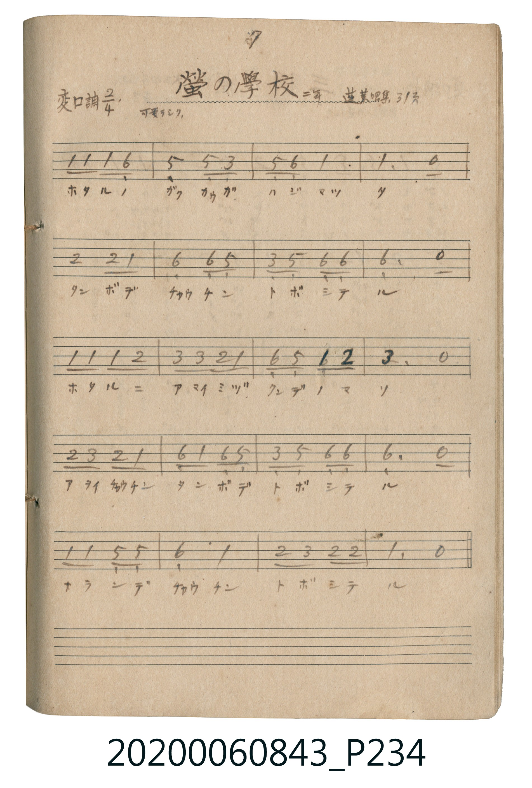

# 螢の學校（螢火蟲的學校）

<audio controls src="hotaru_no_gakko.mp3"></audio>

- 唱歌帖 P234 (二年 / 蓬萊唱集 31頁)

## 說明

螢の學校（螢火蟲的學校）
Source: 唱歌帖 (2020.006.0843), P234.jpg
Marginal notes: 7 / 二年 / 蓬萊唱集 31頁 / 可愛ラシク
Key: 変ロ調 (Bb major), Time: 2/4, Tempo: 可愛ラシク

## 歌詞

```text
ホタルノ ガクカウガ ハジマツタ
タンボデ チャウチン トボシテル
ホタルニ アマイミヅ クンデノマソ
アヲイチャウチン タンボデ トボシテル
ナランデ チャウチン トボシテル
```

## ABC

```abc
X:1
T:螢の學校（螢火蟲的學校）
M:2/4
L:1/16
Q:1/4=104
K:Bb
V:V1 name="Vocal" snm="Voc"
[V:V1]
B2 B2 B2 G2 | F4 F3 D | F2 G2 B4 | B6 z2 |
c4 c2 B2 | G4 G2 F2 | D2 F2 G2 G2 | G6 z2 |
B2 B2 B2 c2 | d2 d2 c2 B2 | G2 F2 B2 c2 | d6 z2 |
c2 d2 c2 B2 | G2 B2 G2 F2 | D2 F2 G2 G2 | G6 z2 |
B2 B2 F2 F2 | G4 B4 | c2 d2 c2 c2 | B6 z2 |
```

## TMD 檔案連結

- [主旋律 TMD 檔案](hotaru_no_gakko.tmd) [[在 TMD Studio 編輯](https://tmdlang.github.io/Tmd-TS/#tmd=s7IKdvYPcrWy4tLSUngxb9HjxnVP1-54tmDh-z0dQO7zxtUv5m96PqsFJtipoKXFpWirYGhgwmVvq-Ckw2VjpG9ix1WnoPR0ysZna3ue7pimEGBkbKKg8WRXz9OdWxT0FV5MXvNiQhdQ-uXsNgVjw5cLGjWVuLj0tRRsqQW4FBSIcjxIXXB-aVFyqpUCwrkaRgZGBnoGBmZ6BhYmxpo6YPfrZRWkg5T7JhalZ-Yl5ijk5ZekFlspmAM9hMdnQMGn_euftcx-3LzycdP2x03rQYZ4p1YCLVzS-bh57YtV-xU0nJIUchOz8ouAdoVk5gIdAwxDIDM1tyAfqA5Tv09lUWZysRWI-bh59uOm_Y-bVz9u7lN43LQGqOJx0-rHTcuAbKBk_-OmHY-b5z1ubgGqAqsHKd78uHnO4-Z2oHzj4-bFIMUgxmYgvwMkA7SnuQ1oJJr53UDNi0CGNS153Dz_cXMrkL8ebFg70HKwxF6IFUBVm8Cq0IxHtRuLXV0gb4JNJMZtlCcUKFDQ0ufi8sgvSSwq9ct3T8zOzrcKy09OzHGoMahRqAZZpWBjaKZlB2bVKBgq6MKxWTyQqFEwBVEgCGUYx8MEwQpAKkEQohcGDUAiYDOBid8hBxyptgpKwCAHBRXQx6uBGByroJAGYlC8QrjN_UB6B5CeB8QtIOVKIE9A3GcENR9Eg-yrgTgCBMEMsLtqQG6EssGiUJ_AleJzIdh1oDiZA8RIcQViQWU6ILJN24F0G8gvSA5EDkCQI4FuAYUZppPBrkNVRVLggZMsJJSalgBpWKqFuhHkcmD4gqX3ogUgFtfA45sKAQhy1SaoqzByCVrgEhOUYGdA3QV3ASLZIfsIEpZEJcQuoG0rkQKL2Giu5eLStVNAyVEKQAFlLgA)]
- [鋼琴伴奏 TMD 檔案](hotaru_no_gakko_piano.tmd) [[在 TMD Studio 編輯](https://tmdlang.github.io/Tmd-TS/#tmd=s7IKdvYPcrWy4tLSUngxb9HjxnVP1-54tmDh-z0dQO7zxtUv5m96PqsFJtipoKXFpWirYGhgwmVvq-Ckw2VjpG9ix1WnoPR0ysZna3ue7pimEGBkbKKg8WRXz9OdWxT0FV5MXvNiQhdQ-uXsNgVjw5cLGjWVuLj0tRRsqQW4FBSIc_yjhikKAZmJefkKjsnJ-bkFiXmZual5JSD9wfmlRcmpVgoIb2gYGRgZ6BkYmOkZWJgYa-qA_aWXVZAOUu6bWJSemZeYo5CXX5JabKVgDvQoHh8DBZ_2r3_WMvtx88rHTdsfN60HGUK5z6FAQUufi8sjvySxqNQv3z0xOzvfKiw_OTHHocagRqEaZJWCjaGZlh2YVaNgqKALx2bxQKJGwRREgSCUYRwPEwQrAKkEQYheGDQAiYDNBMamQ05lUWZysa2C0uPm2QqPm_YrPG5eDcR9QPYaIF4PxKsfNy2DcJv7gfQOID0PiFtAypVAnoC4zwhqPogG2VcDcQQIghlgd9WA3Ahlg0WhPoErxedCsOs2A_EcIG4H4sbHzYvBjmtuhMp0QGSbtgPpNpBfkByIHIAgRwLdAgozTCeDXYeqiqTA6wayF0FCqWkJkJ7_uLkVEpZgN4JcDgxfsPRetADE4hp4fFMhAEGu2gR1FTTwwAygszACl5igBDsD6i64CxDJDtlHkLAkKiF2AW1biRRYxEZzLXp2ApcaQR44MlR1bkEt0PHaEI8gU8jZyzBeGxHiGFkMVR9IBszA9CJYChQGUAoRySbx2mCjYDT2uDaGysJokByEhcMuTF9BbQZGgjYoUiAkwlXoGQC7Ljw-w2Mg7jRMmb8QJsJCD1IawiMB03HmcPdBWWAbscYb9vTkg5KeLBDlczzQ0HgQZQKkkPkgCswHSSDzofIGSP6LVzCCi4N8BTcQzAcSxkC2GRCDaFDoIkQQxmCxGsRAN5agUxDiVHAKRBXCaggfyRpsbgFGgWdeSRHWrGyCmpOjDWMVok1jgdxoEyALyEPXjhpzCO1gK8FuA3sNpMs1LyUzL52QrWlAW81ygZYBLQRaC7QcmmyQteOyFZhcgRZCCxOwLl07BbBrFYAMlIQHEoAYCWIpcwEA)]

## 分析

```text
================================================================================
📊 TMD Song Profile: [ 螢の學校（螢火蟲的學校） ]
================================================================================
⏱  Duration:       0:23 (23.1s), 20 measures total
🎼 Key & Tempo:    首調基準 B,, != 104.0 BPM, <2/4>
   - 分析範圍：      由實際發聲的音符與和弦推測調性；播放脈絡另行呈現
🎤 人聲音域:    D4 (MIDI 62) – D5 (MIDI 74) [跨度: 12 個半音 / 1.0 個八度, 難度: easy]
   - 最低音:  D4 in [HotaruNoGakko #1 @ m.2, 0:02]
   - 最高音: D5 in [HotaruNoGakko #1 @ m.10, 0:10]
   - 適合: soprano, mezzo-soprano, contralto, tenor, baritone, bass
🏛  結構:      HotaruNoGakko (23.1s)
⚡ 編曲密度:        Peak 1 軌道同時演奏
🗝  調性診斷：       G 小調（純淨自然小調，未偵測到可信轉調）
   - 風格氣質:    純淨自然小調（陰鬱抒情、旋律集中，無明顯調外色彩）
   - 轉調歷程:    全曲維持單一推測調性（未偵測到可信轉調）
   - 核心骨幹音:  A#, G, F, C, D
   - 調性數值:    G 小調 [相關度: 0.83, 穩定度: Moderate, 自然音純度: 100.0%]
   - 候選調性 (K-S): G 小調 (0.83), A# 大調 (0.79), F 大調 (0.54)
   - 五度圈歷程:   +1
   - 各段落調性細節:
     • [HotaruNoGakko #1]: G 小調 (r: 0.83, 自然音純度: 100.0%)

  [ 五度圈游移軌跡 ]
               C  
         F           [G ]*
      Bb               D  
      Eb               A  
         Ab           E  
            Db       B  
               F# 
     (* = active key center)

  [ 十二半音累積音高分佈 ]
     C  : ███████████               14.7%
     C# :                            0.0%
     D  : ██████████                12.7%
     D# :                            0.0%
     E  :                            0.0%
     F  : ████████████              15.3%
     F# :                            0.0%
     G  : █████████████████████     26.7%
     G# :                            0.0%
     A  :                            0.0%
     A# : ████████████████████████  30.7%
     B  :                            0.0%
--------------------------------------------------------------------------------
Assignment 軌道音域：
  - Vocal         : D4 – D5 (12 個半音 / 1.0 個八度, 59 個音符)
================================================================================
```


## 原書掃描頁




