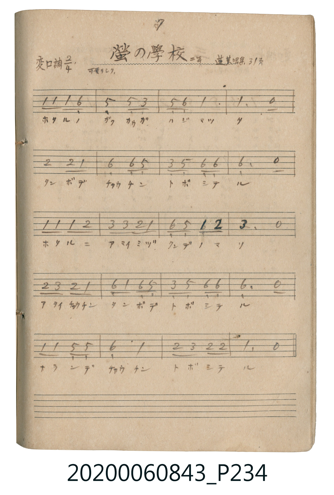

# 螢の學校（螢火蟲的學校）

> Re:Shōka 使用 AI 協助辨識與重建樂譜，可能會有錯誤。歡迎[回報](https://github.com/TMDLang/reshoka/issues)。

- **鋼琴伴奏版**：<br><audio controls src="hotaru_no_gakko.mp3"></audio>
- **NEUTRINO 歌聲合成版**：<br><audio controls src="hotaru_no_gakko_neutrino.mp3"></audio>

- 詞：野口雨情
- 曲：室崎琴月
- 唱歌帖 P234 (二年 / 蓬萊唱集 31頁)

## 說明

螢の學校（螢火蟲的學校）
Source: 唱歌帖 (2020.006.0843), P234.jpg
Marginal notes: 7 / 二年 / 蓬萊唱集 31頁 / 可愛ラシク
Key: 変ロ調 (Bb major), Time: 2/4, Tempo: 可愛ラシク


## 歌詞

```text
ホタルノ ガクカウガ ハジマツタ
タンボデ チャウチン トボシテル
ホタルニ アマイミヅ クンデノマソ
アヲイチャウチン タンボデ トボシテル
ナランデ チャウチン トボシテル
考證資訊：作詞：野口雨情／作曲：室崎琴月。大正時期著名創作童謠名作，描繪螢火蟲提著燈籠到田野上學的純真情景。
```

## ABC

<div class="abc-score" data-abc-src="hotaru_no_gakko.abc" aria-label="五線譜載入中"></div>

[下載 ABC 原始檔](hotaru_no_gakko.abc)

## TMD 檔案連結

- [主旋律 TMD 檔案](hotaru_no_gakko.tmd) [[在 TMD Studio 編輯](https://tmdlang.github.io/Tmd-TS/#tmd=s7IKdvYPcrWy4qpTUCpJTLdSSM7PyUlNLsnMz7MqzsjPTkzOyFeCS5bl55TmploBqXgDc4RwcX5pUXJqfEFieqpVgJGxCboM3KT4vPyS1KT8_GwMFRn5RYmZ8WB1xRmlCOmCovyy1LzEPKCS3MS80uLkosyCkvjk_IJKhJrUssyUVJCK1JTMkvyizMQcJBenFhWD_QJxYklRYh7EDKAgQlVJRirQW4l5mbnIeiGixUB3A_2bk5mWipAC2pKemWdVkpgJdDLI2eWJ8bmJmXk5iXkpyKpKMvLTixILMiqtMjKLQW5LTsyJz07MS1Ti0tJSeDFv0ePGdU_X7ni2YOH7PR1A7vPG1S_mb3o-qwUm2KmgpcWlaKtgaGDCZW-r4KTDZWOkb2IHsuLplI3P1vY83TFNARTmChpPdvU83blFQV_hxeQ1LyZ0AaVfzm5TMDZ8uaBRE-ymFyvnvd8z62V739P-xS9nr3jW3AoWfjZ7E1D46bolT7f0PZ-w5dmcDiUuLn0tBVtqAS4FBaK8ClIXDEkOCgjPaRgZGBnoGRiY6RlYmBhr6oB9q5dVkA5S7ptYBIyHxBwFUMIqtlIwB3ofTzgABZ_2r3_WMvtx88rHTdsfN60HGeKdWgm0cEnn4-a1L1btV9BwSlLITczKLwLaFZIJTAEKwBAHMlNzC_KB6jD1-1QC47XYCsR83Dz7cdP-x82rHzf3KTxuWgNU8bhp9eOmZUA2ULL_cdOOx83zHje3AFWB1YMUb37cPOdxcztQvvFx82KQYhBjM5DfAZIB2tPcBjQSzfxuoOZFIMOaljxunv-4uRXIXw82rB1oOVhiL8QKoKpNYFVoxqPajcWuLpA3wSYS47YXDc0v1na-2Nz-YkUXMEE92TsHM8G939MPFMdMcY8bmp4uWf5s7eJnM5uezZn_YuL0pxN6n3ZuBSp-vnrpizULgFwg-_2enmf9_c93roKnn2f9E4CKn7d3PN-44GnHhudTNgCte7KjC5iogEnr-ZYpz-fMB9r7bOZ6oBUgV1KenKFAQUufi8sjvySxqNQv3z0xOzvfKiAzMS_focagphpkk4KNhZYdmFGjYAiGZvFApmm8gi6IMIZygIKGQBGQGl0gNFCoAevxqQFFNiiSgPRqIO4DKoGkKKAqSKIC8UGizf1A1g4gDUpZYLNA2pBNq1EwAvKMgHbUgCzUBRFAu2tAroC4Aew2sBSqG8CJBGRj8xwgbgdbB00KYNFGIN4MFu2AqGnaDqTbwCKr0dwACQUjkLVACHcN0AEwUbwh0A322CKQP4H0EiANTvYgQVDCBzsPnO-A8iDBvRhBgGQpODaIDAKQlaAcBPU6UASWDSAhDbEcET7EhQTQUrD9YBshSQDiQlBQYEkMXUC8EmoXlniARBMh62u5uHTtFFCSrQJQQJkLAA)]
- [鋼琴伴奏 TMD 檔案](hotaru_no_gakko_piano.tmd) [[在 TMD Studio 編輯](https://tmdlang.github.io/Tmd-TS/#tmd=s7IKdvYPcrWy4qpTUCpJTLdSyC8qychPL0osyKi0ysgsLskvykxOzInPTsxLVIIrKs4vLUpOjS9ITE-1CjAyNkHIlGSk5qZapaaUJieWZObnKXFpaSm8mLfoceO6p2t3PFuw8P2eDiD3eePqF_M3PZ_VAhPsVNDS4lK0VTA0MOGyt1Vw0uGyMdI3sQMZ-3TKxmdre57umKYAsklB48munqc7tyjoK7yYvObFhC6g9MvZbQrGhi8XNGqC3fFi5bz3e2a9bO972r_45ewVz5pbwcLPZm8CCj9dt-Tplr7nE7Y8m9OhxMWlr6VgSy3ApaBAnFcfNUxRCMhMzMtXcExOzs8tSMzLzE3NKwHpDwYHrJUCwtMaRgZGBnoGBmZ6BhYmxpo64FDQyypIByn3TSxKz8xLzFHIyy9JLbZSMAcGC57wAQo-7V__rGX24-aVj5u2P25aD3ZzQ_OLtZ0vNre_WNEFDKEne-dghuD7Pf1AccwgfNzQ9HTJ8mdrFz-b2fRszvwXE6c_ndD7tHMrUPHz1UtfrFkA5ALZ7_f0POvvf75zFTxAnvVPACp-3t7xfOOCpx0bnk_ZALTuyY4uYCgBw-r5linP58wH2vts5nqgFSBXUh4_UKCgpc_F5ZFfklhU6pfvnpidnW8FjgyHGoOaapBNCjYWWnZgRo2CIRiaxQOZpvEKuiDCGMoBChoCRUBqdIHQQKEGrMenRuFx82yFx037gfRqIO4DKnnctAYY2EBVj5tWP25aBuKDRJv7gawdQHre4-YWsFkgbcim1SgYAXlGQDtqQBbqggig3TUgV0DcAHYbWArVDU37HzdvBtnYPAeI28HWNT5uXgyyHiTaCMSbwaIdEDVN24F0G1hkNZobIKFgBLIWCOGuAToAJoo3BLrBHlsE8ieQXgKk5z9ubgULrgc5AuQ8UDiB5EGCezGCAMlScGwQGQQgKzdBbAR5HSiyDMwC-xvsPJDliPAhLiSAloLtB9sISQIQF4KCAkti6ALilVC7sMQDJJoIWV-LNc0GeSClWkMzeLKtzi2oBTpSG-QaVArsaGhiNozXBoYhOFGDrIElbKgiVH0gGTADBg1AglDrgFKgZAqlQBiixSReG2wUjIaaC5ZD2GwMlYXRIDkIC4ddmL6C2gwMfm1QWoSQCFdBXIOwHbsuPD7DYyA8UKnsL4SJsNADQaRIwHScOdx9UBbYRqzxhj05-SAnJ6RCEJTggTkvHugUUBpB8EEUmA-SQOZD5REZByRgBBcHeQpuIJgPJIyBbDMgBtGgwEWIIOU_TKtBDHRjCToFIU4Fp0BUIayG8JGsweYWYAx45pUUYcvIJqj5ONowViHaNBbIjTYBsoA8dN0o8YbQDbYQ7DKwx0CaXPNSMvPSCdiZBrTTLBdoFdA6oKVAq6FJBlk3DjuBKRVoHbQcAWvStVMAO1UByEBJcyABiIkgljIXAA)]

## 分析

```text
================================================================================
📊 TMD Song Profile: [ 螢の學校（螢火蟲的學校） ]
================================================================================
⏱  Duration:       0:23 (23.1s), 20 measures total
🎼 Key & Tempo:    首調基準 B,, != 104.0 BPM, <2/4>
   - 分析範圍：      由實際發聲的音符與和弦推測調性；播放脈絡另行呈現
🎤 人聲音域:    D4 (MIDI 62) – D5 (MIDI 74) [跨度: 12 個半音 / 1.0 個八度, 難度: easy]
   - 最低音:  D4 in [HotaruNoGakko #1 @ m.2, 0:02]
   - 最高音: D5 in [HotaruNoGakko #1 @ m.10, 0:10]
   - 適合: soprano, mezzo-soprano, contralto, tenor, baritone, bass
🏛  結構:      HotaruNoGakko (23.1s)
⚡ 編曲密度:        Peak 1 軌道同時演奏
🗝  調性診斷：       G 小調（純淨自然小調，未偵測到可信轉調）
   - 風格氣質:    純淨自然小調（陰鬱抒情、旋律集中，無明顯調外色彩）
   - 轉調歷程:    全曲維持單一推測調性（未偵測到可信轉調）
   - 核心骨幹音:  A#, G, C, F, D
   - 調性數值:    G 小調 [相關度: 0.84, 穩定度: Moderate, 自然音純度: 100.0%]
   - 候選調性 (K-S): G 小調 (0.84), A# 大調 (0.78), F 大調 (0.53)
   - 五度圈歷程:   +1
   - 各段落調性細節:
     • [HotaruNoGakko #1]: G 小調 (r: 0.84, 自然音純度: 100.0%)

  [ 五度圈游移軌跡 ]
               C  
         F           [G ]*
      Bb               D  
      Eb               A  
         Ab           E  
            Db       B  
               F# 
     (* = active key center)

  [ 十二半音累積音高分佈 ]
     C  : ███████████               14.7%
     C# :                            0.0%
     D  : ██████████                13.3%
     D# :                            0.0%
     E  :                            0.0%
     F  : ███████████               14.7%
     F# :                            0.0%
     G  : █████████████████████     26.7%
     G# :                            0.0%
     A  :                            0.0%
     A# : ████████████████████████  30.7%
     B  :                            0.0%
--------------------------------------------------------------------------------
Assignment 軌道音域：
  - Piano         : D4 – D5 (12 個半音 / 1.0 個八度, 59 個音符)
================================================================================
```


## 原書掃描頁




