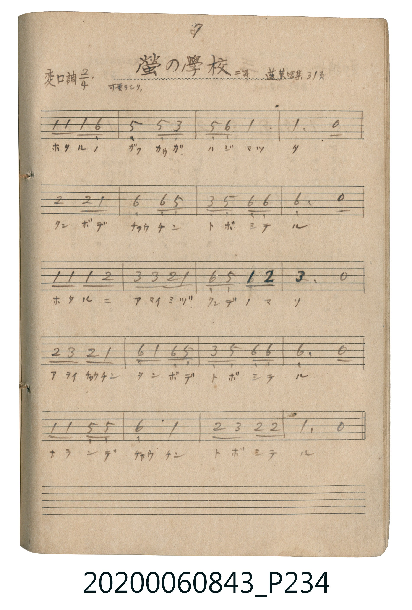

# 螢の學校（螢火蟲的學校）

> Re:Shōka 使用 AI 協助辨識與重建樂譜，可能會有錯誤。歡迎回報。

- **鋼琴伴奏版**：<br><audio controls src="hotaru_no_gakko.mp3"></audio>

- 唱歌帖 P234 (二年 / 蓬萊唱集 31頁)

## 說明

螢の學校（螢火蟲的學校）
Source: 唱歌帖 (2020.006.0843), P234.jpg
Marginal notes: 7 / 二年 / 蓬萊唱集 31頁 / 可愛ラシク
Key: 変ロ調 (Bb major), Time: 2/4, Tempo: 可愛ラシク


## 歌詞

```text
ホタルノ ガクカウガ ハジマツタ
タンボデ チャウチン トボシテル
ホタルニ アマイミヅ クンデノマソ
アヲイチャウチン タンボデ トボシテル
ナランデ チャウチン トボシテル
```

## ABC

<div class="abc-score" data-abc-src="hotaru_no_gakko.abc" aria-label="五線譜載入中"></div>

[下載 ABC 原始檔](hotaru_no_gakko.abc)

## TMD 檔案連結

- [主旋律 TMD 檔案](hotaru_no_gakko.tmd) [[在 TMD Studio 編輯](https://tmdlang.github.io/Tmd-TS/#tmd=s7IKdvYPcrWy4qpTUCpJTLdSSM7PyUlNLsnMz7MqzsjPTkzOyFeCS5bl55TmploBqXgDc4RwcX5pUXJqfEFieqpVgJGxCboM3KT4vPyS1KT8_GwMFRn5RYmZ8WB1xRmlCOmCovyy1LzEPKCS3MS80uLkosyCkvjk_IJKhJrUssyUVJCK1JTMkvyizMQcJBenFhWD_QJxYklRYh7EDKAgQlVJRirQW4l5mbnIeiGixUB3A_2bk5mWipAC2pKemWdVkpgJdDLI2eWJ8bmJmXk5iXkpSlxaWgov5i163Lju6dodzxYsfL-nA8h93rj6xfxNz2e1wAQ7FbS0uBRtFQwNTLjsbRWcdLhsjPRN7EB2PJ2y8dnanqc7pimAglNB48munqc7tyjoK7yYvObFhC6g9MvZbQrGhi8XNGoqcXHpaynYUgtwKSgQ5XiQumBI3CkgnKthZGBkoGdgYKZnYGFirKkDdr9eVkE6SLlvYhEw0BJzFECpoNhKwRzoITw-Awo-7V__rGX24-aVj5u2P25aDzLEO7USaOGSzsfNa1-s2q-g4ZSkkJuYlV8EtCskExhdCsAwBDJTcwvygeow9ftUFmUmF1uBmI-bZz9u2v-4efXj5j6Fx01rgCoeN61-3LQMyAZK9j9u2vG4ed7j5hagKrB6kOLNj5vnPG5uB8o3Pm5eDFIMYmwG8jtAMkB7mtuARqKZ3w3UvAhkWNOSx83zHze3AvnrwYa1Ay0HS-yFWAFUtQmsCs14VLux2NUF8ibYRGLcRnlCgQIFLX0uLo_8ksSiUr9898Ts7HyrgMzEvHyHGoOaapBNCjYWWnZgRo2CIRiaxQOZpvEKuiDCGMoBChoCRUBqdIHQQKEGrMenBhSMIO8D6dVA3AdUAokroCpIdIH4INHmfiBrB5AGxRnYLJA2ZNNqFIyAPCOgHTUgC3VBBNDuGpArIG4Auw0sheoGcPCDbGyeA8TtYOuggQwWbQTizWDRDoiapu1Aug0sshrNDZBQMAJZC4Rw1wAdABPFGwLdYI8tAvkTSC8B0uAEBRIEJSmw88ApGigPEtyLEQRIloJjg8ggAFkJSptQrwNFYAkMEtIQyxHhQ1xIAC0F2w-2EZIEIC4EBQWWxNAFxCuhdmGJB0g0EbK-lotL104BJdkqAAWUuQA)]
- [鋼琴伴奏 TMD 檔案](hotaru_no_gakko_piano.tmd) [[在 TMD Studio 編輯](https://tmdlang.github.io/Tmd-TS/#tmd=s7IKdvYPcrWy4tLSUngxb9HjxnVP1-54tmDh-z0dQO7zxtUv5m96PqsFJtipoKXFpWirYGhgwmVvq-Ckw2VjpG9ix1WnoPR0ysZna3ue7pimEGBkbKKg8WRXz9OdWxT0FV5MXvNiQhdQ-uXsNgVjw5cLGjWVuLj0tRRsqQW4FBSIc_yjhikKAZmJefkKjsnJ-bkFiXmZual5JSD9wfmlRcmpVgoIb2gYGRgZ6BkYmOkZWJgYa-qA_aWXVZAOUu6bWJSemZeYo5CXX5JabKVgDvQoHh8DBZ_2r3_WMvtx88rHTdsfN60HGUK5z6FAQUufi8sjvySxqNQv3z0xOzvfCuxNhxqDmmqQTQo2Flp2YEaNgiEYmsUDmabxCrogwhjKAQoaAkVAanSB0EChBqzHp0bhcfNshcdN-4H0aiDuAyp53LQG6A2gqsdNqx83LQPxQaLN_UDWDiA973FzC9gskDZk02oUjIA8I6AdNSALdUEE0O4akCsgbgC7DSyF6oam_Y-bN4NsbJ4DxO1g6xofNy8GWQ8SbQTizWDRDoiapu1Aug0sshrNDZBQMAJZC4Rw1wAdABPFGwLdYI8tAvkTSC8B0vMfN7eCBdeDHAFyHiicQPIgwb0YQYBkKTg2iAwCkJWbIDaCvA4UWQZmgf0Ndh7IckT4EBcSQEvB9oNthCQBiAtBQYElMXQB8UqoXVjiARJNhKyvxZpmgzyQUq2hGTzZVucW1AIdqQ1yDSoFdjQ0MRvGawPDEJyoQdbAEjZUEao-kAyYAYMGIEGodUApUDKFUiAM0WISrw02CkZDzQXLIWw2hsrCaJAchIXDLkxfQW0GBr82KC1CSISrIK5B2I5dFx6f4TEQHqhU9hfCRFjogSBSJGA6zhzuPigLbCPWeMOenHyQkxNSIQhK8MCcFw90CiiNIPggCswHSSDzofKIjAMSMIKLgzwFNxDMBxLGQLYZEINoUOAiRJDyH6bVIAa6sQSdghCnglMgqhBWQ_hI1mBzCzAGPPNKirBlZBPUfBxtGKsQbRoL5EabAFlAHrpulHhD6AZbCHYZ2GMgTa55KZl56QTsTAPaaZYLtApoHdBSoNXQJIOsG4edwJQKtA5ajoA16dopgJ2qAGSgpDmQAMREEEuZCwA)]

## 分析

```text
================================================================================
📊 TMD Song Profile: [ 螢の學校（螢火蟲的學校） ]
================================================================================
⏱  Duration:       0:23 (23.1s), 20 measures total
🎼 Key & Tempo:    首調基準 B,, != 104.0 BPM, <2/4>
   - 分析範圍：      由實際發聲的音符與和弦推測調性；播放脈絡另行呈現
🎤 人聲音域:    D4 (MIDI 62) – D5 (MIDI 74) [跨度: 12 個半音 / 1.0 個八度, 難度: easy]
   - 最低音:  D4 in [HotaruNoGakko #1 @ m.2, 0:02]
   - 最高音: D5 in [HotaruNoGakko #1 @ m.10, 0:10]
   - 適合: soprano, mezzo-soprano, contralto, tenor, baritone, bass
🏛  結構:      HotaruNoGakko (23.1s)
⚡ 編曲密度:        Peak 1 軌道同時演奏
🗝  調性診斷：       G 小調（純淨自然小調，未偵測到可信轉調）
   - 風格氣質:    純淨自然小調（陰鬱抒情、旋律集中，無明顯調外色彩）
   - 轉調歷程:    全曲維持單一推測調性（未偵測到可信轉調）
   - 核心骨幹音:  A#, G, C, F, D
   - 調性數值:    G 小調 [相關度: 0.84, 穩定度: Moderate, 自然音純度: 100.0%]
   - 候選調性 (K-S): G 小調 (0.84), A# 大調 (0.78), F 大調 (0.53)
   - 五度圈歷程:   +1
   - 各段落調性細節:
     • [HotaruNoGakko #1]: G 小調 (r: 0.84, 自然音純度: 100.0%)

  [ 五度圈游移軌跡 ]
               C  
         F           [G ]*
      Bb               D  
      Eb               A  
         Ab           E  
            Db       B  
               F# 
     (* = active key center)

  [ 十二半音累積音高分佈 ]
     C  : ███████████               14.7%
     C# :                            0.0%
     D  : ██████████                13.3%
     D# :                            0.0%
     E  :                            0.0%
     F  : ███████████               14.7%
     F# :                            0.0%
     G  : █████████████████████     26.7%
     G# :                            0.0%
     A  :                            0.0%
     A# : ████████████████████████  30.7%
     B  :                            0.0%
--------------------------------------------------------------------------------
Assignment 軌道音域：
  - Piano         : D4 – D5 (12 個半音 / 1.0 個八度, 59 個音符)
================================================================================
```


## 原書掃描頁




