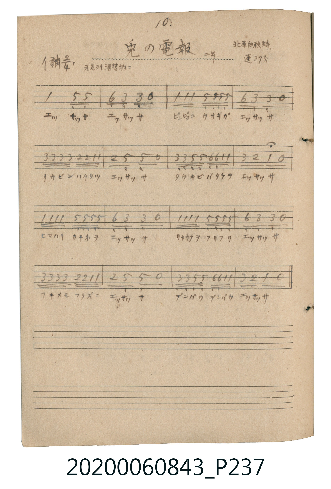

# 兎の電報（兔子的電報）

<audio controls src="usagi_no_denpo.mp3"></audio>

- 詞：北原白秋
- 曲：山田耕筰
- 唱歌帖 P237 (二年 / 蓬萊唱集 37頁)

## 說明

兎の電報（兔子的電報）
Source: 唱歌帖 (2020.006.0843), P237.jpg
Marginal notes: 10. / 北原白秋詩 / 二年 / 蓬 37頁 / 元気ヨク滑稽的ニ
Key: イ調 (A major), Time: 2/4, Tempo: 元気ヨク滑稽的ニ

## 歌詞

```text
エッサッサ エッサッサ
ピョンピョコ ウサギガ エッサッサ
イウビン ハイタツ エッサッサ
タウキビ バタケヲ エッサッサ
ヒマハリ カキネヲ エッサッサ
リャウテヲ フリフリ エッサッサ
ワキメモ フラズニ エッサッサ
デンパウ デンパウ エッサッサ
```

## ABC

```abc
X:1
T:兎の電報（兔子的電報）
C:曲：山田耕筰
M:2/4
L:1/16
Q:1/4=120
K:A
V:V1 name="Vocal" snm="Voc"
[V:V1]
A4 E2 E2 | F2 C2 C2 z2 | A A A2 E E E E | F2 C2 C2 z2 |
c c c c B B A A | B2 E2 E2 z2 | C C E E F F A A | c2 B2 A2 z2 |
A A A A E E E E | F2 C2 C2 z2 | A A A A E E E E | F2 C2 C2 z2 |
c c c c B B A A | B2 E2 E2 z2 | C C E E F F A A | c2 B2 A2 z2 |
```

## TMD 檔案連結

- [主旋律 TMD 檔案](usagi_no_denpo.tmd) [[在 TMD Studio 編輯](https://tmdlang.github.io/Tmd-TS/#tmd=s7IKdvYPcrWy4tLSUnja2ve4cd3L2bufLtj4fk_H09YpT9dOeD6rBSbSqaClxaVoq2BoZMBlb6vgyGVjpG9ix1WnoPR0ysZna3ue7pimEGBkbK6g8WRXz9OdWxT0FV5MXvNiQhdQ-uXsNgVj85cLGjWVQBperJz3fs-spz3Tn_bNfz5z7_Pl3WDhZ7M3gYQ3bnw-ZcOLhqnP125Q4uLS11KwpRbgUlAg7E2QouD80qLkVCsFhM80jAyMDPQMDMz0DCxMjDV1wF7VyypIByn3TSxKz8xLzFHIyy9JLbZSMDTQA_oe2X8vVq4EiiAHDCQ8QMpam59tmP64ecXjpvXPdk98vmIv0DWPm7tBBnunVlopPG5a8mLVfgUNR4XcxKz8IqDdIZm5QMcBgx_ITM0tyAc6FI8hPpVFmcnFViDm46YVj5ubHzdthZDofLCS5imPm5c_bt4MZTRtBqpaBlLStO5x0xqsWpqWgJQ0TwbqAurvB_P3P25uwa54P9i8tUD1QMUTwPyNj5s3YXfMpMfN80BGNq8Cyq8Ga-vFqXjV4-bFYJe0gZU0TwULgUjs6teDzVv4uHkRRPHKx027gIGGXXE7OEwmAs1H42AqpjylQoGClj4XV2hxYnqmX75Lah4wpsPykxNzHGoMahSqQTYp2BiaadmBWTUKhgq6YGgaDyNqFMxAlDGcMAALGoIhWA0cYVcKNhmYBR1ywInIVkEJ4l2gr0H-BVHQAEARgaUhKAsoCE5FUOXrgBiWkJC0KYF8C_GJMRQaASHIqTVAGtlfEG8AnQlEEOcDHQ9EELXGQFmQepAXcfpiCcRB4EQITrWgZAxKnUA2LOGi-hIoA_bCWqiuCVCxjUA2LEFi9w4kvA2JCG8SlGLxVPMkoFPmQTwDyTBQ5_ZidyIiywBZbUC8B6KueSpEP4we0JhqXg_1xEIgBmdUIF4JFNsFpGF5FdVT7dA4nQiNYzQ-Vu_UcnHp2ikg5zUFIF-ZCwA)]
- [鋼琴伴奏 TMD 檔案](usagi_no_denpo_piano.tmd) [[在 TMD Studio 編輯](https://tmdlang.github.io/Tmd-TS/#tmd=s7IKdvYPcrWy4tLSUnja2ve4cd3L2bufLtj4fk_H09YpT9dOeD6rBSbSqaClxaVoq2BoZMBlb6vgyGVjpG9ix1WnoPR0ysZna3ue7pimEGBkbK6g8WRXz9OdWxT0FV5MXvNiQhdQ-uXsNgVj85cLGjWVQBperJz3fs-spz3Tn_bNfz5z7_Pl3WDhZ7M3gYQ3bnw-ZcOLhqnP125Q4uLS11KwpRbgUlAgwpuPGqYoBGQm5uUrOCYn5-cWJOZl5qbmlYA0B-eXFiWnWikgfKxhZGBkoGdgYKZnYGFirKkDDgK9rIJ0kHLfxKL0zLzEHIW8_JLUYisFQwM9YKgg-_vFypVAEeQAg4QTSFlr87MN0x83r3jctP7Z7onPV-wFuvJxczfIYMqDAgoUtPS5uEKLE9Mz_fJdUvMK8q3C8pMTcxxqDGoUqkE2KdgYmmnZgVk1CoYKumBoGg8jahTMQJQxnDAACxqCIVgNHGFXCjYZGMcOOZVFmcnFtgpKj5tWPG5uVnjctBVKATGGSPOUx83LHzdvhrKAgkBm0zKo8nVAvAZTmxLItxCfGEOhERCCnFoDpJH9BfEG0JlABHE-0PFABFFrDJQFqQd5EacvlkAc1DwZiEHu7AfyQWL7gewWbH4CyYC9sBaqawJUbCOQvQmvdyDhbUhEeJOgFIunmicBnTIP4pnmVUBHrIY6txe7E0GqHjcvhgREGxDvgahrngrRD6MHNKaa10M9sRCIF0EdtRIotgtId2P1VDs0TidC4xiNj9U7tWgZDVzEBHngyGrVuWm1QC9p0yrLYQtY03ht83htUoIXqAMUwgiNQBcDOaihTcvkSSdvYI07H5S4s0CUkiDzgUZDqBoFEwgHiAwIyaKaAFUHcl-8ghFUAGqGMZAJ0moGNgRJNYYpA-gOYLDp2ikgh5wCkK_MBQA)]

## 分析

```text
================================================================================
📊 TMD Song Profile: [ 兎の電報（兔子的電報） ]
================================================================================
⏱  Duration:       0:16 (16.0s), 16 measures total
🎼 Key & Tempo:    首調基準 A, != 120.0 BPM, <2/4>
   - 分析範圍：      由實際發聲的音符與和弦推測調性；播放脈絡另行呈現
🎤 人聲音域:    C#4 (MIDI 61) – C#5 (MIDI 73) [跨度: 12 個半音 / 1.0 個八度, 難度: easy]
   - 最低音:  C#4 in [UsagiNoDenpo #1 @ m.2, 0:01]
   - 最高音: C#5 in [UsagiNoDenpo #1 @ m.5, 0:04]
   - 適合: soprano, mezzo-soprano, contralto, tenor, baritone, bass
🏛  結構:      UsagiNoDenpo (16.0s)
⚡ 編曲密度:        Peak 1 軌道同時演奏
🗝  調性診斷：       A 大調（純淨自然大調，未偵測到可信轉調）
   - 風格氣質:    純淨自然大調（陽光明朗、易唱易記，無明顯調外色彩）
   - 轉調歷程:    全曲維持單一推測調性（未偵測到可信轉調）
   - 核心骨幹音:  C#, E, A, F#, B
   - 調性數值:    A 大調 [相關度: 0.85, 穩定度: Moderate, 自然音純度: 100.0%]
   - 候選調性 (K-S): A 大調 (0.85), C# 小調 (0.77), E 大調 (0.66)
   - 五度圈歷程:   +3
   - 各段落調性細節:
     • [UsagiNoDenpo #1]: A 大調 (r: 0.85, 自然音純度: 100.0%)

  [ 五度圈游移軌跡 ]
               C  
         F            G  
      Bb               D  
      Eb              [A ]*
         Ab           E  
            Db       B  
               F# 
     (* = active key center)

  [ 十二半音累積音高分佈 ]
     C  :                            0.0%
     C# : ████████████████████████  28.6%
     D  :                            0.0%
     D# :                            0.0%
     E  : █████████████████████     25.0%
     F  :                            0.0%
     F# : █████████                 10.7%
     G  :                            0.0%
     G# :                            0.0%
     A  : █████████████████████     25.0%
     A# :                            0.0%
     B  : █████████                 10.7%
--------------------------------------------------------------------------------
Assignment 軌道音域：
  - Vocal         : C#4 – C#5 (12 個半音 / 1.0 個八度, 82 個音符)
================================================================================
```


## 原書掃描頁




