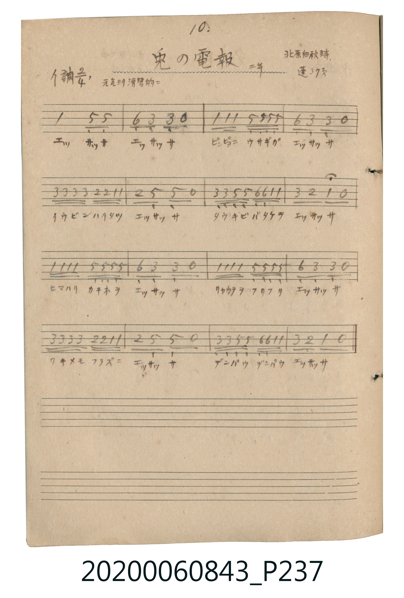

# 兎の電報（兔子的電報）

> Re:Shōka 使用 AI 協助辨識與重建樂譜，可能會有錯誤。歡迎回報。

- **鋼琴伴奏版**：<br><audio controls src="usagi_no_denpo.mp3"></audio>
- **NEUTRINO 歌聲合成版**：<br><audio controls src="usagi_no_denpo_neutrino.mp3"></audio>

- 詞：北原白秋
- 曲：山田耕筰
- 唱歌帖 P237 (二年 / 蓬萊唱集 37頁)

## 說明

兎の電報（兔子的電報）
Source: 唱歌帖 (2020.006.0843), P237.jpg
Marginal notes: 10. / 北原白秋詩 / 二年 / 蓬 37頁 / 元気ヨク滑稽的ニ
Key: イ調 (A major), Time: 2/4, Tempo: 元気ヨク滑稽的ニ


## 歌詞

```text
エッサッサ エッサッサ
ピョンピョコ ウサギガ エッサッサ
イウビン ハイタツ エッサッサ
タウキビ バタケヲ エッサッサ
ヒマハリ カキネヲ エッサッサ
リャウテヲ フリフリ エッサッサ
ワキメモ フラズニ エッサッサ
デンパウ デンパウ エッサッサ
```

## ABC

<div class="abc-score" data-abc-src="usagi_no_denpo.abc" aria-label="五線譜載入中"></div>

[下載 ABC 原始檔](usagi_no_denpo.abc)

## TMD 檔案連結

- [主旋律 TMD 檔案](usagi_no_denpo.tmd) [[在 TMD Studio 編輯](https://tmdlang.github.io/Tmd-TS/#tmd=s7IKdvYPcrWy4qpTUCpJTLdSSM7PyUlNLsnMz7MqzsjPTkzOyFeCS5bl55TmploBqXgDc4RwcX5pUXJqfEFieqpVgJExhgzcpPi8_JLUpPz8bAwVGflFiZnxYHXFGaUI6YKi_LLUvMQ8oJLcxLzS4uSizIKS-OT8gkqEmtSyzJRUkIrUlMyS_KLMxBwkF6cWFYP9AnFiSVFiHsQMoCBCVUlGKtBbiXmZuch6gUalZ-ZZlSRmAt0Fclt5YnxuYmZeTmJeCrKqkoz89KLEgoxKq4zMYpADkhNz4rMT8xKVuLS0FJ629j1uXPdy9u6nCza-39PxtHXK07UTns9qgYl0KmhpcSnaKhgaGXDZ2yo4ctkY6ZvYgYx_OmXjs7U9T3dMUwAFqoLGk109T3duUdBXeDF5zYsJXUDpl7PbFIzNXy5o1AS758XKee_3zHraM_1p3_znM_c-X94NFn42exNIeOPG51M2vGiY-nztBiUuLn0tBVtqAS4FBcLeBCkKhkS2AsJnGkYGRgZ6BgZmegYWJsaaOmCv6mUVpIOU-yYWASMgMUcBlGyKrRQMDfSAvkf234uVK4EiyAEDCQ-QstbmZxumP25e8bhp_bPdE5-v2At0zePmbpDB3qmVVgqPm5a8WLVfQcNRITcxK78IaHdIJjAVKACDH8hMzS3IBzoUjyE-lcCYLrYCMR83rXjc3Py4aSuEROeDlTRPedy8_HHzZiijaTNQ1TKQkqZ1j5vWYNXStASkpHkyUBdQfz-Yv_9xcwt2xfvB5q0FqgcqngDmb3zcvAm7YyY9bp4HMrJ5FVB-NVhbL07Fqx43Lwa7pA2spHkqWAhEYle_HmzewsfNiyCKVz5u2gUMNOyK28FhMhFoPhoHUzHlKRUKFLT0ubhCixPTM_3yXVLzgDEdlg_MtA41BjXVIIsUbAzNtOzArBoFQwVdMDSNhxE1CmYgyhhOGIAFDcEQrAaOsCsFm-xTA_Uj1HyIVyEMsHlwWUwZWGKCsoASm8HSoGADJb91QLwGjxFgX0D9ZwyFRkAI8kANkEb2LcRzQMcDEcRTQC8BEUStMVAWpB7kcTS_LYE4CJwewQkYKrYfyG4h5DiIOrCH1kLNmAAV2whkbyLSc5A4MSQiTkhQCvdi8yQgngfxGiQnQZ3bS4wTETkLyGoD4j1gXcAsAzENSg9sLDavh3ppIRCD8zMQrwSK7QLS3UR4sR0a-xOhqQGVT8hztVxcunYKyFlVAchX5gIA)]
- [鋼琴伴奏 TMD 檔案](usagi_no_denpo_piano.tmd) [[在 TMD Studio 編輯](https://tmdlang.github.io/Tmd-TS/#tmd=s7IKdvYPcrWy4qpTUCpJTLdSyC8qychPL0osyKi0ysgsLskvykxOzInPTsxLVIIrKs4vLUpOjS9ITE-1CjAyNkfIlGSk5qZapaaUJieWZObnKXFpaSk8be173Lju5ezdTxdsfL-n42nrlKdrJzyf1QIT6VTQ0uJStFUwNDLgsrdVcOSyMdI3sQMZ-XTKxmdre57umKYAskVB48munqc7tyjoK7yYvObFhC6g9MvZbQrG5i8XNGqC3fBi5bz3e2Y97Zn-tG_-85l7ny_vBgs_m70JJLxx4_MpG140TH2-doMSF5e-loIttQCXggIR3nzUMEUhIDMxL1_BMTk5P7cgMS8zNzWvBKQ5GByiVgoIH2sYGRgZ6BkYmOkZWJgYa-qAg0AvqyAdpNw3sSg9My8xRyEvvyS12ErB0EAPGCrI_n6xciVQBDnAIOEEUtba_GzD9MfNKx43rX-2e-LzFXuBrnzc3A0ymPKggAIFLX0urtDixPRMv3yX1LyCfCuwzx1qDGqqQRYp2BiaadmBWTUKhgq6YGgaDyNqFMxAlDGcMAALGoIhWA0cYVcKNtmnRuFx04rHzc1Q8x83bYVwgAyweXBZTJnmKY-blz9u3gxlASU2g6WXgZU8bloHxGvwGAH2BdR_xlBoBIQgD9QAaWTfQjwHdDwQQTwF9BIQQdQaA2VB6kEeR_PbEoiDmicDMcil_VCx_UB2CyHHQdSBPbQWasYEqNhGIHsTkZ6DxIkhEXFCglK4F5snAfE8iNeaVwGtXw11bi8xTgTpedy8GBJIbUC8B6zrcfNUiGlQemBjsXk91EsLgXgR1FErgWK7gHQ3EV5sh8b-RGhqQOUT8lwttnwa5IE9p1bnptUC_adNqxyLLZRN47XN47VJCWugDlBwIzQCXQzkoAY9LVMunbyBNep8kKPOAlHGgowHmgyhahRMIBwgMiAki2oCVB3IefEKRlABqBnGQCZIqxnYECTVGKYMoDuAoeaZV1KELaWboCb0aMNYhWjj3FggP9oMSEWbAJlo-lGCG6Ef7AhIEjEB0iBNrnkpmXnp-G0FWWoKtQhsPTSakfXisBGYeEA2gWyGatK1UwA7VAHIQE4nID7EQBBLmQsA)]

## 分析

```text
================================================================================
📊 TMD Song Profile: [ 兎の電報（兔子的電報） ]
================================================================================
⏱  Duration:       0:16 (16.0s), 16 measures total
🎼 Key & Tempo:    首調基準 A, != 120.0 BPM, <2/4>
   - 分析範圍：      由實際發聲的音符與和弦推測調性；播放脈絡另行呈現
🎤 人聲音域:    C#4 (MIDI 61) – C#5 (MIDI 73) [跨度: 12 個半音 / 1.0 個八度, 難度: easy]
   - 最低音:  C#4 in [UsagiNoDenpo #1 @ m.2, 0:01]
   - 最高音: C#5 in [UsagiNoDenpo #1 @ m.5, 0:04]
   - 適合: soprano, mezzo-soprano, contralto, tenor, baritone, bass
🏛  結構:      UsagiNoDenpo (16.0s)
⚡ 編曲密度:        Peak 1 軌道同時演奏
🗝  調性診斷：       A 大調（純淨自然大調，未偵測到可信轉調）
   - 風格氣質:    純淨自然大調（陽光明朗、易唱易記，無明顯調外色彩）
   - 轉調歷程:    全曲維持單一推測調性（未偵測到可信轉調）
   - 核心骨幹音:  C#, E, A, F#, B
   - 調性數值:    A 大調 [相關度: 0.85, 穩定度: Moderate, 自然音純度: 100.0%]
   - 候選調性 (K-S): A 大調 (0.85), C# 小調 (0.77), E 大調 (0.66)
   - 五度圈歷程:   +3
   - 各段落調性細節:
     • [UsagiNoDenpo #1]: A 大調 (r: 0.85, 自然音純度: 100.0%)

  [ 五度圈游移軌跡 ]
               C  
         F            G  
      Bb               D  
      Eb              [A ]*
         Ab           E  
            Db       B  
               F# 
     (* = active key center)

  [ 十二半音累積音高分佈 ]
     C  :                            0.0%
     C# : ████████████████████████  28.6%
     D  :                            0.0%
     D# :                            0.0%
     E  : █████████████████████     25.0%
     F  :                            0.0%
     F# : █████████                 10.7%
     G  :                            0.0%
     G# :                            0.0%
     A  : █████████████████████     25.0%
     A# :                            0.0%
     B  : █████████                 10.7%
--------------------------------------------------------------------------------
Assignment 軌道音域：
  - Vocal         : C#4 – C#5 (12 個半音 / 1.0 個八度, 82 個音符)
================================================================================
```


## 原書掃描頁




