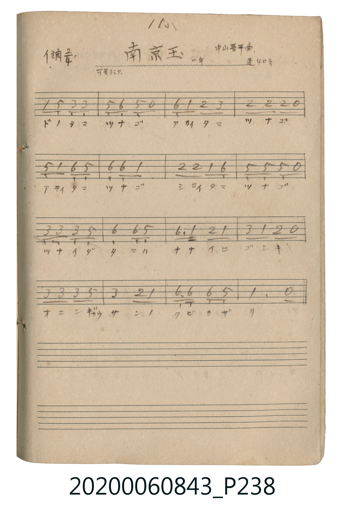

# 南京玉（琉璃珠／南京玉）

> Re:Shōka 使用 AI 協助辨識與重建樂譜，可能會有錯誤。歡迎回報。

- **鋼琴伴奏版**：<br><audio controls src="nankin_dama.mp3"></audio>

- 曲：中山晋平
- 唱歌帖 P238 (二年 / 蓬萊唱集 40頁)

## 說明

南京玉（琉璃珠／南京玉）
Source: 唱歌帖 (2020.006.0843), P238.jpg
Marginal notes: 11. / 中山晋平曲 / 二年 / 蓬 40頁 / 可愛ラシク
Key: イ調 (A major), Time: 2/4, Tempo: 可愛ラシク


## 歌詞

```text
ドノタマ ツナゴ アカイタマ ツナゴ
アヲイタマ ツナゴ シロイタマ ツナゴ
ツナイダ タマハ ナナイロ ゴシキ
オニンギャウ サンノ クビカザリ
```

## ABC

<div class="abc-score" data-abc-src="nankin_dama.abc" aria-label="五線譜載入中"></div>

[下載 ABC 原始檔](nankin_dama.abc)

## TMD 檔案連結

- [主旋律 TMD 檔案](nankin_dama.tmd) [[在 TMD Studio 編輯](https://tmdlang.github.io/Tmd-TS/#tmd=s7IKdvYPcrWy4qpTUCpJTLdSSM7PyUlNLsnMz7MqzsjPTkzOyFeCS5bl55TmploBqXgDc4RwcX5pUXJqfEFieqpVgJGxBboM3KT4vPyS1KT8_GwMFRn5RYmZ8WB1xRmlCOmCovyy1LzEPKCS3MS80uLkosyCkvjk_IJKhJrUssyUVJCK1JTMkvyizMQcJBenFhWD_QJxYklRYh7EDKAgQhVQU3pmnlVJYibQBSBXlCfG5yZm5uUk5qUocWlpKTztnf5k15rnfZ3v93Q8n9D5fFLz8_4F7_f0I4l3KmhpcSnaKhgamHDZ2yo4ctkY6ZvYgax4OmXjs7U9T3dMUwAFjoLGk109T3duUdBXeDF5zYsJXUDpl7PbFEwMXi5o1AS76dnsTe_3zHqyY-3TjRufzex-unOzEheXvpaCLbUAl4ICUV4CqQuGRJACwhcaRgZGBnoGBmZ6BhYmxpo6YG_pZRWkg5T7JhYBgzIxRwEU1cVWCoaGekCfIvsF6DuQCFIgQPwOZD_tX_-sZfbj5pWPm7Y_bloPMs87tdJK4XHTkher9itoOCrkJmblFwGtDMkEpkMFYAgDmam5BflA92Hq9aksykwutgIxHzd3Pm7ue9y0_3HzPCCn5XFz1-OmLUCDFz1uWg00Hl0GrAco2bwJiyRQZvvj5rW4tEE5Sx43NwBVghQ8bu4HCnfBhNcChbeAnbkWYs-qx83dj5s3P25a97h58eOmZUChrSB-cx-Qtf5x82SwI7c9bl4FUk95_EOBgpY-F5dfYl52Zp5LYm6iVUBmYl6-Q41BTTXIGgUbQzMtOzCrRsFQQVfBNB5IGMOJGoiAGYgAswzAgmA-SLkRSCFYCMSCYbAisKE-NaBYAXJB3gSSTfvB7HlgLcBABPO6wDJbgCTESmCcgEVAcUasJi6oH8COBLkM4WSoc-FuBkGEe-FqoXoRBKovIG4CJxUi3ASxAxj9YHFQKiLVI4g4ABPIPgFBDO-BfALzD1A3lIUlNpBtBbsKmIIhjgW5DgQhLgSlZ4g7QWohemA61kJ1gFwN9WQTSIwIH4BcBoIIt0KdD6SQPQWLKRBEi4lVYDd0g8nNYLthWQriqq1wf4BlwSkPJL4ezJsM1rEaTG6D-hBkIgxC_FDLxaVrp4DINwpAnjIXAA)]
- [鋼琴伴奏 TMD 檔案](nankin_dama_piano.tmd) [[在 TMD Studio 編輯](https://tmdlang.github.io/Tmd-TS/#tmd=s7IKdvYPcrWy4tLSUnjaO_3JrjXP-zrf7-l4PqHz-aTm5_0L3u_pRxLvVNDS4lK0VTA0MOGyt1Vw5LIx0jex46pTUHo6ZeOztT1Pd0xTCDAytlDQeLKr5-nOLQr6Ci8mr3kxoQso_XJ2m4KJwcsFjZpKIA3PZm96v2fWkx1rn27c-Gxm99Odm5W4uPS1FGypBbgUFIjz0qOGKQoBmYl5-QqOycn5uQWJeZm5qXklIP3B-aVFyalWCgjfaRgZGBnoGRiY6RlYmBhr6oC9q5dVkA5S7ptYlJ6Zl5ijkJdfklpspWBoqAcMAWQ_An0NEkEKHEiYANlP-9c_a5n9uHnl46btj5vWg8yjPBCgQEFLn4vLLzEvOzPPJTE30QrsXYcag5pqkDUKNoZmWnZgVo2CoYKugmk8kDCGEzUQATMQAWYZgAXBfJByI5BCsBCIBcNgRWBDfWoUHjd3ArmPm_tAZNN-MHseWMvj5hYwrwssswVIQqx83LQILLL6cdMSYjVxQf0AdiTIZQgnQ50LdzMIItwLVwvViyBQfQFxU_Mm4twEsQMYnWDxtWR4BBEHYALZJyCI4T2QT2D-AeqGsrDEBrKtYFc1N0AdC3IdCEJc-Li5H-pOkFqIHpiOtVAdIFdDPdkEEiPCByCXgSDCrVDnAylkT8FiCgTRYmIV2A3dYHIz2O51j5sXP25aBnXVVrg_wLLglAcSXw_mTQbrWA0mt0F9CDIRBiF-qMXMNEEe2LNNdW5BLdCL2mRkH9N4bXA4aEPyEJBrDhHBxkKEAo5kbhKvDebCaKibIGkRahXMRphWUDRpQ12NSiNbhz0qYfYQkR4hPoR6GYt_sFsA0QWCUGdDfYQrzYCdDvczIuVgiUwf5Mi0QBSB8UCz4mEUmG8C4RuAPQyyD64EFKjxCkZQAaACDEOMwYaAtEFNgZgKIkEYZBZIAlkLfmMQ7kF1DYgG64AJ4DYGykfogjkPJoruGmDoeeaVFOVjyQUmqJkg2jBWIdooNxbIjzYFMoFcdO0o4Y7QDrTKCBIyYL-BNLnmpWTmpROwNA1oqRnQwmgTDEuR9eOwFZh2TNBs1bVTALtWAchApBkQD2IeiKXMBQA)]

## 分析

```text
================================================================================
📊 TMD Song Profile: [ 南京玉（琉璃珠／南京玉） ]
================================================================================
⏱  Duration:       0:18 (18.5s), 16 measures total
🎼 Key & Tempo:    首調基準 A, != 104.0 BPM, <2/4>
   - 分析範圍：      由實際發聲的音符與和弦推測調性；播放脈絡另行呈現
🎤 人聲音域:    C#4 (MIDI 61) – C#5 (MIDI 73) [跨度: 12 個半音 / 1.0 個八度, 難度: easy]
   - 最低音:  C#4 in [NankinDama #1 @ m.1, 0:00]
   - 最高音: C#5 in [NankinDama #1 @ m.3, 0:03]
   - 適合: soprano, mezzo-soprano, contralto, tenor, baritone, bass
🏛  結構:      NankinDama (18.5s)
⚡ 編曲密度:        Peak 1 軌道同時演奏
🗝  調性診斷：       A 調性不明確（純淨自然大調，未偵測到可信轉調）
   - 風格氣質:    純淨自然大調（陽光明朗、易唱易記，無明顯調外色彩）
   - 轉調歷程:    全曲維持單一推測調性（未偵測到可信轉調）
   - 核心骨幹音:  F#, A, C#, E, B
   - 調性數值:    A 調性不明確 [相關度: 0.78, 穩定度: Ambiguous, 自然音純度: 100.0%]
   - 候選調性 (K-S): A 大調 (0.78), F# 小調 (0.77), E 大調 (0.67)
   - 五度圈歷程:   +3
   - 各段落調性細節:
     • [NankinDama #1]: A 調性不明確 (r: 0.78, 自然音純度: 100.0%)

  [ 五度圈游移軌跡 ]
               C  
         F            G  
      Bb               D  
      Eb              [A ]*
         Ab           E  
            Db       B  
               F# 
     (* = active key center)

  [ 十二半音累積音高分佈 ]
     C  :                            0.0%
     C# : █████████████████████     20.3%
     D  :                            0.0%
     D# :                            0.0%
     E  : █████████████████████     20.3%
     F  :                            0.0%
     F# : ████████████████████████  22.9%
     G  :                            0.0%
     G# :                            0.0%
     A  : ██████████████████████    21.2%
     A# :                            0.0%
     B  : ████████████████          15.3%
--------------------------------------------------------------------------------
Assignment 軌道音域：
  - Piano         : C#4 – C#5 (12 個半音 / 1.0 個八度, 54 個音符)
================================================================================
```


## 原書掃描頁




