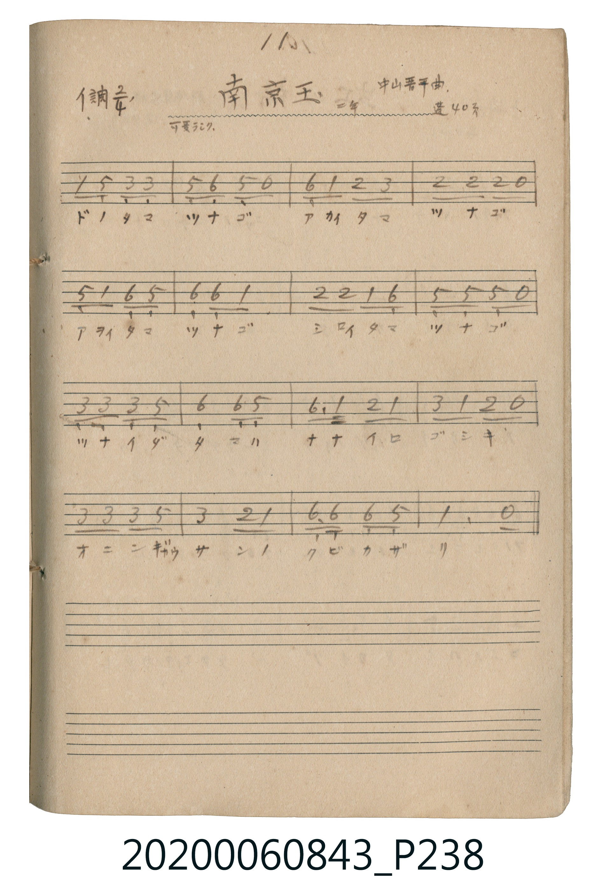

# 南京玉（琉璃珠／南京玉）

> Re:Shōka 使用 AI 協助辨識與重建樂譜，可能會有錯誤。歡迎[回報](https://github.com/TMDLang/reshoka/issues)。

- **鋼琴伴奏版**：<br><audio controls src="nankin_dama.mp3"></audio>
- **NEUTRINO 歌聲合成版**：<br><audio controls src="nankin_dama_neutrino.mp3"></audio>

- 詞：西村酔香
- 曲：中山晋平
- 唱歌帖 P238 (二年 / 蓬萊唱集 40頁)

## 說明

南京玉（琉璃珠／南京玉）
Source: 唱歌帖 (2020.006.0843), P238.jpg
Marginal notes: 11. / 中山晋平曲 / 二年 / 蓬 40頁 / 可愛ラシク
Key: イ調 (A major), Time: 2/4, Tempo: 可愛ラシク


## 歌詞

```text
ドノタマ ツナゴ アカイタマ ツナゴ
アヲイタマ ツナゴ シロイタマ ツナゴ
ツナイダ タマハ ナナイロ ゴシキ
オニンギャウ サンノ クビカザリ
考證資訊：作詞：西村酔香／作曲：中山晋平。發表於童謠童畫雜誌《コドモノクニ》，描寫串聯各色琉璃珠做為洋娃娃項鍊的兒童遊戲歌。
```

## ABC

<div class="abc-score" data-abc-src="nankin_dama.abc" aria-label="五線譜載入中"></div>

[下載 ABC 原始檔](nankin_dama.abc)

## TMD 檔案連結

- [主旋律 TMD 檔案](nankin_dama.tmd) [[在 TMD Studio 編輯](https://tmdlang.github.io/Tmd-TS/#tmd=s7IKdvYPcrWy4qpTUCpJTLdSSM7PyUlNLsnMz7MqzsjPTkzOyFeCS5bl55TmploBqXgDc4RwcX5pUXJqfEFieqpVgJGxBboM3KT4vPyS1KT8_GwMFRn5RYmZ8WB1xRmlCOmCovyy1LzEPKCS3MS80uLkosyCkvjk_IJKhJrUssyUVJCK1JTMkvyizMQcJBenFhWD_QJxYklRYh7EDKAgQhVQU3pmnlVJYibQBSBXlCfG5yZm5uUk5qUgqyrJyE8vSizIqLTKyCwGWZWcmBOfnZiXiFBUkpEKDKHUlNLkRIgdWloKT3unP9m15nlf5_s9Hc8ndD6f1Py8f8H7Pf1I4p0KWlpcirYKhgYmXPa2Co5cNkb6JnYgU59O2fhsbc_THdMUQEGroPFkV8_TnVsU9BVeTF7zYkIXUPrl7DYFE4OXCxo1wc54sXLe-z2zXizd_2zuxJetU14umwkWfjZ7E1D4yY61TzdufDaz--nOzUpcXPpaCrbUAlwKCkT5FKQuGBLrCgjPaRgZGBnoGRiY6RlYmBhr6oB9q5dVkA5S7ptYBIyfxBwFUPoptlIwNNQDBgCyX4C-A4kghQ0kSIDsp_3rn7XMfty88nHT9sdN60HmeadWWik8blryYtV-BQ1HhdzErPwioJUhmcCoUwAGPJCZmluQD3Qfpl6fSmC0F1uBmI-bOx839z1u2v-4eR6Q0_K4uetx0xagwYseN60GGo8uA9YDlGzehEUSKLP9cfNaXNqgnCWPmxuAKkEKHjf3A4W7YMJrgcJbwM5cC7Fn1ePm7sfNmx83rXvcvPhx0zKg0FYQv7kPyFr_uHky2JHbHjevAql_0dD8Ym3ni83tL1Z0gdLJ3jmY6QgYkUBxzIT0uKHp-cw9LxaueDZtz_PVS1-sWQAkn09d_XL2nBereh43AB0ItBYYVkCvA4MLaHf344bu93t6nvX3P12_-smOTS8a1z-d0PKicxM80TxtnPW8adezLd1PVzQD0csFrS97u57PannaOglo-MvGrmcdm4BJB2g1yPWUp14oUNDS5-LyS8zLzsxzScxNtArITMzLd6gxqKkGWaNgY2imZQdm1SgYKugqmMYDCWM4UQMRMAMRYJYBWBDMByk3AikEC4FYMAxWBDbUpwaUpoBcUCQByab9YPY8sBZgEgDzusAyW4AkxEpgigKLgFIcsZq4oH4AOxLkMoSToc6FuxkEEe6Fq4XqRRCovoC4CZzQiXATxA5g4gWLg_IAqR5BxAGYQPYJCGJ4D-QTmH-AuqEsLLGBbCvYVcD8B3EsyHUgCHEhKDdC3AlSC9ED07EWqgPkaqgnm0BiRPgA5DIQRLgV6nwghewpWEyBIFpMrAK7oRtMbgbbDSsQIK7aCvcHWBac8kDi68G8yWAdq8HkNqgPQSbCIMQPtVxcunYKiHyjAOQpcwEA)]
- [鋼琴伴奏 TMD 檔案](nankin_dama_piano.tmd) [[在 TMD Studio 編輯](https://tmdlang.github.io/Tmd-TS/#tmd=s7IKdvYPcrWy4qpTUCpJTLdSyC8qychPL0osyKi0ysgsLskvykxOzInPTsxLVIIrKs4vLUpOjS9ITE-1CjAytkDIlGSk5qZapaaUJieWZObnKXFpaSk87Z3-ZNea532d7_d0PJ_Q-XxS8_P-Be_39COJdypoaXEp2ioYGphw2dsqOHLZGOmb2IFMfTpl47O1PU93TFMAWaSg8WRXz9OdWxT0FV5MXvNiQhdQ-uXsNgUTg5cLGjXBznixct77PbNeLN3_bO7El61TXi6bCRZ-NnsTUPjJjrVPN258NrP76c7NSlxc-loKttQCXAoKxPn0UcMUhYDMxLx8Bcfk5PzcgsS8zNzUvBKQ_mBwuFopIDytYWRgZKBnYGCmZ2BhYqypAw4FvayCdJBy38Si9My8xByFvPyS1GIrBUNDPWDAIPsR6GuQCFKYQYIKyH7av_5Zy-zHzSsfN21_3LQeZN6LhuYXaztfbG5_saILFFh752AGJtA3QHHM0Hzc0PR85p4XC1c8m7bn-eqlL9YsAJLPp65-OXvOi1U9jxu6Hjdtftzc-bh50ePmPqB9j5u7Hzd0v9_T86y__-n61U92bHrRuP7phJYXnZvgIfe0cdbzpl3PtnQ_XdEMRC8XtL7s7Xo-q-Vp6ySg4S8bu551bAKGE9BqkOspj0IoUNDS5-LyS8zLzsxzScxNtAJHlkONQU01yBoFG0MzLTswq0bBUEFXwTQeSBjDiRqIgBmIALMMwIJgPki5EUghWAjEgmGwIrChPjUKwHACcoHhBCKb9oPZ88BaHje3gHldYJktQBJi5eOmRWCR1Y-blhCriQvqB7AjQS5DOBnqXLibQRDhXrhaqF4EgeoLiJuaNxHnJogdwMQIFl9LhkcQcQAmkH0CghjeA_kE5h-gbigLS2wg2wp2VXMD1LEg14EgxIWPm_uh7gSpheiB6VgL1QFyNdSTTSAxInwAchkIItwKdT6QQvYULKZAEC0mVoHd0A0mN4PtXve4efHjpmVQV22F-wMsC055IPH1YN5ksI7VYHIb1IcgE2EQ4odazEwT5IE921TnFtQCvahNRvYxjdcGh4M2JA8BueYQEWwsRCjgSOYm8dpgLoyGugmSFqFWwWyEaQVFkzbU1ag0snXYoxJmDxHpEeJDqJex-Ae7BRBdIAh1NtRHuNIM2OlwPyNSDpbI9EGOTAtEERgPNCseRoH5JhC-AdjDIPvgSkCBGq9gBBUAKsAwxBhsCEgb1BSIqSAShEFmgSSQteA3BuEeVNeAaLAOmABuY6B8hC6Y82Ci6K4Bhp5nXklRPpZcYIKaCaINYxWijXJjgfxoUyATyEXXjhLuCO1Aq4wgIQP2G0iTa15KZl46AUvTgJaaAS2MNsGwFFk_DluBaccEzVZdOwWwaxWADESaAfEg5oFYylwA)]

## 分析

```text
================================================================================
📊 TMD Song Profile: [ 南京玉（琉璃珠／南京玉） ]
================================================================================
⏱  Duration:       0:18 (18.5s), 16 measures total
🎼 Key & Tempo:    首調基準 A, != 104.0 BPM, <2/4>
   - 分析範圍：      由實際發聲的音符與和弦推測調性；播放脈絡另行呈現
🎤 人聲音域:    C#4 (MIDI 61) – C#5 (MIDI 73) [跨度: 12 個半音 / 1.0 個八度, 難度: easy]
   - 最低音:  C#4 in [NankinDama #1 @ m.1, 0:00]
   - 最高音: C#5 in [NankinDama #1 @ m.3, 0:03]
   - 適合: soprano, mezzo-soprano, contralto, tenor, baritone, bass
🏛  結構:      NankinDama (18.5s)
⚡ 編曲密度:        Peak 1 軌道同時演奏
🗝  調性診斷：       A 調性不明確（純淨自然大調，未偵測到可信轉調）
   - 風格氣質:    純淨自然大調（陽光明朗、易唱易記，無明顯調外色彩）
   - 轉調歷程:    全曲維持單一推測調性（未偵測到可信轉調）
   - 核心骨幹音:  F#, A, C#, E, B
   - 調性數值:    A 調性不明確 [相關度: 0.78, 穩定度: Ambiguous, 自然音純度: 100.0%]
   - 候選調性 (K-S): A 大調 (0.78), F# 小調 (0.77), E 大調 (0.67)
   - 五度圈歷程:   +3
   - 各段落調性細節:
     • [NankinDama #1]: A 調性不明確 (r: 0.78, 自然音純度: 100.0%)

  [ 五度圈游移軌跡 ]
               C  
         F            G  
      Bb               D  
      Eb              [A ]*
         Ab           E  
            Db       B  
               F# 
     (* = active key center)

  [ 十二半音累積音高分佈 ]
     C  :                            0.0%
     C# : █████████████████████     20.3%
     D  :                            0.0%
     D# :                            0.0%
     E  : █████████████████████     20.3%
     F  :                            0.0%
     F# : ████████████████████████  22.9%
     G  :                            0.0%
     G# :                            0.0%
     A  : ██████████████████████    21.2%
     A# :                            0.0%
     B  : ████████████████          15.3%
--------------------------------------------------------------------------------
Assignment 軌道音域：
  - Piano         : C#4 – C#5 (12 個半音 / 1.0 個八度, 54 個音符)
================================================================================
```


## 原書掃描頁




