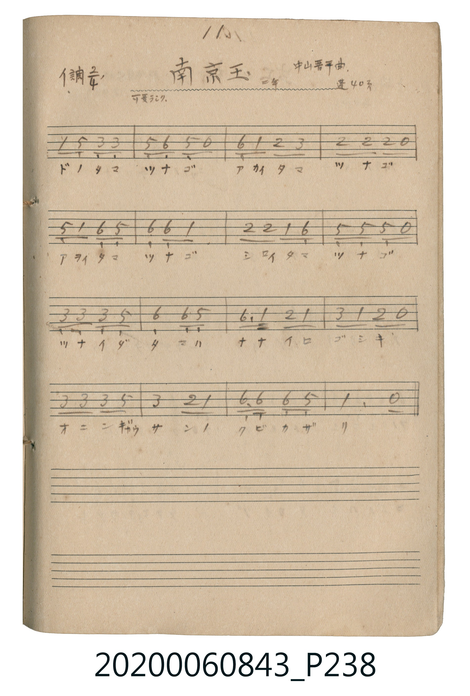

# 南京玉（琉璃珠／南京玉）

<audio controls src="nankin_dama.mp3"></audio>

- 曲：中山晋平
- 唱歌帖 P238 (二年 / 蓬萊唱集 40頁)

## 說明

南京玉（琉璃珠／南京玉）
Source: 唱歌帖 (2020.006.0843), P238.jpg
Marginal notes: 11. / 中山晋平曲 / 二年 / 蓬 40頁 / 可愛ラシク
Key: イ調 (A major), Time: 2/4, Tempo: 可愛ラシク

## 歌詞

```text
ドノタマ ツナゴ アカイタマ ツナゴ
アヲイタマ ツナゴ シロイタマ ツナゴ
ツナイダ タマハ ナナイロ ゴシキ
オニンギャウ サンノ クビカザリ
```

## ABC

```abc
X:1
T:南京玉（琉璃珠／南京玉）
C:曲：中山晋平
M:2/4
L:1/16
Q:1/4=104
K:A
V:V1 name="Vocal" snm="Voc"
[V:V1]
A2 E2 C2 C2 | E2 F2 E2 z2 | F2 A2 B2 c2 | B2 B2 B2 z2 |
E2 A2 F2 E2 | F2 F2 A4 | B2 B2 A2 F2 | E2 E2 E2 z2 |
C2 C2 C2 E2 | F4 F2 E2 | F3 A B2 A2 | c2 A2 B2 z2 |
C2 C2 C2 E2 | c4 B2 A2 | F3 F F2 E2 | A6 z2 |
```

## TMD 檔案連結

- [主旋律 TMD 檔案](nankin_dama.tmd) [[在 TMD Studio 編輯](https://tmdlang.github.io/Tmd-TS/#tmd=s7IKdvYPcrWy4tLSUnjaO_3JrjXP-zrf7-l4PqHz-aTm5_0L3u_pRxLvVNDS4lK0VTA0MOGyt1Vw5LIx0jex46pTUHo6ZeOztT1Pd0xTCDAytlDQeLKr5-nOLQr6Ci8mr3kxoQso_XJ2m4KJwcsFjZpKIA3PZm96v2fWkx1rn27c-Gxm99Odm5W4uPS1FGypBbgUFIjyEkhdcH5pUXKqlQLCFxpGBkYGegYGZnoGFibGmjpgb-llFaSDlPsmFqVn5iXmKOTll6QWWykYGuoBfYrsF6DvQCJIgQDxO5D9tH_9s5bZj5tXPm7a_rhpPcg879RKK4XHTUterNqvoOGokJuYlV8EtDIkMxfoJmAIA5mpuQX5QPdh6vWpLMpMLrYCMR83dz5u7nvctP9x8zwgp-Vxc9fjpi1Agxc9bloNNB5dBqwHKNm8CYskUGb74-a1uLRBOUseNzcAVYIUPG7uBwp3wYTXAoW3gJ25FmLPqsfN3Y-bNz9uWve4efHjpmVAoa0gfnMfkLX-cfNksCO3PW5eBVJPefxDgYKWPheXX2JedmaeS2JuolVYfnJijkONQY1CNcgeBRtDMy07MKtGwVBBV8E0HkgYw4kaiIAZiACzDMCCYD5IuRFIIVgIxIJhsCKwocAU7ZADjiJbBSVgBAGDCOTf_UAaHKSgIAOFFCgigHg1KBlgk1cC-QPiSrAzQHYjHAV1ENxVIIhwEVwtVC-CwOVOkFuaN-FyCyhpANmgGCbkVkRAgglkx4Ighg9AjoU5GagbKZBxBinMWqBTIGkR6hxwakSSAydIiNOb1hJ0IshqEEQ4Buo-IIXsalhogyDO0FwFtL4biDcDrUZK_RARSPoH0pOh8b8NyF4FdmAtF5eunQIi8SoAecpcAA)]
- [鋼琴伴奏 TMD 檔案](nankin_dama_piano.tmd) [[在 TMD Studio 編輯](https://tmdlang.github.io/Tmd-TS/#tmd=s7IKdvYPcrWy4tLSUnjaO_3JrjXP-zrf7-l4PqHz-aTm5_0L3u_pRxLvVNDS4lK0VTA0MOGyt1Vw5LIx0jex46pTUHo6ZeOztT1Pd0xTCDAytlDQeLKr5-nOLQr6Ci8mr3kxoQso_XJ2m4KJwcsFjZpKIA3PZm96v2fWkx1rn27c-Gxm99Odm5W4uPS1FGypBbgUFIjz0qOGKQoBmYl5-QqOycn5uQWJeZm5qXklIP3B-aVFyalWCgjfaRgZGBnoGRiY6RlYmBhr6oC9q5dVkA5S7ptYlJ6Zl5ijkJdfklpspWBoqAcMAWQ_An0NEkEKHEiYANlP-9c_a5n9uHnl46btj5vWg8yjPBCgQEFLn4vLLzEvOzPPJTE30SosPzkxx6HGoEahGmSPgo2hmZYdmFWjYKigq2AaDySM4UQNRMAMRIBZBmBBMB-k3AikECwEYsEwWBHYUGC0OuRUFmUmF9sqKD1u7lR43Nyn8LhpP5CeB8QtQNwF5G8B4kVAvBqIl2CTVwL5A-JKsDNAdiMcBXUQ3FUgiHARXC1UL4LA5U6QW5o34XILEG8HstcS4VZEQIIJZMeCIIYPQI6FORmoGymQcQYpzFqgU5obkJzTDxGHy4GcC3V601qCTgRZDYIIx0DdB6SQXQ0LbRDEGZqrgNZ3A_FmoNXrHjcvfty0DMjaChEBp4f1QHoyNP63AdmrwA6sRUm54Iwa5IEj7VbnFtQCfaBNRho2jdcGe1MbkpCBXHOICDYWwpM4UqJJvDaYC6OhboIkSahVMBthWkGxoA11NSqNbB32mILZQ0R6gvgQ6mUs_sFuAUQXCEKdDfURriQBdjrcz4iEgSU2fVBi0wJREMUDDYuHUWC-CYRvAPYxyEK4ElCoxisYQQWACjAMMQYbAtIGNQViKogEYZBZIAlkLfiNQbgH1TUgGqwDJoDbGCgfoQvmPJgoumuAweeZV1KUjy0fmKBmg2jDWIVoo9xYID_aFMgEctH1o4Y8Qj_QMiNI2IB9B9LlmpeSmZdOyNo0oLVmQCujTTCsRTYAl73ABGSCZq-unQLYwQpABiLhgHgQA0EsZS4A)]

## 分析

```text
================================================================================
📊 TMD Song Profile: [ 南京玉（琉璃珠／南京玉） ]
================================================================================
⏱  Duration:       0:18 (18.5s), 16 measures total
🎼 Key & Tempo:    首調基準 A, != 104.0 BPM, <2/4>
   - 分析範圍：      由實際發聲的音符與和弦推測調性；播放脈絡另行呈現
🎤 人聲音域:    C#4 (MIDI 61) – C#5 (MIDI 73) [跨度: 12 個半音 / 1.0 個八度, 難度: easy]
   - 最低音:  C#4 in [NankinDama #1 @ m.1, 0:00]
   - 最高音: C#5 in [NankinDama #1 @ m.3, 0:03]
   - 適合: soprano, mezzo-soprano, contralto, tenor, baritone, bass
🏛  結構:      NankinDama (18.5s)
⚡ 編曲密度:        Peak 1 軌道同時演奏
🗝  調性診斷：       A 調性不明確（純淨自然大調，未偵測到可信轉調）
   - 風格氣質:    純淨自然大調（陽光明朗、易唱易記，無明顯調外色彩）
   - 轉調歷程:    全曲維持單一推測調性（未偵測到可信轉調）
   - 核心骨幹音:  F#, A, C#, E, B
   - 調性數值:    A 調性不明確 [相關度: 0.78, 穩定度: Ambiguous, 自然音純度: 100.0%]
   - 候選調性 (K-S): A 大調 (0.78), F# 小調 (0.77), E 大調 (0.67)
   - 五度圈歷程:   +3
   - 各段落調性細節:
     • [NankinDama #1]: A 調性不明確 (r: 0.78, 自然音純度: 100.0%)

  [ 五度圈游移軌跡 ]
               C  
         F            G  
      Bb               D  
      Eb              [A ]*
         Ab           E  
            Db       B  
               F# 
     (* = active key center)

  [ 十二半音累積音高分佈 ]
     C  :                            0.0%
     C# : █████████████████████     20.3%
     D  :                            0.0%
     D# :                            0.0%
     E  : █████████████████████     20.3%
     F  :                            0.0%
     F# : ████████████████████████  22.9%
     G  :                            0.0%
     G# :                            0.0%
     A  : ██████████████████████    21.2%
     A# :                            0.0%
     B  : ████████████████          15.3%
--------------------------------------------------------------------------------
Assignment 軌道音域：
  - Vocal         : C#4 – C#5 (12 個半音 / 1.0 個八度, 54 個音符)
================================================================================
```


## 原書掃描頁




