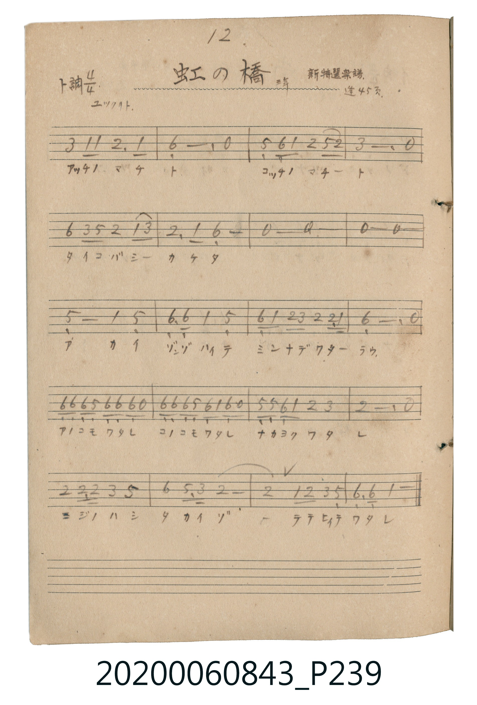

# 虹の橋（彩虹橋）

> Re:Shōka 使用 AI 協助辨識與重建樂譜，可能會有錯誤。歡迎回報。

- **鋼琴伴奏版**：<br><audio controls src="niji_no_hashi.mp3"></audio>

- 唱歌帖 P239 (三年 / 新特選楽譜 / 蓬萊唱集 45頁)

## 說明

虹の橋（彩虹橋）
Source: 唱歌帖 (2020.006.0843), P239.jpg
Marginal notes: 12 / 三年 / 新特選楽譜 / 蓬 45頁 / ユックリト
Key: ト調 (G major), Time: 4/4, Tempo: ユックリト


## 歌詞

```text
アッチノ マチト コッチノ マチート
タイコバシー カケタ
アカイ ゾウリ ハイテ ミンナデ ワターラウ
アノコモ ワタレ コノコモ ワタレ ナカヨク ワタレ
ニジノハシ タカイゾ テテヒイテ ワタレ
```

## ABC

<div class="abc-score" data-abc-src="niji_no_hashi.abc" aria-label="五線譜載入中"></div>

[下載 ABC 原始檔](niji_no_hashi.abc)

## TMD 檔案連結

- [主旋律 TMD 檔案](niji_no_hashi.tmd) [[在 TMD Studio 編輯](https://tmdlang.github.io/Tmd-TS/#tmd=s7IKdvYPcrWy4qpTUCpJTLdSSM7PyUlNLsnMz7MqzsjPTkzOyFeCS5bl55TmploBqXgDc4RwcX5pUXJqfEFieqpVgJGxJboM3KT4vPyS1KT8_GwMFRn5RYmZ8WB1xRmlCOmCovyy1LzEPKCS3MS80uLkosyCkvjk_IJKhJrUssyUVJCK1JTMkvyizMQcJBenFhWD_QJxYklRYh7EDKAgQlVJRirQW3mJJaVFqQhRoFHpmXlWJYmZQHeB3FaeGJ-bmJmXk5iXosSlpaXwYubOx43rnq3sfr-n4-nelUAumN2poKXFpWirYGHBZW-r4M5lY6JvYgcy9emUjc_W9jzdMU0BFEoKGk92dD7duUVBX-HZtA3PO3e-bNzxbOneF2vnAEVeTF7zYkIXUMPL2W0KJqYvFzRqKnFx6Wsp2FILcCko4PQASC4YEjEKCEdrGBkYGegZGJjpGViYGGvqgH2hl1WQDlLum1gEDKzEHAVQFBdbKRgaAX2B34MQfwHZj5uXPW5ufty0_nHzqsfNHSDjvFMrrYDiHS9W7VfQcFfITczKLwLaGJIJjCcFYHgCmam5BfkgNRh6fSqLMpOLrUDMx02LQLLNjY-b-4BK54FZHUDhzZjCe6DaHzftf9y0BKxkwuOm7UAJoNDqx00bgRIwM0H8JUDWvsdNQOtXAc3oB-lpbgOy5j9uBmrtetzcDuSsB5kGMnolUCXcRX1g0xfB5ddAXIRFGGgO0K7mFUAPIoTB5jR3P27aAdIDsno7xNUgVwEdBZRsA6NJcEch6aQ86UCBgpY-F5dfZlamX74HMNdmWoXlJyfmONQY1FSD7FGwMTTTsgOzahSMFXTB0BCKjaB8mFiNglk8khAyNIDSNQqmICVgdSAtIAgzxhTKRliE0xSwg4AZySEHnExsFZQgiQQYSI1ADE4PUDYsoWCRAqaJ5g4lUAhA_GcGNR5kPcwxML-BxGowfIzh3xq4G9HdTIIKbL7bD_QGKLFuBrp5ApAGJhZImgbijaCEg-QPcBAjQ1hIwyWgMYUSDRi6oIpgMQ0KAZj_IbQhUTGONa6gLodlP6BnwPkPIgTJgUAM8mwXEIMzIciT0EgD5UPkeIP7BUwgUhiCALkGj0J4XELUgSVQZWE-hyVN1LRAisdBSRAcjeAyAuorcOGBWw4UCqAAa14BpMGFCEwOKRhQI8cI7lRQUobGJ4qIMYYXEGYgRzrBlIMOsfm8uRvo4h3QDAiKZ3Bph5wMoHELinsQBhV7UCaqZ2u5uHTtFJCKLAUgV5kLAA)]
- [鋼琴伴奏 TMD 檔案](niji_no_hashi_piano.tmd) [[在 TMD Studio 編輯](https://tmdlang.github.io/Tmd-TS/#tmd=s7IKdvYPcrWy4tLSUngxc-fjxnXPVna_39PxdO9KIBfM7lTQ0uJStFWwsOCyt1Vw57Ix0Tex46pTUHo6ZeOztT1Pd0xTCDAytlTQeLKj8-nOLQr6Cs-mbXjeufNl445nS_e-WDsHKPJi8poXE7qAGl7OblMwMX25oFFTiYtLX0vBllqAS0EBtwceNUxRCMhMzMtXcExOzs8tSMzLzE3NKwHpCc4vLUpOtVJAeEbDyMDIQM_AwEzPwMLEWFMH7Du9rIJ0kHLfxKL0zLzEHIW8_JLUYisFQyOg7_B7HOJfIPtx87LHzc2Pm9Y_bl71uLkDZBzl_oYCBS19Li6_zKxMv3yPxOKMTKuw_OTEHIcag5pqkD0KNoZmWnZgVo2CsYIuGBpCsRGUDxOrUTCLRxJChgZQukbBFKQErA6kBQRhxphC2QiLcJoCdhAwFTjkVBZlJhfbKig9bloEDCNgUDUCcR8Qz4OyOxQeN23GLrUHJK0ECgGI_8ygxoOshzkG5jeQWA2GjzH8WwN3I7qbSVCBzXf7gd5YAvIK0M0TgPR2iPubVgPxRiDej-QPcBAjQ1hIwyWgMYUSDRi6oIpgMQ0KAZj_IbQhUTGONa6gLgf5aN_jpmVAz6wC4n6IUHMbEM8HYpBnu4C4HYjXgzwJjbSVQC3I8Qb3C5hApDAEAXINHoXwuISoA0ugysJ8DkuaqGmBFI-DkiA4GkFsmK_WQMVwyIFCARRgzSuANFAcIYcUDKiRYwR3KigpQ-MTRcQYwwsIM5AjnWDKQYfYfN7cDXTxDmgGBMUzMAGDEzU8GUDjFhT3IDwJkRRQPVuLWl6Bi-cgD-wlVnVuQa2CoTZ6wWUar41ZdhnHa8MTMy42tmIMaBgiC8HNRRRmSNZjYaGmFpBq9FIIyVBEQYTFB8juRERodW5aLSUFG7r7wCEKTw1AO-FslHCA24-c2zDlkfVjKW6QfIkocUiKJzwlBEw9Ok1EUYGqFEtpgRxn8KgGx5o5UhLBw0P3AEZIGKGkJkQWR6QfWCZHTpQIJoqRsDBHGIk1BsGxBY9EdFiDNWf6IOdMC3jGNIwHWhEPo0DYCIkGWRoPtC4ehYaFNyG9qPJACqoRarUJRBCIQAbDtMEsAoULqoGoTiBPP6oLMBwIpSD6oeYjrEFSBJEFmYgkSHTIwTMDpgoYbYBFHmYlTB5qLbJLQFbDPYDuJhCN6gJ0FTiCAC2IEX5EDlqoWgz9UHG09OmZV1KUj6XOMEFUGcDyLdowFp78o01iFaJNgRgshm4ISvJGGAK3GOQWUGYCC4A1u-alZOal43cCqMyONssFWgqy3AjEALoA6BaEu9CNwuEQYL4FOsAI7AZkZ4G069opgH2iAGQg5VsQF2IyiKXMBQA)]

## 分析

```text
================================================================================
📊 TMD Song Profile: [ 虹の橋（彩虹橋） ]
================================================================================
⏱  Duration:       0:54 (54.5s), 20 measures total
🎼 Key & Tempo:    首調基準 G, != 88.0 BPM, <4/4>
   - 分析範圍：      由實際發聲的音符與和弦推測調性；播放脈絡另行呈現
🎤 人聲音域:    D4 (MIDI 62) – E5 (MIDI 76) [跨度: 14 個半音 / 1.2 個八度, 難度: moderate]
   - 最低音:  D4 in [NijiNoHashi #1 @ m.3, 0:05]
   - 最高音: E5 in [NijiNoHashi #1 @ m.5, 0:10]
   - 適合: soprano, mezzo-soprano, contralto, tenor, baritone, bass
🏛  結構:      NijiNoHashi (54.5s)
⚡ 編曲密度:        Peak 1 軌道同時演奏
🗝  調性診斷：       E 調性不明確（純淨自然大調，未偵測到可信轉調）
   - 風格氣質:    純淨自然大調（陽光明朗、易唱易記，無明顯調外色彩）
   - 轉調歷程:    全曲維持單一推測調性（未偵測到可信轉調）
   - 核心骨幹音:  E, A, D, G, B
   - 調性數值:    E 調性不明確 [相關度: 0.71, 穩定度: Ambiguous, 自然音純度: 100.0%]
   - 候選調性 (K-S): E 小調 (0.71), A 大調 (0.71), D 大調 (0.65)
   - 五度圈歷程:   +4
   - 各段落調性細節:
     • [NijiNoHashi #1]: E 調性不明確 (r: 0.71, 自然音純度: 100.0%)

  [ 五度圈游移軌跡 ]
               C  
         F            G  
      Bb               D  
      Eb               A  
         Ab          [E ]*
            Db       B  
               F# 
     (* = active key center)

  [ 十二半音累積音高分佈 ]
     C  :                            0.0%
     C# :                            0.0%
     D  : ██████████████            16.8%
     D# :                            0.0%
     E  : ████████████████████████  28.4%
     F  :                            0.0%
     F# :                            0.0%
     G  : ██████████████            16.0%
     G# :                            0.0%
     A  : ██████████████████████    25.7%
     A# :                            0.0%
     B  : ███████████               13.1%
--------------------------------------------------------------------------------
Assignment 軌道音域：
  - Vocal         : D4 – E5 (14 個半音 / 1.2 個八度, 75 個音符)
================================================================================
```


## 原書掃描頁




