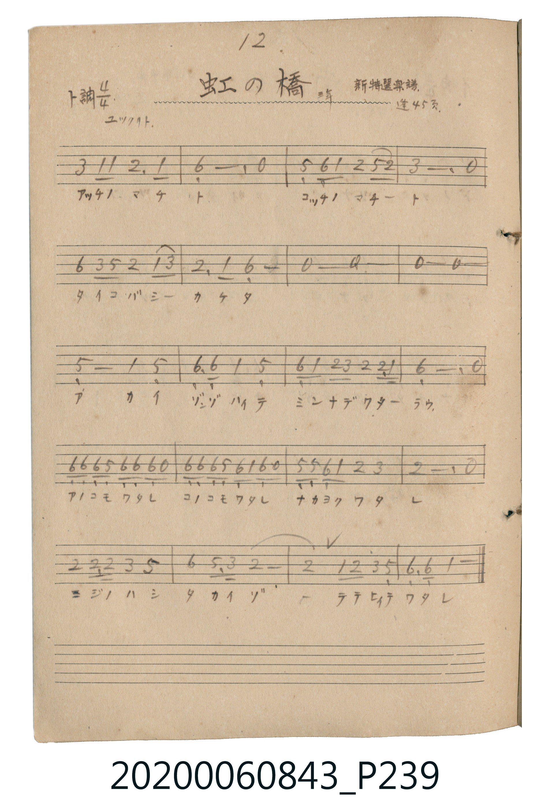

# 虹の橋（彩虹橋）

<audio controls src="niji_no_hashi.mp3"></audio>

- 唱歌帖 P239 (三年 / 新特選楽譜 / 蓬萊唱集 45頁)

## 說明

虹の橋（彩虹橋）
Source: 唱歌帖 (2020.006.0843), P239.jpg
Marginal notes: 12 / 三年 / 新特選楽譜 / 蓬 45頁 / ユックリト
Key: ト調 (G major), Time: 4/4, Tempo: ユックリト

## 歌詞

```text
アッチノ マチト コッチノ マチート
タイコバシー カケタ
アカイ ゾウリ ハイテ ミンナデ ワターラウ
アノコモ ワタレ コノコモ ワタレ ナカヨク ワタレ
ニジノハシ タカイゾ テテヒイテ ワタレ
```

## ABC

```abc
X:1
T:虹の橋（彩虹橋）
M:4/4
L:1/16
Q:1/4=88
K:G
V:V1 name="Vocal" snm="Voc"
[V:V1]
B4 G2 G2 A6 G2 | E12 z4 | D2 E2 G4 A4 d2 A2 | B12 z4 |
e4 B2 d2 A4 G2 B2 | A6 G2 E8 | z8 z8 | z8 z8 |
D8 G4 D4 | E2 E2 G4 D8 | E2 G2 A2 B2 A4 A3 G | E12 z4 |
E2 E2 E2 D2 E2 E2 E2 z2 | E2 E2 E2 D2 E2 G2 E2 z2 | D2 D2 E2 G2 A4 B4 | A12 z4 |
A4 A3 A B4 d4 | e4 d3 B A8 | A4 G2 A2 B4 D4 | E2 E2 G12 |
```

## TMD 檔案連結

- [主旋律 TMD 檔案](niji_no_hashi.tmd) [[在 TMD Studio 編輯](https://tmdlang.github.io/Tmd-TS/#tmd=s7IKdvYPcrWy4tLSUngxc-fjxnXPVna_39PxdO9KIBfM7lTQ0uJStFWwsOCyt1Vw57Ix0Tex46pTUHo6ZeOztT1Pd0xTCDAytlTQeLKj8-nOLQr6Cs-mbXjeufNl445nS_e-WDsHKPJi8poXE7qAGl7OblMwMX25oFFTiYtLX0vBllqAS0EBpwdAcsH5pUXJqVYKCEdrGBkYGegZGJjpGViYGGvqgH2hl1WQDlLum1iUnpmXmKOQl1-SWmylYGgE9AV-D0L8BWQ_bl72uLn5cdP6x82rHjd3gIzzTq20Aop3vFi1X0HDXSE3MSu_CGhjSGYu0EnA8AQyU3ML8kFqMPT6VBZlJhdbgZiPmxaBZJsbHzf3AZXOA7M6gMKbMYX3QLU_btr_uGkJWMmEx03bgRJAodWPmzYCJWBmgvhLgKx9j5uA1q8CmtEP0tPcBmTNf9wM1Nr1uLkdyFkPMg1k9EqgSriL-sCmL4LLr4G4CIsw0BygXc0rgB5ECIPNae5-3LQDpAdk9XaIq0GuAjoKKNkGRpPgjkLSSXnSgQIFLX0uLr_MrEy_fI_E4oxMq7D85MQchxqDGoVqkEUKNoZmWnZgVo2CsYIuGBpCsRGUDxOrUTCLRxJChgZQukbBFKQErA6kBQRhxphC2QiLcJoCdhAwJznkgNOJrYISJJUAQ6kRiMEJAsqGpRQsUsBE0dyhBAoCiP_MoMaDrIc5BuY3kFgNho8x_FsDdyO6m0lQgc13-4HeAKXWzUA3TwDSwNQCSdRAvBGUcpD8AQ5iZAgLabgENKZQogFDF1QRLKZBIQDzP4Q2JCrGscYV1OWw_Af0DDgDQoQgWRCIQZ7tAmJwLgR5EhppoIyIHG9wv4AJRApDECDX4FEIj0uIOrAEqizM57CkiZoWSPE4KAmCoxFcSEB9BS49cMuBQgEUYM0rgDS4FIHJIQUDauQYwZ0KSsrQ-EQRMcbwAsIM5EgnmHLQITafN3cDXbwDmgFB8Qwu7pCTATRuQXEPwqByD8pE9WwtF5eunQJSmaUA5CpzAQA)]
- [鋼琴伴奏 TMD 檔案](niji_no_hashi_piano.tmd) [[在 TMD Studio 編輯](https://tmdlang.github.io/Tmd-TS/#tmd=s7IKdvYPcrWy4tLSUngxc-fjxnXPVna_39PxdO9KIBfM7lTQ0uJStFWwsOCyt1Vw57Ix0Tex46pTUHo6ZeOztT1Pd0xTCDAytlTQeLKj8-nOLQr6Cs-mbXjeufNl445nS_e-WDsHKPJi8poXE7qAGl7OblMwMX25oFFTiYtLX0vBllqAS0EBtwceNUxRCMhMzMtXcExOzs8tSMzLzE3NKwHpCc4vLUpOtVJAeEbDyMDIQM_AwEzPwMLEWFMH7Du9rIJ0kHLfxKL0zLzEHIW8_JLUYisFQyOg7_B7HOJfIPtx87LHzc2Pm9Y_bl71uLkDZBzl_oYCBS19Li6_zKxMv3yPxOKMTKuw_OTEHIcagxqFapBFCjaGZlp2YFaNgrGCLhgaQrERlA8Tq1Ewi0cSQoYGULpGwRSkBKwOpAUEYcaYQtkIi3CaAnYQMBk45FQWZSYX2yooPW5aBAwkYFg1AnEfEM-DsjsUHjdtxi61ByStBAoCiP_MoMaDrIc5BuY3kFgNho8x_FsDdyO6m0lQgc13-4HeWALyCtDNE4D0doj7m1YD8UYg3o_kD3AQI0NYSMMloDGFEg0YuqCKYDENCgGY_yG0IVExjjWuoC4H-Wjf46ZlQM-sAuJ-iFBzGxDPB2KQZ7uAuB2I14M8CY20lUAtyPEG9wuYQKQwBAFyDR6F8LiEqANLoMrCfA5LmqhpgRSPg5IgOBpBbJiv1kDFcMiBQgEUYM0rgDRQHCGHFAyokWMEdyooKUPjE0XEGMMLCDOQI51gykGH2Hze3A108Q5oBgTFMzABgxM1PBlA4xYU9yA8CZEUUD1bi1pggcvnIA8cRVZ1bkGtgqE2esllGq-NWXgZx2vDUzMuNrZyDGgYIg_BzUWUZkjWY2GhJheQavRiCMlQREmExQfI7kTEaHVuWi0lJRu6-8AhCk8OQDvhbJRwgNuPnN0w5ZH1YylvkHyJKHJIiic8RQRMPTpNRFmBqhRLcYEcZ_CoBseaOVISwcND9wBGSBihpCZEHkekH1guR06UCCaKkbAwRxiJNQbBsQWPRHRYgzVr-qBkTQt4zjSMB9oRD6NA2AiJBtkaD7QvHoWGBTghvajyQAqqEWq1CUQQiEAGw7TBLAIFDKqBqE4gTz-qCzAcCKUg-qHmI6xBUgSRBZmIJEh0yMFzA6YKGG2ARR5mJUweai2yS0BWwz2A7iYQjeoCdBU4ggAtiBF-RA5aqFoM_VBxtASqa6eAlEYVgFxlLgA)]

## 分析

```text
================================================================================
📊 TMD Song Profile: [ 虹の橋（彩虹橋） ]
================================================================================
⏱  Duration:       0:54 (54.5s), 20 measures total
🎼 Key & Tempo:    首調基準 G, != 88.0 BPM, <4/4>
   - 分析範圍：      由實際發聲的音符與和弦推測調性；播放脈絡另行呈現
🎤 人聲音域:    D4 (MIDI 62) – E5 (MIDI 76) [跨度: 14 個半音 / 1.2 個八度, 難度: moderate]
   - 最低音:  D4 in [NijiNoHashi #1 @ m.3, 0:05]
   - 最高音: E5 in [NijiNoHashi #1 @ m.5, 0:10]
   - 適合: soprano, mezzo-soprano, contralto, tenor, baritone, bass
🏛  結構:      NijiNoHashi (54.5s)
⚡ 編曲密度:        Peak 1 軌道同時演奏
🗝  調性診斷：       E 調性不明確（純淨自然大調，未偵測到可信轉調）
   - 風格氣質:    純淨自然大調（陽光明朗、易唱易記，無明顯調外色彩）
   - 轉調歷程:    全曲維持單一推測調性（未偵測到可信轉調）
   - 核心骨幹音:  E, A, D, G, B
   - 調性數值:    E 調性不明確 [相關度: 0.71, 穩定度: Ambiguous, 自然音純度: 100.0%]
   - 候選調性 (K-S): E 小調 (0.71), A 大調 (0.71), D 大調 (0.65)
   - 五度圈歷程:   +4
   - 各段落調性細節:
     • [NijiNoHashi #1]: E 調性不明確 (r: 0.71, 自然音純度: 100.0%)

  [ 五度圈游移軌跡 ]
               C  
         F            G  
      Bb               D  
      Eb               A  
         Ab          [E ]*
            Db       B  
               F# 
     (* = active key center)

  [ 十二半音累積音高分佈 ]
     C  :                            0.0%
     C# :                            0.0%
     D  : ██████████████            16.8%
     D# :                            0.0%
     E  : ████████████████████████  28.4%
     F  :                            0.0%
     F# :                            0.0%
     G  : ██████████████            16.0%
     G# :                            0.0%
     A  : ██████████████████████    25.7%
     A# :                            0.0%
     B  : ███████████               13.1%
--------------------------------------------------------------------------------
Assignment 軌道音域：
  - Vocal         : D4 – E5 (14 個半音 / 1.2 個八度, 75 個音符)
================================================================================
```


## 原書掃描頁




