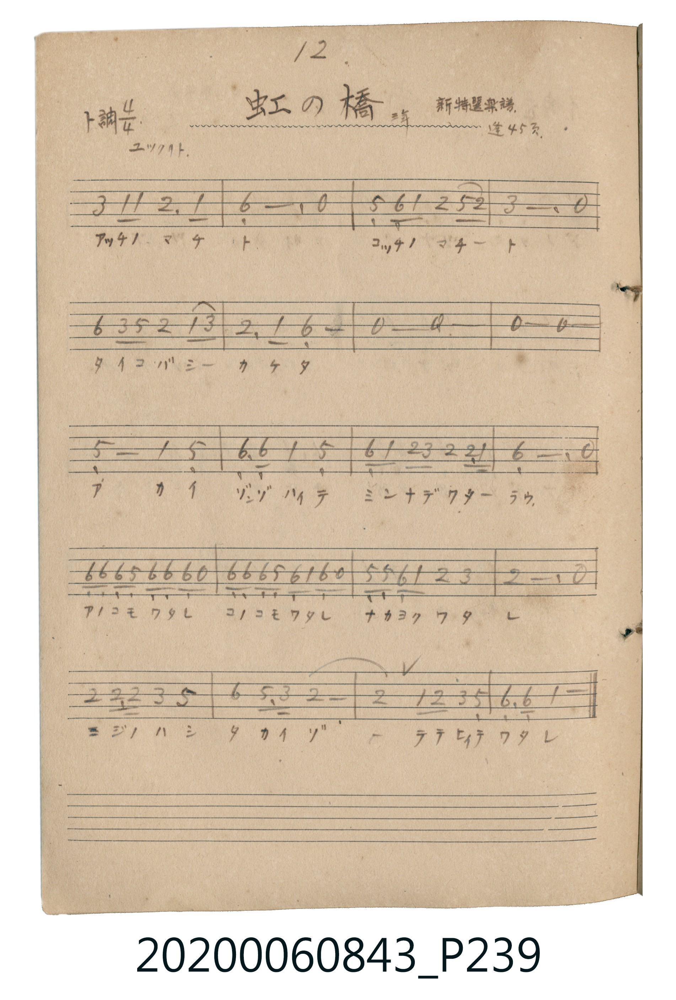

# 虹の橋（彩虹橋）

> Re:Shōka 使用 AI 協助辨識與重建樂譜，可能會有錯誤。歡迎[回報](https://github.com/TMDLang/reshoka/issues)。

- **鋼琴伴奏版**：<br><audio controls src="niji_no_hashi.mp3"></audio>
- **NEUTRINO 歌聲合成版**：<br><audio controls src="niji_no_hashi_neutrino.mp3"></audio>

- 詞：野口雨情
- 曲：成楽会（原田彦四郎 編）
- 唱歌帖 P239 (三年 / 新特選楽譜 / 蓬萊唱集 45頁)

## 說明

虹の橋（彩虹橋）
Source: 唱歌帖 (2020.006.0843), P239.jpg
Marginal notes: 12 / 三年 / 新特選楽譜 / 蓬 45頁 / ユックリト
Key: ト調 (G major), Time: 4/4, Tempo: ユックリト


## 歌詞

```text
アッチノ マチト コッチノ マチート
タイコバシー カケタ
アカイ ゾウリ ハイテ ミンナデ ワターラウ
アノコモ ワタレ コノコモ ワタレ ナカヨク ワタレ
ニジノハシ タカイゾ テテヒイテ ワタレ
考證資訊：作詞：野口雨情（童謠詩〈虹の橋〉，收錄於雨情童謠集《十五夜お月さん》）／作曲・編曲：成楽会（原田彦四郎 編，福岡成樂會《新特選楽譜》）。
```

## ABC

<div class="abc-score" data-abc-src="niji_no_hashi.abc" aria-label="五線譜載入中"></div>

[下載 ABC 原始檔](niji_no_hashi.abc)

## TMD 檔案連結

- [主旋律 TMD 檔案](niji_no_hashi.tmd) [[在 TMD Studio 編輯](https://tmdlang.github.io/Tmd-TS/#tmd=s7IKdvYPcrWy4qpTUCpJTLdSSM7PyUlNLsnMz7MqzsjPTkzOyFeCS5bl55TmploBqXgDc4RwcX5pUXJqfEFieqpVgJGxJboM3KT4vPyS1KT8_GwMFRn5RYmZ8WB1xRmlCOmCovyy1LzEPKCS3MS80uLkosyCkvjk_IJKhJrUssyUVJCK1JTMkvyizMQcJBenFhWD_QJxYklRYh7EDKAgQlVJRirQW3mJJaVFqQhRoFHpmXlWJYmZQHeB3FaeGJ-bmJmXk5iXgqyqJCM_vSixIKPSKiOzGOSA5MSc-OzEvEQlLi0thRczdz5uXPdsZff7PR1P964EcsHsTgUtLS5FWwULCy57WwV3LhsTfRM7kKFPp2x8trbn6Y5pCqCgVNB4sqPz6c4tCvoKz6ZteN6582XjjmdL975YOwco8mLymhcTuoAaXs5uUzAxfbmgURPsrhcr573fM-tle9_T_sUvZ6941twKFn42exNQ-FnHBKABT_bMArmnb_7zKRue7l32dPbsl819Cs-3rwC6TImLS19LwZZagEtBAWcggOSCISlAAeFxDSMDIwM9AwMzPQMLE2NNHXBI6GUVpIOU-yYWAWMlMUcBlJaKrRQMjYAhgT-QIGEDZD9uXva4uflx0_rHzaseN3eAjPNOrbQCine8WLVfQcNdITcxK78IaGNIJjBBKADjBMhMzS3IB6nB0OtTCYzrYisQ83HTIpBsc-NjYDA-bp4HZnUAhTdjCu-Ban_ctP9x0xKwkgmPm7YDJYBCqx83bQRKwMwE8ZcAWfseNwGtXwU0ox-kp7kNyJr_uBmotetxczuQsx5kGsjolUCVcBf1gU1fBJdfA3ERFmGgOUC7mlcAPYgQBpvT3P24aQdID8jq7RBXg1wFdBRQsg2MJsEdhaTzRUPzi7WdLza3v1jRBUx4T_bOwUyYwPTwfPXSF2sWvFi58nFDBzydPG7ofL-n59mUbS97Wp5N2wNRDFEJTOyPG7qe9jY-2TXl6ZI5jxu7ns3peNw49XHT5McNoET1fk8_0C5gan_cvBuYoolM9j3Pl_U_3bQQpG5F07M5zUA70BITxPTHDU0gz1GeL6BAQUufi8svMyvTL98DWPZlWgVkJublO9QY1FSD7FGwMTTTsgOzahSMFXTB0BCKjaB8mFiNglk8khAyNIDSNWCjfGqgKRYqCkyXYLIPTM5D0geRASoHpmZCJkNdaQpyA9ghIDeBIMydplA2widEOBOUg9CcCHEYzJkQGbAuPM6EBQzcmWZQAZBTYA4DQZCjQWI1GMGLEbhQs8DO3A9zDTC_gsjNYJdNgItuR7ixaTWSGcD8DiZh-tHMroEHCS5IhAqYK3ElDoRRBFWgRDIyhMU1XAKaGFESAoYu5OSIJoUIJkiQQsyEFIUgQWBpCCJB5SFMHbAEwuFcuCtAcQqKXVjcQmhD0rJO83ywbZAo7gKT7WByPdzFsOgEqQYVyTjMxkyV8DADE4i8hCBA7sGjEJ5SwepQwxeaw6GJEyICcjPEvaCKAOIkcL4jRT1KskB1CyykYVkeNV8RCGhw4IITArBuArPB1uMIaJBziApl1Ng3grsNVA5ADIOVDhARYww3I7mxG-6WHRAaXNf3w0WRcz6ilIAkbmjtjmE4mjuRUy7YVfgyGTqEOxUmAMknMBJUd6NIQN2KEdHYza7l4tK1U0CqwBSAXGUuAA)]
- [鋼琴伴奏 TMD 檔案](niji_no_hashi_piano.tmd) [[在 TMD Studio 編輯](https://tmdlang.github.io/Tmd-TS/#tmd=s7IKdvYPcrWy4qpTUCpJTLdSyC8qychPL0osyKi0ysgsLskvykxOzInPTsxLVIIrKs4vLUpOjS9ITE-1CjAytkTIlGSk5qZapaaUJieWZObnKXFpaSm8mLnzceO6Zyu73-_peLp3JZALZncqaGlxKdoqWFhw2dsquHPZmOib2IEMejpl47O1PU93TFMAma2g8WRH59OdWxT0FZ5N2_C8c-fLxh3Plu59sXYOUOTF5DUvJnQBNbyc3aZgYvpyQaMm2C0vVs57v2fWy_a-p_2LX85e8ay5FSz8bPYmoPCzjglAA57smQVyT9_851M2PN277Ons2S-b-xSeb18BdJkSF5e-loIttQCXggLuQHjUMEUhIDMxL1_BMTk5P7cgMS8zNzWvBKQnGBzMVgqIANEwMjAy0DMwMNMzsDAx1tQBh5BeVkE6SLlvYlF6Zl5ijkJefklqsZWCoREwhPAHHiTMgOzHzcseNzc_blr_uHnV4-YOsIsbml-s7Xyxuf3Fii5gqD3ZOwczVIGeeb566Ys1C16sXPm4oQPuyccNne_39Dybsu1lT8uzaXsgiiEqgTH1uKHraW_jk11Tni6Z87ix69mcjseNUx83TX7cAAqR93v6gXYBo-px825gdBAZZz3Pl_U_3bQQpG5F07M5zUA70HwMMf1xQxPIc5RHKhQoaOlzcfllZmX65XskFmdkWoHj0qHGoKYaZI-CjaGZlh2YVaNgrKALhoZQbATlw8RqFMzikYSQoQGUrgEb5VOj8LhpETDCoKKPmxvBZB-YnIekDyIDVN7cQdBkqCtNQW4AOwTkJhCEudMUykb4hAhnboY4E9mJEIfBnAmRAevC40xYwMCdaQYVADkF5jAQBDkaJFaDEbwYgQs1C-zM_TDXNC0Bk5vBLpsAF92OcGPTaiQzHjdtBJMw_Whm18CDBBckQgXMlbgSB8IogipQIhkZwuIaLgFNjCgJAUMXcnJEk0IEEyRIIWY-btr3uGkZSLB5FZjsR8g-bm7D5Vy4K0BxCopdWNxCaEPSsk7zfLBtkCjuApPtYHI93MWw6ASpXglxMTaImSrhYQYmEHkJQYDcg0chPKWC1aGGLzSHQxMnRATkZoh7HzevgToJnO9IUY-SLFDdAgtpWJZHzVcEAhocuOCE8Lh5BZgNth5HQIOcQ1Qoo8a-EdxtoHIAYhisdICIGGO4GcmN3XC37IDQwEADpku4KHLOR5QSkMQNSrzAJI1hOJo7kVMu2FX4Mhk6hDsVJgDJJzByErYMBPIXekRjN7sWS-0V5IG9_qrOLahVMNRGr8ZM47UxazLjeG14jsTFhicYpCQHNAxR2sDNRdQ8SNZjYaEmQZBq9GoCyVBETYHFB8juhIcWMATSaimpedDdBw5ReGoA2glno4QD3H7kAgNTHlk_ljITyZeIYpOkeMJTyMHUo9NElHaoSrEUQchxBo9qcKyZIyURPDx0D2CEhBFKakIUI4j0AytIkBMlgoliJCzMEUZijUFwbMEjER1iz5k-yDnTAp4xDeOBVsTDKBA2QqJBlsYDrYtHoWHhTUgvqjyQQq6ZahRMIIJABDIYpg1mEShcUA1EdQJ5-lFdgOFAKAXRDzUfYQ2SIogsyEQkQaJDDp4ZMFXAaAMs8jArYfJQa5FdArIa7gF0N4FoVBegq8ARBGhBjPAjctBC1WLoh4qjpU_PvJKifCx1hgmiygCWb9GGsfDkH20SqxBtCsRgMXRDUJI3whC4xSC3gDITWACs2TUvJTMvHb8TQGV2tFku0FKQ5UYgBtAFQLcg3IVuFA6HAPMt0AFGYDcgOwukXddOAewTBSADKd-CuBCTQSxlLgA)]

## 分析

```text
================================================================================
📊 TMD Song Profile: [ 虹の橋（彩虹橋） ]
================================================================================
⏱  Duration:       0:54 (54.5s), 20 measures total
🎼 Key & Tempo:    首調基準 G, != 88.0 BPM, <4/4>
   - 分析範圍：      由實際發聲的音符與和弦推測調性；播放脈絡另行呈現
🎤 人聲音域:    D4 (MIDI 62) – E5 (MIDI 76) [跨度: 14 個半音 / 1.2 個八度, 難度: moderate]
   - 最低音:  D4 in [NijiNoHashi #1 @ m.3, 0:05]
   - 最高音: E5 in [NijiNoHashi #1 @ m.5, 0:10]
   - 適合: soprano, mezzo-soprano, contralto, tenor, baritone, bass
🏛  結構:      NijiNoHashi (54.5s)
⚡ 編曲密度:        Peak 1 軌道同時演奏
🗝  調性診斷：       E 調性不明確（純淨自然大調，未偵測到可信轉調）
   - 風格氣質:    純淨自然大調（陽光明朗、易唱易記，無明顯調外色彩）
   - 轉調歷程:    全曲維持單一推測調性（未偵測到可信轉調）
   - 核心骨幹音:  E, A, D, G, B
   - 調性數值:    E 調性不明確 [相關度: 0.71, 穩定度: Ambiguous, 自然音純度: 100.0%]
   - 候選調性 (K-S): E 小調 (0.71), A 大調 (0.71), D 大調 (0.65)
   - 五度圈歷程:   +4
   - 各段落調性細節:
     • [NijiNoHashi #1]: E 調性不明確 (r: 0.71, 自然音純度: 100.0%)

  [ 五度圈游移軌跡 ]
               C  
         F            G  
      Bb               D  
      Eb               A  
         Ab          [E ]*
            Db       B  
               F# 
     (* = active key center)

  [ 十二半音累積音高分佈 ]
     C  :                            0.0%
     C# :                            0.0%
     D  : ██████████████            16.8%
     D# :                            0.0%
     E  : ████████████████████████  28.4%
     F  :                            0.0%
     F# :                            0.0%
     G  : ██████████████            16.0%
     G# :                            0.0%
     A  : ██████████████████████    25.7%
     A# :                            0.0%
     B  : ███████████               13.1%
--------------------------------------------------------------------------------
Assignment 軌道音域：
  - Piano         : D4 – E5 (14 個半音 / 1.2 個八度, 75 個音符)
================================================================================
```


## 原書掃描頁




