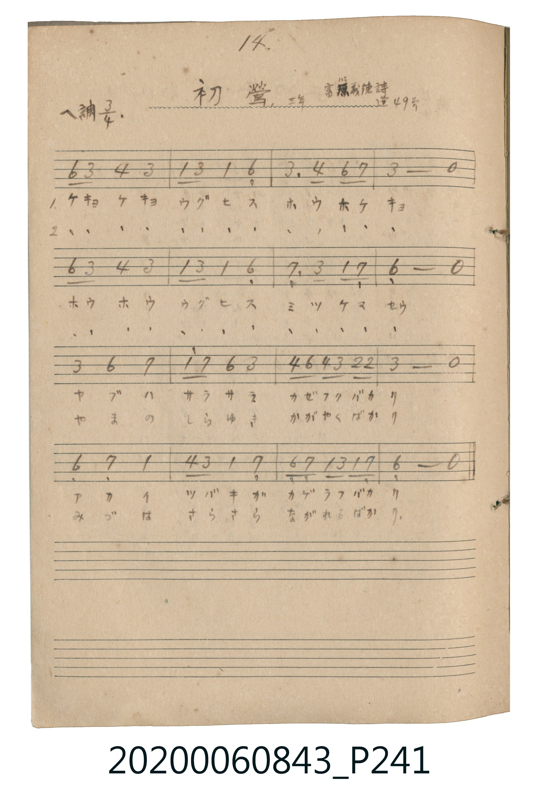

# 初鶯（初鶯）

> Re:Shōka 使用 AI 協助辨識與重建樂譜，可能會有錯誤。歡迎回報。

- **鋼琴伴奏版**：<br><audio controls src="hatsu_uguisu.mp3"></audio>
- **NEUTRINO 歌聲合成版**：<br><audio controls src="hatsu_uguisu_neutrino.mp3"></audio>

- 詞：富原義徳
- 曲：佐々木英
- 唱歌帖 P241 (三年 / 蓬萊唱集 49頁)

## 說明

> [!NOTE]
> **原件資訊與抄本考證**（對應《唱歌帖》第 7 冊 `P241.jpg`，頁頂編號 `14.`）：
> - **調性與拍號**：原譜左上標「ヘ調 3/4.」（即 1 個降記號 `?= F` 關係小調 D 小調 `key= Dm`，3/4 拍）
> - **眉批註記**：「初鶯」「三年」「富原（ハラ）義徳詩」「蓬 49頁」（抄自《蓬萊唱歌集》第 49 頁；同曲亦見於臺灣教育會公認《新定兒童唱歌》尋常科第五學年用 `P078.jpg`，署「佐々木英」作曲）
> - **校勘備註（依 Editorial Policy A 校訂）**：
>   1. **第 1、5 小節首音低八度點漏標**：原抄簡譜於第 1、5 小節首拍記為連底線之八分音符 `6 3`（底線下方漏點 `6` 之低音點），然對照第 2、6 小節結尾 `6_`（D4）及《新定兒童唱歌》`P078.jpg` 印刷五線譜（首音為下加一間 D4 = `6_` 上跳完全五度至 A4 = `3`），此處確為抄寫時於八分音符底線下漏點低音點，依 Policy A 復原為 `6_ 3 4 - 3 -`。
>   2. **歌詞異文與同文省記**：第 1、2 行（第 1–8 小節）第 2 節歌詞原抄以頓號「`、`」逐字表示與第 1 節同文；第 3 小節第 2 個音符（`4`）下原抄明確記作「ウ」（「ホ ウ ホ ケ」，異於《新定兒童唱歌》`P078.jpg` 之長音符「ホ ー ホ ケ」）；第 15 小節第 1 節原抄保存歷史假名遣「カ ゲ ラ フ バ カ」（《新定兒童唱歌》印作「カ ゲ ロ ウ バ カ」）。以上原抄假名均忠實保留。
>
> **1.**
> ケキョ ケキョ ウグヒス ホウホケキョ
> ホウ ホウ ウグヒス ミツケマセウ
> ヤブハ サラサラ カゼフクバカリ
> アカイ ツバキガ カゲラフバカリ
>
> **2.**
> ケキョ ケキョ ウグヒス ホウホケキョ
> ホウ ホウ ウグヒス ミツケマセウ
> やまの しらゆき かがやくばかり
> みづは さらさら ながれるばかり


## 歌詞

```text
（TMD 檔案未包含歌詞註解）
```

## ABC

<div class="abc-score" data-abc-src="hatsu_uguisu.abc" aria-label="五線譜載入中"></div>

[下載 ABC 原始檔](hatsu_uguisu.abc)

## TMD 檔案連結

- [主旋律 TMD 檔案](hatsu_uguisu.tmd) [[在 TMD Studio 編輯](https://tmdlang.github.io/Tmd-TS/#tmd=s7IKdvYPcrWy4qpTUCpJTLdSSM7PyUlNLsnMz7MqzsjPTkzOyFeCS5bl55TmploBqXgDc4RwcX5pUXJqfEFieqpVgJGJIboM3KT4vPyS1KT8_GwMFRn5RYmZ8WB1xRmlCOmCovyy1LzEPKCS3MS80uLkosyCkvjk_IJKhJrUssyUVJCK4uTEvPiy1KLMtMzUFCRXpxYVg_0DcWZJUWIexBygIEJVflFJRn56UWJBRqVVRmZxSX5RZnJiTnx2Yl4iQlFJRirQ_4l5mbmJOeiixamJxfl5xcgmZqZn5lmVJGYC_QXyW3lifG5iZl5OYh7QdVpaCk875r7ctv79ng4Yo1NBS4tL0VbB0ozL3lbBjSs7tdJWwSWXy8ZY38QOZO7TKRufre15umOaAiicFTSe7Oh8unOLgr7Ci8lrXkzoAkq_nN2mYGL5ckGjJtghL1bOe79n1tP1PU_75j_ft_Lpvs1g4WezNwGFn-yd8Lih9dmcFS-6NypxcelrKdhSC3ApKCjYKUQr-vmHuMZCOFpaQDc82b3txeb2Fyu6XnS0P-tqeTZnzYuG5hdrO7W0QMGwofdZe-fjBpA_IN583ND9fM0aBXOFp21dCgkgP-tlFaQnvN_TA_ThywVNz7eveDFzvkKCoYkeULAT6CeIXbpA216s2v-sYTnInu5eoCKQDbOALnixds7T7cue7Oh6tmLm44aex80zgAoVgAGs97ihF-SI3s0KhgpPG7pfzux9sWIG2HhQZCQovJw-58n-pqcb-kEaXBSgjARoJIEcBTRFAWgb0CUIZzyf0_msc-eLFbuBhoHdALQUEt9A-4BsSBRC2JB4AjricXP_4-aVQHMgcfZi5UqIAmA0Q2IX4lZgCL5oXwUMMHj0A4MNmAKgwWZiqQBU-n7P7KcTeoAx_mTXshfLup9N2_OifdfzxsXPps580bTp2Zzmp61rXqwCmt71bNqGp-tmPW2d9Hz1UohZQIOebuh-umPH8-UTgSY-2TXl6dodQOc-n7ICGB0G5haw6Hi-dxPIL0gJCujCJ3vngBMaUmg8W7DwafeMp00zgQEC9MCTfXMVXFMyQZktMUchID8nM7lSwVEBqOrFiiagRnCAQXQrKBjqgYIT6C_Dxw2NpqDwf76-4eWyaS_nb36yt-9p6-qnu5a93D3v2Z5-YNTCohsYRM83LARGOtDfWPSC0saKGc-bdr1sWPx019Tn22c92dkNMqqjDWjs8zXLFBLMFIyBPuyAyu4ABuBOoBVAi4BSCQpA5UDLgWqBAuAU2PO8ZRswIT9vXQ6yzghonRnUuudbJzzdsA-oKx5knosJUPnT_i5c4Y4IXoWnvRuedmwHBj7QAUCfADVDfA10NtA9T7sWPNnR8HLaZAUXEwVbsPEKwOT9Yvvmp-t6nrauAEUaMObbNys4guVBvgG589naJS9mTn2-aBfQGGAoPV2_-tnMJmAoIfse4Wmwj5F82gOKOniEPQUmU2AB07QLZL2CsYIJMLKNFXQTHjc0wWLPCBR7QK8BS6TnUzc8m9YOzJmgdDmt_fmcRljegMWQkcKLhT1Af4L5jxomW0CDEJQjQKGqAGRDzIJE8ZPdS18umAzMq8BECLS0EYh7XzZMeLp2-ouFK54v2QW0C2wUSB_EUmCuAIkYw-IGbCoo14P9DbQ6wQQUTqDwBdvwbEYfMKiA7gQmalCx0bQMkgXBRchsBSBfAUKDEj4oFYD8uIeIyAUmoJdTt0OshRnWvAfFMGBsgR1rCEu4CL9AfL9_7tO1M56t3f60f9PTRmCo9r5sXAx25GqgGZuAZq0E4qlAPAHIXw1zOI783rsB5kWY7rVQ7yF0AwvpJmCYA5MZxAUQW5_ObX-6f8HT9cuADno-FVi6QiIfVvwb6gFrNzAb5LGmtY-bl6Owlj1u2vC4edLjpp0g34P4IBIqD9UIFodTqFrmP25uAalvnve4aTdQDqZlyePmacACFah8KzAkICTYJ017gKHyuGk90GcgbvMqmOsWgWWXAPW2gOXWPm5aA9GxCWQCUBOKDpgHjQbGg00tjxv3PW5cp_C4cfrjps7HTW2PG3uBnO7HjcBIBEr2P27cAOI2dUF1NO5_3Lj0ceN6IAvo_04ICeSsAusAIqBWJB2UNwegQEFLn4vLI7GkuDQ0vTSzuNQqLB_YxnKoMaipBtmjYGOhBQ5MBWxNEQVQBbSjAVgwKGiYQDOCDrgdBMpImlg0AG0DGVajgFwmAbmGQNoQyAIKg7ggQV2gtBmwnQHj6SoYgOTA-n0Ma0DRCMSwGAVKQTkg_ZCY2gCMoElgiZ0QUWAGBpmDVDKA1UK1oVlhRFMr8Ifprh7qh6k5iALJGYKYYNVYgxWp6IT4A59v50N829wCCavmeWC1oJyAPUBpYTiB5NlJTlCCQtAMiM0hIRkHZIC4kIAFpUsTINsICHGmzuYlYLdPA5P9UH9uhRT8QBokuhIqCirUQdULsDpoAhYAkEIdHAKrcCTLFpD-xn1gch3ElMbpQHFgidHUBhbthYp2A3EPWAew0AFiYCgDxUBmdBEfiE9nzyYzPQJDEESAkiEo3CAJEiwElgayIKkUb4psWgROFqvBJChYQUED9BA4oNaCRdcgBSVG7YovKBv3g4NrKZhcDw00UESACt-pYLM7oaKroEEJwqBgxRWUtVxcunYKSGWqApCrzAUA)]
- [鋼琴伴奏 TMD 檔案](hatsu_uguisu_piano.tmd) [[在 TMD Studio 編輯](https://tmdlang.github.io/Tmd-TS/#tmd=s7IKdvYPcrWy4qpTUCpJTLdSyC8qychPL0osyKi0ysgsLskvykxOzInPTsxLVIIrKs4vLUpOjS9ITE-1CjAyMUTIlGSk5qZapaaUJieWZObnKXFpaSk87Zj7ctv693s6XnbveT5hy5M9W54u7X_e2fF-T6eClhaXoq2CpRmXva2CG1d2aqWtgksul42xvokdyMynUzY-W9vzdMc0BZA1ChpPdnQ-3blFQV_hxeQ1LyZ0AaVfzm5TMLF8uaBRE-yIFyvnvd8z6-n6nqd985_vW_l032aw8LPZm4DCT_ZOeNzQ-mzOihfdG5W4uDwSS4pLQ9NLM4tLrQIyE_PygzwcagxqqrkUgMDGQssOzNDXUrBFBwrP16x5sqPhxcIeBQ0Thacb-p-vb9ABO1EvqyBdE4sGLX2wYTUKZvEKxgomCrpAUhfINQTShkAWUBjEBQnqAqXNFMzhPF0FA5AcWL-PYY3C46aNQLz2cfNyMFMXxgHpf9y0DIg3KDxungSW2AkRbZ4NNgcsC2SDtIHUQrWhWWFEUyvwh-muHuqHqTmIAskZgphg1ViDFexqiOsh_sDn2_kQ3za3QMKqeR5Y7W6INiwBSgvDCSTPTnKCEhSCZkBsDgnJOCADxIUELChdmgDZRkCIM3U2LwG7fRqY7If6cyuQvRJMg0RXQkVXA_EeIH8qkF4PpCeAxUBmrMKRLFtA-hv3gcl1EFMapwPFO4G4DSzaCxXtBuIesI7Hjf1ADAxloBjIjC7iA_Hp7NlkpkdgCIIIUDIEhRskQYKFwNJAFiSV4k2RTYvAyWI1mAQFKyhogB4CB9RasOgapKDcBAlkUHASDsrG_eDgWgom10MDDRQRwKAE0iCzO6Giq6BBCcKgYMUVlLVYilQfHEXqsx2tz6ZteDm342n31Cc7uxVcQCH8YtV-YLJ91t37dO2Ep9uXPevshtQV7_f0PF068emEjmfTlz6bs-ZF-6rnLdsg6t_v6X_ZvBcYNY-bdz_d1_1sevezzVNfdG56unclcnyAAjjaKD43FkSbQWi4OJQP5GkbwmIIRINIo3gwZQyKJmOwqHG8NjgeEeFJhgXm8WAZMAU0GygKZqLrwGIHVCbaGNkOoBFwCbjlQKfrwtwPZhPhA6ip0YbxcDNAZkO4qHaCHQx0OEHnA5OFrp0CUsqI9jEEyqIJGYGFlLkA)]

## 分析

```text
================================================================================
📊 TMD Song Profile: [ 初鶯（初鶯） ]
================================================================================
⏱  Duration:       0:30 (30.0s), 16 measures total
🎼 Key & Tempo:    首調基準 F, != 96.0 BPM, <3/4>
   - 分析範圍：      由實際發聲的音符與和弦推測調性；播放脈絡另行呈現
🎤 人聲音域:    D4 (MIDI 62) – F5 (MIDI 77) [跨度: 15 個半音 / 1.2 個八度, 難度: moderate]
   - 最低音:  D4 in [HatsuUguisu #1 @ m.1, 0:00]
   - 最高音: F5 in [HatsuUguisu #1 @ m.10, 0:16]
   - 適合: soprano, mezzo-soprano, contralto, tenor, baritone, bass
🏛  結構:      HatsuUguisu (30.0s)
⚡ 編曲密度:        Peak 1 軌道同時演奏
🗝  調性診斷：       D 小調（純淨自然小調，未偵測到可信轉調）
   - 風格氣質:    純淨自然小調（陰鬱抒情、旋律集中，無明顯調外色彩）
   - 轉調歷程:    全曲維持單一推測調性（未偵測到可信轉調）
   - 核心骨幹音:  A, D, E, F, A#
   - 調性數值:    D 小調 [相關度: 0.85, 穩定度: High, 自然音純度: 100.0%]
   - 候選調性 (K-S): D 小調 (0.85), D 大調 (0.62), A 大調 (0.61)
   - 五度圈歷程:   +2
   - 各段落調性細節:
     • [HatsuUguisu #1]: D 小調 (r: 0.85, 自然音純度: 100.0%)

  [ 五度圈游移軌跡 ]
               C  
         F            G  
      Bb              [D ]*
      Eb               A  
         Ab           E  
            Db       B  
               F# 
     (* = active key center)

  [ 十二半音累積音高分佈 ]
     C  :                            0.0%
     C# :                            0.0%
     D  : ████████████████████      26.1%
     D# :                            0.0%
     E  : ████████████              15.9%
     F  : ████████████              15.9%
     F# :                            0.0%
     G  : ██                         2.3%
     G# :                            0.0%
     A  : ████████████████████████  30.7%
     A# : ███████                    9.1%
     B  :                            0.0%
--------------------------------------------------------------------------------
Assignment 軌道音域：
  - Vocal         : D4 – F5 (15 個半音 / 1.2 個八度, 54 個音符)
================================================================================
```


## 原書掃描頁




