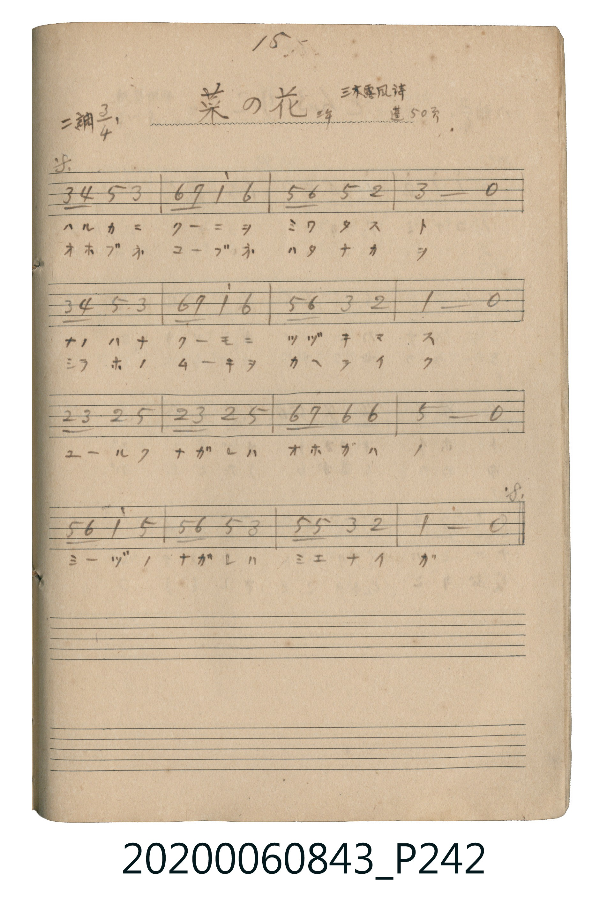

# 菜の花（油菜花）

> Re:Shōka 使用 AI 協助辨識與重建樂譜，可能會有錯誤。歡迎回報。

- **鋼琴伴奏版**：<br><audio controls src="nanohana.mp3"></audio>
- **NEUTRINO 歌聲合成版**：<br><audio controls src="nanohana_neutrino.mp3"></audio>

- 詞：三木露風
- 曲：佐々木すぐる
- 唱歌帖 P242 (三年 / 蓬萊唱集 50頁)

## 說明

菜の花（油菜花）
Source: 唱歌帖 (2020.006.0843), P242.jpg
Marginal notes: 15. / 三年 / 三木露風詩 / 蓬 50頁
Key: ニ調 (D major), Time: 3/4


## 歌詞

```text
1. ハルカニ クーニヲ ミワタス ト
ナノハナ クーモニ ツヅキマス
ユールク ナガレハ オホガハノ
ミーヅノ ナガレハ ミエナイガ
オホブネ コーブネ ハタナカヲ
シラホノ ムーキヲ カヘテイク
考證資訊：作詞：三木露風／作曲：佐々木すぐる。國立音樂大學附屬圖書館藏 三木露風作詞・佐々木すぐる作曲〈菜の花〉。
```

## ABC

<div class="abc-score" data-abc-src="nanohana.abc" aria-label="五線譜載入中"></div>

[下載 ABC 原始檔](nanohana.abc)

## TMD 檔案連結

- [主旋律 TMD 檔案](nanohana.tmd) [[在 TMD Studio 編輯](https://tmdlang.github.io/Tmd-TS/#tmd=s7IKdvYPcrWy4qpTUCpJTLdSSM7PyUlNLsnMz7MqzsjPTkzOyFeCS5bl55TmploBqXgDc4RwcX5pUXJqfEFieqpVgJGJEboM3KT4vPyS1KT8_GwMFRn5RYmZ8WB1xRmlCOmCovyy1LzEPKCS3MS80uLkosyCkvjk_IJKhJrUssyUVJCK1JTMkvyizMQcJBenFhWD_QJxYklRYh7EDKAgQlVJRirQWwU5iXklCEGgSemZeVYliZlAZ4GcVp4Yn5uYmQdUlYKsqiQjP70osSCj0iojsxhkf3JiTnx2Yl6iEpeWlsKL_jmPG9e96Nr4fk_Hs007gVwwu1NBS4tL0VbB0ozL3lbBhcvGWN_EDmTo0ykbn63tebpjmgIoJBU0nuzofLpzi4K-wovJa15M6AJKv5zdpmBq8HJBoybYFS9Wznu_ZxZQ2bM5K17O2fRy0Qqw8LPZm0DCeyc8bmgFyjxunPm4ccLjpm4lLi59LQVbagEuBQWcXgTJBUOiVwHhLQ0jAyMDPQMDMz0DCxNjTR2wP_WyCtJByn0Ti4BhnpijAEooxVYKhqZ6QK_DwwDZly9WroSECiQwQLq9UyutFB43d79YtV9Bw0UhNzErvwhoQUgmMHIVgAEMUuNTCYygYisQ01APqLj_cfPqx02rgboUHjetf9y8B8h63LwJKDP_cfP6x037HzftBHI6QBoeN3c9bu4D6-mCq14E1trc8ri59XHT2sfN84AaIIqXgeWBpq8H62xa87gZiPqBOlc9bp4N5gNN6oMoBtoGVNwK5KMpBso0rQALLQGKghVD9DdPe9zcC-RsBuuEcIAGAl0MUgz00SaI4u2Pm1eC1YNMXgBSDHIm0IcgNTMeN7eBTV4PjsmG5hdrO19sbn-xoguceuZgpq73e_qB4riS1-OGpqdzup-v7n45f_OzFU1Plyx_unbHy5ktTzeueTpn2rPZO14uWfFiej9KTEKsedy8G9M4iE2PGzrgaexxQyfQDpBjKU-8UKCgpc_F5ZeYl58BzLRWAZlAlkONQU01yBIFGwstOzCjRsFYwUTBVEEXSOsCeWYK5gqGcUCmGZhrCqRBkkZgHkgJCBqAeGDtPoY1oOgB4tWgkAeKg9INSC0ofcB4oHgBizXPB2JgumnaDxIFJkGIaAfU3HiEuUYgE1YB5WYD8TSwGb1QczeDeShi4OS3H5TEwOaC3AESBdmKMJdY_4IkIP41xOFfYDYBJ7t-sBtAdiL8uwg5DJpbgLgVKLcWLDoPqhLkb2z-3Q5UsxLsZ5DqPqgZC8B-gpgADUegD4GJHIjbwHJLkFyA4V8joIdA3gH5GZ0H8j3I4zDPY_fuMrDV4MgFWwENgqY1QHoNWA4UEEgRBpRBEgV7BIt3qWwu1LugGARHKMSHsAQMiW1TICQcvfPBtrSiRAJWd4GSc9MKeLKDRQNIDTb_UtfcWi4uXTsFWAZXALKVuQA)]
- [鋼琴伴奏 TMD 檔案](nanohana_piano.tmd) [[在 TMD Studio 編輯](https://tmdlang.github.io/Tmd-TS/#tmd=s7IKdvYPcrWy4qpTUCpJTLdSyC8qychPL0osyKi0ysgsLskvykxOzInPTsxLVIIrKs4vLUpOjS9ITE-1CjAyMULIlGSk5qZaFacmFufnFStxaWkpvOif87hx3Yuuje_3dDzbtBPIBbM7FbS0uBRtFSzNuOxtFVy4bIz1TexAxjydsvHZ2p6nO6YpgExW0Hiyo_Ppzi0K-govJq95MaELKP1ydpuCqcHLBY2aYHtfrJz3fs8soLJnc1a8nLPp5aIVYOFnszeBhPdOeNzQCpR53DjzceOEx03dSlxc-loKttQCXAoKuL34qGGKQkBmYl6-gmNycn5uQWJeZm5qXglITzA4CK0UEN7VMDIwMtAzMDDTM7AwMdbUAftfL6sgHaTcN7EoPTMvMUchL78ktdhKwdBUDxgk8LBB9v2LlSshoQUJJLADG5pfrO18sbn9xYoucKDMwQy093v6geK4Qu1xQ9PTOd3PV3e_nL_52Yqmp0uWP1274-XMlqcb1zydM-3Z7B0vl6x4Mb0fxSEQax4378Y0DmLT44YOeNA9bugE2gFyLOVxAgUKWvpcXH7A0M8AJl4rcDw41BjUVIMsUbCx0LIDM2oUjBVMFEwVdIG0LpBnpmCuYBgHZJqBuaZAGiRpBOaBlICgAYgH1u5jWKPwuLkfiFcrPG5aDRR_3NwNVvu4aT2c97h5E0SseT4QrwfK7QeJNu2EinZAzY1HmGsEMmEVUG42EE8Dm9ELNXczmIciBnIB0MzHzV1gc0HuAImCbEWYS6x_QRIQ_xri8G8XEPeBbQW5AWQnwr-LkMOguQWIW4Fya8Gi86AqQf7G5t_tQDUrwX4Gqe6DmrEA7CeICdBwBPrwcfMMIG4Dyy1BcgGGf42AHgJ5B-RndB7I9yCPwzyP3bvLwFaDIxdsBTQImtYA6TVgOVBAIEUYUAZJFOwRLN6lsrlQ74JiEByhEB_CEjAktk2BkHD0zgfb0ooSCVjdBUrOTSvgyQ4WDSA12PxLXXNr0XN3kAfW_F2dW1ALTvSG2qCAMNRGJHxjbXBIGWojEj9EkXm8NjSIwKpRAwmShYg0DSQNN800XhszzCFpEqoGSCHSKboYOK-CTTfUNlGHWgNSBJZHNxWclWFOQiQGVHeDEgQhR2IEtA9yQJvAA9owHqgXhGoUTOJBPCAJFjUGiULZQGkgCXMjdi0gxWBhuB4UTSCuEVQXMhtIm4F5IGGIKLpNQJfAbAIZiGETyMtgD3vmlRTlY0lWCN9WA1NVtGGsQrRZbiw43KJNgBxTMBvNBNzhBXQvSCvQRUBXQDW65qVk5qXjtxuUpKONgBaDLARZDLQe6BZQnGGYgcN2SKjBogiuU9dOAexyBSADFuvRPiCzkflGYD7EFhBLmQsA)]

## 分析

```text
================================================================================
📊 TMD Song Profile: [ 菜の花（油菜花） ]
================================================================================
⏱  Duration:       0:30 (30.0s), 16 measures total
🎼 Key & Tempo:    首調基準 D, != 96.0 BPM, <3/4>
   - 分析範圍：      由實際發聲的音符與和弦推測調性；播放脈絡另行呈現
🎤 人聲音域:    D4 (MIDI 62) – D5 (MIDI 74) [跨度: 12 個半音 / 1.0 個八度, 難度: easy]
   - 最低音:  D4 in [Nanohana #1 @ m.8, 0:13]
   - 最高音: D5 in [Nanohana #1 @ m.2, 0:02]
   - 適合: soprano, mezzo-soprano, contralto, tenor, baritone, bass
🏛  結構:      Nanohana (30.0s)
⚡ 編曲密度:        Peak 1 軌道同時演奏
🗝  調性診斷：       A 調性不明確（純淨自然大調，未偵測到可信轉調）
   - 風格氣質:    純淨自然大調（陽光明朗、易唱易記，無明顯調外色彩）
   - 轉調歷程:    全曲維持單一推測調性（未偵測到可信轉調）
   - 核心骨幹音:  A, F#, B, D, E
   - 調性數值:    A 調性不明確 [相關度: 0.80, 穩定度: Ambiguous, 自然音純度: 97.7%]
   - 候選調性 (K-S): A 大調 (0.80), D 大調 (0.79), F# 小調 (0.74)
   - 五度圈歷程:   +3
   - 各段落調性細節:
     • [Nanohana #1]: A 調性不明確 (r: 0.80, 自然音純度: 97.7%, 調外音: G)

  [ 五度圈游移軌跡 ]
               C  
         F            G  
      Bb               D  
      Eb              [A ]*
         Ab           E  
            Db       B  
               F# 
     (* = active key center)

  [ 十二半音累積音高分佈 ]
     C  :                            0.0%
     C# : ███                        3.4%
     D  : ██████████████            15.9%
     D# :                            0.0%
     E  : ████████████              13.6%
     F  :                            0.0%
     F# : ██████████████████        20.5%
     G  : ██                         2.3%
     G# :                            0.0%
     A  : ████████████████████████  27.3%
     A# :                            0.0%
     B  : ███████████████           17.0%
--------------------------------------------------------------------------------
Assignment 軌道音域：
  - Piano         : D4 – D5 (12 個半音 / 1.0 個八度, 52 個音符)
================================================================================
```


## 原書掃描頁




