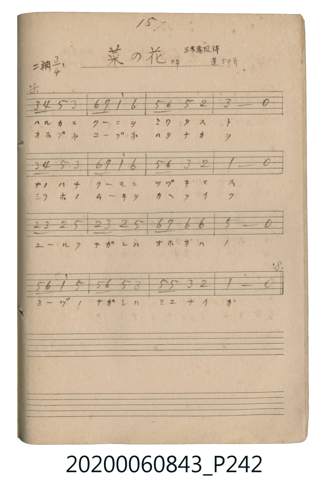

# 菜の花（油菜花）

> Re:Shōka 使用 AI 協助辨識與重建樂譜，可能會有錯誤。歡迎回報。

- **鋼琴伴奏版**：<br><audio controls src="nanohana.mp3"></audio>
- **NEUTRINO 歌聲合成版**：<br><audio controls src="nanohana_neutrino.mp3"></audio>

- 詞：三木露風
- 唱歌帖 P242 (三年 / 蓬萊唱集 50頁)

## 說明

菜の花（油菜花）
Source: 唱歌帖 (2020.006.0843), P242.jpg
Marginal notes: 15. / 三年 / 三木露風詩 / 蓬 50頁
Key: ニ調 (D major), Time: 3/4


## 歌詞

```text
1. ハルカニ クーニヲ ミワタス ト
ナノハナ クーモニ ツヅキマス
ユールク ナガレハ オホガハノ
ミーヅノ ナガレハ ミエナイガ
オホブネ コーブネ ハタナカヲ
シラホノ ムーキヲ カヘテイク
```

## ABC

<div class="abc-score" data-abc-src="nanohana.abc" aria-label="五線譜載入中"></div>

[下載 ABC 原始檔](nanohana.abc)

## TMD 檔案連結

- [主旋律 TMD 檔案](nanohana.tmd) [[在 TMD Studio 編輯](https://tmdlang.github.io/Tmd-TS/#tmd=s7IKdvYPcrWy4qpTUCpJTLdSSM7PyUlNLsnMz7MqzsjPTkzOyFeCS5bl55TmploBqXgDc4RwcX5pUXJqfEFieqpVgJGJEboM3KT4vPyS1KT8_GwMFRn5RYmZ8WB1xRmlCOmCovyy1LzEPKCS3MS80uLkosyCkvjk_IJKhJrUssyUVJCK1JTMkvyizMQcJBenFhWD_QJxYklRYh7EDKAgQlVJRirQWwU5iXklCEGgSemZeVYliZlAZ4GcVp4Yn5uYmQdUlaLEpaWl8KJ_zuPGdS-6Nr7f0_Fs004gF8zuVNDS4lK0VbA047K3VXDhsjHWN7EDmfp0ysZna3ue7pimAAokBY0nOzqf7tyioK_wYvKaFxO6gNIvZ7cpmBq8XNCoCXbGi5Xz3u-ZBVT2bM6Kl3M2vVy0QomLS19LwZZagEtBAacvQHLBkMhRQLhcw8jAyEDPwMBMz8DCxFhTB-wVvayCdJBy38QiYIgl5iiAornYSsHQVA_oO7g3kT3yYuVKiMch_gXp9k6ttFJ43Nz9YtV-BQ0XhdzErPwioAUhmcCoUQCGIUiNT2VRZnKxFYhpqAdU3P-4efXjptVAXQqPm9Y_bt4DZD1u3gSUmf-4ef3jpv2Pm3YCOR0gDY-bux4394H1dMFVLwJrbW553Nz6uGnt4-Z5QA0QxcvA8kDT14N1Nq153AxE_UCdqx43zwbzgSb1QRQDbQMqbgXy0RQDZZpWgIWWAEXBiiH6m6c9bu4FcjaDdUI4QAOBLgYpBvpoE0Tx9sfNK8HqQSYvACkGORPoQ5CaGY-b28Amrwcppjw9QIGClj4Xl19iXn5GYl6iVUAmkOVQY1BTDbJEwcZCyw7MqFEwVjBRMFXQBdK6QJ6ZgrmCYRyQaQbmmgJpkKQRmAdSAoIGIB5Yu49hDcjHQLwa5BmgOCgqQGpBQQ7jgbwKFmueD8TAqGjaDxIFxipEtANqbjzCXCOQCauAcrOBeBrYjF6ouZvBPBQxcIzuB8Ua2FyQO0CiIFsR5hLrX5AExL-GOPwLTHngmOwHuwFkJ8K_i5DDoLkFiFuBcmvBovOgKkH-xubf7UA1K8F-Bqnug5qxAOwniAnQcAT6EJhugLgNLLcEyQUY_jUCegjkHZCf0Xkg34M8DvM8du8uA1sNjlywFdAgaFoDpNeA5UABgRRhQBkkUbBHsHiXyuZCvQuKQXCEQnwIS8CQ2DYFQsLROx9sSytKJGB1Fyg5N62AJztYNIDUYPMvdc2t5eLStVOAZXAFIFuZCwA)]
- [鋼琴伴奏 TMD 檔案](nanohana_piano.tmd) [[在 TMD Studio 編輯](https://tmdlang.github.io/Tmd-TS/#tmd=s7IKdvYPcrWy4tLSUnjRP-dx47oXXRvf7-l4tmknkAtmdypoaXEp2ipYmnHZ2yq4cNkY65vYcdUpKD2dsvHZ2p6nO6YpBBiZGCloPNnR-XTnFgV9hReT17yY0AWUfjm7TcHU4OWCRk0lkIYXK-e93zMLqOzZnBUv52x6uWiFEheXvpaCLbUAl4ICbl88apiiEJCZmJev4JicnJ9bkJiXmZuaVwLSE5xfWpScaqWA8JGGkYGRgZ6BgZmegYWJsaYO2It6WQXpIOW-iUXpmXmJOQp5-SWpxVYKhqZ6QF_DvY_swRcrV0ICBBIOIN2UexMKFLT0ubj8gB7KSMxLtAJ7zaHGoKYaZImCjYWWHZhRo2CsYKJgqqALpHWBPDMFcwXDOCDTDMw1BdIgSSMwD6QEBA1APLB2H8MahcfN_UC8WuFx02qg-OPmbrDax03r4bzHzZsgYs3zgXg9UG4_SLRpJ1S0A2puPMJcI5AJq4Bys4F4GtiMXqi5m8E8FDGQC4BmPm7uApsLcgdIFGQrwlxi_QuSgPjXEId_u4C4D2wryA0gOxH-XYQcBs0tQNwKlFsLFp0HVQnyNzb_bgeqWQn2M0h1H9SMBWA_QUyAhiPQh4-bZwBxG1huCZILMPxrBPQQyDsgP6PzQL4HeRzmeezeXQa2Ghy5YCugQdC0BkivAcuBAgIpwoAySKJgj2DxLpXNhXoXFIPgCIX4EJaAIbFtCoSEo3c-2JZWlEjA6i5Qcm5aAU92sGgAqcHmX-qaW4ueu4M8sObv6tyCWnCiN9QGBYShNiLhG2uDQ8pQG5H4IYrM47WhQQRWjRpIkCxEpGkgabhppvHamGEOSZNQNUAKkU7RxcB5FWy6obaJOtQakCKwPLqp4KwMcxIiMaC6G5QgCDkSI6B9kAPaBB7QhvFAvSBUo2ASD-IBSbCoMUgUygZKA0mYG7FrASkGC8P1oGgCcY2gupDZQNoMzAMJQ0TRbQK6BGYTyEAMm0BeBnvYM6-kKB9LskL4thqYqqINYxWizXJjweEWbQLkmILZaCbgDi-ge0FagS4CugKq0TUvJTMvHb_doCQdbQS0GGQhyGKg9UC3gOIMwwwctkNCDRZFcJ26dgpglysAGbBYj_YBmY3MNwLzIbaAWMpcAA)]

## 分析

```text
================================================================================
📊 TMD Song Profile: [ 菜の花（油菜花） ]
================================================================================
⏱  Duration:       0:30 (30.0s), 16 measures total
🎼 Key & Tempo:    首調基準 D, != 96.0 BPM, <3/4>
   - 分析範圍：      由實際發聲的音符與和弦推測調性；播放脈絡另行呈現
🎤 人聲音域:    D4 (MIDI 62) – D5 (MIDI 74) [跨度: 12 個半音 / 1.0 個八度, 難度: easy]
   - 最低音:  D4 in [Nanohana #1 @ m.8, 0:13]
   - 最高音: D5 in [Nanohana #1 @ m.2, 0:02]
   - 適合: soprano, mezzo-soprano, contralto, tenor, baritone, bass
🏛  結構:      Nanohana (30.0s)
⚡ 編曲密度:        Peak 1 軌道同時演奏
🗝  調性診斷：       A 調性不明確（純淨自然大調，未偵測到可信轉調）
   - 風格氣質:    純淨自然大調（陽光明朗、易唱易記，無明顯調外色彩）
   - 轉調歷程:    全曲維持單一推測調性（未偵測到可信轉調）
   - 核心骨幹音:  A, F#, B, D, E
   - 調性數值:    A 調性不明確 [相關度: 0.80, 穩定度: Ambiguous, 自然音純度: 97.7%]
   - 候選調性 (K-S): A 大調 (0.80), D 大調 (0.79), F# 小調 (0.74)
   - 五度圈歷程:   +3
   - 各段落調性細節:
     • [Nanohana #1]: A 調性不明確 (r: 0.80, 自然音純度: 97.7%, 調外音: G)

  [ 五度圈游移軌跡 ]
               C  
         F            G  
      Bb               D  
      Eb              [A ]*
         Ab           E  
            Db       B  
               F# 
     (* = active key center)

  [ 十二半音累積音高分佈 ]
     C  :                            0.0%
     C# : ███                        3.4%
     D  : ██████████████            15.9%
     D# :                            0.0%
     E  : ████████████              13.6%
     F  :                            0.0%
     F# : ██████████████████        20.5%
     G  : ██                         2.3%
     G# :                            0.0%
     A  : ████████████████████████  27.3%
     A# :                            0.0%
     B  : ███████████████           17.0%
--------------------------------------------------------------------------------
Assignment 軌道音域：
  - Piano         : D4 – D5 (12 個半音 / 1.0 個八度, 52 個音符)
================================================================================
```


## 原書掃描頁




