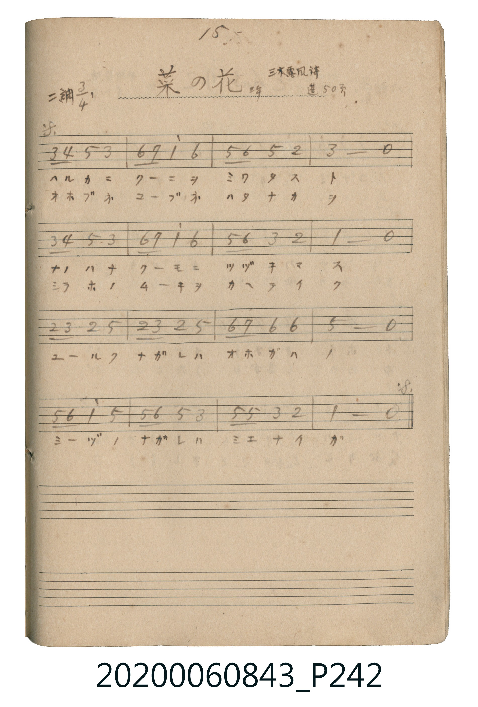

# 菜の花（油菜花）

<audio controls src="nanohana.mp3"></audio>

- 詞：三木露風
- 唱歌帖 P242 (三年 / 蓬萊唱集 50頁)

## 說明

菜の花（油菜花）
Source: 唱歌帖 (2020.006.0843), P242.jpg
Marginal notes: 15. / 三年 / 三木露風詩 / 蓬 50頁
Key: ニ調 (D major), Time: 3/4

## 歌詞

```text
1. ハルカニ クーニヲ ミワタス ト
ナノハナ クーモニ ツヅキマス
ユールク ナガレハ オホガハノ
ミーヅノ ナガレハ ミエナイガ
オホブネ コーブネ ハタナカヲ
シラホノ ムーキヲ カヘテイク
```

## ABC

```abc
X:1
T:菜の花（油菜花）
M:3/4
L:1/16
Q:1/4=96
K:D
V:V1 name="Vocal" snm="Voc"
[V:V1]
F2 G2 A4 F4 | B2 c2 d4 B4 | A2 B2 A4 E4 | F8 z4 |
F2 G2 A4 F4 | B2 c2 d4 B4 | A2 B2 F4 E4 | D8 z4 |
E2 F2 E4 A4 | E2 F2 E4 A4 | B2 c2 B4 B4 | A8 z4 |
A2 B2 d4 A4 | A2 B2 A4 F4 | A2 A2 F4 E4 | D8 z4 |
```

## TMD 檔案連結

- [主旋律 TMD 檔案](nanohana.tmd) [[在 TMD Studio 編輯](https://tmdlang.github.io/Tmd-TS/#tmd=s7IKdvYPcrWy4tLSUnjRP-dx47oXXRvf7-l4tmknkAtmdypoaXEp2ipYmnHZ2yq4cNkY65vYcdUpKD2dsvHZ2p6nO6YpBBiZGCloPNnR-XTnFgV9hReT17yY0AWUfjm7TcHU4OWCRk0lkIYXK-e93zMLqOzZnBUv52x6uWiFEheXvpaCLbUAl4ICTl-A5ILzS4uSU60UEC7XMDIwMtAzMDDTM7AwMdbUAXtFL6sgHaTcN7EoPTMvMUchL78ktdhKwdBUD-g7uDeRPfJi5UqIxyH-Ben2Tq20Unjc3P1i1X4FDReF3MSs_CKgBSGZuUAXAMMQpMansigzudgKxDTUAyruf9y8-nHTaqAuhcdN6x837wGyHjdvAsrMf9y8_nHT_sdNO4GcDpCGx81dj5v7wHq64KoXgbU2tzxubn3ctPZx8zygBojiZWB5oOnrwTqb1jxuBqJ-oM5Vj5tng_lAk_ogioG2ARW3AvloioEyTSvAQkuAomDFEP3N0x439wI5m8E6IRyggUAXgxQDfbQJonj74-aVYPUgkxeAFIOcCfQhSM2Mx81tYJPXgxRTnh6gQEFLn4vLLzEvPyMxL9EqLD85McehxqBGoRpki4KNhZYdmFGjYKxgomCqoAukdYE8MwVzBcM4INMMzDUF0iBJIzAPpAQEDUA8sHZgQnbIAcenrYISJLBWg7wFSgOg-AHSeyBsSIQCMVCsaT8Qg-NUCeRMVIPijUBGNa0CSs8G4mlADA5jqFFQPjgSgcaAkwHIuk1wo4jwEkgC4iVDQl4Cmg-ONpDXwEkO6o5FUG-1AHErUHwtkJ4H8hZuL20HKlkJ9RY4JUCMAmsFJwYgPQOI24DsJSCrkLxkBHQzyMUgb6HzQB4E-Q3mPwI-Wgb1ASiiwPkCSK8B0iAMzhoQJ4LFQL7uQ3IGKPDAYQmxGZY8IAFtCoQkhCwoMYDcAQw9SJZDdQdIvmkFVBwUHGvA7qjl4tK1U4AlbAUgW5kLAA)]
- [鋼琴伴奏 TMD 檔案](nanohana_piano.tmd) [[在 TMD Studio 編輯](https://tmdlang.github.io/Tmd-TS/#tmd=s7IKdvYPcrWy4tLSUnjRP-dx47oXXRvf7-l4tmknkAtmdypoaXEp2ipYmnHZ2yq4cNkY65vYcdUpKD2dsvHZ2p6nO6YpBBiZGCloPNnR-XTnFgV9hReT17yY0AWUfjm7TcHU4OWCRk0lkIYXK-e93zMLqOzZnBUv52x6uWiFEheXvpaCLbUAl4ICbl88apiiEJCZmJev4JicnJ9bkJiXmZuaVwLSE5xfWpScaqWA8JGGkYGRgZ6BgZmegYWJsaYO2It6WQXpIOW-iUXpmXmJOQp5-SWpxVYKhqZ6QF_DvY_swRcrV0ICBBIOIN2UexMKFLT0ubj8gB7KSMxLtArLT07McagxqFGoBtmiYGOhZQdm1CgYK5gomCroAmldIM9MwVzBMA7INANzTYE0SNIIzAMpAUEDEA-sHRg_DjmVRZnJxbYKSo-b-xUeN69WeNwExM3dQHo9kN4DYTdvAuL5QAwUa9oPxDuB7A4lkDNRDYo3AhnVtAooPRuIpwFxL1D5ZqhRUD7IKpAxzV1Q6zbBjSLCSyAJiJcMCXkJaH5zH8Q-sF0wLy2CeqsFiFuB4muB9DyQt3B7aTtQyUqot0BGLoAYBdYKDB2wN2YAcRuQvQRkFZKXjIBuBrkY5C10HsiDIL_B_EfAR8ugPgBFFMg3IF-tAdIgDApVaMiDxUC-7kNyBijwwGEJsRmWPCABbQqEJIQsKDGA3AEMPXBwoLkDJN-0AioOCo41YHfUIqVqcIYN8sCerqtzC2rBKcFQG-REQ21EajDWBvvBUBuRIiCKzOO1oY4Hq0Z1PiRdEWkaSBpummm8NmZoQGIRqgZIIWIWXQycgMGmG2qbqEOtASkCy6ObCk7fMCchognV3aCoIuRIjJD2QQlpE3hIG8YDNYNQjYJJPIgHJMGixiBRKBsoDSRhjsSuBaQYLAzXg6IJxDWC6kJmA2kzMA8kDBFFtwnoEphNIAMxbAL5GexjXTsFmKcVgGxlLgA)]

## 分析

```text
================================================================================
📊 TMD Song Profile: [ 菜の花（油菜花） ]
================================================================================
⏱  Duration:       0:30 (30.0s), 16 measures total
🎼 Key & Tempo:    首調基準 D, != 96.0 BPM, <3/4>
   - 分析範圍：      由實際發聲的音符與和弦推測調性；播放脈絡另行呈現
🎤 人聲音域:    D4 (MIDI 62) – D5 (MIDI 74) [跨度: 12 個半音 / 1.0 個八度, 難度: easy]
   - 最低音:  D4 in [Nanohana #1 @ m.8, 0:13]
   - 最高音: D5 in [Nanohana #1 @ m.2, 0:02]
   - 適合: soprano, mezzo-soprano, contralto, tenor, baritone, bass
🏛  結構:      Nanohana (30.0s)
⚡ 編曲密度:        Peak 1 軌道同時演奏
🗝  調性診斷：       A 調性不明確（純淨自然大調，未偵測到可信轉調）
   - 風格氣質:    純淨自然大調（陽光明朗、易唱易記，無明顯調外色彩）
   - 轉調歷程:    全曲維持單一推測調性（未偵測到可信轉調）
   - 核心骨幹音:  A, F#, B, D, E
   - 調性數值:    A 調性不明確 [相關度: 0.80, 穩定度: Ambiguous, 自然音純度: 97.7%]
   - 候選調性 (K-S): A 大調 (0.80), D 大調 (0.79), F# 小調 (0.74)
   - 五度圈歷程:   +3
   - 各段落調性細節:
     • [Nanohana #1]: A 調性不明確 (r: 0.80, 自然音純度: 97.7%, 調外音: G)

  [ 五度圈游移軌跡 ]
               C  
         F            G  
      Bb               D  
      Eb              [A ]*
         Ab           E  
            Db       B  
               F# 
     (* = active key center)

  [ 十二半音累積音高分佈 ]
     C  :                            0.0%
     C# : ███                        3.4%
     D  : ██████████████            15.9%
     D# :                            0.0%
     E  : ████████████              13.6%
     F  :                            0.0%
     F# : ██████████████████        20.5%
     G  : ██                         2.3%
     G# :                            0.0%
     A  : ████████████████████████  27.3%
     A# :                            0.0%
     B  : ███████████████           17.0%
--------------------------------------------------------------------------------
Assignment 軌道音域：
  - Vocal         : D4 – D5 (12 個半音 / 1.0 個八度, 52 個音符)
================================================================================
```


## 原書掃描頁




