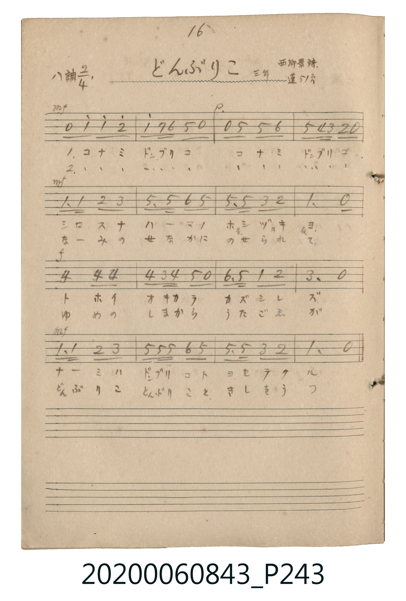

# どんぶりこ（漂呀漂）

> Re:Shōka 使用 AI 協助辨識與重建樂譜，可能會有錯誤。歡迎回報。

- **鋼琴伴奏版**：<br><audio controls src="donburiko.mp3"></audio>
- **NEUTRINO 歌聲合成版**：<br><audio controls src="donburiko_neutrino.mp3"></audio>

- 詞：西郷景
- 曲：佐々木英（佐々木すぐる）
- 唱歌帖 P243 (三年 / 蓬萊唱集 51頁)

## 說明

どんぶりこ（漂呀漂）
Source: 唱歌帖 (2020.006.0843), P243.jpg
Marginal notes: 16 / 三年 / 西郷景詩 / 蓬 51頁
Key: ハ調 (C major), Time: 2/4


## 歌詞

```text
1. コナミ ドンブリコ コナミ ドンブリコ
シロスナ ハーマノ ホシヅキヨ
トホイ オキカラ カズシレズ
ナーミハ ドンブリコト ヨセテクル
2. コナミ ドンブリコ コナミ ドンブリコ
なーみの せなかに のせられて
ゆめの しまから うたごゑが
どんぶりこ とんぶりこと きしをうつ
考證資訊：作詞：西郷景（西郷果）／作曲：佐々木英（佐々木すぐる筆名）。臺灣教育會公認《新定兒童唱歌》四年級補充教材第 20 首（4_20_donburiko）同曲。
```

## ABC

<div class="abc-score" data-abc-src="donburiko.abc" aria-label="五線譜載入中"></div>

[下載 ABC 原始檔](donburiko.abc)

## TMD 檔案連結

- [主旋律 TMD 檔案](donburiko.tmd) [[在 TMD Studio 編輯](https://tmdlang.github.io/Tmd-TS/#tmd=s7IKdvYPcrWy4qpTUCpJTLdSSM7PyUlNLsnMz7MqzsjPTkzOyFeCS5bl55TmploBqXgDc4RwcX5pUXJqfEFieqpVgJGJMboM3KT4vPyS1KT8_GwMFRn5RYmZ8WB1xRmlCOmCovyy1LzEPKCS3MS80uLkosyCkvjk_IJKhJrUssyUVJCK1JTMkvyizMQcJBenFhWD_QJxYklRYh7EDKAgQhVQU3pmnlVJYibQBSBXlCfG5yZm5uUk5qUgqyrJyE8vSizIqLTKyCwGWZWcmBOfnZiXiFBUkpEKDKHUlNLkRIgdWloKjxtXPm6a_Lhx2-OmrseNk9_v6Xi2p-npxAYg-X5Pp4KWFpeirYKhgQmXva2CM5eNkb6JHci8p1M2Plvb83THNAVQoCpoPNnR-XTnFgV9hReT17yY0AWUfjm7TcHU8OWCRk2wA16snPd-z6wXS_e_bN7-bOZ6sNiz2ZuAYk_2Tnjc0PpszooX3RuB1sO5jxtnPm6c8LipG-gOJS4ufS0FW2oBLgUFAh4HqQiGRL8Cwq8aRgZGBnoGBmZ6BhYmxpo6YM_rZRWkg5T7JhYBIyoxRwGUkIqtFAzNgMGBCBeYz1-sXAkJJkjogHR6p1ZaKTxu7n-xar-ChrNCbmJWfhHQ8JBMYGwpAEMcpManEhijxVYgpqGewuOmzY-bux43zwdq63zcDORMe9y8CiiKWwbs56btj5vXPm7aCVQCsvBx857HzfMeN_cBObPBkq2Pm9Y-bl4BVtzcARZdAtQGNACobfXj5pVAzurHTbvAitcAGRCVQAuBJs0HGoluLdAUoNCKx027Hze3PW5a_7h5NUiLEfl-aFwFsqxx_-PGdUDObBC_sftx42ogZx2I39T5uKnnceMyiIeBdjZCVE5_3LgPpLKpE8hpe9w4_3HjlMdNEx839mBJDkA-0M0IPpALFOoFmdI0Cax9CUjXi4bmF2s7X2xuf7GiC5yU56Clc2CygrLnzQEmq_d7-oFqiEz3z9e2PZ3QC9T1uKHpRfuu542Ln02d-aJp07M5zU9b17xY1fu4oevZtA1P18162jrp-eqlkHT6uKH76ezZwET3fMusF4vnPG1tBep6NnfC8zVrFIwMFF4umwa0zCTeyCA-JT8vqbQoMzsfaMXTCT1AVwEtAvmK8gwGBQpa-lxcLjBrrAIyE_PyHWoMaqpBtijYGJpp2YFZNQrVuWm1CgYKugqGcTDCCETUQNjmCmYKpkAapAKouACiFiQCwmZgURDLRMFYwQimDmy0j2GNQjyQB0pXQBKY7kHkfLAOSOoCC0wD4lVQRSDl5GmC2GhETxuRw88QKAIMPHAIGMPDBBRGoBACsREiIHmQOmAAg0UgEDXcgJkcLAosM4DsnXCHgZzUD9UBLD_AZB9UfDZEFKgTWJiAWWuhMiuQ7EENLWAWhpnWuB9MroPoaYSaBpQH5lwwazVUBqQCxJ8NtKETbE8PVGYZhj2wMAIGkQlUAkSDcA2YNAaSiOQFCixQECGnQmMQhSOUgCUcLCxA7gWVmGCXNIF8BfI_sMgEyq2EuQfMh4TSLmgYA8tSqMwu3KHU1Aazp6kRJZSmg3n7wGEECQ2oPY0QHcCyDoingHVOhMqAQgt7KOFKSSAIyWtkpCRwuoGEEShRQ9IPPGnDEjYi_YOCFJFogLUHkA3yDLAGgcpAghB7cgIV5VCfbwNqAWcmYJkO8TmoXMeQAJXvEOleqMbpQPlJYFYb0DMgGVC0otpYy8Wla6cAL-AUgBxlLgA)]
- [鋼琴伴奏 TMD 檔案](donburiko_piano.tmd) [[在 TMD Studio 編輯](https://tmdlang.github.io/Tmd-TS/#tmd=s7IKdvYPcrWy4qpTUCpJTLdSyC8qychPL0osyKi0ysgsLskvykxOzInPTsxLVIIrKs4vLUpOjS9ITE-1CjAyMUbIlGSk5qZapaaUJieWZObnKXFpaSk8blz5uGny48Ztj5u6HjdOfr-n49mepqcTG4Dk-z2dClpaXIq2CoYGJlz2tgrOXDZG-iZ2IPOeTtn4bG3P0x3TFEBWKGg82dH5dOcWBX2FF5PXvJjQBZR-ObtNwdTw5YJGTbADXqyc937PrBdL979s3v5s5nqw2LPZm4BiT_ZOeNzQ-mzOihfdG4HWw7mPG2c-bpzwuKkb6A4lLi59LQVbagEuBQVCHn_UMEUhIDMxL1_BMTk5P7cgMS8zNzWvBKQzGBzAVgqIMNAwMjAy0DMwMNMzsDAx1tQBB4peVkE6SLlvYlF6Zl5ijkJefklqsZWCoRkwmBDhBQuRFytXQoIPEmognS8aml-s7Xyxuf3Fii5wQM1BC0Wgo6HseXOAjn6_px-ohshQfb627emEXqCuxw1NL9p3PW9c_GzqzBdNm57NaX7auubFqt7HDV3Ppm14um7W09ZJz1cvhfj2cUP309mzgU5_vmXWi8Vznra2AnU9mzvh-Zo1CkYGCi-XTQNaZhJvZBCfkp-XVFqUmZ0PtOLphB6gq4AWgXxFefRBgYKWPheXC8waK3BsOdQY1FSDbFGwMTTTsgOzahSqc9NqFQwUdBUM42CEEYiogbDNFcwUTIE0SAVQcQFELUgEhM3AoiCWiYKxghFMHdhoH8MahXgg73HTZhDZ3AUm54N1PG7ufNwMEZ4GxKugikDKydMEsdGInjYih58hUAQYeOAQMIaHCSiMQCEEYiNEQPIgdcAABotAIGq4PW7aDhZ93LwWyN4JdxjISf1QHY-b54HJPqj4bIgoUOfj5lYway1UZgWSPaih9bhxFcy0xv1gch1ETyPUNKD848ZuMGs1VAakAsSfDbShE2xPD1RmGYY9sDACBpEJVAJEg3ANmDQGkojkBQosUBAhp0JjEIUjlJo74GEBcu_jpiUQlzSBfAXy_-Om1UC5lTD3gPmQUNoFDePHzWugMrtwh1JTG8yepkaUUJoO5u0DhxEkNKD2NEJ0PG6cD8RTwDonQmVAoYU9lHClJBCE5DUyUhI43UDCCJSoIekHnrRhCRuR_kFBikg0j5t2A9kgzzxuWg-VgQQh9uQEqjegPt8G1ALOTI0gEZDkCpAkugRQGCrdC9U4HSg_CcxqA3oGJAOKVlQbazFKtyAPPOWbsTYozIy1wQkLSplqw1IYhA8q6QzB6hBlnaE2KIwhojASUuZBeKBSzzxeG7XgwxmTED3gBA42BcJHFQephJoIjOh4bewxC8lShtqwTAVhQUiQebCshewfiJ3gdIMWAKbaODIZwTRJiT8wo9AHOQot4DFoGA80AEqCecZgHihpwKVMQFKm8WAuiAJKIuuGYCATph-oHsxD0gLCcOUQ86FGQBTDtABpI7gDIIJmqNpRdVPkAGAgeeaVFGFL4yaoSTzaMFYh2jQWyI02ywUyTYBMNO0o4YvQDgtZM0gwgjS55qVk5qXjtxRkJ9A-sEUI29F147ATaCE4yqB2g3Tp2imA3aoAZMATRrQP0GBUASOwAMQOEEuZCwA)]

## 分析

```text
================================================================================
📊 TMD Song Profile: [ どんぶりこ（漂呀漂） ]
================================================================================
⏱  Duration:       0:18 (18.5s), 16 measures total
🎼 Key & Tempo:    首調基準 C, != 104.0 BPM, <2/4>
   - 分析範圍：      由實際發聲的音符與和弦推測調性；播放脈絡另行呈現
🎤 人聲音域:    C4 (MIDI 60) – E5 (MIDI 76) [跨度: 16 個半音 / 1.3 個八度, 難度: moderate]
   - 最低音:  C4 in [Donburiko #1 @ m.5, 0:04]
   - 最高音: E5 in [Donburiko #1 @ m.12, 0:12]
   - 適合: soprano, mezzo-soprano, contralto, tenor, baritone, bass
🏛  結構:      Donburiko (18.5s)
⚡ 編曲密度:        Peak 1 軌道同時演奏
🗝  調性診斷：       C 大調（純淨自然大調，未偵測到可信轉調）
   - 風格氣質:    純淨自然大調（陽光明朗、易唱易記，無明顯調外色彩）
   - 轉調歷程:    全曲維持單一推測調性（未偵測到可信轉調）
   - 核心骨幹音:  G, C, E, D, F
   - 調性數值:    C 大調 [相關度: 0.95, 穩定度: High, 自然音純度: 100.0%]
   - 候選調性 (K-S): C 大調 (0.95), G 大調 (0.73), E 小調 (0.56)
   - 五度圈歷程:   +0
   - 各段落調性細節:
     • [Donburiko #1]: C 大調 (r: 0.95, 自然音純度: 100.0%)

  [ 五度圈游移軌跡 ]
              [C ]*
         F            G  
      Bb               D  
      Eb               A  
         Ab           E  
            Db       B  
               F# 
     (* = active key center)

  [ 十二半音累積音高分佈 ]
     C  : ██████████████████████    25.0%
     C# :                            0.0%
     D  : ███████████               12.5%
     D# :                            0.0%
     E  : ████████████              14.3%
     F  : █████████                 10.7%
     F# :                            0.0%
     G  : ████████████████████████  27.7%
     G# :                            0.0%
     A  : ████████                   8.9%
     A# :                            0.0%
     B  : █                          0.9%
--------------------------------------------------------------------------------
Assignment 軌道音域：
  - Piano         : C4 – E5 (16 個半音 / 1.3 個八度, 53 個音符)
================================================================================
```


## 原書掃描頁




