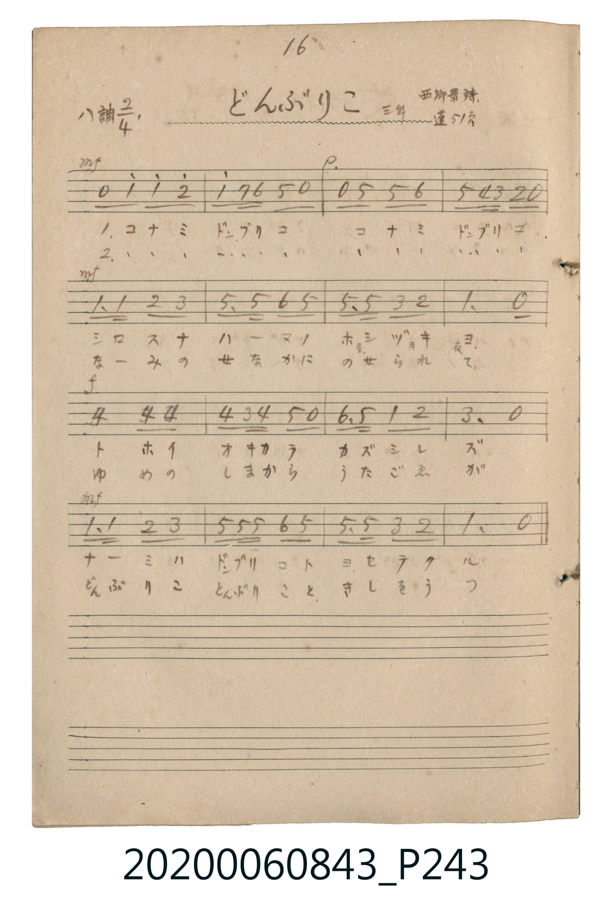

# どんぶりこ（漂呀漂）

<audio controls src="donburiko.mp3"></audio>

- 詞：西郷景
- 唱歌帖 P243 (三年 / 蓬萊唱集 51頁)

## 說明

どんぶりこ（漂呀漂）
Source: 唱歌帖 (2020.006.0843), P243.jpg
Marginal notes: 16 / 三年 / 西郷景詩 / 蓬 51頁
Key: ハ調 (C major), Time: 2/4

## 跨冊／重複收錄參照

> 同曲（〈どんぶりこ〉；收錄於《新定兒童唱歌》四年級與《唱歌帖》P243《蓬萊唱歌集》抄譜）

- **[同曲]** 《新定兒童唱歌》尋常科第四學年用（2020.006.0847.0004）：[**〈どんぶりこ〉**](../../../shintei_jido_shoka/grade_4_2020.006.0847.0004/4_20_donburiko/index.md)（`C` / `2/4` — [原始 TMD](../../../shintei_jido_shoka/grade_4_2020.006.0847.0004/4_20_donburiko/donburiko.tmd)）
- 總表：[跨冊重複與同名歌曲總索引](../../../duplicate_songs.md)

## 歌詞

```text
1. コナミ ドンブリコ コナミ ドンブリコ
シロスナ ハーマノ ホシヅキヨ
トホイ オキカラ カズシレズ
ナーミハ ドンブリコト ヨセテクル
2. コナミ ドンブリコ コナミ ドンブリコ
なーみの せなかに のせられて
ゆめの しまから うたごゑが
どんぶりこ とんぶりこと きしをうつ
```

## ABC

```abc
X:1
T:どんぶりこ（漂呀漂）
M:2/4
L:1/16
Q:1/4=104
K:C
V:V1 name="Vocal" snm="Voc"
[V:V1]
!mf! z2 c2 c2 d2 | c2 B A G2 z2 | !p! z2 G2 G2 A2 | G2 F E D2 z2 |
!mf! C3 C D2 E2 | G3 G A2 G2 | G3 G E2 D2 | C6 z2 |
!f! F4 F2 F2 | F2 E F G2 z2 | A3 G c2 d2 | e6 z2 |
!mf! C3 C D2 E2 | G G G2 A2 G2 | G3 G E2 D2 | C6 z2 |
```

## TMD 檔案連結

- [主旋律 TMD 檔案](donburiko.tmd) [[在 TMD Studio 編輯](https://tmdlang.github.io/Tmd-TS/#tmd=s7IKdvYPcrWy4qpTUCpJTLdSSM7PyUlNLsnMz7MqzsjPTkzOyFeCS5bl55TmploBqXgDc4RwcX5pUXJqfEFieqpVgJGJMboM3KT4vPyS1KT8_GwMFRn5RYmZ8WB1xRmlCOmCovyy1LzEPKCS3MS80uLkosyCkvjk_IJKhJrUssyUVJCK1JTMkvyizMQcJBenFhWD_QJxYklRYh7EDKCgEpeWlsLjxpWPmyY_btz2uKnrcePk93s6nu1pejqxAUi-39OpoKXFpWirYGhgwmVvq-DMZWOkb2IHMvzplI3P1vY83TFNAeRhBY0nOzqf7tyioK_wYvKaFxO6gNIvZ7cpmBq-XNCoCXbNi5Xz3u-Z9WLp_pfN25_NXK_ExaWvpWBLLcCloEDAJyAVwZCwVkA4XsPIwMhAz8DATM_AwsRYUwfsG72sgnSQct_EovTMvMQcBVCsFVspGJoB_YfwKMwrL1auhPgb4l2QTu_USiuFx839L1btV9BwVshNzMovAhoekglMPArAIASp8aksykwutgIxDfUUHjdtftzc9bh5PlBb5-NmIGfa4-ZVQFHcMmA_N21_3Lz2cdNOoBKQhY-b9zxunve4uQ_ImQ2WbH3ctPZx8wqw4uYOsOgSoDagAUBtqx83rwRyVj9u2gVWvAbIgKgEWgg0aT7QSHRrgaYAhVY8btr9uLntcdP6x82rQVqMyPdD4yqQZY37HzeuA3Jmg_iN3Y8bVwM560D8ps7HTT2PG5dBPAy0sxGicvrjxn0glU2dQE7b48b5jxunPG6a-LixB0tyAPKBbkbwgVygUC_IlKZJYO1LQLooT4pQoKClz8Xlkp-XVFqUmZ1vFZafnJjjUGNQo1ANskbBxtBMyw7MAorkptUqGCjoKhjGwQgjEFEDYZsrmCmYAmmQCqDiAohakAgIm4FFQSwTBWMFI5g6sNHAHOaQA05mtgpK4HgApxJwLAAxiD8NiFeB4geCccsrgTyEami8ERWNhQaDIdDxwDAAe8QY7jWQV0EeBbERIiB5kDpgOIFFIBCn97cD7VwLtHMn1D2glL0HiOcBMTi_gHITkG4F0kB1zStwerkR6HSQ1sb9oCQKSrOgRAzE3UAMTrYQMVDCbOoBspchexPoSxOoW0E0CNeASWMgiYhokH9BvkROD8YgipBHwfkTZDs4n0M80wR0FSSrA_EuqEfXgNi447UNKN0I9cx0IN4H8SAktwExMD4bpwD5E4F0DzHxCIKQBEtJPILjDhRvoPQELp0w0xykiAKydwNpkD_WA-nVuOMTFDKgEmIbkAYaDyktsIs19kKCo2kSNBiWgI2t5eLStVOA53cFIEeZCwA)]
- [鋼琴伴奏 TMD 檔案](donburiko_piano.tmd) [[在 TMD Studio 編輯](https://tmdlang.github.io/Tmd-TS/#tmd=s7IKdvYPcrWy4tLSUnjcuPJx0-THjdseN3U9bpz8fk_Hsz1NTyc2AMn3ezoVtLS4FG0VDA1MuOxtFZy5bIz0Tey46hSUnk7Z-Gxtz9Md0xQCjEyMFTSe7Oh8unOLgr7Ci8lrXkzoAkq_nN2mYGr4ckGjphJIw4uV897vmfVi6f6XzdufzVyvxMWlr6VgSy3ApaBAyCePGqYoBGQm5uUrOCYn5-cWJOZl5qbmlYB0BueXFiWnWikgPKVhZGBkoGdgYKZnYGFirKkD9qVeVkE6SLlvYlF6Zl5ijkJefklqsZWCoRnQ34gAgHnxxcqVkPCABANIJ-UehQIFLX0uLpf8vKTSoszsfKuw_OTEHIcagxqFapA1CjaGZlp2YBZQJDetVsFAQVfBMA5GGIGIGgjbXMFMwRRIg1QAFRdA1IJEQNgMLApimSgYKxjB1IGNBsafQ05lUWZysa2C0uOmzQqPm7uAeD4QdwIxiD8NiFcpgOXwyyuBPIRqaLwRFY2FBoMh0PHAMAB7xBjuNZBXQR4FsREiIHmQOmA4gUUgEKf3twPtXAu0cyfUPf1AvAeI5wFxHxDPBsqB1LQCaaC65hU4vdwIdDpIa-N-IF4HxECtILHGbiBejRBrAnq3qQfIXobsTaAvTaBuBdEgXAMmjYEkIqJB_gX5Ejk9GIMoQh5t7oB6ZgkQgwIZ5Gmgq5pXQuimXVCPrgGxccdrG1C6EeqZ6UC8D-JBkKcagXKNwPhsnALkTwTSPcTEIwhCEiwl8QiOO1C8gdITKA6xpDlwEKwAsncDaZA_1gPp1bjjExQyk4He2AakgcY3gtgg7VjEGnshwdE0CRoMS8DG1iJndnAhFuSBL7sba4N8b6wNjl0oZaoNi2YIH5TxDcHqEFnfUBsUWhBRGAkpAiA8UCFgHq-NWg7gjBOIHnAqA5sC4aOKg1RCTQRGWbw29jiCpGtDbVjKhrAgJMg8WPpG9g_ETnAKQAsAU20cKZ1g6qLEH5hx6IMShxbwKDSMB5oAJcE8YzDPAFnKBCRlGg_mgiigJLJuCAYyYfqB6sE8JC0gDFcOMR9qBEQxTAuQNoI7ACJohqodVTdFDgCGkmdeSRHWVG6CmsijDWMVok1jgdxos1wg0wTIRNOPGsII_bCwNYMEJEiXa15KZl46AWtBtgJtBFuFsB9dOy5bgVaCow1qO0ibrp0C2LkKQAY8dYA4EPNALGUuAA)]

## 分析

```text
================================================================================
📊 TMD Song Profile: [ どんぶりこ（漂呀漂） ]
================================================================================
⏱  Duration:       0:18 (18.5s), 16 measures total
🎼 Key & Tempo:    首調基準 C, != 104.0 BPM, <2/4>
   - 分析範圍：      由實際發聲的音符與和弦推測調性；播放脈絡另行呈現
🎤 人聲音域:    C4 (MIDI 60) – E5 (MIDI 76) [跨度: 16 個半音 / 1.3 個八度, 難度: moderate]
   - 最低音:  C4 in [Donburiko #1 @ m.5, 0:04]
   - 最高音: E5 in [Donburiko #1 @ m.12, 0:12]
   - 適合: soprano, mezzo-soprano, contralto, tenor, baritone, bass
🏛  結構:      Donburiko (18.5s)
⚡ 編曲密度:        Peak 1 軌道同時演奏
🗝  調性診斷：       C 大調（純淨自然大調，未偵測到可信轉調）
   - 風格氣質:    純淨自然大調（陽光明朗、易唱易記，無明顯調外色彩）
   - 轉調歷程:    全曲維持單一推測調性（未偵測到可信轉調）
   - 核心骨幹音:  G, C, E, D, F
   - 調性數值:    C 大調 [相關度: 0.95, 穩定度: High, 自然音純度: 100.0%]
   - 候選調性 (K-S): C 大調 (0.95), G 大調 (0.73), E 小調 (0.56)
   - 五度圈歷程:   +0
   - 各段落調性細節:
     • [Donburiko #1]: C 大調 (r: 0.95, 自然音純度: 100.0%)

  [ 五度圈游移軌跡 ]
              [C ]*
         F            G  
      Bb               D  
      Eb               A  
         Ab           E  
            Db       B  
               F# 
     (* = active key center)

  [ 十二半音累積音高分佈 ]
     C  : ██████████████████████    25.0%
     C# :                            0.0%
     D  : ███████████               12.5%
     D# :                            0.0%
     E  : ████████████              14.3%
     F  : █████████                 10.7%
     F# :                            0.0%
     G  : ████████████████████████  27.7%
     G# :                            0.0%
     A  : ████████                   8.9%
     A# :                            0.0%
     B  : █                          0.9%
--------------------------------------------------------------------------------
Assignment 軌道音域：
  - Vocal         : C4 – E5 (16 個半音 / 1.3 個八度, 53 個音符)
================================================================================
```


## 原書掃描頁




