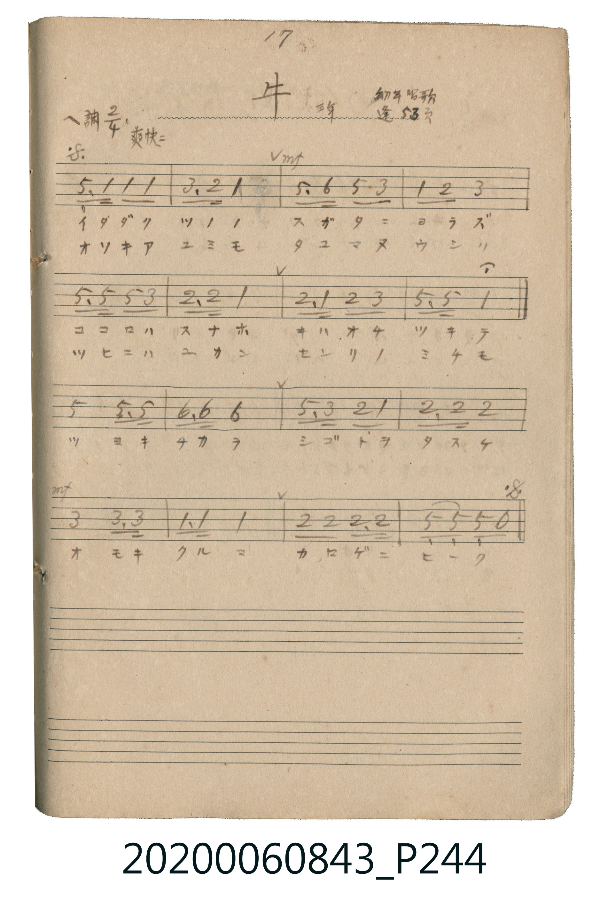

# 牛（牛）

> Re:Shōka 使用 AI 協助辨識與重建樂譜，可能會有錯誤。歡迎回報。

- **鋼琴伴奏版**：<br><audio controls src="ushi.mp3"></audio>
- **NEUTRINO 歌聲合成版**：<br><audio controls src="ushi_neutrino.mp3"></audio>

- 唱歌帖 P244 (三年 / 幼年唱歌 / 蓬萊唱集 53頁)

## 說明

牛（牛）
Source: 唱歌帖 (2020.006.0843), P244.jpg
Marginal notes: 17 / 三年 / 幼年唱歌 / 蓬 53頁 / 爽快ニ
Key: ヘ調 (F major), Time: 2/4, Tempo: 爽快ニ


## 歌詞

```text
1. イダダク ツノノ スガタニ ヨラズ
ココロハ スナホ キハオチ ツキテ
ツヨキ チカラ シゴトヲ タスケ
オモキ クルマ カロゲニ ヒーク
2. オソキア ユミモ タユマヌ ウシノ
ツヒニハ ユカン センリノ ミチモ
```

## ABC

<div class="abc-score" data-abc-src="ushi.abc" aria-label="五線譜載入中"></div>

[下載 ABC 原始檔](ushi.abc)

## TMD 檔案連結

- [主旋律 TMD 檔案](ushi.tmd) [[在 TMD Studio 編輯](https://tmdlang.github.io/Tmd-TS/#tmd=s7IKdvYPcrWy4qpTUCpJTLdSSM7PyUlNLsnMz7MqzsjPTkzOyFeCS5bl55TmploBqXgDc4RwcX5pUXJqfEFieqpVgJGJCboM3KT4vPyS1KT8_GwMFRn5RYmZ8WB1xRmlCOmCovyy1LzEPKCS3MS80uLkosyCkvjk_IJKhJrUssyUVJCK1JTMkvyizMQcJBenFhWD_QJxYklRYh7EDKAgQlVJRirQW4l5mbnIeoFGpWfmWeWmZmZlxpekVpRAXK6lpfC8c_b7PR1gslNBS4tL0VbB0MCCy95WwY3LxkjfxA5kxtMpG5-t7Xm6Y5oCKEwUNJ7s6Hy6c4uCvsLTnXuADIg0kPti8poXE7qA3Jez2xRMjV8uaNRU4uLS11KwpRbgUlBAcTKIHwwJdwWEKzWMDIwM9AwMzPQMLEyMNXXAztbLKkgHKfdNLAKGRWKOAigGi60UDM2BLsfjI4hHgOznHXuf7l_9uLkbZIp3aqWVwuPmGS9W7VfQcFPITczKLwJaFJIJDH0FYLgBmam5BflWqLp8Kosyk4utQExDPYXHTUseNzeAUNN6oFktj5v7gAgovPNx05rHTfuBmoDCKx43r3zctAuk53HTZhBqXvu4uR-srLnrcfNsIAsk8Lhp1ePmRrA5IH4bWAPI0BVAPpDV-LgJ6IyVQNXbHzdtedzc8bh5E5CzH2zdRojxQBMWgVU3rX_cDFQ9D8gCUmsfN22COGbS4-Y9QEmQaiOQB1Y9btoLsq5pEVBy2ePm-UADwIaCOPMeN_cAOctANjb3wd0DNKMb7AGgGpDpm4FqdgOpx81A64HeBxnSCDQHpIHyFAMFClr6XFyhxRmZjlZh-cmJOQ41BjXVIBsUbAzNtOzArBoF03gFXSA0BEIQqQsUMgaLGIF5IFijUJ2bVgtTaRYPYxnHA6VAioxAHJhisLk-hjWguAaLAGMbjIEsYKSDjAOGCVQG5Pc-uDXAeIGIN60BhShUTTdYxwoweyVYdheqXUYgnaugOveC0gaYtQhq1zKoOfOBGCQGswtm_jIgngdl94BlQDqAMQh1IcwuWICBuaZQ2hgoAvI-anhBRAzhAYPQBVeDFEyboU4HpopmkNNB1vYjB0dzFxDPRnI6QhXE46BcgBKw4OTfhhlM8ICfBA5YJLtgwdS0GsiGuAhi126oKpDrIHaBggSkYz5UBpQD4QHLVQtJdE54Ex1UNSxUahTMwCwzKI0IMWNwGELSJSycITTcXwhvgRwDSieQAACJg4IF5ilQ2oF5ChS3IPEtQPEOsL5NUBloqgAGPbCIgFsEdTc4H8BSOoQGJQBIpEKyECIBwDCIhOYzBGGA4n5o6gW5AxKQUPeD8wtIFOR-SBqFuHI1WBSUDIDlFFQNJJ9MArP3gGVAukGWgSNF104BXBgoQBlOIIYyFwA)]
- [鋼琴伴奏 TMD 檔案](ushi_piano.tmd) [[在 TMD Studio 編輯](https://tmdlang.github.io/Tmd-TS/#tmd=s7IKdvYPcrWy4tLSUnjeOfv9ng4w2amgpcWlaKtgaGDBZW-r4MZlY6RvYsdVp6D0dMrGZ2t7nu6YphBgZGKioPFkR-fTnVsU9BWe7twDZECkgdwXk9e8mNAF5L6c3aZgavxyQaOmEheXvpaCLbUAl4ICqpMfNUxRCMhMzMtXcExOzs8tSMzLzE3NKwGpC84vLUpOtVJAuF7DyMDIQM_AwEzPwMLEWFMH7B29rIJ0kHLfxKL0zLzEHIW8_JLUYisFQ3Ogj_D4FOJBIPt5x96n-1c_bu4GmUK5F6FAQUufiyu0OCPT0QrsP4cag5pqkA0KNoZmWnZgVo2CabyCLhAaAiGI1AUKGYNFjMA8EKxRqM5Nq4WpNIuHsYzjgVIgRUYgDkwx2FwfwxqFx01LwCKPmxvAGMhqWg827nFzC1SmD4xh1jxu2gkRb1oDxPuharrBOlaA2SvBsrtQ7TIC6VwF1bkXiNeCWYugdi2DmjMfiEFiMLtg5i8D4nlQdg9YBqTjcdN2qAthdsECDMw1hdLGQBGQ91HDCyJiCA8YhC64GqRg2gx1-magdSCng6ztRw6O5i4gno3kdIQqiMcfNzeiBixQxePmNsxgggf8JHDAItkFC6am1UA2xEUQu3ZDVYFcB7ELFCQgHfOhMo3IActVC0l0TngTHVQ1LFRqFMzALDMojQgxY3AYQtIlLJwhNNxfCG-BHANKJ5AAAImDggXmKVDagXkKFLcg8S1A8Q6wvk1QGWiqAAb946aNcIug7gbnA1hKh9CgBACJVEgWQiQAGAaR0HyGIAxQ3A9NvSB3QAIS6n5wfgGJgtwPSaMQV64Gi4KSweMmkMsR-WQSmL0HLAPSDbIMHinQkiDIA3u0IGdzQ2D21gZ5CEqBfKANKxmgYtCIwlouQJUANYHCAK4X5mtgoGnD8wSUBQpKqHoslkDFkTOVeTzcDKBioBJE7kJNhbg8DLMZaCzcJJAoLDXCWCDLEK5EpEiglUA3wByMzEP4ExqocP_DmSDvwv0ID26IZWYQc6CUiTrCEqilEINQaEiSQo1pH2SPWyD8DYqreBiFlW-CRx7DFGOwKhAHxRgQaQQXQ1FggBFHBJ0KsQTqLigFlgdJGAExSAzFUiCF6VaI08yAJEgfjAZmWSgPRqOYBHWuZ15JUT6WJGWCmoWiDWPBsRhtGqsQbZYbi6EZxa8IzUDXQTMUMDOB9bjmpWTmpeO3EWShCdAioGVAKyFWo-vFYaEJOM_CLAZp0rVTALtTAcgAp6NoH5CJEI4TkqgRWBRiB4ilzAUA)]

## 分析

```text
================================================================================
📊 TMD Song Profile: [ 牛（牛） ]
================================================================================
⏱  Duration:       0:17 (17.8s), 16 measures total
🎼 Key & Tempo:    首調基準 F, != 108.0 BPM, <2/4>
   - 分析範圍：      由實際發聲的音符與和弦推測調性；播放脈絡另行呈現
🎤 人聲音域:    A3 (MIDI 57) – D5 (MIDI 74) [跨度: 17 個半音 / 1.4 個八度, 難度: challenging]
   - 最低音:  A3 in [UshiA #1 @ m.3, 0:03]
   - 最高音: D5 in [UshiB #1 @ m.10, 0:10]
   - 適合: soprano, mezzo-soprano, contralto, tenor, baritone, bass
🏛  結構:      UshiA (8.9s) -> UshiB (8.9s)
⚡ 編曲密度:        Peak 1 軌道同時演奏
🗝  調性診斷：       C 大調（推測轉調經歷 1 次）
   - 風格氣質:    純淨自然大調（陽光明朗、易唱易記，無明顯調外色彩）
   - 轉調歷程:    C 大調起奏 ➔ [UshiB] 轉至 C 大調 (-5 半音 / 五度圈 +1 步)
   - 核心骨幹音:  C, F, G, A, D
   - 調性數值:    C 大調 [相關度: 0.85, 穩定度: Moderate, 自然音純度: 100.0%]
   - 候選調性 (K-S): C 大調 (0.85), F 大調 (0.80), A 小調 (0.57)
   - 五度圈歷程:   -1 -> +0
   - 各段落調性細節:
     • [UshiA #1]: F 大調 (r: 0.86, 自然音純度: 100.0%)
     • [UshiB #1]: C 大調 (r: 0.86, 自然音純度: 100.0%)

  [ 五度圈游移軌跡 ]
              [C ]*
        [F ]*          G  
      Bb               D  
      Eb               A  
         Ab           E  
            Db       B  
               F# 
     (* = active key center)

  [ 十二半音累積音高分佈 ]
     C  : ████████████████████████  29.4%
     C# :                            0.0%
     D  : ██████                     7.1%
     D# :                            0.0%
     E  :                            0.0%
     F  : ███████████████████       23.8%
     F# :                            0.0%
     G  : ███████████████████       23.8%
     G# :                            0.0%
     A  : █████████████             15.9%
     A# :                            0.0%
     B  :                            0.0%
--------------------------------------------------------------------------------
Assignment 軌道音域：
  - Vocal         : A3 – D5 (17 個半音 / 1.4 個八度, 54 個音符)
================================================================================
```


## 原書掃描頁




