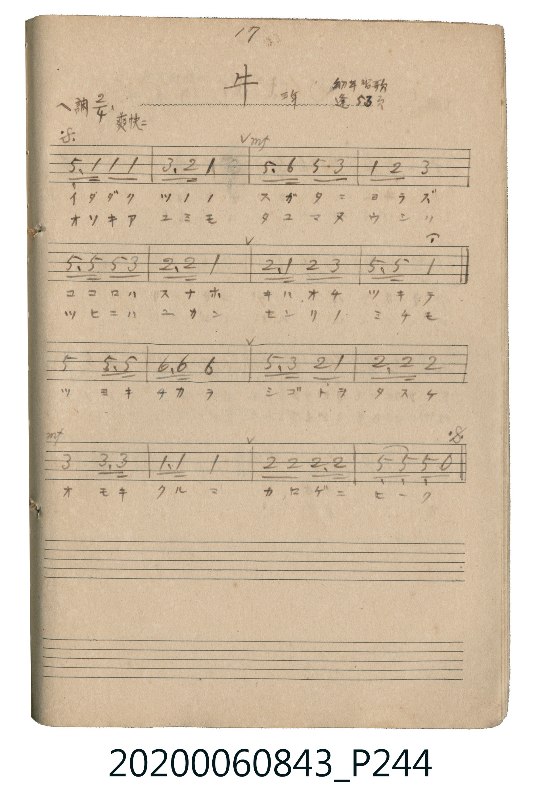

# 牛（牛）

<audio controls src="ushi.mp3"></audio>

- 唱歌帖 P244 (三年 / 幼年唱歌 / 蓬萊唱集 53頁)

## 說明

牛（牛）
Source: 唱歌帖 (2020.006.0843), P244.jpg
Marginal notes: 17 / 三年 / 幼年唱歌 / 蓬 53頁 / 爽快ニ
Key: ヘ調 (F major), Time: 2/4, Tempo: 爽快ニ

## 歌詞

```text
1. イダダク ツノノ スガタニ ヨラズ
ココロハ スナホ キハオチ ツキテ
ツヨキ チカラ シゴトヲ タスケ
オモキ クルマ カロゲニ ヒーク
2. オソキア ユミモ タユマヌ ウシノ
ツヒニハ ユカン センリノ ミチモ
```

## ABC

```abc
X:1
T:牛（牛）
M:2/4
L:1/16
Q:1/4=108
K:F
V:V1 name="Vocal" snm="Voc"
[V:V1]
C3 F F2 F2 | A3 G F4 | !mf! C3 D C3 A, | F2 G2 A4 |
c3 c c3 A | G3 G F4 | G3 F G2 A2 | c3 c F4 |
c4 c3 c | d3 d d4 | c3 A G2 F2 | G3 G G4 |
!mf! A4 A3 A | F3 F F4 | G2 G2 G3 G | C2 C2 C2 z2 |
```

## TMD 檔案連結

- [主旋律 TMD 檔案](ushi.tmd) [[在 TMD Studio 編輯](https://tmdlang.github.io/Tmd-TS/#tmd=s7IKdvYPcrWy4tLSUnjeOfv9ng4w2amgpcWlaKtgaGDBZW-r4MZlY6RvYsdVp6D0dMrGZ2t7nu6YphBgZGKioPFkR-fTnVsU9BWe7twDZECkgdwXk9e8mNAF5L6c3aZgavxyQaOmEheXvpaCLbUAl4ICipNB_OD80qLkVCsFhCs1jAyMDPQMDMz0DCxMjDV1wM7WyypIByn3TSxKz8xLzFHIyy9JLbZSMDQHuhyPjyAeAbKfd-x9un_14-ZukCneqZVWCo-bZ7xYtV9Bw00hNzErvwhoUUhmLtAlwHADMlNzC_KtUHX5VBZlJhdbgZiGegqPm5Y8bm4Aoab1QLNaHjf3ARFQeOfjpjWPm_YDNQGFVzxuXvm4aRdIz-OmzSDUvPZxcz9YWXPX4-bZQBZI4HHTqsfNjWBzQPw2sAaQoSuAfCCr8XET0Bkrgaq3P27a8ri543HzJiBnP9i6jRDjgSYsAqtuWv-4Gah6HpAFpNY-btoEccykx817gJIg1UYgD6x63LQXZF3TIqDkssfN84EGgA0FceY9bu4BcpaBbGzug7sHaEY32ANANSDTNwPV7AZSj5uB1gO9DzKkEWgOSAPlKQYKFLT0ubhCizMyrcLykxNzHGoMahSqQTYo2BiaadmBWTUKpvEKukBoCIQgUhcoZAwWMQLzQBCoLTetFqbSLB7GMo4HSoEUGYE4MMVgc4EZwCEHHPO2CkrASAd6sQGCIfEOxCBvg2MeiNeAAhDIB0c-EIOibJcSyAOohsUbgY1bBZTeC0oDQAyOBVAIAjE4HqB8YDxCogIU-yCr4MYB_Qx2qSmUNgaKgHyA6mWIiCHcbwhdcDXYfAqKWSBuBiU_cIIF0l1ADE6yUDGg8yGpFirWhtOn4ICaBA0YcPIBpU4gDU5AELoZZBw4DUGNXYThU5CrIWSNghkkEqE0wl_GYJ9CEgAsNCA0dp-CnQaMK0hGgzoLnNWAeAuQ3QHE4NwGjeONSM4CpydYioHQoFiAhCwkKSJiAYZBJDS9IggDXBEBChVQegDnbCAb5Dxw3oZEThPQaZDsDcR7QGrAzqvl4tK1UwBlGgUgrcwFAA)]
- [鋼琴伴奏 TMD 檔案](ushi_piano.tmd) [[在 TMD Studio 編輯](https://tmdlang.github.io/Tmd-TS/#tmd=s7IKdvYPcrWy4tLSUnjeOfv9ng4w2amgpcWlaKtgaGDBZW-r4MZlY6RvYsdVp6D0dMrGZ2t7nu6YphBgZGKioPFkR-fTnVsU9BWe7twDZECkgdwXk9e8mNAF5L6c3aZgavxyQaOmEheXvpaCLbUAl4ICqpMfNUxRCMhMzMtXcExOzs8tSMzLzE3NKwGpC84vLUpOtVJAuF7DyMDIQM_AwEzPwMLEWFMH7B29rIJ0kHLfxKL0zLzEHIW8_JLUYisFQ3Ogj_D4FOJBIPt5x96n-1c_bu4GmUK5F6FAQUufiyu0OCPTKiw_OTHHocagRqEaZIOCjaGZlh2YVaNgGq-gC4SGQAgidYFCxmARIzAPBIHactNqYSrN4mEs43igFEiREYgDUww2FxhjDjmVRZnJxbYKSo-blig8bm6A4Kb1QLoFiPsguGknEK8B4v1AfjcQrwDilUD-LiWQB1ANizcCG7cKKL0XiNcC8SKg8mVAPB-IgWywMSD-PCDuAfKB7KbtIKvgxgH9DHapKZQ2BoqAfIDqZYiIIdxvCF1wNdh8uhloHRA3A53W3A_xXXMXEM-GOBcsBnR-cyMkFMBibTh9Cg6oSdCAAWoF-axpNZAGWbMbQjeDjAMFJigEQMYuwvApyNUQskbBDBKJUBrhL2OwTyEJABYaEBq7T8FOA8YV2AdAa8HOAsUbMLCbtgDZHUC8CRIh4DjeiOQscHqCpRgIDYoFSMhCkiIiFmAYRELTK4IwwBURoFABpQdQGgElOZDzgGkC7EyQGNBp4FAFhe4ekBqw82qhOQZcIAR54MgzyNnBEJgNtEEOhlIgF2rDchBUDBrOWPMPVAlQE8iPcL0wXwEDRRue8KAsUFBB1WOxBCqOnHLN4-FmABUDlaAmYYQdQG1wlSBRWGKBsUCGIVyBSDBAI4F2wByEzEPYAQ00uP_gTJB34H6AByfEMjOIOVDKRB1hCdRSiEEoNCRJoMSkD0pMWsAj0hAUF_EwCivfBI88hinGYFUgDooxINIILoaiwACnKVCLoRRYHiRhBMQgMRRTgRSmMRC7zYAkSB-MBuYpKA9Go5gEcg8w6HTtFEChpwCklbkA)]

## 分析

```text
================================================================================
📊 TMD Song Profile: [ 牛（牛） ]
================================================================================
⏱  Duration:       0:17 (17.8s), 16 measures total
🎼 Key & Tempo:    首調基準 F, != 108.0 BPM, <2/4>
   - 分析範圍：      由實際發聲的音符與和弦推測調性；播放脈絡另行呈現
🎤 人聲音域:    A3 (MIDI 57) – D5 (MIDI 74) [跨度: 17 個半音 / 1.4 個八度, 難度: challenging]
   - 最低音:  A3 in [Ushi #1 @ m.3, 0:03]
   - 最高音: D5 in [Ushi #1 @ m.10, 0:10]
   - 適合: soprano, mezzo-soprano, contralto, tenor, baritone, bass
🏛  結構:      Ushi (17.8s)
⚡ 編曲密度:        Peak 1 軌道同時演奏
🗝  調性診斷：       C 大調（純淨自然大調，未偵測到可信轉調）
   - 風格氣質:    純淨自然大調（陽光明朗、易唱易記，無明顯調外色彩）
   - 轉調歷程:    全曲維持單一推測調性（未偵測到可信轉調）
   - 核心骨幹音:  C, F, G, A, D
   - 調性數值:    C 大調 [相關度: 0.85, 穩定度: Moderate, 自然音純度: 100.0%]
   - 候選調性 (K-S): C 大調 (0.85), F 大調 (0.80), A 小調 (0.57)
   - 五度圈歷程:   +0
   - 各段落調性細節:
     • [Ushi #1]: C 大調 (r: 0.85, 自然音純度: 100.0%)

  [ 五度圈游移軌跡 ]
              [C ]*
         F            G  
      Bb               D  
      Eb               A  
         Ab           E  
            Db       B  
               F# 
     (* = active key center)

  [ 十二半音累積音高分佈 ]
     C  : ████████████████████████  29.4%
     C# :                            0.0%
     D  : ██████                     7.1%
     D# :                            0.0%
     E  :                            0.0%
     F  : ███████████████████       23.8%
     F# :                            0.0%
     G  : ███████████████████       23.8%
     G# :                            0.0%
     A  : █████████████             15.9%
     A# :                            0.0%
     B  :                            0.0%
--------------------------------------------------------------------------------
Assignment 軌道音域：
  - Vocal         : A3 – D5 (17 個半音 / 1.4 個八度, 54 個音符)
================================================================================
```


## 原書掃描頁




