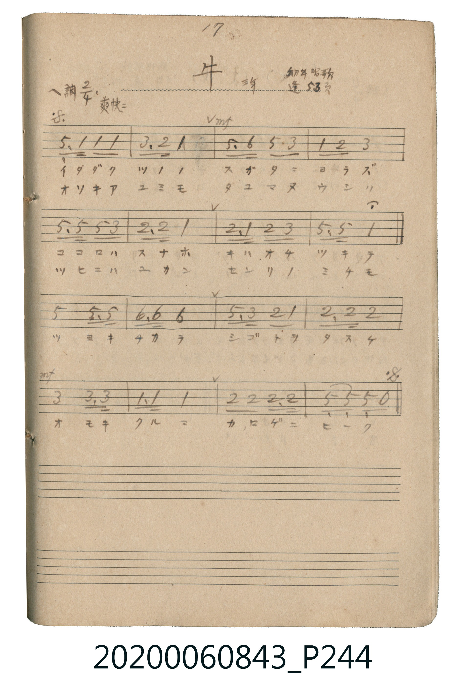

# 牛（牛）

> Re:Shōka 使用 AI 協助辨識與重建樂譜，可能會有錯誤。歡迎回報。

- **鋼琴伴奏版**：<br><audio controls src="ushi.mp3"></audio>
- **NEUTRINO 歌聲合成版**：<br><audio controls src="ushi_neutrino.mp3"></audio>

- 唱歌帖 P244 (三年 / 幼年唱歌 / 蓬萊唱集 53頁)

## 說明

牛（牛）
Source: 唱歌帖 (2020.006.0843), P244.jpg
Marginal notes: 17 / 三年 / 幼年唱歌 / 蓬 53頁 / 爽快ニ
Key: ヘ調 (F major), Time: 2/4, Tempo: 爽快ニ


## 歌詞

```text
1. イダダク ツノノ スガタニ ヨラズ
ココロハ スナホ キハオチ ツキテ
ツヨキ チカラ シゴトヲ タスケ
オモキ クルマ カロゲニ ヒーク
2. オソキア ユミモ タユマヌ ウシノ
ツヒニハ ユカン センリノ ミチモ
```

## ABC

<div class="abc-score" data-abc-src="ushi.abc" aria-label="五線譜載入中"></div>

[下載 ABC 原始檔](ushi.abc)

## TMD 檔案連結

- [主旋律 TMD 檔案](ushi.tmd) [[在 TMD Studio 編輯](https://tmdlang.github.io/Tmd-TS/#tmd=s7IKdvYPcrWy4qpTUCpJTLdSSM7PyUlNLsnMz7MqzsjPTkzOyFeCS5bl55TmploBqXgDc4RwcX5pUXJqfEFieqpVgJGJCboM3KT4vPyS1KT8_GwMFRn5RYmZ8WB1xRmlCOmCovyy1LzEPKCS3MS80uLkosyCkvjk_IJKhJrUssyUVJCK1JTMkvyizMQcJBenFhWD_QJxYklRYh7EDKAgQlVJRirQW4l5mbnIeoFGpWfmWeWmZmZlxpekVpSgujy_qCQjP70osSCj0iojsxhkc3JiTnx2Yl6iEpeWlsLzztnv93SAyU4FLS0uRVsFQwMLLntbBTcuGyN9EzuQSU-nbHy2tufpjmkKoIBT0Hiyo_Ppzi0K-gpPd-4BMiDSQO6LyWteTOgCcl_OblMwNX65oFFTiYtLX0vBllqAS0EBxckgfjAkchQQrtQwMjAy0DMwMNMzsDAx1tQBO1svqyAdpNw3sQgYYIk5CqBoLrZSMDQHuhyPjyAeAbKfd-x9un_14-ZukCneqZVWCo-bZ7xYtV9Bw00hNzErvwhoUUgmMIoUgOEGZKbmFuRboeryqQQGf7EViGmop_C4acnj5gYQaloPNKvlcXMfEAGFdz5uWvO4aT9QE1B4xePmlY-bdoH0PG7aDELNax8394OVNXc9bp4NZIEEHjetetzcCDYHxG8DawAZugLIB7IaHzcBnbESqHr746Ytj5s7HjdvAnL2g63bCDEeaMIisOqm9Y-bgarnAVlAau3jpk0Qx0x63LwHKAlSbQTywKrHTXtB1jUtAkoue9w8H2gA2FAQZ97j5h4gZxnIxuY-uHuAZnSDPQBUAzJ9M1DNbiD1uBloPdD7IEMageaANFCeYqBAQUufiyu0OCPT0SogMzEv36HGoKYaZIOCjaGZlh2YVaNgGq-gC4SGQAgidYFCxmARIzAPBGsUqnPTamEqzeJhLON4oBRIkRGIA1MMNtfHsAYU12ARYGyDMZAFjHSQccAwgcqA_N4HtwYYLxDxpjWgEIWq6QbrWAFmrwTL7kK1ywikcxVU515Q2gCzFkHtWgY1Zz4Qg8RgdsHMXwbE86DsHrAMSAcwBqEuhNkFCzAw1xRKGwNFQN5HDS-IiCE8YBC64GqQgmkz1OnAVNEMcjrI2n7k4GjuAuLZSE5HqIJ4HJQLUAIWnPzbMIMJHvCTwAGLZBcsmJpWA9kQF0Hs2g1VBXIdxC5QkIB0zIfKgHIgPGC5aiGJzglvooOqhoVKjYIZmGUGpREhZgwOQ0i6hIUzhIb7C-EtkGNA6QQSACBxULDAPAVKOzBPgeIWJL4FKN4B1rcJKgNNFcCgBxYRcIug7gbnA1hKh9CgBACJVEgWQiQAGAaR0HyGIAxQ3A9NvSB3QAIS6n5wfgGJgtwPSaMQV64Gi4KSAbCcgqqB5JNJYPYesAxIN8gycKTo2imACwMFKMMJxFDmAgA)]
- [鋼琴伴奏 TMD 檔案](ushi_piano.tmd) [[在 TMD Studio 編輯](https://tmdlang.github.io/Tmd-TS/#tmd=s7IKdvYPcrWy4qpTUCpJTLdSyC8qychPL0osyKi0ysgsLskvykxOzInPTsxLVIIrKs4vLUpOjS9ITE-1CjAyMUHIlGSk5qZapaaUJieWZObnKXFpaSk875z9fk8HmOxU0NLiUrRVMDSw4LK3VXDjsjHSN7ED6X46ZeOztT1Pd0xTABmooPFkR-fTnVsU9BWe7twDZECkgdwXk9e8mNAF5L6c3aZgavxyQaOmEheXvpaCLbUAl4ICqpMfNUxRCMhMzMtXcExOzs8tSMzLzE3NKwGpCwYHhJUCwvUaRgZGBnoGBmZ6BhYmxpo6YO_oZRWkg5T7JhalZ-Yl5ijk5ZekFlspGJoDfYTHpxAPAtnPO_Y-3b_6cXM3yBTKvQgFClr6XFyhxRmZjlZg_znUGNRUg2xQsDE007IDs2oUTOMVdIHQEAhBpC5QyBgsYgTmgWCNQnVuWi1MpVk8jGUcD5QCKTICcWCKweb6GNYoPG5aAhZ53NwAxkBW03qwcY-bW6AyfWAMs-Zx006IeNMaIN4PVdMN1rECzF4Jlt2FapcRSOcqqM69QLwWzFoEtWsZ1Jz5QAwSg9kFM38ZEM-DsnvAMiAdj5u2Q10IswsWYGCuKZQ2BoqAvI8aXhARQ3jAIHTB1SAF02ao0zcDrQM5HWRtP3JwNHcB8WwkpyNUQTz-uLkRNWCBKh43t2EGEzzgJ4EDFskuWDA1rQayIS6C2LUbqgrkOohdoCAB6ZgPlWlEDliuWkiic8Kb6KCqYaFSo2AGZplBaUSIGYPDEJIuYeEMoeH-QngL5BhQOoEEAEgcFCwwT4HSDsxToLgFiW8BineA9W2CykBTBTDoHzdthFsEdTc4H8BSOoQGJQBIpEKyECIBwDCIhOYzBGGA4n5o6gW5AxKQUPeD8wtIFOR-SBqFuHI1WBSUDB43gVyOyCeTwOw9YBmQbpBl8EiBlgRBHtijBTmbGwKztzbIQ1AK5ANtWMkAFYNGFNZyAaoEqAkUBnC9MF8DA00bniegLFBQQtVjsQQqjpypzOPhZgAVA5UgchdqKsTlYZjNQGPhJoFEYakRxgJZhnAlIkUCrQS6AeZgZB7Cn9BAhfsfzgR5F-5HeHBDLDODmAOlTNQRlkAthRiEQkOSFGpM-yB73ALhb1BcxcMorHwTPPIYphiDVYE4KMaASCO4GIoCA4w4IuhUiCVQd0EpsDxIwgiIQWIolgIpTLdCnGYGJEH6YDQwy0J5MBrFJKhzPfNKivKxJCkT1CwUbRgLjsVo01iFaLPcWAzNKH5FaAa6DpqhgJkJrMc1LyUzLx2_jSALTYAWAS0DWgmxGl0vDgtNwHkWZjFIk66dAtidCkAGOB1F-4BMhHCckESNwKIQO0AsZS4A)]

## 分析

```text
================================================================================
📊 TMD Song Profile: [ 牛（牛） ]
================================================================================
⏱  Duration:       0:17 (17.8s), 16 measures total
🎼 Key & Tempo:    首調基準 F, != 108.0 BPM, <2/4>
   - 分析範圍：      由實際發聲的音符與和弦推測調性；播放脈絡另行呈現
🎤 人聲音域:    A3 (MIDI 57) – D5 (MIDI 74) [跨度: 17 個半音 / 1.4 個八度, 難度: challenging]
   - 最低音:  A3 in [UshiA #1 @ m.3, 0:03]
   - 最高音: D5 in [UshiB #1 @ m.10, 0:10]
   - 適合: soprano, mezzo-soprano, contralto, tenor, baritone, bass
🏛  結構:      UshiA (8.9s) -> UshiB (8.9s)
⚡ 編曲密度:        Peak 1 軌道同時演奏
🗝  調性診斷：       C 大調（推測轉調經歷 1 次）
   - 風格氣質:    純淨自然大調（陽光明朗、易唱易記，無明顯調外色彩）
   - 轉調歷程:    C 大調起奏 ➔ [UshiB] 轉至 C 大調 (-5 半音 / 五度圈 +1 步)
   - 核心骨幹音:  C, F, G, A, D
   - 調性數值:    C 大調 [相關度: 0.85, 穩定度: Moderate, 自然音純度: 100.0%]
   - 候選調性 (K-S): C 大調 (0.85), F 大調 (0.80), A 小調 (0.57)
   - 五度圈歷程:   -1 -> +0
   - 各段落調性細節:
     • [UshiA #1]: F 大調 (r: 0.86, 自然音純度: 100.0%)
     • [UshiB #1]: C 大調 (r: 0.86, 自然音純度: 100.0%)

  [ 五度圈游移軌跡 ]
              [C ]*
        [F ]*          G  
      Bb               D  
      Eb               A  
         Ab           E  
            Db       B  
               F# 
     (* = active key center)

  [ 十二半音累積音高分佈 ]
     C  : ████████████████████████  29.4%
     C# :                            0.0%
     D  : ██████                     7.1%
     D# :                            0.0%
     E  :                            0.0%
     F  : ███████████████████       23.8%
     F# :                            0.0%
     G  : ███████████████████       23.8%
     G# :                            0.0%
     A  : █████████████             15.9%
     A# :                            0.0%
     B  :                            0.0%
--------------------------------------------------------------------------------
Assignment 軌道音域：
  - Piano         : A3 – D5 (17 個半音 / 1.4 個八度, 54 個音符)
================================================================================
```


## 原書掃描頁




