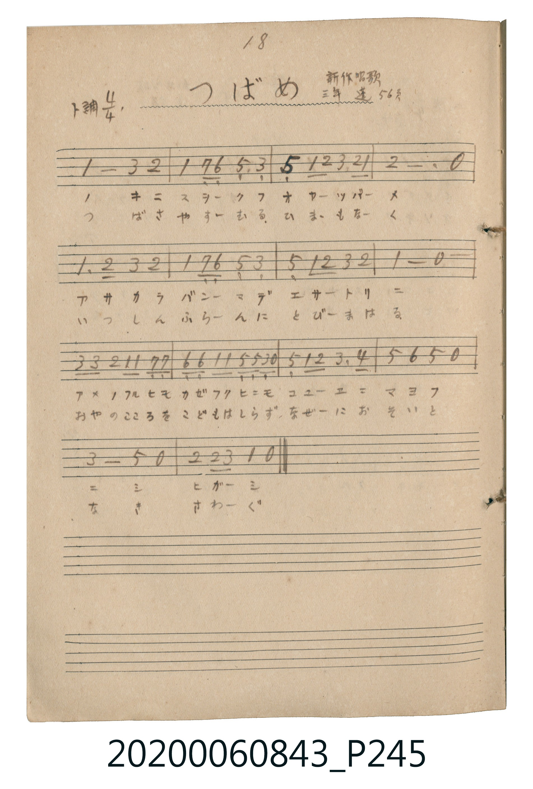

# つばめ（燕子）

> Re:Shōka 使用 AI 協助辨識與重建樂譜，可能會有錯誤。歡迎回報。

- **鋼琴伴奏版**：<br><audio controls src="tsubame.mp3"></audio>
- **NEUTRINO 歌聲合成版**：<br><audio controls src="tsubame_neutrino.mp3"></audio>

- 詞：吉丸一昌
- 曲：北村季晴
- 唱歌帖 P245 (三年 / 新作唱歌 / 蓬 56頁)

## 說明


- 出處：唱歌帖 P245 (三年 / 新作唱歌 / 蓬 56頁)
- 調性與拍號：調號 ?= G，拍號 <4/4>，速度 != 104


## 歌詞

```text
> [!NOTE]
> **原頁資訊與歌詞全文**（對應 `P245.jpg`）：
> - **出處與詞曲考證**：頁頂標示曲號「`18`」、曲名「`つばめ`」，右上角記「`新作唱歌`」「`三年 蓬 56頁`」（原曲出自吉丸一昌作詞、北村季晴作曲《新作唱歌》卷三〈つばめ〉，此處轉抄自《蓬萊唱歌集》第 56 頁）；左上角記「`ト調 4/4,`」（G 大調，`?= G`，`<4/4>`）。
> - **校訂與手抄原貌說明（依 Editorial Policy A 校訂）**：
>   1. **首小節首字「ノ」補回**：原抄本第 1 小節首音 `1` 正下方清楚寫有片假名「`ノ`」（與 `3 2` 下方「`キ ニ`」合為「ノキニ」＝「軒に巣をくふ」），舊轉錄誤將「ノ」看作段落斜線而漏錄，今依原譜補回。
>   2. **第 2、6 小節底線誤延與附點差異**：第 2 小節原抄本記作 `1  7_6_  5_. 3_`，其中 `5_` 右側確有附點，惟單底線自 `3_` 向左誤延至 `5_.` 下方，依 `<4/4>` 拍數與北村季晴原曲節奏還原為附點四分音符加八分音符 `| 1 - 7_ 6_ 5_ - - 3_ |`；第 6 小節 `1  7_6_  5_ 3_` 則無附點，抄寫者誤於末二音 `5_ 3_` 下方畫上單底線，依 `<4/4>` 拍數還原末二音為兩個四分音符 `| 1 - 7_ 6_ 5_ - 3_ - |`。
>   3. **第 3 小節頓筆逗點**：第 3 小節第三拍四分音符 `3` 右下角有一小逗點狀筆跡（非附點，該小節 `5_  1_2_  3  2_1_` 四拍完整）。
>
> **1.**
> ノキニ　スヲークフ　オヤーツバーメ
> アサカラ　バンーマデ　エサートリニ
> アメノフルヒモ　カゼフクヒニモ　コユーエニ　マヨフ
> ニシ　ヒガーシ
>
> **2.**
> つばさ　やすーむる　ひまーもなく
> いつしん　ふらーんに　とびーまはる
> おやのこころを　こどもはしらず　なぜーにおそいと
> なき　さわーぐ
```

## ABC

<div class="abc-score" data-abc-src="tsubame.abc" aria-label="五線譜載入中"></div>

[下載 ABC 原始檔](tsubame.abc)

## TMD 檔案連結

- [主旋律 TMD 檔案](tsubame.tmd) [[在 TMD Studio 編輯](https://tmdlang.github.io/Tmd-TS/#tmd=s7IKdvYPcrWy4qpTUCpJTLdSSM7PyUlNLsnMz7MqzsjPTkzOyFeCS5bl55TmploBqXgDc4RwcX5pUXJqfEFieqpVgJGJKboM3KT4vPyS1KT8_GwMFRn5RYmZ8WB1xRmlCOmCovyy1LzEPKCS3MS80uLkosyCkvjk_IJKhJrUssyUVJCK4uTEvPiy1KLMtMzUFCRXpxYVg_0DcWZJUWIexBygIEJVflFJRn56UWJBRqVVRmZxSX5RZnJiTnx2Yl4iQlFJRirQ_4l5mbmJOchaM9Mz86xKEjOBHgB5ojwxPjcxMy8nMQ_oDC0thceNSx43bnjc1Ph-T8fz9qlP1054v6dTQUuLS9FWwdDAhMveVsGdy8ZE38QOZObTKRufre15umOaAigwFTSe7Oh8unOLgr7Cs2kbnuydA5EGcl9MXqNgavZyQaMm2CkvVs57v2fW0wmdT3bseLKj4dmMHrDws9mbQMI905_Nnfh07eJnM7cocXHpaynYUgtwKSgo2ClEK_r5h7jGQjhaWk_75gMd9mJz-4sVXS862oEOBjrvaeuKZ9PatbSAofB0Q--z9k6FBJAP9bIK0hOAAQJ0JkS7LsiA9l0vZk4FagXqA3rhRUPzi7WdIK2zgOa-XND0bMXM50t2gWRmzn_c0JNgaJHwuKH3cUMjUOjpBCCjJwEe6iCZ93t6nvZvfrKj68XySS9WzADJIwcnRHNPAjSs4UEL0doB9A7IXKCb2lchhzBQP9B9QFuRwxcoCFT8uKEL2YLHDd1Pe7cDjX_c0AF32OMGoKd7nq1dAvLq3s5nXS1A84Eagda_mNAF0fhydhtQ7_M1IAcpAF0EDqjZT7cvQ_HL4-aOF6v2KwCTkA7Uye4KT5csB4oBLUgApS9gCPckgNMYKKwfNzQhwvrZgoUvVjSBoqmzG-gGoGdfbOp5sWrVsxl9QIOe7Jur4JqSCcoQiTkKAfk5mcmVCo4KEE1Ao8CRAjFMQcFQD2jey2XTnm7of76-AcRYOx3ovsfNfUBXvVg85-nseWD1oADtank2Zw3IY4YKcOUv529WSDBMUHi2dvGTHd3Ppu18tqP12dJZT9evfjan83ln-9PGdljsNvdBfQp0uEKCsYJRggJEC1i2aa3C4-ZukIqnEzqeN-2COqJpLVAUrG0uUOTF7kmPG1c_3b74cROQ0f-4cStYChQpLzq6gDHysqflxaolTze0w_3wfE43KH7XbX0xYe-zaXOeb5_1oqHn2Z5-oEqgrie7u4DBBQrAtXMgvoUHtIKCEShsQP41AiYYM6ifn-6aCjIDaMnubUCPvJzZ8nL3vKfb1z2fugEcUGD1MLWwQANGOtARwIBSUDCPN4tXUDCN11MwjgdF8dPWbU92rFVIMI1PUAAm-KeNW54v2gUMO4jBoNTWPP_ptHVQa9tXAUMOpHLCRGCKgrqiHRgFQANhwQnyFjAJQNOOwrPu3mdTdwCdipzkIfkD5MSl_S-bQCkIGORQv8ye_bSjDRivz9cse9q14GnrajhXIaEGGPe6QD8oAD1hGg9k6gK9oVAD9MhskMdhgYTiU5BHFZ52tj9vWYjwFDDVrl_9oqEV6IVn0_Y8m7P6ya4ecFqCqod45fnU1cBcA_c-Vp9BnA83AeiPp60rnwJzL5I_sDgc6GxdoMORotsYFt3GsOS9YPLztW0vG6YD3QyPW5gkkA0sHIBOQLXHGByLQNcDszowFoGlDlA5xIjn3Q1A415sXwjMAi_nzoOHxYuVm2ChBnSZgmG8EZA0Bia_eENQwM2eDbJkXc-zqVuQygFYuW2oB6yVwGyk3NLwuGnn4-ZNj5v3PG5a_7h5Klhk1ePmJSCR5pbHzRPAjIVQjU2LHjdtfdy0-nHzSpBKkOxmsIJ5j5uBGQmodwVIAUik43Ez0JxuhMbmhSB7gVY0A7VPety8CKx-9eMmoOKpYNuBgt0wcaCxy8CuWgF1J8gKIHsqzAvdj5u2g8UnPW5aA1a5HcW7RgjvQsrkRojnWh43zgQrB7LBBjduety4DyzS9LhxFbCsgOkCqgRqnP64aTJYGdDfnWBlk4EFC1hkxeNGsO-B2hvXA02DaewC27LucSNQ5eTHTb2gIgikHshdCbZlPdjYzseNs8DiQEvngM1ZDdLbOBds9QqYaUBZYKkIVAYMpH6wsgkgKcprdyhQ0NLn4gopLk1KBLZ_AjIT8_IdagxqqkF2KNhYaIEDVAGSKcCZGIiNQBkCe_6GsA2BSiAKDYFCIOUwaADSCjbSx7AGlBKh4qBSHUg2d4ONBqZKMG8TWGY9REXzVLDMKjB7CZhsAZMTIHqaF2K3xwgo1whSDzalcQOYnAq1B2xC40ywPQ1Ql3SDZBrBdjfuA4s0gdkgm0Ey_Rj2oIQRzOtYwghSlKCHEUwhzDwQRAqjpkVQd20F4tVgH6-E-hjkc2AWBJPzwGQ71F8roDpAYh1gEup6cAhjsQkcSqDQAPl0CRBPB5swGepnsElNnXAxYGKFyoBtagS7ARJajaD4ArkB0yZoOBkDIShpQEMHiGpAQQREIDFg6ECQAXpQ6SqYgISAtBkQg2i05AQMKlAyACUrUHIBFjVgr08C4kVgJ60G4j0QOWCygsh0g2VBlgGLHbD6ZWBvgjwGSZKgYIMEL9izQN2YCawLnJiA2R6IJ4MxyIxeIJ4EDiaQ2EpwUgIFECh4QcEJLAIgNoMTF7AcgActiO4Cy8wFsyEJFWQ_SpKDBAtSYIDTEyi4QIGLnttgMQIsLOHqQYEAElmDKo7kNZDTIA7qRegC5yBgiQQWB6VDiK5aLi5dOwVocRLtYxirgMw1AnOVuQA)]
- [鋼琴伴奏 TMD 檔案](tsubame_piano.tmd) [[在 TMD Studio 編輯](https://tmdlang.github.io/Tmd-TS/#tmd=s7IKdvYPcrWy4qpTUCpJTLdSSM7PyUlNLsnMz7MqzsjPTkzOyFeCS5bl55TmploBqXgDc4RwcX5pUXJqfEFieqpVgJGJKboM3KT4vPyS1KT8_GwMFRn5RYmZ8WB1xRmlCOmCovyy1LzEPKCS3MS80uLkosyCkvjk_IJKhJrUssyUVJCK4uTEvPiy1KLMtMzUFCRXpxYVg_0DcWZJUWIexBygIEJVflFJRn56UWJBRqVVRmZxSX5RZnJiTnx2Yl4iQlFiEVBzempual6JVUFmYl5-fGJycn5uQWJeJkgMobAkA6jICiScmINsR2Z6Zp5VSWIm0Kcg35YnxucmZublJOYB3aulpfC4ccnjxg2Pmxrf7-l43j716doJ7_d0KmhpcSnaKhgamHDZ2yq4c9mY6JvYgcx8OmXjs7U9T3dMUwCFuoLGkx2dT3duUdBXeDZtw5O9cyDSQO6LyWsUTM1eLmjUBDvlxcp57_fMejqh88mOHU92NDyb0QMWfjZ7E0i4Z_qzuROfrl38bOYWJS4uz7ySonyrAJBXgzwcagxqqrkUgMDGRMsOzKhRqM4tqFUwjtc2jdc2VDAC0-bxIAEzkABEAihQo2ACFQKqATMRinUVarhqUezywW6XYbyCaXy8ghkQGwMxyEyQMRBRqCkhxaVJicCwB5uDZIoFwhSgUhA0BmIjkDawCNAdQDeZgswBSoEMB7OB7oUqNAQKgZTDoAHYRpCRPoY1Co-b-6Dij5vWgsjmbrDRj5t2gnmbwDLrISqap4JlVoHZS8BkC5icANHTvBC7PUZAuUaQerApjRvA5FSoPWATGmeC7WmAuqQbJNMItrtxH1ikCcwG2QyS6cewByWMYF7HEkbAEAKJooURTCHMPBBECqOmRVB3bQXi1WAfr4T6GOTzx82bweQ8MNkO9dcKqA6QWAeYhLoeHMJYbAKHEig0QD5dAsTTwSZMhvoZbFJTJ1zscSPIJSAZsE2NYDdAQqsRFF8gN2DaBA0nYyAEJQ1o6IATOjCIgAgkBgwdCDJADypdBROQEJA2A2IQjZacgEEFSgagZAVKLo-bIcE1CYgXgZ20Goj3QOSAyQoi0w2WBVn2uAkSlMvA3gR5DJIkQcEGCV6wZ4G6MRNYFzgxPW5cB8STwRhkRi8QTwIHE0hsJTgpgQIIFLyg4HzcOAtiMzhxPW6cAw9aEN0FlpkLZkMSKsh-lCQHCRakwACnJ1BwgQIXPbfBYuRx03a4elAggETWoIojeQ3kNIiDehG6wDnocRMoLzxuBKVDiC70sgSl_EOUJtW5aeDyD-RIcGkHimVtkGeAhRskR0BlIbkHpga9kIHogRQz4GIRrBkcINBCEuEZuJFgDURYhp5bgaqhmqD2gPWBi3BsWQqYqYHqQRhsDdgKqD0Qx6GU8QjSEEJAXIFMouQHiAcgOcJQGxT9JtqgXAFhI_saphJFDskXoMSC8Af2aMRftUApUCYG-QBJAMgAiQEpSNUDEoVVPUDvkGgMiAMXgOrAZgqimoOaAgo5hDTIKDAfIYthBCSsUWwBholrXkpmXjqBmh2YspFqbdSaHS6AnnQwjMcR4iAnw2pzeFAgGaFrpwBuESgAGdAYjPYxjEXhGoG5EMtALGUuAA)]

## 分析

```text
================================================================================
📊 TMD Song Profile: [ つばめ（燕子） ]
================================================================================
⏱  Duration:       1:04 (64.6s), 28 measures total
🎼 Key & Tempo:    首調基準 G, != 104.0 BPM, <4/4>
   - 分析範圍：      由實際發聲的音符與和弦推測調性；播放脈絡另行呈現
🎤 人聲音域:    B3 (MIDI 59) – E5 (MIDI 76) [跨度: 17 個半音 / 1.4 個八度, 難度: challenging]
   - 最低音:  B3 in [Tsubame[L1] #1 @ m.2, 0:04]
   - 最高音: E5 in [Tsubame[L1] #1 @ m.12, 0:25]
   - 適合: soprano, mezzo-soprano, contralto, tenor, baritone, bass
🏛  結構:      Tsubame[L1] (32.3s) -> Tsubame[L2] (32.3s)
⚡ 編曲密度:        Peak 1 軌道同時演奏
🗝  調性診斷：       G 大調（純淨自然大調，未偵測到可信轉調）
   - 風格氣質:    純淨自然大調（陽光明朗、易唱易記，無明顯調外色彩）
   - 轉調歷程:    全曲維持單一推測調性（未偵測到可信轉調）
   - 核心骨幹音:  G, A, B, D, E
   - 調性數值:    G 大調 [相關度: 0.84, 穩定度: Moderate, 自然音純度: 100.0%]
   - 候選調性 (K-S): G 大調 (0.84), D 大調 (0.76), B 小調 (0.65)
   - 五度圈歷程:   +1 -> +1
   - 各段落調性細節:
     • [Tsubame[L1] #1]: G 大調 (r: 0.84, 自然音純度: 100.0%)
     • [Tsubame[L2] #1]: G 大調 (r: 0.84, 自然音純度: 100.0%)

  [ 五度圈游移軌跡 ]
               C  
         F           [G ]*
      Bb               D  
      Eb               A  
         Ab           E  
            Db       B  
               F# 
     (* = active key center)

  [ 十二半音累積音高分佈 ]
     C  : █                          1.0%
     C# :                            0.0%
     D  : ██████████████████        20.2%
     D# :                            0.0%
     E  : ██████                     6.1%
     F  :                            0.0%
     F# : ████                       4.0%
     G  : ████████████████████████  26.3%
     G# :                            0.0%
     A  : ███████████████████       21.2%
     A# :                            0.0%
     B  : ███████████████████       21.2%
--------------------------------------------------------------------------------
Assignment 軌道音域：
  - Piano         : B3 – E5 (17 個半音 / 1.4 個八度, 116 個音符)
================================================================================
```


## 原書掃描頁




