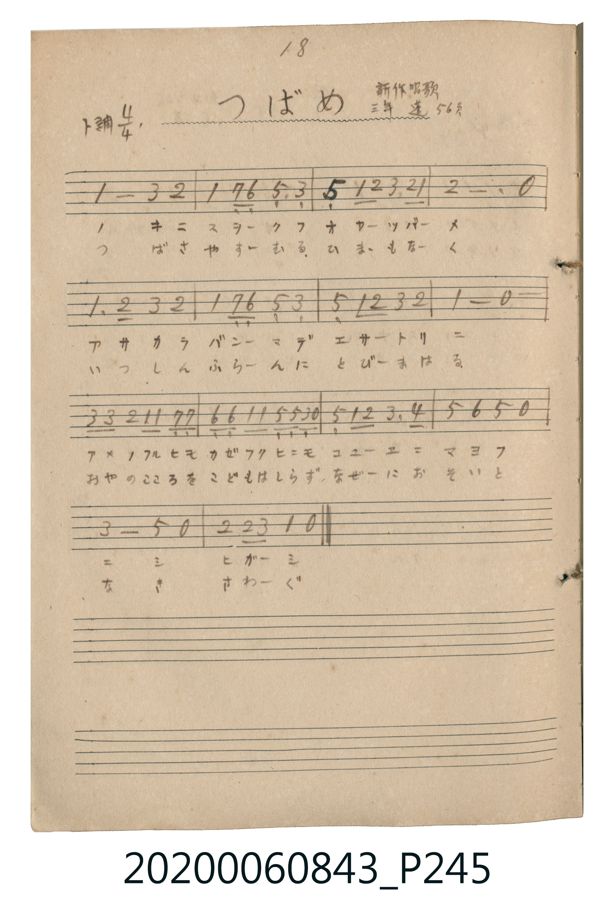

# つばめ（燕子）

<audio controls src="tsubame.mp3"></audio>

- 唱歌帖 P245 (三年 / 新作唱歌 / 蓬萊唱集 56頁)

## 說明

つばめ（燕子）
Source: 唱歌帖 (2020.006.0843), P245.jpg
Marginal notes: 18 / 三年 / 新作唱歌 / 蓬 56頁
Key: ト調 (G major), Time: 4/4

## 跨冊／重複收錄參照

> 同名異曲（各冊收錄之不同詞曲版本）

- **[同名異曲]** 《新定兒童唱歌》尋常科第六學年用（2020.006.0847.0006）：[**〈つばめ〉**](../../../shintei_jido_shoka/grade_6_2020.006.0847.0006/4_05_tsubame/index.md)（`E,` / `4/4` — [原始 TMD](../../../shintei_jido_shoka/grade_6_2020.006.0847.0006/4_05_tsubame/tsubame.tmd)）
- **[同名異曲]** 《新定兒童唱歌》高等科女子用（2020.006.0849）：[**〈燕〉**](../../../shintei_jido_shoka/koto_girls_2020.006.0849/1_5_02_tsubame/index.md)（`F` / `4/4` — [原始 TMD](../../../shintei_jido_shoka/koto_girls_2020.006.0849/1_5_02_tsubame/tsubame.tmd)）
- **[同名異曲]** 楊金土手抄《唱歌帖》第 10 冊・X（2020.006.0843）：[**〈燕 (燕子)〉**](../../vol_10/p208_tsubame/index.md)（`F` / `4/4` — [原始 TMD](../../vol_10/p208_tsubame/tsubame.tmd)）
- 總表：[跨冊重複與同名歌曲總索引](../../../duplicate_songs.md)

## 歌詞

```text
1. キニスヲ ークフ オヤーツバーメ
アサカラ バンーマデ エサートリニ
アメノフルヒモ カゼフクヒニモ コユーエニ マヨフ
ニシ ヒガーシ
2. つばさ やすーむる ひまーもなく
いつしん ふらーんに とびーまはる
おやのこころを こどもはしらず なぜーにおそいと
なき さわーぐ
```

## ABC

```abc
X:1
T:つばめ（燕子）
M:4/4
L:1/16
Q:1/4=104
K:G
V:V1 name="Vocal" snm="Voc"
[V:V1]
G8 B4 A4 | G4 F2 E2 D4 B,4 | D4 G2 A2 B4 A2 G2 | A12 z4 |
G6 A2 B4 A4 | G4 F2 E2 D4 B,4 | D4 G2 A2 B4 A4 | G8 z8 |
B2 B2 A2 G2 G4 F2 F2 | E2 E2 G2 G2 D2 D2 D2 z2 | D4 G2 A2 B6 c2 | d4 e4 d4 z4 |
B8 d4 z4 | A4 A2 B2 G4 z4 |
```

## TMD 檔案連結

- [主旋律 TMD 檔案](tsubame.tmd) [[在 TMD Studio 編輯](https://tmdlang.github.io/Tmd-TS/#tmd=s7IKdvYPcrWy4tLSUnjcuORx44bHTY3v93Q8b5_6dO2E93s6FbS0uBRtFQwNTLjsbRXcuWxM9E3suOoUlJ5O2fhsbc_THdMUAoxMTBU0nuzofLpzi4K-wrNpG57snQORBnJfTF7zYkIXkPtydpuCqdnLBY2aSlxc-loKttQCXAoK2N0OkgjOLy1KTrVSQDhXw8jAyEDPwMBMz8DCxFhTB-x-vayCdJBy38Si9My8xByFvPyS1GIrBUMLoBfweA3iI5BO79RKK4XHzR0vVu1X0HBXyE3Myi8CGh6SmQu0HRhoIDU-lUWZycVWIKahnsLjprWPm7sfN-183LwJqHPP46b1j5unAoVXPW5eAuI3tzxungBmLAT7sWnR46atj5tWP25eCVQPlNkMlpz3uLkdKLkCJAnidzxuBprQDdPSvPBxcx_Q4MfNQI2THjcvAoquftwEVDgVbCNQqBsiCjRuGdgdK4BCQBuABgNZU8EGgRy6HUhNety0BqxmO0jYCOgLSMg3ghze8rhxJliy4XET0IDGTY8b94H5TY8bVz1u7IfEFFAVUMv0x02TgRygfzrBSiY_blwN5K943Aj2FVBj43qgKRAtXWCz1z1uBKqa_Lip93HTJKAokLMSbPZ6sHGdjxtnAUWBFs0Bm7AapK9xLtjCFRBzgHK9QAro8X6wkgkgYcpTIBQoaOlzcYUUlyYlAuM8LD85McehxqBGoRpkiYKNhZYdmFGjYKigC4bGQGwExBAR83gFs3gF03iQBIiogbANgUogCg2BQiDlMGgAUgQ2EpibHHLAactWQQmYrEDRBYyOnUAanLKA7PVAGpy2gPQSiFhzCygVQdkLlUCuRzUs3ghkXCNQeeMGUKiBYhhIz4Qa2QDE4FgG4n1QsSZQIEPYjf1wI2FehvmEaC_DFMK8C4JYvQxKvltBCRtoNzhzAPFmqNfmATE4g0DUgMU6gBjkzm7c3gZ5FeT16UBt4JQKpDuh3gTxwakViKHWgIKgERjKTQgja4C-MAZHHNSzQFQD8jEQgcSAnoUgA3Sf6yqYgISAtBkQg2ickQ30efNCIO6DRHAzKASAmQOSzYEY5FtQzIESAEgclLHBmR1IL4N6B-gNSIYHYhB7Ku5Q6YImgnWg_AfBTcAsBcmPQAwMfHAiAFoHDjlgiEFyJRDPgYYUKOSA5jTOBRUGoFBECTFILMP9DE4FoFABhSGuUAAnd3DxBKTXQH21HbcvQK4BFwRAZf1QV00AK6_l4tK1U4BmYgUgU5kLAA)]
- [鋼琴伴奏 TMD 檔案](tsubame_piano.tmd) [[在 TMD Studio 編輯](https://tmdlang.github.io/Tmd-TS/#tmd=s7IKdvYPcrWy4tLSUnjcuORx44bHTY3v93Q8b5_6dO2E93s6FbS0uBRtFQwNTLjsbRXcuWxM9E3suOoUlJ5O2fhsbc_THdMUAoxMTBU0nuzofLpzi4K-wrNpG57snQORBnJfTF7zYkIXkPtydpuCqdnLBY2aSlxc-loKttQCXAoKONz-qGGKQkBmYl6-gmNycn5uQWJeZm5qXglIQ3B-aVFyqpUCwhsaRgZGBnoGBmZ6BhYmxpo6YH_pZRWkg5T7JhalZ-Yl5ijk5ZekFlspGFoAvYbHyxCfgnRS7j8oUNDS5-IKKS5NSsxNtQrLT07McagxqFGoBlmiYGOhZQdm1CgYKuiCoTEQGwExRMQ8XsEsXsE0HiQBImogbEOgEohCQ6AQSDkMGoAUgY0ExpVDTmVRZnKxrYLS46a1Co-buxUeN-0E0puAeA-QvR5ITwXSq4D0EohYcwsQT4CyFyqBXI9qWLwRyLhGoPLGDUAM0g7U0jgTamQDEAOtaQRa0bgPKtYEZIOsALIb--FGwrwM8wnRXoYphHkXBLF6eRHQ7q1AvBpo90qotzZDvTYPiNuBcisgasBiHUAMcmc3bm-DvAry-nSgtslAGmR8J9SbID7QqkagkY1Qa0BB0AgM5SaEkTVAXxiDIw7qWSCqAfkYiEBiQM9CkAG6z3UVTEBCQNoMiEE0zsgG-rx5IRD3QSK4GRQCk4AYFCJAdhPIt6CYAyUAkDgwxsByIGcvg3oH6A2wOCikQOypuEOlC5oI1gExKBSAuKkXiIFGg_nAwAcnAqB14JADhljjLEiiaJwDDSlQyAHNaZwLxCCzVqCEGCSW4X4GpwJQqIDCEFcogJP7dogPm9ZAfbUdty9ArgG6Gpyk-6GumgBWXovIweByKcgDex6uzk2rBSZabZCrgBQk9rRBrjeN14YkXKgsJJHD1KCnc4geSOYG6jSHaAaHAIiH4me4kWANZFgGVA3VBLUHrA_IxZ7HyEu_EIdBUrChNigeDbVBqRjCRvYNTCWKHJLrQLGOcB9EJ3r8-KDEjwmijAU5DOhMCAVydbyCCbIAkAESA1LGYD5I1AiIQTTQPyQaA-LABaA6MEwBWQSxDGQE1BhQ2CH0gMwC8xGyGC6BhDaKNcBQ0bVTgAaMApCpzAUA)]

## 分析

```text
================================================================================
📊 TMD Song Profile: [ つばめ（燕子） ]
================================================================================
⏱  Duration:       0:32 (32.3s), 14 measures total
🎼 Key & Tempo:    首調基準 G, != 104.0 BPM, <4/4>
   - 分析範圍：      由實際發聲的音符與和弦推測調性；播放脈絡另行呈現
🎤 人聲音域:    B3 (MIDI 59) – E5 (MIDI 76) [跨度: 17 個半音 / 1.4 個八度, 難度: challenging]
   - 最低音:  B3 in [Tsubame #1 @ m.2, 0:04]
   - 最高音: E5 in [Tsubame #1 @ m.12, 0:25]
   - 適合: soprano, mezzo-soprano, contralto, tenor, baritone, bass
🏛  結構:      Tsubame (32.3s)
⚡ 編曲密度:        Peak 1 軌道同時演奏
🗝  調性診斷：       G 大調（純淨自然大調，未偵測到可信轉調）
   - 風格氣質:    純淨自然大調（陽光明朗、易唱易記，無明顯調外色彩）
   - 轉調歷程:    全曲維持單一推測調性（未偵測到可信轉調）
   - 核心骨幹音:  G, B, A, D, E
   - 調性數值:    G 大調 [相關度: 0.83, 穩定度: Moderate, 自然音純度: 100.0%]
   - 候選調性 (K-S): G 大調 (0.83), D 大調 (0.74), B 小調 (0.66)
   - 五度圈歷程:   +1
   - 各段落調性細節:
     • [Tsubame #1]: G 大調 (r: 0.83, 自然音純度: 100.0%)

  [ 五度圈游移軌跡 ]
               C  
         F           [G ]*
      Bb               D  
      Eb               A  
         Ab           E  
            Db       B  
               F# 
     (* = active key center)

  [ 十二半音累積音高分佈 ]
     C  : █                          1.0%
     C# :                            0.0%
     D  : ██████████████████        19.2%
     D# :                            0.0%
     E  : ██████                     6.1%
     F  :                            0.0%
     F# : ████                       4.0%
     G  : ████████████████████████  26.3%
     G# :                            0.0%
     A  : ███████████████████       21.2%
     A# :                            0.0%
     B  : ████████████████████      22.2%
--------------------------------------------------------------------------------
Assignment 軌道音域：
  - Vocal         : B3 – E5 (17 個半音 / 1.4 個八度, 58 個音符)
================================================================================
```


## 原書掃描頁




