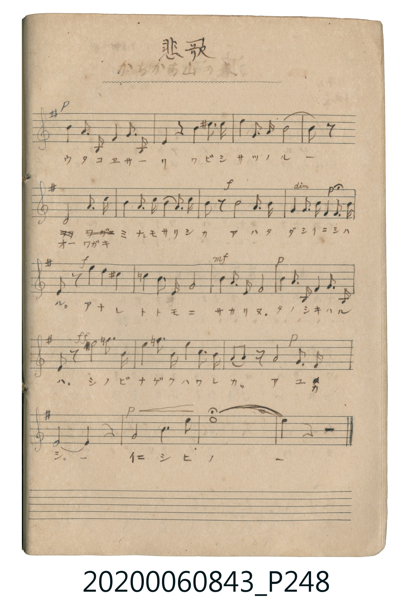

# 悲歌（かちかち山の兎）

<audio controls src="hika.mp3"></audio>

- 唱歌帖 P247b–P248

## 說明

悲歌（かちかち山の兎）
Source: 唱歌帖 (2020.006.0843), P247.jpg (bottom) – P248.jpg
Marginal notes: （悲歌） / かちかち山の兎 (faint pencil on P248)
Key: ホ短調 (E minor / 1 sharp), Time: 4/4

## 歌詞

```text
ラライニ シハルヨ コヒシヤ
トハニスギー ココロモカナシ モモトリノ
ウタコヱサーリ ワビシサツノル ー
オーワガキ ミナモサリシカ アハタダシイニシハ
ル。アナレ トトモニ サカリヌ。タノシキハル
ハ。シノビ ナゲクハワレカ。アユカ
シ。ー イニシヒノ ー
```

## ABC

```abc
X:1
T:悲歌（かちかち山の兎）
M:4/4
L:1/16
Q:1/4=76
K:Em
V:V1 name="Vocal" snm="Voc"
[V:V1]
!p! E4 B8 G2 F2 | G4 E3 F E8 | !mf! A4 B3 E F8 | !p! B4 A3 ^D E4 F3 D |
!f! E2 F2 z4 e4 B2 G2 | G4 F3 E F8 | !mf! B4 B3 F G8 | !p! B4 A3 ^D G4 F3 D |
E4 z4 B4 ^c3 d | e4 A3 B F8 | G8 z8 | E8 F3 G A3 B |
B4 A3 B c3 B A3 c | !f! B2 z6 B4 B3 A | !p! G3 A B3 G F3 G A3 F | !f! E2 z2 e4 B4 G2 F2 |
G4 E3 F G8 | !mf! B4 B3 F G8 | !p! B4 A3 ^D G4 F3 D | !ff! E2 z2 ^d4 e6 B2 |
e4 =f3 G e4 B3 G | !p! F2 G2 z4 A4 G3 F | E8 E4 z4 | !p! F8 B6 d2 |
e16 | e4 z4 z8 |
```

## TMD 檔案連結

- [主旋律 TMD 檔案](hika.tmd) [[在 TMD Studio 編輯](https://tmdlang.github.io/Tmd-TS/#tmd=s7IKdvYPcrWy4tLSUnjWtOnZ2p73ezoeN3Y_blwIIZ9u3Pi4cd3T1r73ezoVtLS4FG0VzM247G0V3LmyUyttFVxzuWxM9E3suOoUlJ5O2Qg04OmOaQoBRibmSY8aJgNpCyUuLn0tBVtqAS4FBcIuBSkKzi8tSk61UkC4SsPIwMhAz8DATM_AwsRYUwfsTL2sgnQFjaT8kpL8XE0FoJtBohYgUZAhvolF6Zl5iTkKefklqcVWCkA7YZZ3KugrYLVfQSMtMTOvRKEgNS85M0chPw9soibIOO_USiuFx82zn89f-2LVfgUNV4XczLz8IqBJhgrFGYlFBUBHhWTmAl0NDFOQBp_KoszkYisQ83HzShBqWvK4uVvhcdP2x839j5tXP25eAeRsftw8CSy0BKKyAyzZ_bhp5-OmdY-b94CVgFStfdy86HETUFcXUDlQ4SIwAipf9bi5D6y3adnjpv1gtRsfN20F6gXKARWuf9w8GWQDSKgFqBZoNVB0D0QLUDNQ2frHTWseN60FCs8HmQ-yCKh4FVgXUHET0KJ-kNnNDWAhkD8g3oC4efXjhiawIqDWNRA_ABGQD_LtVrCjgfb0gFUBDekDGwL0DygUICb0g-WAJgJdNxnIB_px0-MmoMuBSoAk0HFwO4CehGgCKgcKgUMI7qBJQBNgnqM8wUKBgpY-F5dHZnaiVVh-cmKOQ41BjUI1yAYFG0MzLTswCyhSUKtgFq-gC4bGUBoGDYHYHCRZA2aCIFQtUBSuCwaBhuWm1SoYoRgGVAU2AUUh2G5gHnXIAac2WwUlYEIDpTdQoABpcHIDhS8oloAYnOKA9CSo-BIlkOcQHoC5G2K1qTqS46CWg8RqIKJgEQOodDXQwWZIDgZ5E-FZqGasfoB4FmYzhAaqgmnF69cOqN9A_twJxOtAkQ_xI9ifoCS9CMgG-b0L6mcgH4xBekH5o49gGKD5AikIQBAWAjB9JuoQVSA1KEYZY_M8ujdhpuHzdtMyoFf2Q724EZTHIN6GZHcgBmYhkFfB4i0gL0Kjfw-SVzFSHdRxhnDX1qAFhbGCCZSG8E1AAQaNOmRno0alETRYIR41gooaolsH5GL1KshLIK8BvdUELFsghRQkNsExC_IiUA3Yu-CiCpIiQMHT3AAVR8kJ6EEAcjl64oU4DE-WxUicxCZiElIYtvQO8yHI9-CSFopBYuDCFprWQaHWAw0FYOSDQwEUcuByAHsIAJ1vCkm5QI8iORnkWERKNteBBg5qcBkClYDdDvIILC3Ayi9E7OOIZHCEgSIHlE7BxT-QvwmIQWkZ5GQQDYp8cBqGBgEoD2B4BRliZFBI4GPkQeSy2hTFs7ggQgXMaKJyLciH4NoKKTkCC2JIjQXPnbVcXLp2CqDqRgFIK3MBAA)]
- [鋼琴伴奏 TMD 檔案](hika_piano.tmd) [[在 TMD Studio 編輯](https://tmdlang.github.io/Tmd-TS/#tmd=s7IKdvYPcrWy4tLSUnjWtOnZ2p73ezoeN3Y_blwIIZ9u3Pi4cd3T1r73ezoVtLS4FG0VzM247G0V3LmyUyttFVxzuWxM9E3suOoUlJ5O2Qg04OmOaQoBRibmSY8aJgNpCyUuLn0tBVtqAS4FBSJc-qhhikJAZmJevoJjcnJ-bkFiXmZual4JSHNwfmlRcqqVAsK1GkYGRgZ6BgZmegYWJsaaOmDn62UVpCtoJOWXlOTnagLNmwwStQCJggzxTSxKz8xLzFHIyy9JLbZSALoF5qhOBX0FrO5S0EhLzMwrUShIzUvOzFHIzwObqAkyjvJggQIFLX0uLo_M7ESrsPzkxByHGoMahWqQDQo2hmZadmAWUKSgVsEsXkEXDI2hNAwaArE5SLIGzARBqFqgKFwXDAINy02rVTBCMQyoCmwCikKw3cCU4JBTWZSZXGyroPS4eaUCGDctAdLdQHo7kO4H4tVAvALI3wykJ0HFlyiBPIfwAMzdEKtN1ZEcB7UcJFYDEQWLGEClq4EONkNyMMibCM9CNWP1A8SzMJshNFAVTCtev3ZA_Qby504gXgdk74H4EezPtUC8CMgG-b0L6mcgH4xBelcBcR_BMEDzBVIQgCAsBGD6TNQhqkBqUIwyxuZ5dG_CTMPn7aZlQK_sh3pxI5DeCvE22DvrgXgyxKtg8RaQF6HRvwfJqxipDuo4Q7hra9CCwljBBEpD-CagAINGHbKzUaPSCBqsEI8aQUUN0a0DcrF6FeQlkNeA3mpaA8SgGJ0PiU1wzIK8CFQD9i7Qi02gmAWmCFDwNDdAxVFyAnoQgFyOnnghDsOTZTESJ7GJmIQUhi29w3wI8j0wNMBpGIRBYiAfAkMDnNZBodYDDQVg5INDARRy4HIAewgAnW8KSblAjyI5GeRYREo214EGDmpwGQKVgN0O8ggsLcDKL0Ts44hkcISBIgeUToFpF5xVNwExKC2DnAyiQZEPTsPQIADlAQyvIEOMDAoJfIw8iFxWm6J4FhdEqIAZTVSuBfkQ5Hrk5AgsiMG-BiVxSO6shdY14Jo2yIOY2sYsXttQG0-VYwyURw0UoARQEFfFAzQPo-4BJkltHPUPzDVwJ5BXexhqY9YfSC5HVCHYnQJ3OkYmRDKEaIdjLfKRgwxPqY_wCKzcxOFisHkYbsOellBth0EsZTaGd4xBQthLbpC70EtvjBAktQBHuBRWtKLGLEQTwcSJo4glNoJJi1qsDkcuERFegNmMHM_wUhHdp6ByER75yGUjUhbDUjxij2xsyQ_iT6zpCxa5cD5YObisIKKAQ1aGu5RDKax8UAorE3hZZRYPiiIoBcn_EBZCxAiJZx4PEkLRi67ZAIthCK2YmggYBnScEYhnCKJxmmRAwBwQC-YPUAQSciaSYdgUkiSCxSwoF-gxhD6Io2B-xOYdoCcRToS4F0_AgRIEOBHo2imA0oECkFbmAgA)]

## 分析

```text
================================================================================
📊 TMD Song Profile: [ 悲歌（かちかち山の兎） ]
================================================================================
⏱  Duration:       1:22 (82.1s), 26 measures total
🎼 Key & Tempo:    首調基準 G, != 76.0 BPM, <4/4>
   - 分析範圍：      由實際發聲的音符與和弦推測調性；播放脈絡另行呈現
🎤 人聲音域:    D#4 (MIDI 63) – F5 (MIDI 77) [跨度: 14 個半音 / 1.2 個八度, 難度: moderate]
   - 最低音:  D#4 in [Hika #1 @ m.4, 0:10]
   - 最高音: F5 in [Hika #1 @ m.21, 1:03]
   - 適合: soprano, mezzo-soprano, contralto, tenor, baritone, bass
🏛  結構:      Hika (82.1s)
⚡ 編曲密度:        Peak 1 軌道同時演奏
🗝  調性診斷：       E 小調（純淨自然小調，未偵測到可信轉調）
   - 風格氣質:    純淨自然小調（陰鬱抒情、旋律集中，無明顯調外色彩）
   - 轉調歷程:    全曲維持單一推測調性（未偵測到可信轉調）
   - 核心骨幹音:  E, B, G, F#, A
   - 調性數值:    E 小調 [相關度: 0.88, 穩定度: High, 自然音純度: 95.7%]
   - 候選調性 (K-S): E 小調 (0.88), E 大調 (0.63), B 大調 (0.51)
   - 五度圈歷程:   +4
   - 各段落調性細節:
     • [Hika #1]: E 小調 (r: 0.88, 自然音純度: 95.7%, 調外音: C#, D#, F)

  [ 五度圈游移軌跡 ]
               C  
         F            G  
      Bb               D  
      Eb               A  
         Ab          [E ]*
            Db       B  
               F# 
     (* = active key center)

  [ 十二半音累積音高分佈 ]
     C  : █                          1.1%
     C# : █                          0.8%
     D  : █                          0.8%
     D# : ██                         2.7%
     E  : ████████████████████████  27.0%
     F  : █                          0.8%
     F# : ███████████████           17.3%
     G  : █████████████████         19.2%
     G# :                            0.0%
     A  : ████████                   9.2%
     A# :                            0.0%
     B  : ███████████████████       21.1%
--------------------------------------------------------------------------------
Assignment 軌道音域：
  - Vocal         : D#4 – F5 (14 個半音 / 1.2 個八度, 111 個音符)
================================================================================
```


## 原書掃描頁





