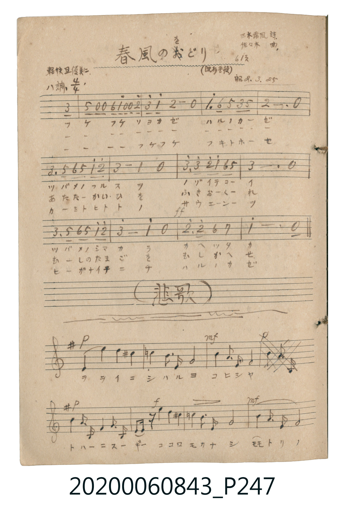
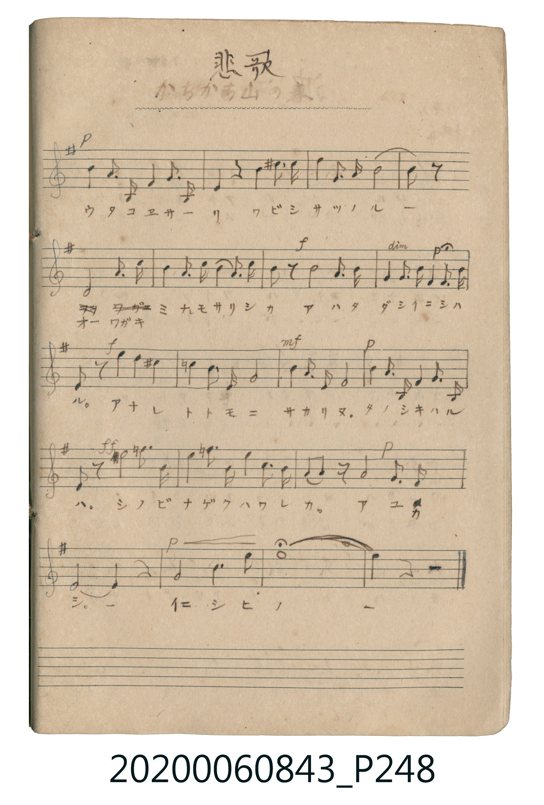

# 悲歌（かちかち山の春）

> Re:Shōka 使用 AI 協助辨識與重建樂譜，可能會有錯誤。歡迎回報。

- **鋼琴伴奏版**：<br><audio controls src="hika.mp3"></audio>
- **NEUTRINO 歌聲合成版**：<br><audio controls src="hika_neutrino.mp3"></audio>

- 唱歌帖 P247b–P248

## 說明

悲歌（かちかち山の春）
Source: 唱歌帖 (2020.006.0843), P247.jpg (bottom) – P248.jpg
Marginal notes: （悲歌） / かちかち山の春 (faint pencil on P248)
Key: ホ短調 (E minor / 1 sharp), Time: 4/4


## 歌詞

```text
ラライニ シハルヨ コヒシヤ
トハニスギー ココロモカナシ モモトリノ
ウタコヱサーリ ワビシサツノル ー
オーワガキ ミナモサリシカ アハタダシイニシハ
ル。アナレ トトモニ サカリヌ。タノシキハル
ハ。シノビ ナゲクハワレカ。アユカ
シ。ー イニシヒノ ー
```

## ABC

<div class="abc-score" data-abc-src="hika.abc" aria-label="五線譜載入中"></div>

[下載 ABC 原始檔](hika.abc)

## TMD 檔案連結

- [主旋律 TMD 檔案](hika.tmd) [[在 TMD Studio 編輯](https://tmdlang.github.io/Tmd-TS/#tmd=s7IKdvYPcrWy4qpTUCpJTLdSSM7PyUlNLsnMz7MqzsjPTkzOyFeCS5bl55TmploBqXgDc4RwcX5pUXJqfEFieqpVgJGJeRK6FNyo-Lz8ktSk_PxsDBUZ-UWJmfFgdcUZpQjpgqL8stS8xDygktzEvNLi5KLMgpL45PyCSoSa1LLMlFSQitSUzJL8oszEHCQnpxYVgz0DcWNJUWIexAygIEIVUFN6Zp5VaR7IoJLMtMzUFGTJkoz89KLEgoxKq4zMYpANyYk58dmJeYkIRSUZqcCQSU0pTU6EGK2lpfCsadOztT3v93Q8bux-3LgQQj7duPFx47pnM5a-39OpoKXFpWirYG7GZW-r4M6VnVppq-Cay2Vjom9iBzL56ZSNQAOe7pimAA7WRw2TgbSFEheXvpaCLbUAl4ICYZeCFAVDYkoB4SoNIwMjAz0DAzM9AwsTY00dsDP1sgrSFTSS8ktK8nM1FYBuBolagERBhvgmFgFDOjFHAZQSiq0UgHbCLO9U0FfAar-CRlpiZl6JQgEwkjNzFPLzwCZqgozzTq20UnjcPPv5_LUvVu1X0HBVyM3Myy8CmmSoUJyRWFQAdFRIJjBmFIBhCtLgUwmMvWIrEPNx80oQalryuLlb4XHT9sfN_Y-bVz9uXgHkbH7cPAkstASisgMs2f24aefjpnWPm_eAlYBUrX3cvOhxE1BXF1A5UOEiMAIqX_W4uQ-st2nZ46b9YLUbHzdtBeoFygEVrn_cPBlkA0ioBagWaDVQdA9EC1AzUNn6x01rHjetBQrPB5kPsgioeBVYF1BxE9CifpDZzQ1gIZA_IN6AuHn144YmsCKg1jUQPwARkA_y7Vawo4H29IBVAQ3pAxsC9A8oFCAm9IPlgCYCXTcZyAf6cdPjJqDLgUqAJNBxcDuAnoRoAioHCoFDCO6gSUATYJ6jPMFCgYKWPheXR2Z2olVAZmJevkONQU01yAIFGxMtOy4wC5hNnq9Z82RHw4uFPSDlILEaheqCWgWzeAUzBVMFE3UgH0hoGCvoAqFZvKaqhq4mMO3oKtSAVfvUgJIJBDctAdLdQA2gmNYABgJYDzCwNIHECrAWmA25abUKxsDsgWKqeTxIDdh6uJwxQk4DZCtCBGF_02aQbZMgtjVtB9m2BGwSMD4R7gBqAblOA5hEYXyoe6ChsKsHJRQ0gEGA7DpigwNowTq4hUCngXHzWrBzFoGc0wV1KChYgAFFs2ABZzWQhR3QeFgFCoE-SMg0LQM5dD_UKZtBMhtBIluxh82OTpSwAQYN0CnAgAApNgFZDNIBDCCoY4wgbgGFEpJ7wLka5KDJiKgCOWUrSKwF6sg-kFNWI0IF4oCns2ejOEBXwRQUKsDQANsOMgceNlARdD7cISCbV4E0QwoQIG8t2B3N85Fip3kRKHbALgOphbkWFlPABGAAMbYaHGVgpxjDnGIIjxRELIFjES6CnFpWK8SD7FoEcVI_kLkf4p4GkCwogYBsXwJPvlCR5n4ljBQ8BT2WiM_D4PISVIQB8RpE3oGlHVBwAK2nXR4GBTUwKJBSag80pQJrLUiyheVuYImPWrqgJpXWteihUJ0GdKqZgrk60E1AAWBkQFIuNDKAAiZYIwcSG6BaC1Q6TwaHShfInZugrlkPcmc_OCVBXbMGOZEYwTICKBxAQQL1vjm2RAAuLqCJYBnUfITfwP4ABbOCATR4QUbBohSeA83AfFC46QIVglmIIIYkHJB-aJ0OsguenCZBEh0koFFNqOXi0rVTAFUlCkBamQsA)]
- [鋼琴伴奏 TMD 檔案](hika_piano.tmd) [[在 TMD Studio 編輯](https://tmdlang.github.io/Tmd-TS/#tmd=s7IKdvYPcrWy4qpTUCpJTLdSSM7PyUlNLsnMz7MqzsjPTkzOyFeCS5bl55TmploBqXgDc4RwcX5pUXJqfEFieqpVgJGJeRK6FNyo-Lz8ktSk_PxsDBUZ-UWJmfFgdcUZpQjpgqL8stS8xDygktzEvNLi5KLMgpL45PyCSoSa1LLMlFSQitSUzJL8oszEHCQnpxYVgzxTkJmYlx-fWFSUmJeempuaV4JQgiQIU5acnJ9bkJiXiaoQaHR6Zp5VaR7IupLMtMzUFGTJkoz89KLEgoxKq4zMYpA7khNz4rMT8xIRikoygNYAnVmanAgKYiUuLS2FZ02bnq3teb-n43Fj9-PGhRDy6caNjxvXPZux9P2eTgUtLS5FWwVzMy57WwV3ruzUSlsF11wuGxN9EzuQyU-nbAQa8HTHNAVw4D9qmAykLZS4uPS1FGypBbgUFIhw6aOGKQoBoCBUcEQOQpDmYEg8KyBcq2FkYGSgZ2BgpmdgYWKsqQN2vl5WQbqCRlJ-SUl-ribQvMkgUQuQKMgQ38QiYAwk5iiA0lGxlQLQLTBHdSroK2B1l4JGWmJmXolCATCJZOYo5OeBTdQEGeedWmml8Lh59vP5a1-s2q-g4aqQm5mXXwQ0yVChOCOxqADoqBCgD6wUgGEN0kB5OEKBgpY-F5dHZnaiFTi4HGoMaqpBFijYmGjZcYFZwNh7vmbNkx0NLxb2gJSDxGoUqgtqFcziFcwUTBVM1IF8IKFhrKALhGbxmqoauppAp-sq1IBV-9QAPbcSgpuWAOluoIbHTdsVNB4394P1PG5erQkkVoC1wGzITatVMAbGDoqp5vEgNWDr4XLGCDkNkK0IEYT9TZtBtk2C2Na0HWTbErBJj5s7EO4AagG5TuNx004YH-oeaCjs6kEJBQ1gECC7jtjgAFqwDm4h0Glg3LwW7JxFIOd0QR0KChZgQNEsWJoXQS3sgMbDKlAI9EFCpmkZyKH7oU7ZDJLZCBLZij1sdnSihA0waIBOAQYESLEJyGKQDmAAQR1jBHELKJSQ3LMKiNeDHDQZEVUgp2wFibVAHdkHcspqRKhAHPB09mwUB-gqmIJCBRgaYNtB5sDDBiqCzoc7BGTzKpBmoGseN60B8taC3dE8Hyl2mheBYgfsMpBamGthMQVMAAYQY6vBUQZ2ijHMKYbwSEHEEjgW4SLIqWW1QjzIrkUQJ_UDmfsh7mkAyYISCMj2JfDkCxVp7lfCSMFT0GOJ-Dy8GuwEkP8fN69B5B1Y2gEFB9B62uVhUFADgwIppfZAUyqw0IQkW1jublqLVrqgJpXWteihUJ0GdKqZgrk60E1AAWBkQFIuNDKAAiZYIwcSG9vBuQaUakEiXSB3boK6Zj3Inf3glAR1zRrkRGIEywigcAAFCdT75tgSAbi4gCaCZVDzEX4D-wMUzAoG0OAFGQWLUngONAPzQeGmC1QIZiGCGJJwQPqByQkSm0jJaRIk0UECGtWEWuR6JMgDqSYxNMNalWjk6hkC61UTTdRKBWSeYby2McQn2obaIOdDSFMYF8SASIMCzUQ9XhvscYg3QOkYJIAqBzIK6mqQDcZQYZhNMD7MCEjChQoCaZBeEygXyQxTdZCAEYwBF4EbA0riEN0ww4AKtKH5HEknJMEjzMdW6wADzBQYYBZIAQZzPiR30SqwYB4H2gZjwujBGV6QmggYXpbA8DI0QE5huaBcgRZqCCYiFMBMcD6EMGEuRA9WdE9ChUE-g7CgFLaaCpQDQFnAEDkPQNWDILI7gT6HhwLUSUCrISUppk6YFAjiEEbTBXI7uJoCex6aYNBSEtQIaOBAIgYsgTUVgF0PTxDwQALHAEo8QiMdIYCtwgKFFSj1GyInf3ARBw0kmAdIyQYoMUtqqYHqtUGZEaDVHCjsQDnByBRv2KEFnjaonkALTWh4IBIJzL1Y1CFrQKQaeBpCcjlK2KGUMLB0Dvcepig0pKAqQIFkBDcQqXQHuQI5PyGzIVUYauDjqyQQ3of6AcaEJyW4K5EdC_c_ljyGaiTCITDPwaVgEOZmGESrgH2QK2ALUupfs_h4YMMdiIEMUICCSWCGQE6dRlBpkDKQJ5B0gGiU-DSECiLpgQiYo6uGWA4WgxgMVIHsFCLrRCweAPHAXgA5ArsnTICkIVAVmKSLBwhUUmjegMYAxKEwG0HSIP-BxEDJFMIDegBEEV3jwPSBTAOxwa4GCcCMRrYOphhiHcwBiKQBEjWAFsRQx0OTEHpogcIWzZNgjyMHLYl1Adg4LLYTEf8DkogJlc9w_0A9BCwIoCGvDYxkUKkBLZkQxTCyIoi_oc4G0SAZFH_B_AOTBDsWxIGUquhGowQQWABSEKH5Hos65ABAMg9mvxGaMqCnUMpAJH-hFtjAQs8zr6QoH1e3A-Eu5AIdtdiFGgirUEAFtTaor4fexkU3AYkLqb8h1TOkakZU1ZAAQnUoRvFMKPwQAYWSHVFVoqRKYBcOZKlrXkpmXjrh4IHUUJAuLnp9BY4CdG-htEBQKlxEbY0OUeIN2WV4wgOeJKFFBKRKRPIo1tSPbCPYNl07BXD4KwAZoGoSRENcAGIpcwEA)]

## 分析

```text
================================================================================
📊 TMD Song Profile: [ 悲歌（かちかち山の春） ]
================================================================================
⏱  Duration:       1:18 (78.9s), 25 measures total
🎼 Key & Tempo:    首調基準 G, != 76.0 BPM, <4/4>
   - 分析範圍：      由實際發聲的音符與和弦推測調性；播放脈絡另行呈現
🎤 人聲音域:    B3 (MIDI 59) – G5 (MIDI 79) [跨度: 20 個半音 / 1.7 個八度, 難度: challenging]
   - 最低音:  B3 in [Hika #1 @ m.4, 0:10]
   - 最高音: G5 in [Hika #1 @ m.19, 0:58]
   - 適合: soprano, mezzo-soprano, tenor, baritone
🏛  結構:      Hika (78.9s)
⚡ 編曲密度:        Peak 1 軌道同時演奏
🗝  調性診斷：       E 小調（流行色彩小調，未偵測到可信轉調）
   - 風格氣質:    流行小調（略帶和弦色彩音與裝飾副屬和弦）
   - 轉調歷程:    全曲維持單一推測調性（未偵測到可信轉調）
   - 核心骨幹音:  B, E, G, F#, A
   - 調性數值:    E 小調 [相關度: 0.84, 穩定度: High, 自然音純度: 92.1%]
   - 候選調性 (K-S): E 小調 (0.84), B 小調 (0.67), E 大調 (0.66)
   - 五度圈歷程:   +4
   - 各段落調性細節:
     • [Hika #1]: E 小調 (r: 0.84, 自然音純度: 92.1%, 調外音: C#)

  [ 五度圈游移軌跡 ]
               C  
         F            G  
      Bb               D  
      Eb               A  
         Ab          [E ]*
            Db       B  
               F# 
     (* = active key center)

  [ 十二半音累積音高分佈 ]
     C  : ██                         2.4%
     C# : ████████                   7.9%
     D  : ██████                     6.3%
     D# :                            0.0%
     E  : ███████████████████████   22.0%
     F  :                            0.0%
     F# : ████████████              11.5%
     G  : ████████████████          16.0%
     G# :                            0.0%
     A  : ███████████               10.7%
     A# :                            0.0%
     B  : ████████████████████████  23.3%
--------------------------------------------------------------------------------
Assignment 軌道音域：
  - Piano         : B3 – G5 (20 個半音 / 1.7 個八度, 103 個音符)
================================================================================
```


## 原書掃描頁






