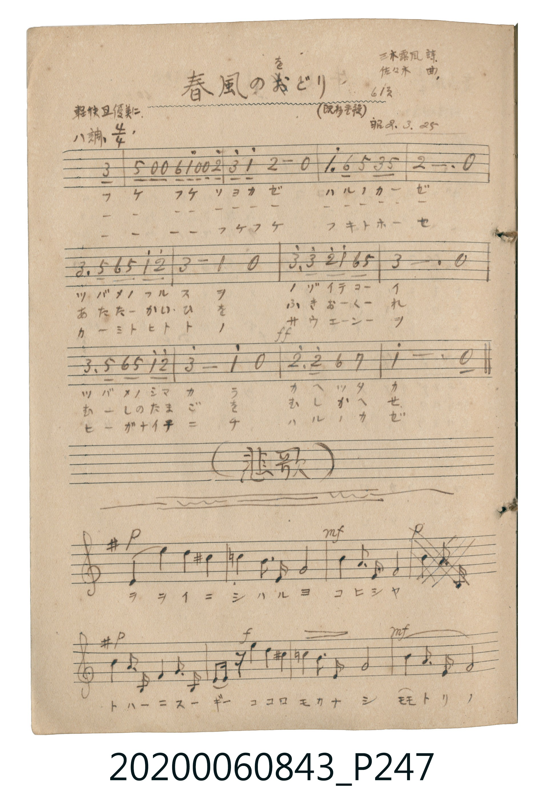
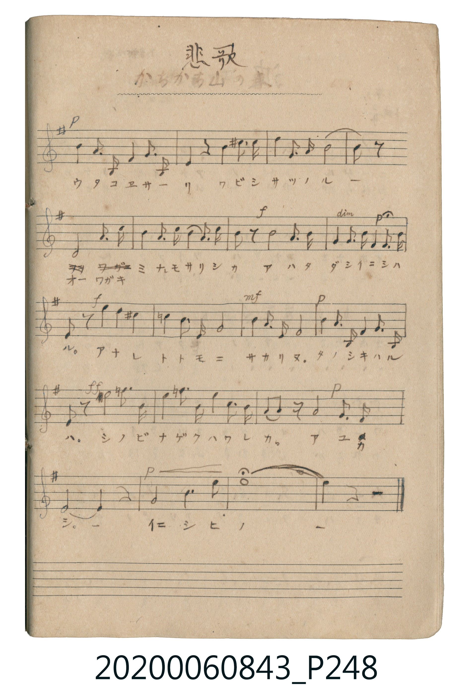

# 悲歌（かちかち山の兎）

> Re:Shōka 使用 AI 協助辨識與重建樂譜，可能會有錯誤。歡迎回報。

- **鋼琴伴奏版**：<br><audio controls src="hika.mp3"></audio>

- 唱歌帖 P247b–P248

## 說明

悲歌（かちかち山の兎）
Source: 唱歌帖 (2020.006.0843), P247.jpg (bottom) – P248.jpg
Marginal notes: （悲歌） / かちかち山の兎 (faint pencil on P248)
Key: ホ短調 (E minor / 1 sharp), Time: 4/4


## 歌詞

```text
ラライニ シハルヨ コヒシヤ
トハニスギー ココロモカナシ モモトリノ
ウタコヱサーリ ワビシサツノル ー
オーワガキ ミナモサリシカ アハタダシイニシハ
ル。アナレ トトモニ サカリヌ。タノシキハル
ハ。シノビ ナゲクハワレカ。アユカ
シ。ー イニシヒノ ー
```

## ABC

<div class="abc-score" data-abc-src="hika.abc" aria-label="五線譜載入中"></div>

[下載 ABC 原始檔](hika.abc)

## TMD 檔案連結

- [主旋律 TMD 檔案](hika.tmd) [[在 TMD Studio 編輯](https://tmdlang.github.io/Tmd-TS/#tmd=s7IKdvYPcrWy4qpTUCpJTLdSSM7PyUlNLsnMz7MqzsjPTkzOyFeCS5bl55TmploBqXgDc4RwcX5pUXJqfEFieqpVgJGJeRK6FNyo-Lz8ktSk_PxsDBUZ-UWJmfFgdcUZpQjpgqL8stS8xDygktzEvNLi5KLMgpL45PyCSoSa1LLMlFSQitSUzJL8oszEHCQnpxYVgz0DcWNJUWIexAygIEIVUFN6Zp5VaR7IoJLMtMzUFCUuLS2FZ02bnq3teb-n43Fj9-PGhRDy6caNjxvXPW3te7-nU0FLi0vRVsHcjMveVsGdKzu10lbBNZfLxkTfxA5k-tMpG4EGPN0xTQEcMI8aJgNpCyUuLn0tBVtqAS4FBcIuBSkKhoS1AsJVGkYGRgZ6BgZmegYWJsaaOmBn6mUVpCtoJOWXlOTnaioA3QwStQCJggzxTSwChlVijgIoLoutFIB2wizvVNBXwGq_gkZaYmZeiUIBMJoycxTy88AmaoKM806ttFJ43Dz7-fy1L1btV9BwVcjNzMsvAppkqFCckVhUAHRUSCYw1SkAwxSkwaeyKDO52ArEfNy8EoSaljxu7lZ43LT9cXP_4-bVj5tXADmbHzdPAgstgajsAEt2P27a-bhp3ePmPWAlIFVrHzcvetwE1NUFVA5UuAiMgMpXPW7uA-ttWva4aT9Y7cbHTVuBeoFyQIXrHzdPBtkAEmoBqgVaDRTdA9EC1AxUtv5x05rHTWuBwvNB5oMsAipeBdYFVNwEtKgfZHZzA1gI5A-INyBuXv24oQmsCKh1DcQPQATkg3y7FexooD09YFVAQ_rAhgD9AwoFiAn9YDmgiUDXTQbygX7c9LgJ6HKgEiAJdBzcDqAnIZqAyoFC4BCCO2gS0ASY5yhPsFCgoKXPxeWRmZ1oFZafnJjjUGNQUw2yQMHG0EzLDsyqUaguqFUwi1fQBUNjKA2DhkBsDpKsATNBEKoWKArXBYNAw3LTahWMUAwDqgKbgKIQbDcwizrkgBObrYISMJ2BkhsoTIA0OLWBghcUSUAMTnBAehJUfIkSyG8ID8DcDbHaVB3JcVDLQWI1EFGwiAFUuhroYDMkB4O8ifAsVDNWP0A8C7MZQgNVwbTi9WsH1G8gf-4E4nWguIf4EexPUIpeBGSD_N4F9TOQD8YgvaDs0UcwDNB8gRQEIAgLAZg-E3WIKpAaFKOMsXke3Zsw0_B5u2kZ0Cv7oV7cCMpiEG9DcjsQA3MQyKtg8RaQF6HRvwfJqxipDuo4Q7hra9CCwljBBEpD-CagAINGHbKzUaPSCBqsEI8aQUUN0a0DcrF6FeQlkNeA3moCFi2QMgoSm-CYBXkRqAbsXXBJBUkRoOBpboCKo-QE9CAAuRw98UIchifLYiROYhMxCSkMW3qH-RDke3BBC8UgMXBZC03roFDrgYYCMPLBoQAKOXA5gD0EgM43haRcoEeRnAxyLCIlm-tAAwc1uAyBSsBuB3kElhZg5Rci9nFEMjjCQJEDSqfg0h_I3wTEoLQMcjKIBkU-OA1DgwCUBzC8ggwxMigk8DHyIHJZbYriWVwQoQJmNFG5FuRDcGWFlByBBTGkwoLnzlouLl07BVBtowCklbkA)]
- [鋼琴伴奏 TMD 檔案](hika_piano.tmd) [[在 TMD Studio 編輯](https://tmdlang.github.io/Tmd-TS/#tmd=s7IKdvYPcrWy4tLSUnjWtOnZ2p73ezoeN3Y_blwIIZ9u3Pi4cd3T1r73ezoVtLS4FG0VzM247G0V3LmyUyttFVxzuWxM9E3suOoUlJ5O2Qg04OmOaQoBRibmSY8aJgNpCyUuLn0tBVtqAS4FBSJc-qhhikJAZmJevoJjcnJ-bkFiXmZual4JSHNwfmlRcqqVAsK1GkYGRgZ6BgZmegYWJsaaOmDn62UVpCtoJOWXlOTnagLNmwwStQCJggzxTSxKz8xLzFHIyy9JLbZSALoF5qhOBX0FrO5S0EhLzMwrUShIzUvOzFHIzwObqAkyjvJggQIFLX0uLo_M7ESrsPzkxByHGoOaapAFCjaGZlp2YFaNQnVBrYJZvIIuGBpDaRg0BGJzkGQNmAmCULVAUbguGAQalptWq2CEYhhQFdgEFIVgu4EJwSGnsigzudhWQelx80oFMG5aAqS7gfR2IN0PxKuBeAWQvxlIT4KKL1EC-Q3hAZi7IVabqiM5Dmo5SKwGIgoWMYBKVwMdbIbkYJA3EZ6FasbqB4hnYTZDaKAqmFa8fu2A-g3kz51AvA7I3gPxI9ifa4F4EZAN8nsX1M9APhiD9K4C4j6CYYDmC6QgAEFYCMD0mahDVIHUoBhljM3z6N6EmYbP203LgF7ZD_XiRiC9FeJtsHfWA_FkiFfB4i0gL0Kjfw-SVzFSHdRxhnDX1qAFhbGCCZSG8E1AAQaNOmRno0alETRYIR41gooaolsH5GL1KshLIK8BvdW0BohBMTofEpvgmAV5EagG7F2gF5tAMQtMEaDgaW6AiqPkBPQgALkcPfFCHIYny2IkTmITMQkpDFt6h_kQ5HtgaIDTMAiDxEA-BIYGOK2DQq0HGgrAyAeHAijkwOUA9hAAOt8UknKBHkVyMsixiJRsrgMNHNTgMgQqAbsd5BFYWoCVX4jYxxHJ4AgDRQ4onQLTLjirbgJiUFoGORlEgyIfnIahQQDKAxheQYYYGRQS-Bh5ELmsNkXxLC6IUAEzmqhcC_IhyPXIyRFYEIN9DUrikNxZC61qwBVtkAcRlY1ZvLahNp4axxgojxomQAmgIK56B2geRtUDTJHaOKofmGvgTiCv8jDUxqw-kFyOqEGwOwXudIw8iGQI0Q7HWuIjBxmeQh_hEVixicPFYPMw3IY9KaHaDoNYimwM7xiDhLAX3CB3oRfeGCFIavmNcCmsZEWNWYgmgokTRwlLbASTFrVYHY5cICK8ALMZOZ7hhSK6T0HFIjzykYtGpCyGpXTEHtnYkh_En1jTFyxy4XywcnBZQUT5hqwMdyGHUlb5IJdVJvCiyiweFENQCpL9ISyEiBESzzweJISiF12zARbDEFoxNREwDOg4IxDPEETjNMmAgDkgFswfoPgj5Ewkw7ApJEkEi1lQLtBjCH0QR8H8iM07QE8inAhxL56AA6UHcBrwzCspysdSYSESASiVRhvGgpNNtGksUCTaLDdWIdoEiIFcTHNwJCZgHIHTMrQaMQHWBuBiBKTbNS8lMy8dvzNyQe4wAtkMtBVmO9AxUKdhMQmHQ4ABC7QZYj_cWVDtunYKYJ8oABmg7AGiIUaCWMpcAA)]

## 分析

```text
================================================================================
📊 TMD Song Profile: [ 悲歌（かちかち山の兎） ]
================================================================================
⏱  Duration:       1:22 (82.1s), 26 measures total
🎼 Key & Tempo:    首調基準 G, != 76.0 BPM, <4/4>
   - 分析範圍：      由實際發聲的音符與和弦推測調性；播放脈絡另行呈現
🎤 人聲音域:    D#4 (MIDI 63) – F5 (MIDI 77) [跨度: 14 個半音 / 1.2 個八度, 難度: moderate]
   - 最低音:  D#4 in [Hika #1 @ m.4, 0:10]
   - 最高音: F5 in [Hika #1 @ m.21, 1:03]
   - 適合: soprano, mezzo-soprano, contralto, tenor, baritone, bass
🏛  結構:      Hika (82.1s)
⚡ 編曲密度:        Peak 1 軌道同時演奏
🗝  調性診斷：       E 小調（純淨自然小調，未偵測到可信轉調）
   - 風格氣質:    純淨自然小調（陰鬱抒情、旋律集中，無明顯調外色彩）
   - 轉調歷程:    全曲維持單一推測調性（未偵測到可信轉調）
   - 核心骨幹音:  E, B, G, F#, A
   - 調性數值:    E 小調 [相關度: 0.88, 穩定度: High, 自然音純度: 95.7%]
   - 候選調性 (K-S): E 小調 (0.88), E 大調 (0.63), B 大調 (0.51)
   - 五度圈歷程:   +4
   - 各段落調性細節:
     • [Hika #1]: E 小調 (r: 0.88, 自然音純度: 95.7%, 調外音: C#, D#, F)

  [ 五度圈游移軌跡 ]
               C  
         F            G  
      Bb               D  
      Eb               A  
         Ab          [E ]*
            Db       B  
               F# 
     (* = active key center)

  [ 十二半音累積音高分佈 ]
     C  : █                          1.1%
     C# : █                          0.8%
     D  : █                          0.8%
     D# : ██                         2.7%
     E  : ████████████████████████  27.0%
     F  : █                          0.8%
     F# : ███████████████           17.3%
     G  : █████████████████         19.2%
     G# :                            0.0%
     A  : ████████                   9.2%
     A# :                            0.0%
     B  : ███████████████████       21.1%
--------------------------------------------------------------------------------
Assignment 軌道音域：
  - Vocal         : D#4 – F5 (14 個半音 / 1.2 個八度, 111 個音符)
================================================================================
```


## 原書掃描頁






