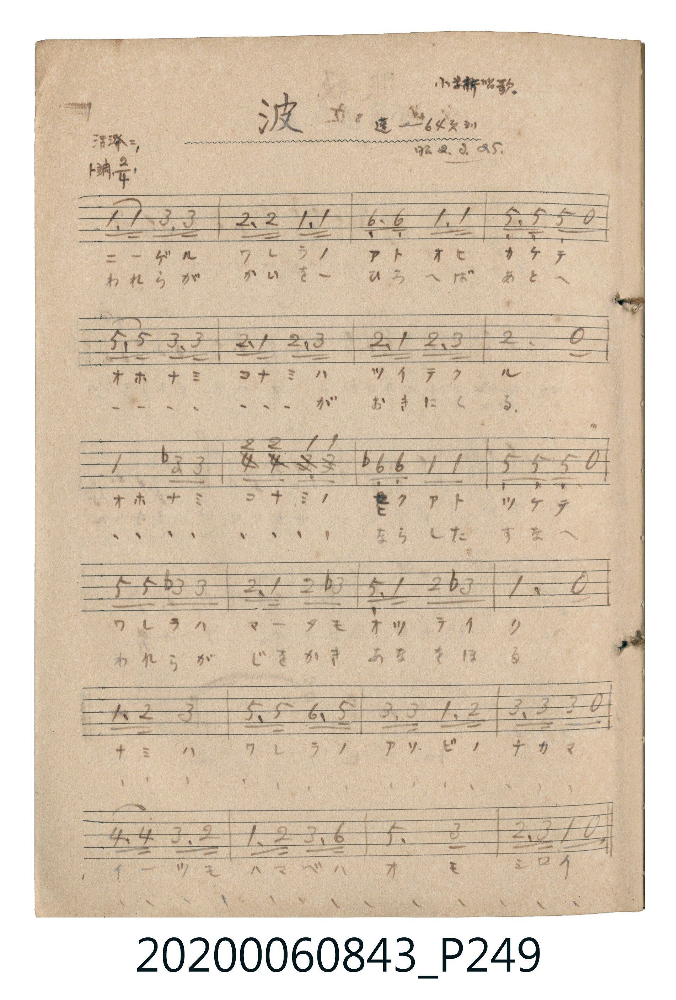

# 波（波浪）

<audio controls src="nami.mp3"></audio>

- 唱歌帖 P249 (小学新唱歌 / 蓬萊唱集 64頁 / 昭2.3.25)

## 說明

波（波浪）
Source: 唱歌帖 (2020.006.0843), P249.jpg
Marginal notes: 小学新唱歌 / 蓬 64頁ヨリ / 昭2.3.25. / 活潑ニ
Key: ト調 (G major), Time: 2/4, Tempo: 活潑ニ

## 歌詞

```text
1. ニーゲル ワレラノ アト オヒ カケテ
オホナミ コナミハ ツイテクル
オホナミ コナミノ ヒクアト ツケテ
ワレラハ マータモ オツテイク
ナミハ ワレラノ アソビノ ナカマ
イーツモ ハマベハ オモシロイ
2. われらが かいを ひろへば あとへ
オホナミ コナミが おきにくる
オホナミ コナミノ ならした すなへ
われらが じをかき あなをほる
ナミハ ワレラノ アソビノ ナカマ
イーツモ ハマベハ オモシロイ
```

## ABC

```abc
X:1
T:波（波浪）
M:2/4
L:1/16
Q:1/4=108
K:G
V:V1 name="Vocal" snm="Voc"
[V:V1]
G3 G B,3 B, | A,3 A, G3 G | E3 E G3 G | D3 D D2 z2 |
D3 D B,3 B, | A,3 G A,3 B, | A,3 G A,3 B, | A,6 z2 |
G4 _B3 B | A3 A G3 G | _E3 E G3 G | D3 D D2 z2 |
D3 D _B3 B | A3 G A3 _B | D3 G A3 _B | G6 z2 |
G3 A B4 | D3 D E3 D | B,3 B, G3 A | B3 B B2 z2 |
c3 c B3 A | G3 A B3 E | D6 B2 | A3 B G2 z2 |
```

## TMD 檔案連結

- [主旋律 TMD 檔案](nami.tmd) [[在 TMD Studio 編輯](https://tmdlang.github.io/Tmd-TS/#tmd=s7IKdvYPcrWy4tLSUni2edH7PR1A8tnWVe_3dCpoaXEp2ioYGlhw2dsquHPZGOmb2HHVKSg9nbLx2dqepzumKQQYmVgqaDzd0P907bJn0zZAJBT0FV5MXvNiQheQ-3J2m4KZycsFjUDBZzPWGukZ6xmZaipxcelrKdhSC3ApKKC7HSQUnF9alJxqpYBwroaRgZGBnoGBmZ6BhYmxpg7Y_XpZBekg5b6JRemZeYk5Cnn5JanFQG3YfAXxzOPmFY-bVyF7SQ_E2bL72d6Jj5u7QaZ5p1ZaKTxu7nixar-ChrtCbmJWfhHQwpDMXKCLgAEJZKbmFuRboeryqSzKTC62AjEN9YDaux8373nctOlx82ogZ_3j5jWPm1c-bu5TeNy0CGg2kFr1uHkSkFr9uGnj4-Y2kD6w2OzHzV2Pm-cDOZshrMfN_UATWh43LQEqe9wENGo1PsVAG5ongZRB7QHphFuAcAjIzHlgJ-5_3LwIYloL2IIlQM0QxQjb0dzftPdx82SIVV0gHzTPg7gI6MI9YGOABjb3gy2YCTYAZDpQ2_bHzWuBqkCKjYBh1NT_uKnncVPn48YehceN3Y8bgU4FBknjpsdNvY8bdzxu3ADkND1uXAHk4PEyWHfX40agntWPG4FmguMDT_g0rgJbOv1xI1CmcSaID7MAxUUzgM4Bu6sX4g6gNiB_N8wCmoYP5VkLChS09Lm4_BJzM63C8pMTcxxqDGoUqkE2KNgYmmnZgVk1CoYKukBoqGAcD2YAqRoFIwgbSMFkaxTMIGJACiFmChEDUmCWARDXgI0FFhQOOeBsYaugBMwRQE_vAfp1E5AGZwogXgPEK4EYHG6gTAcKC1AKBuUMIN4IZLcpgfyAamC8EcjIJlDQAWOqqRMYQeA0BMQtQD5QO8iqRqBVTaDI2wHE4MQExCtAfLiRyM7H4nlDGIOgIATi8jzYU7NB6QGIwekRwYbkb1DyAHkWSIMCZjVuT-MxCpIVgBjkaWD4NYICqBvJs5BYA7pcB0YBPQCJZuRY1oFGM5AmOZ7xehVcOkG8CItvsNcJxDMBIxuB8uA0MB2IwXkaIoYrnjE8D4xRhBBUIYoYLNzwxTFKggaXr9AEvx9Ig4tYiGfBcQyM66b1xCfsGZBEDU7g4NII6mmQ2G6scWykYAx1L7LXofkXyKpBSu4wHUAxiBCYxulP5HSLJRM37QWyJ0MjG6gWlJGb5-H0K4XG1SiYgN1sAnU7yBeoIQD0MzwIoKkfHCrQ6AWrxpmYQXkSGIfgeAOX2tB4BaYwSMENjdvtQHotKF5xxyl5RtVycenaKYAKcAUgrcwFAA)]
- [鋼琴伴奏 TMD 檔案](nami_piano.tmd) [[在 TMD Studio 編輯](https://tmdlang.github.io/Tmd-TS/#tmd=s7IKdvYPcrWy4tLSUni2edH7PR1A8tnWVe_3dCpoaXEp2ioYGlhw2dsquHPZGOmb2HHVKSg9nbLx2dqepzumKQQYmVgqaDzd0P907bJn0zZAJBT0FV5MXvNiQheQ-3J2m4KZycsFjUDBZzPWGukZ6xmZaipxcelrKdhSC3ApKGC4_VHDFIWAzMS8fAXH5OT83ILEvMzc1LwSkNLg_NKi5FQrBYQ3NIwMjAz0DAzM9AwsTIw1dcD-0ssqSAcp900sSs_MS8xRyMsvSS0GasPmW4gnHzeveNy8CtmreiDOlt3P9k583NwNMo1y30KBgpY-F5dfYm6mVVh-cmKOQ41BjUI1yAYFG0MzLTswq0bBUEEXCA0VjOPBDCBVo2AEYQMpmGyNghlEDEghxEwhYkAKzDIA4hqwscC4c8ipLMpMLrZVUAL6S-Fx8x6Fx02bgPRqIF4PxGuAeCUQ9wHFFwHpDiC9CkhPAtJANU0bgew2JZAfUA2MNwIZ2dQPVNIDxJ0KjxuBdCPQisYWIB-oHWRVI9Cqpl4gvQOINwBxExCvAPHhRiI7H4vnDWEMgoIQiMvzYE_NBuIuIJ4PdNVmBLsZ6ItmkKuXgDwLpEEBsxq3p_EYBQ4EILsR5Glg-DWCAqgbybOQWAO6XAdGAT0AiWbkWNaBRjOQJjme8XoVGM_guAV6ERbfYK8TiGcCRjYC5cFpYDoQg4JhJkQMVzxjeB4YowghqEIUMVi44YtjlAQNitN50AS_H0gDPQv2BdCz4DgGxnXTeuIT9gxIogYncFDcghIyyNMgsd1Y49hIwRjqXmSvQ_MvkFWDlNxhOoBiECEwjdOfyOkWSyZu2gtkT4ZGNlAtKCM3z8PpVwqNq1EwAbvZBOp2kC9QQwDoZ3gQQFM_OFSg0QtWjTMxg_IkMA7B8QZKsLB4BaYwEBscpyBHbgfSa0HxijtOyTOqFlp6gyupIA8c5Xd1blotMCa18ZfjSAqQi3ITZGGgGuQSEcJBBA_l5aV5fLw2jjIT5I8CoD90YA4CWaONnF2BXFhxhVCFXmSh-geoDDnr4_URLtsIlg8Qc-GuxvQWMHpgqdJQm5ycCdMFTK9gFrLxZvHasEwA8gFcDzy-UbICIoaRcwNQoznMu8D8D_cOxB6UVOiDkgotEI0IUAAC3QyhQEaiCZgASRg2A4sgtBjAfYPNGCOoUSCakAh-k3A7CJhyqOEgiBpizIEyQJYDmXA-KGRwGwJVDTcEphooAJJCdQvYWCRfg4wBRqVnXklRPrYSxQRRoADzYbRhrEK0SSyQF22UC2SaAplo2lGTAkI72DWQEgCUokG6XPNSMvPSCdgKyv7RZiDLIPYCrQS5AsMAXPaCSzNIvgL5HaRN104B7GAFIAOUhkE0xCgQS5kLAA)]

## 分析

```text
================================================================================
📊 TMD Song Profile: [ 波（波浪） ]
================================================================================
⏱  Duration:       0:26 (26.7s), 24 measures total
🎼 Key & Tempo:    首調基準 G, != 108.0 BPM, <2/4>
   - 分析範圍：      由實際發聲的音符與和弦推測調性；播放脈絡另行呈現
🎤 人聲音域:    A3 (MIDI 57) – C5 (MIDI 72) [跨度: 15 個半音 / 1.2 個八度, 難度: moderate]
   - 最低音:  A3 in [Nami #1 @ m.2, 0:01]
   - 最高音: C5 in [Nami #1 @ m.21, 0:22]
   - 適合: soprano, mezzo-soprano, contralto, tenor, baritone, bass
🏛  結構:      Nami (26.7s)
⚡ 編曲密度:        Peak 1 軌道同時演奏
🗝  調性診斷：       G 大調（流行色彩大調，未偵測到可信轉調）
   - 風格氣質:    流行大調（略帶和弦色彩音與裝飾副屬和弦）
   - 轉調歷程:    全曲維持單一推測調性（未偵測到可信轉調）
   - 核心骨幹音:  G, A, D, B, A#
   - 調性數值:    G 大調 [相關度: 0.79, 穩定度: Moderate, 自然音純度: 92.2%]
   - 候選調性 (K-S): G 大調 (0.79), D 大調 (0.70), B 小調 (0.52)
   - 五度圈歷程:   +1
   - 各段落調性細節:
     • [Nami #1]: G 大調 (r: 0.79, 自然音純度: 92.2%, 調外音: D#, A#)

  [ 五度圈游移軌跡 ]
               C  
         F           [G ]*
      Bb               D  
      Eb               A  
         Ab           E  
            Db       B  
               F# 
     (* = active key center)

  [ 十二半音累積音高分佈 ]
     C  : ██                         2.2%
     C# :                            0.0%
     D  : ██████████████████        18.9%
     D# : ██                         2.2%
     E  : ████                       4.4%
     F  :                            0.0%
     F# :                            0.0%
     G  : ████████████████████████  25.0%
     G# :                            0.0%
     A  : ██████████████████████    23.3%
     A# : █████                      5.6%
     B  : ██████████████████        18.3%
--------------------------------------------------------------------------------
Assignment 軌道音域：
  - Vocal         : A3 – C5 (15 個半音 / 1.2 個八度, 82 個音符)
================================================================================
```


## 原書掃描頁




