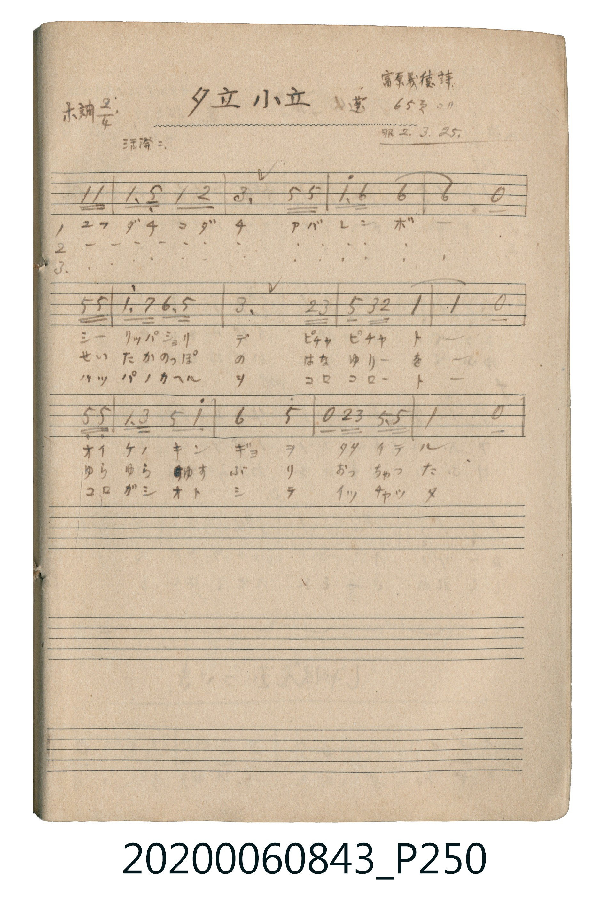

# 夕立小立 (陣雨)

<audio controls src="yudachi_kodachi.mp3"></audio>

- 詞：富原義徳
- 公學校唱歌帳 補遺 — 蓬 65頁ヨリ

## 說明

・出處：公學校唱歌帳 補遺 — 蓬 65頁ヨリ
・調性與拍號：調號 ?= E，拍號 <2/4>，速度 != 112

## 歌詞

```text
（TMD 檔案未包含歌詞註解）
```

## ABC

```abc
X:1
T:夕立小立 陣雨
M:2/4
L:1/16
Q:1/4=112
K:E
V:V1 name="Vocal" snm="Voc"
[V:V1]
z4 z2 E E | E3 B, E2 F2 | G4 B2 B2 | e3 c c4 |
c4 z2 B B | e3 d c3 B | G4 F2 G2 | B2 G F E4 |
E4 z2 B B | E2 G2 B2 e2 | c4 B4 | z2 F G B,3 B, |
E4 z4 |
```

## TMD 檔案連結

- [主旋律 TMD 檔案](yudachi_kodachi.tmd) [[在 TMD Studio 編輯](https://tmdlang.github.io/Tmd-TS/#tmd=s7IKdvYPcrWy4tLSUni6ZOrz1d1PN_QDSQWNlzMXv5y9QlNBS4tL0VbB0NCIy95WwZXLxkjfxI6rTkHpaeuap2t3PFuw8OmUjc_W9jzdsVnhxeI5Lxt3KTxqmKLwYvIaBTPTlwsaHzeveNy8Sgmk48XKee_3zHq6vudp3_zn-1Y-3bdZiYsrsjQlMTkj0zsfTFmF5Scn5jjUGNQoVHMpAIGNoZmWHZhVo2CgoAuGINoQCGvA4vpaCuVWCo-blwHxVAUtfRIFa4AGgQw1jQczjIC4RsEYapMpFAMVxYEFzIAQIlUDZ4GcYwqEqM5pAOJGhcdNm5HYi4D0BCBeA8Qg8TkKWkDR7UDWHnQ3Eq29cTYQt5Ctvbn_cXMzkIEIDYhHzaHeA3oLHhqgsAGxa8BhYgzkQ4IOHD54A2MVyJLHzRNBvn3cvBwkAsTtQDwF5LjHzYtRmR3ggAGqaVqC5rPG-UDcDcTrHjcCVTbuBTGBeD0Qg9S3AXEXEE8CmwDidaKHDdAVzX1AidVAegYQg-hN0LBai6ChjoDwUBILKAxAIQAOKkQ6AAlBAgMUCEZAZcA0BU1aqAEEVoXspqaNUDeB7AXa2LQOEkogZ-2H4iVAPtA_QOei-gfqSTDdOBOIt0GCoLELEkILHzc1Q1jz0XUCUwIo9YECGuhbSEoEmbYEEl2gyACzgPYDddZycenaKaDmVwWgiDIXAA)]
- [鋼琴伴奏 TMD 檔案](yudachi_kodachi_piano.tmd) [[在 TMD Studio 編輯](https://tmdlang.github.io/Tmd-TS/#tmd=s7IKdvYPcrWy4tLSUni6ZOrz1d1PN_QDSQWNlzMXv5y9QlNBIyAzMS9fwTE5OT-3IDEvMzc1r0RTQUuLS9FWwdDQiMveVsGVy8ZI38SOq05B6WnrmqdrdzxbsPDplI3P1vY83bFZ4cXiOS8bdyk8apii8GLyGgUz05cLGh83r3jcvEoJpOPFynnv98x6ur7nad_85_tWPt23WYmLK7I0JTE5I9M7H0xZheUnJ-Y41BjUKFRzKQCBjaGZlh2YVaNgoKALhiDaEAhrwOL6WgrlVgqPm5cB8VQFLX0SBWuABoEMNY0HM4yAuEbBGGqTKRQDFcWBBcyAECJVA2eBnGMKhKjOaQDiRoXHTZuR2IuA9AQgXgPEIPE5ClpA0e1A1h50NxKtvXE2ELeQrb25_3FzM5CBCA2IR82h3gN6Cx4aoLABsWvAYWIM5EOCDhw-eANjFciSx80TQb593LwcJALE7UA8BeS4x82LUZkd4IABqmlaguazxvlA3A3E6x43AlU27gUxgXg9EIPUtwFxFxBPApsA4nWihw3QFc19QInVQHoGEIPoTdCwWougoY6A8FASCygMQCEADipEOgAJQQIDFAhGQGXANAVNWqgBBFaF7KamjVA3gewF2ti0DhJKIGfth-IlQD7QP0DnovoH6kkw3TgTiLdBgqCxCxJCCx83NUNY89F1AlMCKPWBAhroW0hKBJm2BBJdoMgAs4D2A3XWYmRWcHkR5EFMdtUGJxyojGm8NjzTQdlACpL1ICpB0FgbnMzAJDARakNTpom2GRjDAhvBBlkEVQ61CK7JVNscrhCkBNkec4jVUCcqGIFNAPHAEnC3gtM9goNpGVQSYg7M8dA0gnAkRAKRTsCWgPQYxWtD0wuEhWEbJNXgiAUflFiwQIkEAwVDoHGwBAwKciiJzjMBlYFgAsoGOwhVJ1QawoHIQ1hYDDXAYSvYDBgHYgxIPwiDlUL8C_arZ15JUT62hGYC92J1bkGtQrRhrEK0aSyQG22cC2SaAQl0A1DDCGEAzCXG8QpmoIAC6nLNS8nMSydkbxrQXhO4vSAXwK1FNgCXvcBggIUXzF5dOwWwgxWADNRoBolADAWxlLkA)]

## 分析

```text
================================================================================
📊 TMD Song Profile: [ 夕立小立 陣雨 ]
================================================================================
⏱  Duration:       0:13 (13.9s), 13 measures total
🎼 Key & Tempo:    首調基準 E, != 112.0 BPM, <2/4>
   - 分析範圍：      由實際發聲的音符與和弦推測調性；播放脈絡另行呈現
🎤 人聲音域:    B3 (MIDI 59) – E5 (MIDI 76) [跨度: 17 個半音 / 1.4 個八度, 難度: challenging]
   - 最低音:  B3 in [YudachiKodachi #1 @ m.2, 0:01]
   - 最高音: E5 in [YudachiKodachi #1 @ m.4, 0:03]
   - 適合: soprano, mezzo-soprano, contralto, tenor, baritone, bass
🏛  結構:      YudachiKodachi (13.9s)
⚡ 編曲密度:        Peak 1 軌道同時演奏
🗝  調性診斷：       E 大調（純淨自然大調，未偵測到可信轉調）
   - 風格氣質:    純淨自然大調（陽光明朗、易唱易記，無明顯調外色彩）
   - 轉調歷程:    全曲維持單一推測調性（未偵測到可信轉調）
   - 核心骨幹音:  E, B, C#, G#, F#
   - 調性數值:    E 大調 [相關度: 0.91, 穩定度: High, 自然音純度: 100.0%]
   - 候選調性 (K-S): E 大調 (0.91), C# 小調 (0.70), B 大調 (0.63)
   - 五度圈歷程:   +4
   - 各段落調性細節:
     • [YudachiKodachi #1]: E 大調 (r: 0.91, 自然音純度: 100.0%)

  [ 五度圈游移軌跡 ]
               C  
         F            G  
      Bb               D  
      Eb               A  
         Ab          [E ]*
            Db       B  
               F# 
     (* = active key center)

  [ 十二半音累積音高分佈 ]
     C  :                            0.0%
     C# : █████████████             18.2%
     D  :                            0.0%
     D# : █                          1.1%
     E  : ████████████████████████  33.0%
     F  :                            0.0%
     F# : █████                      6.8%
     G  :                            0.0%
     G# : ████████████              15.9%
     A  :                            0.0%
     A# :                            0.0%
     B  : ██████████████████        25.0%
--------------------------------------------------------------------------------
Assignment 軌道音域：
  - Vocal         : B3 – E5 (17 個半音 / 1.4 個八度, 40 個音符)
================================================================================
```


## 原書掃描頁




