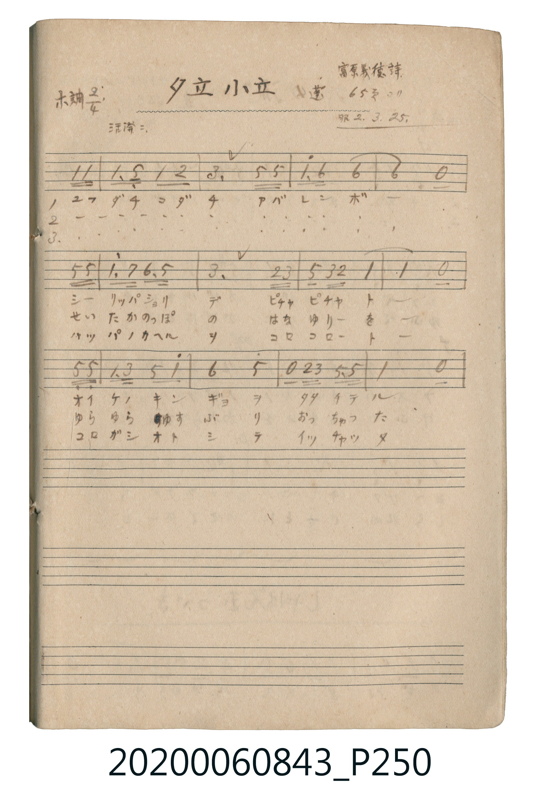

# 夕立小立 (陣雨)

> Re:Shōka 使用 AI 協助辨識與重建樂譜，可能會有錯誤。歡迎回報。

- **鋼琴伴奏版**：<br><audio controls src="yudachi_kodachi.mp3"></audio>
- **NEUTRINO 歌聲合成版**：<br><audio controls src="yudachi_kodachi_neutrino.mp3"></audio>

- 詞：富原義徳
- 曲：中山晋平
- 公學校唱歌帳 補遺 — 蓬 65頁ヨリ（昭 2. 3. 25.）

## 說明


- 出處：公學校唱歌帳 補遺 — 蓬 65頁ヨリ（昭 2. 3. 25.）
- 調性與拍號：調號 ?= E，拍號 <2/4>，速度 != 112


## 歌詞

```text
（TMD 檔案未包含歌詞註解）
```

## ABC

<div class="abc-score" data-abc-src="yudachi_kodachi.abc" aria-label="五線譜載入中"></div>

[下載 ABC 原始檔](yudachi_kodachi.abc)

## TMD 檔案連結

- [主旋律 TMD 檔案](yudachi_kodachi.tmd) [[在 TMD Studio 編輯](https://tmdlang.github.io/Tmd-TS/#tmd=s7IKdvYPcrWy4qpTUCpJTLdSSM7PyUlNLsnMz7MqzsjPTkzOyFeCS5bl55TmploBqXgDc4RwcX5pUXJqfEFieqpVgJGpAboM3KT4vPyS1KT8_GwMFRn5RYmZ8WB1xRmlCOmCovyy1LzEPKCS3MS80uLkosyCkvjk_IJKhJrUssyUVJCK4uTEvPiy1KLMtMzUFIR8flFJRn56UWJBRqVVRmZxSX5RZnJiTnx2Yl4iktdSi4rBnob4paQoMQ9iGVAQoaokIxXo__LURCCjCNmGzPTMPKuSxEygD0C-KE-Mz03MzMtJzAO6Q0tL4emSqc9Xdz_d0A8kFTRezlz8cvYKTQUtLS5FWwVDQyMue1sFVy4bI30TO5CZL1bOe79n1tP1PU_75j_ft_Lpvs1gq57N3gQUfrJj7dONG5_N7H66EyL8tHXN07U7ni1Y-HTKxmdre57u2KzwYvGcl427FB41TFF4MXmNgpnpywWNj5tXPG5e9X5Px7MZaxWM9BSM9RSMTPXe7-lU4uKKLE0BRk-mdz6YsgrITMzLd6jRNayp5lIAAhtDMy07MKtGwUBBFwxBtCEQ1oDFfQxrFOKhMiD6cfMyIJ4KkzXCK2uMSxZqpSFYyjQezDAC4hoFY6h6sAQQAhXFgTlmQAgRroErADkVrAju1MfNDWCZx82NCo-bNoNZIBGQTCOS0Y-bFgFFJoDF10B1bAbiORh2gB3etB0otwfJ0zSyp3E2ELcgBR-N7GnuB-JmpIiAhLE5NIxBwY4cEUZAXg1QVBdIG0FjjVA8rAJZAHHIRFAAPm5eDuWuAruyHdn1zVNA_nncvBgsNQXiYRA3HsjowO6HplVAvAQ5ThrnQ0xr7AbidY8bF0O5e0GmNq5DtrBxPRCDHdLUBjasCxzBj5sm4bCsDYg7USJmItTpfUCZ1VD2jMfNq8Fe2IRsGTDeHjevBVsGicG1EMtw-gyqHjmbgKIDFAHgmKqB5wWQEMQEUByA4gmYm8AS8fD8BYkfsCpE_DRthDoeZN9aMBvkNpDMOlhUgQRhHoHk5MdN-6F4CVS-DeJj5GyOZBMoVqAB3AkNRlDgz4TY1LgNHkJdqNY0doFi73HjwsdNzRAWJGpBnsJhFShOmkBJH5RZIckD5D5QEINkQGJQF6P5aAkooUKSG5gF9B5uq2q5uHTtFFBLVQWgiDIXAA)]
- [鋼琴伴奏 TMD 檔案](yudachi_kodachi_piano.tmd) [[在 TMD Studio 編輯](https://tmdlang.github.io/Tmd-TS/#tmd=s7IKdvYPcrWy4qpTUCpJTLdSyC8qychPL0osyKi0ysgsLskvykxOzInPTsxLVIIrKs4vLUpOjS9ITE-1CjAyNUDIlGSk5qZapaaUJieWZObnKXFpaSk8XTL1-erupxv6gaSCxsuZi1_OXqGpoBGQmZiXr-CYnJyfW5CYl5mbmleiqaClxaVoq2BoaMRlb6vgymVjpG9iBzL8xcp57_fMerq-52nf_Of7Vj7dtxls57PZm4DCT3asfbpx47OZ3U93QoSftq55unbHswULn07Z-Gxtz9MdmxVeLJ7zsnGXwqOGKQovJq9RMDN9uaDxcfOKx82rlLi4IktTEpMzMr3zwZQV2GVBHg41uoY11VwKQGBjaKZlB2bVKBgo6IIhiDYEwhqwuI9hjUI8VAZEP25eBsRTYbJGeGWNcclCrTQES5nGgxlGQFyjYAxVD5YAQqCiODDHDAghwjVwBSCnghXBnfq4uQEs87i5UeFx02YwCyQCkmlEMvpx0yKgyASw-Bqojs1APAfDDrDDm7YD5fYgeZpG9jTOBuIWpOCjkT3N_UDcjBQRkDA2h4YxKNiRI8IIyKsBiuoCaSNorBGKh1UgCyAOmQgKwMfNy6HcVWBXtiO7vnkKyD-PmxeDpaZAPAzixgMZHdj90LQKiJcgx0njfIhpjd1AvO5x42Iody_I1MZ1yBY2rgdisEOa2sCGdYEj-HHTJByWtQFxJ0rETIQ6vQ8osxrKnvG4eTXYC5uQLQPG2-PmtWDLIDG4FmIZTp9B1SNnE1B0gCIAHFM18LwAEoKYAIoDUDwBcxNYIh6evyDxA1aFiJ-mjVDHg-xbC2aD3AaSWQeLKpAgzCOQnPy4aT8UL4HKt0F8jJzNkWwCxQo0gDuhwQgK_JkQmxq3wUOoC9Waxi5Q7D1uXPi4qRnCgkQtyFM4rALFSRMo6YMyKyR5gNwHCmKQDEgM6mI0Hy0BJVRIcgOzgN7DbVUt9kLVB6VQtUApU0EY4kZghMSDSzswicQzAHJMQKUgmICyMfVBZVG0mcZjMRK3lWAjYByoXigFVQozGeRVz7ySonxs1YYJ3IfVuQW1CtGGsQrRprFAbrRxLpBpBiTQDUANIoQBMMcYxyuYAWmQLte8lMy8dEL2pgHtNYHbC3IB3FpkA3DZCwwJmKdh9uraKYAdrABkoMZytA_QfCyiRlhFjcGiEEeAWMpcAA)]

## 分析

```text
================================================================================
📊 TMD Song Profile: [ 夕立小立 陣雨 ]
================================================================================
⏱  Duration:       0:12 (12.9s), 12 measures total
🎼 Key & Tempo:    首調基準 E, != 112.0 BPM, <2/4>
   - 分析範圍：      由實際發聲的音符與和弦推測調性；播放脈絡另行呈現
🎤 人聲音域:    B3 (MIDI 59) – E5 (MIDI 76) [跨度: 17 個半音 / 1.4 個八度, 難度: challenging]
   - 最低音:  B3 in [YudachiKodachi #1 @ m.2, 0:01]
   - 最高音: E5 in [YudachiKodachi #1 @ m.4, 0:03]
   - 適合: soprano, mezzo-soprano, contralto, tenor, baritone, bass
🏛  結構:      YudachiKodachi (12.9s)
⚡ 編曲密度:        Peak 1 軌道同時演奏
🗝  調性診斷：       E 大調（純淨自然大調，未偵測到可信轉調）
   - 風格氣質:    純淨自然大調（陽光明朗、易唱易記，無明顯調外色彩）
   - 轉調歷程:    全曲維持單一推測調性（未偵測到可信轉調）
   - 核心骨幹音:  E, B, G#, C#, F#
   - 調性數值:    E 大調 [相關度: 0.90, 穩定度: High, 自然音純度: 100.0%]
   - 候選調性 (K-S): E 大調 (0.90), C# 小調 (0.73), G# 小調 (0.60)
   - 五度圈歷程:   +4
   - 各段落調性細節:
     • [YudachiKodachi #1]: E 大調 (r: 0.89, 自然音純度: 100.0%)

  [ 五度圈游移軌跡 ]
               C  
         F            G  
      Bb               D  
      Eb               A  
         Ab          [E ]*
            Db       B  
               F# 
     (* = active key center)

  [ 十二半音累積音高分佈 ]
     C  :                            0.0%
     C# : █████████████             18.2%
     D  :                            0.0%
     D# : █                          1.1%
     E  : ████████████████████████  33.0%
     F  :                            0.0%
     F# : ████                       5.7%
     G  :                            0.0%
     G# : ██████████████            19.3%
     A  :                            0.0%
     A# :                            0.0%
     B  : █████████████████         22.7%
--------------------------------------------------------------------------------
Assignment 軌道音域：
  - Piano         : B3 – E5 (17 個半音 / 1.4 個八度, 38 個音符)
================================================================================
```


## 原書掃描頁




