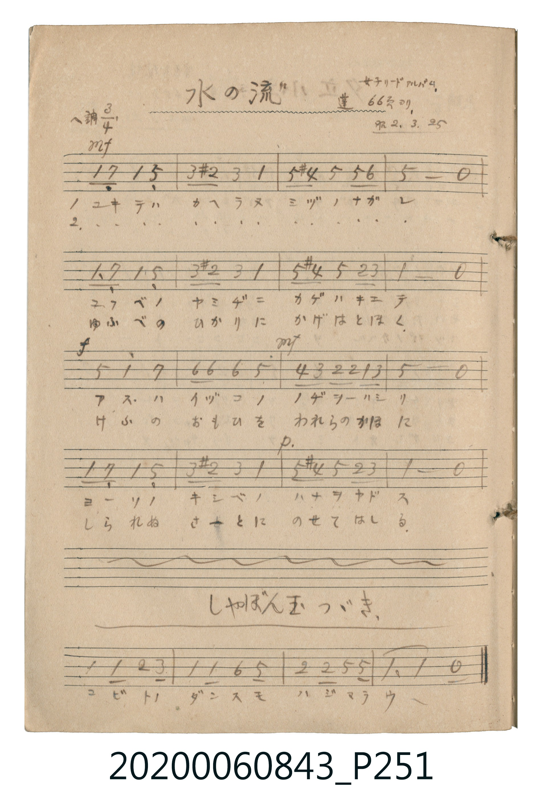

# 水の流 (水流)

<audio controls src="mizu_no_nagare.mp3"></audio>

- 公學校唱歌帳 補遺 — 女子リードアルバム・蓬 66頁ヨリ

## 說明

・出處：公學校唱歌帳 補遺 — 女子リードアルバム・蓬 66頁ヨリ
・調性與拍號：調號 ?= F，拍號 <3/4>，速度 != 96

## 歌詞

```text
（TMD 檔案未包含歌詞註解）
```

## ABC

```abc
X:1
T:水の流 水流
M:3/4
L:1/16
Q:1/4=96
K:F
V:V1 name="Vocal" snm="Voc"
[V:V1]
!mf! F2 E2 F4 C4 | A2 ^G2 A4 F4 | c2 =B2 c4 c2 d2 | c8 z4 |
F2 E2 F4 C4 | A2 ^G2 A4 F4 | c2 =B2 c4 G2 A2 | F8 z4 |
!f! c4 f4 e4 | d2 d2 d4 c4 | !mf! B2 A2 G2 G2 F2 A2 | c8 z4 |
F2 E2 F4 C4 | A2 ^G2 A4 F4 | !p! c2 =B2 c4 G2 A2 | F8 z4 |
```

## TMD 檔案連結

- [主旋律 TMD 檔案](mizu_no_nagare.tmd) [[在 TMD Studio 編輯](https://tmdlang.github.io/Tmd-TS/#tmd=s7IKdvYPcrWy4tLSUni2YcvjxnXPtjYqaACZQFpTQUuLS9FWwdKMy95WwY3LxljfxI6rTkHpaeuap2t3PFuw8OmUjc_W9jzdsVnhxeI5Lxt3KTxqmKLwdOnmp2snPG5e9bh5z-PmzsdNix43r37cDBRZ8Lh594vJaxTMzF4uaHzcvAKoRomLyzezqtQv3y8xPbEo1SosPzkxx6HGoEahmksBCGwstOzADKBAblqtgqGCeTyQ0FUwjQcSNQrGCkbqQEIXLFajYKpgog4kgNIKZmCuLhgagCTBxuhrKZRbKTxuXqbwuGktkG4D4n4gezWQngHEK4G4B4jnA3ErEPcBcRdQfg2QXqOgpU89Q2qI9osRUBCkGo9fmqcC8UyoVUugVjcBcTfEWU2boE4EOrdpBdjJqH5pAvqhcSsQ7wTidUAM1NAI0gx0dyPQABC7cRIQrwdioAGNu4G4H-GXamDcgNxqGAckzMHuNwNDUFSAeODYMwH5EQgNwT7CGTtNi4AY6BCwi0G-AQZi02ao70AY5LNNClpQFduB9Co0_zROhPoH5BdQ2AO1gPzUBPRDE0gTMH6aOqHyIL-B_LOa6LipLgB5l8j4AQZX016Iy8HhD3IvLK6ATgElDaBvIPEGdBLQ52h-mQ5xK8jNjcA01AiMbHAcgOIF5P7ZQAxMBOC4AantBhlQy8Wla6eAnLkUgHxlLgA)]
- [鋼琴伴奏 TMD 檔案](mizu_no_nagare_piano.tmd) [[在 TMD Studio 編輯](https://tmdlang.github.io/Tmd-TS/#tmd=s7IKdvYPcrWy4tLSUni2YcvjxnXPtjYqaACZQFpTQSMgMzEvX8ExOTk_tyAxLzM3Na9EU0FLi0vRVsHSjMveVsGNy8ZY38SOq05B6WnrmqdrdzxbsPDplI3P1vY83bFZ4cXiOS8bdyk8apii8HTp5qdrJzxuXvW4ec_j5s7HTYseN69-3AwUWfC4efeLyWsUzMxeLmh83LwCqEaJi8s3s6rUL98vMT2xKNUqLD85McehxqBGoZpLAQhsLLTswAygQG5arYKhgnk8kNBVMI0HEjUKxgpG6kBCFyxWo2CqYKIOJIDSCmZgri4YGoAkwcboaymUWyk8bl6m8LhpLZBuA-J-IHs1kJ4BxCuBuAeI5wNxKxD3AXEXUH4NkF6joKVPPUNqiPaLEVAQpBqPX5qnAvFMqFVLoFY3AXE3xFlNm6BOBDq3aQXYyah-aQL6oXErEO8E4nVADNTQCNIMdHcj0AAQu3ESEK8HYqABjbuBuB_hl2pg3IDcahgHJMzB7jcDQ1BUgHjg2DMB-REIDcE-whk7TYuAGOgQsItBvgEGYtNmqO9AGOSzTQpaUBXbgfQqNP80ToT6B-QXUNgDtYD81AT0QxNIEzB-mjqh8iC_gfyzmui4qS4AeZfI-AEGV9NeiMvB4Q9yLyyugE4BJQ2gbyDxBnQS0OdofpkOcSvIzY3ANNQIjGxwHIDiBeT-2UAMTATguAGp7QYZUIuWs8AZPMgDT94yjdcGextMw31uqA32O4iC-d5YG-x3EKUL4WiDcpsRmI8aBsBYJstU83htYDIBykINwDQXlOJgLgCnOlNtSLoDOQaGIc6Dpz8jbROwoWDTwQTYcIg9FDoflCSI9gLWyPFBiRwTeOQYgmwHkbiYpvFgNoiCOZuwQiRxhB5jsBgwDONBCKzHCKKeMotA_gb7WtdOAdnjCkC-MhcA)]

## 分析

```text
================================================================================
📊 TMD Song Profile: [ 水の流 水流 ]
================================================================================
⏱  Duration:       0:30 (30.0s), 16 measures total
🎼 Key & Tempo:    首調基準 F, != 96.0 BPM, <3/4>
   - 分析範圍：      由實際發聲的音符與和弦推測調性；播放脈絡另行呈現
🎤 人聲音域:    C4 (MIDI 60) – F5 (MIDI 77) [跨度: 17 個半音 / 1.4 個八度, 難度: challenging]
   - 最低音:  C4 in [MizuNoNagare #1 @ m.1, 0:01]
   - 最高音: F5 in [MizuNoNagare #1 @ m.9, 0:15]
   - 適合: soprano, mezzo-soprano, contralto, tenor, baritone, bass
🏛  結構:      MizuNoNagare (30.0s)
⚡ 編曲密度:        Peak 1 軌道同時演奏
🗝  調性診斷：       F 大調（流行色彩大調，未偵測到可信轉調）
   - 風格氣質:    流行大調（略帶和弦色彩音與裝飾副屬和弦）
   - 轉調歷程:    全曲維持單一推測調性（未偵測到可信轉調）
   - 核心骨幹音:  C, F, A, D, E
   - 調性數值:    F 大調 [相關度: 0.88, 穩定度: High, 自然音純度: 93.2%]
   - 候選調性 (K-S): F 大調 (0.88), C 大調 (0.72), A 小調 (0.67)
   - 五度圈歷程:   -1
   - 各段落調性細節:
     • [MizuNoNagare #1]: F 大調 (r: 0.88, 自然音純度: 93.2%, 調外音: G#, B)

  [ 五度圈游移軌跡 ]
               C  
        [F ]*          G  
      Bb               D  
      Eb               A  
         Ab           E  
            Db       B  
               F# 
     (* = active key center)

  [ 十二半音累積音高分佈 ]
     C  : ████████████████████████  31.8%
     C# :                            0.0%
     D  : ████                       5.7%
     D# :                            0.0%
     E  : ████                       5.7%
     F  : ██████████████████████    29.5%
     F# :                            0.0%
     G  : ███                        4.5%
     G# : ███                        3.4%
     A  : ███████████               14.8%
     A# : █                          1.1%
     B  : ███                        3.4%
--------------------------------------------------------------------------------
Assignment 軌道音域：
  - Vocal         : C4 – F5 (17 個半音 / 1.4 個八度, 56 個音符)
================================================================================
```


## 原書掃描頁




