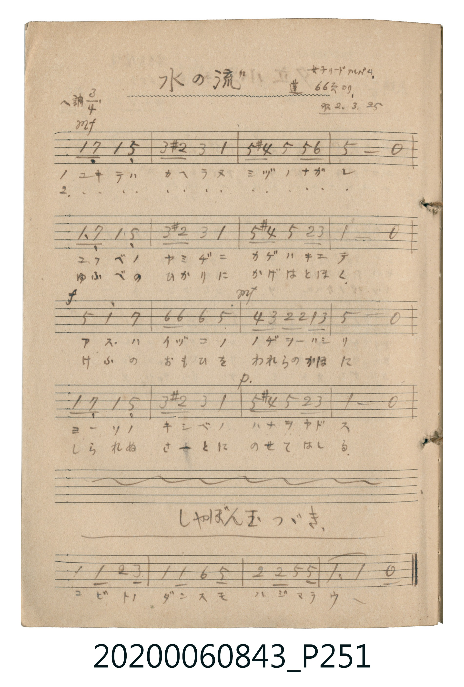

# 水の流 (水流)

> Re:Shōka 使用 AI 協助辨識與重建樂譜，可能會有錯誤。歡迎回報。

- **鋼琴伴奏版**：<br><audio controls src="mizu_no_nagare.mp3"></audio>

- 公學校唱歌帳 補遺 — 女子リードアルバム・蓬 66頁ヨリ

## 說明


- 出處：公學校唱歌帳 補遺 — 女子リードアルバム- 蓬 66頁ヨリ
- 調性與拍號：調號 ?= F，拍號 <3/4>，速度 != 96


## 歌詞

```text
（TMD 檔案未包含歌詞註解）
```

## ABC

<div class="abc-score" data-abc-src="mizu_no_nagare.abc" aria-label="五線譜載入中"></div>

[下載 ABC 原始檔](mizu_no_nagare.abc)

## TMD 檔案連結

- [主旋律 TMD 檔案](mizu_no_nagare.tmd) [[在 TMD Studio 編輯](https://tmdlang.github.io/Tmd-TS/#tmd=s7IKdvYPcrWy4qpTUCpJTLdSSM7PyUlNLsnMz7MqzsjPTkzOyFeCS5bl55TmploBqXgDc4RwcX5pUXJqfEFieqpVgJGpIboM3KT4vPyS1KT8_GwMFRn5RYmZ8WB1xRmlCOmCovyy1LzEPKCS3MS80uLkosyCkvjk_IJKhJrUssyUVJCK1JTMkvyizMQcJBenFhWD_QJxYklRYh7EDKAgQlVJRirQW-WJJalFCEGgSemZeVYliZlAZ4GcVp4Yn5uYmZeTmJeixKWlpfBsw5bHjeuebW1U0AAygbSmgpYWl6KtgqUZl72tghuXjbG-iR3IvKeta56u3fFswcKnUzY-W9vzdMdmhReL57xs3KXwqGGKwtOlm5-unfC4edXj5j2PmzsfNy163Lz6cTNQZMHj5t0vJq9RMDN7uaDxcfMKoBolLi7fzKpSv3y_xPTEolSrsPzkxByHGoOaai4FILCx0LIDM2oUqnPTahUMFczjgYSugmk8kKhRMFYwUgcSumCxGgVTBRN1IAGUVjADc3XB0AAkCTZGX0uh3ErhcfMyhcdNa4F0GxD3A9mrgfQMIF4JxD1APB-IW4G4D4i7gPJrgPQaBS196hlSQ7RfjICCINV4_NI8FYhnQq1aArW6CYi7Ic5q2gR1ItC5TSvATkb1SxPQD41bgXgnEK8DYqCGRpBmoLsbgQaA2I2TgHg9EAMNaNwNxP0Iv1QD4wbkVsM4IGEOdr8ZGIKiAsQDx54JyI9AaAj2Ec7YaVoExECHgF0M8g0wEJs2Q30HwiCfbVLQgqrYDqRXofmncSLUPyC_gMIeqAXkpyagH5pAmoDx09QJlQf5DeSf1UTHTXUByLtExg8wuJr2QlwODn-Qe2FxBXQKKGkAfQOJN6CTgD5H88t0iFtBbm4EpqFGYGSD4wAULyD3zwZiYCIAxw1IbTfIgFouLl07BeS8pQDkK3MBAA)]
- [鋼琴伴奏 TMD 檔案](mizu_no_nagare_piano.tmd) [[在 TMD Studio 編輯](https://tmdlang.github.io/Tmd-TS/#tmd=s7IKdvYPcrWy4tLSUni2YcvjxnXPtjYqaACZQFpTQSMgMzEvX8ExOTk_tyAxLzM3Na9EU0FLi0vRVsHSjMveVsGNy8ZY38SOq05B6WnrmqdrdzxbsPDplI3P1vY83bFZ4cXiOS8bdyk8apii8HTp5qdrJzxuXvW4ec_j5s7HTYseN69-3AwUWfC4efeLyWsUzMxeLmh83LwCqEaJi8s3s6rUL98vMT2xKNUqLD85McehxqCmmksBCGwstOzAjBqF6ty0WgVDBfN4IKGrYBoPJGoUjBWM1IGELlisRsFUwUQdSAClFczAXF0wNABJgo3R11Iot1J43LxM4XHTWiDdBsT9QPZqID0DiFcCcQ8QzwfiViDuA-IuoPwaIL1GQUufeobUEO0XI6AgSDUevzRPBeKZUKuWQK1uAuJuiLOaNkGdCHRu0wqwk1H90gT0Q-NWIN4JxOuAGKihEaQZ6O5GoAEgduMkIF4PxEADGncDcT_CL9XAuAG51TAOSJiD3W8GhqCoAPHAsWcC8iMQGoJ9hDN2mhYBMdAhYBeDfAMMxKbNUN-BMMhnmxS0oCq2A-lVaP5pnAj1D8gvoLAHagH5qQnohyaQJmD8NHVC5UF-A_lnNdFxU10A8i6R8QMMrqa9EJeDwx_kXlhcAZ0CShpA30DiDegkoM_R_DId4laQmxuBaagRGNngOADFC8j9s4EYmAjAcQNS2w0yoBYtY4Hzd5AH7qxlGq8N9jWYhnvcUBvsdRAF87yxNtjrIEoXwtEGZTYjMB81CICRTJap5vHawFQClIUagGkuKMHBXABOdKbakGQHcgwMQ5wHT35G2iZgQ8Gmgwmw4RB7KHQ-KEUQ7QWsceODHDcm8LgxBFkOInExTePBbBAFczVhhUjiCD3GYDFgEMaDEFiPEUQ9ZRaBvA32tGdeSVE-lpSI8C0oGKMNY4Faos1yY4EC0SZgjimQjWYC7vDSVTCDegMcY2CNrnkpmXnp-O3OBVluBLQWaiHUJdAYQzYBh93A0ILYCHEFVKOunQLY2QpABnK0g_gQQ0EsZS4A)]

## 分析

```text
================================================================================
📊 TMD Song Profile: [ 水の流 水流 ]
================================================================================
⏱  Duration:       0:30 (30.0s), 16 measures total
🎼 Key & Tempo:    首調基準 F, != 96.0 BPM, <3/4>
   - 分析範圍：      由實際發聲的音符與和弦推測調性；播放脈絡另行呈現
🎤 人聲音域:    C4 (MIDI 60) – F5 (MIDI 77) [跨度: 17 個半音 / 1.4 個八度, 難度: challenging]
   - 最低音:  C4 in [MizuNoNagare #1 @ m.1, 0:01]
   - 最高音: F5 in [MizuNoNagare #1 @ m.9, 0:15]
   - 適合: soprano, mezzo-soprano, contralto, tenor, baritone, bass
🏛  結構:      MizuNoNagare (30.0s)
⚡ 編曲密度:        Peak 1 軌道同時演奏
🗝  調性診斷：       F 大調（流行色彩大調，未偵測到可信轉調）
   - 風格氣質:    流行大調（略帶和弦色彩音與裝飾副屬和弦）
   - 轉調歷程:    全曲維持單一推測調性（未偵測到可信轉調）
   - 核心骨幹音:  C, F, A, D, E
   - 調性數值:    F 大調 [相關度: 0.88, 穩定度: High, 自然音純度: 93.2%]
   - 候選調性 (K-S): F 大調 (0.88), C 大調 (0.72), A 小調 (0.67)
   - 五度圈歷程:   -1
   - 各段落調性細節:
     • [MizuNoNagare #1]: F 大調 (r: 0.88, 自然音純度: 93.2%, 調外音: G#, B)

  [ 五度圈游移軌跡 ]
               C  
        [F ]*          G  
      Bb               D  
      Eb               A  
         Ab           E  
            Db       B  
               F# 
     (* = active key center)

  [ 十二半音累積音高分佈 ]
     C  : ████████████████████████  31.8%
     C# :                            0.0%
     D  : ████                       5.7%
     D# :                            0.0%
     E  : ████                       5.7%
     F  : ██████████████████████    29.5%
     F# :                            0.0%
     G  : ███                        4.5%
     G# : ███                        3.4%
     A  : ███████████               14.8%
     A# : █                          1.1%
     B  : ███                        3.4%
--------------------------------------------------------------------------------
Assignment 軌道音域：
  - Vocal         : C4 – F5 (17 個半音 / 1.4 個八度, 56 個音符)
================================================================================
```


## 原書掃描頁




