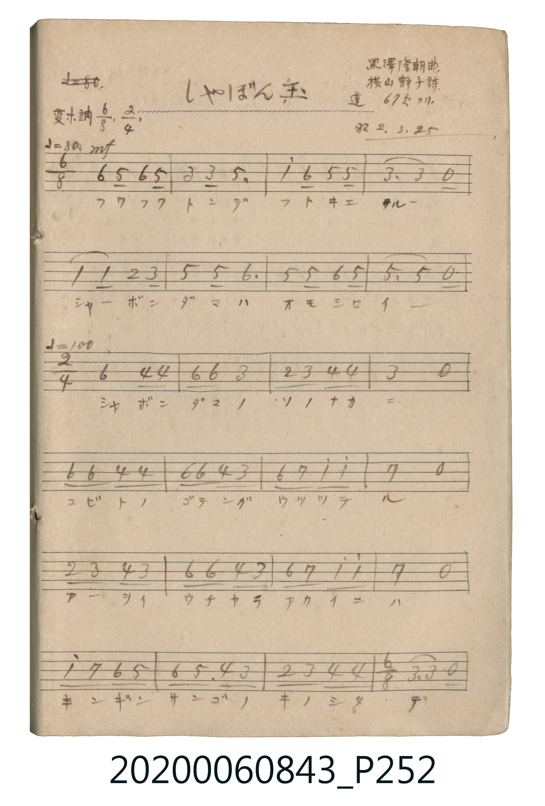

# しゃぼん玉 (肥皂泡)

<audio controls src="shabondama.mp3"></audio>

- 曲：黒澤隆朝
- 詞：横山静子
- 公學校唱歌帳 補遺 — 蓬 67頁ヨリ

## 說明

・出處：公學校唱歌帳 補遺 — 蓬 67頁ヨリ
・調性與拍號：調號 ?= E,，拍號 <2/4>，速度 != 92

## 跨冊／重複收錄參照

> 同名異曲（各冊收錄之不同詞曲版本）

- **[同名異曲]** 《新定兒童唱歌》尋常科第二學年用（2020.006.0847.0002）：[**〈シヤボンダマ〉**](../../../shintei_jido_shoka/grade_2_2020.006.0847.0002/1_08_shabondama/index.md)（`C` / `2/4` — [原始 TMD](../../../shintei_jido_shoka/grade_2_2020.006.0847.0002/1_08_shabondama/shabondama.tmd)）
- **[同名異曲]** 楊金土手抄《唱歌帖》第 7 冊・VII（2020.006.0843）：[**〈シャボン玉（肥皂泡）〉**](../p233_shabondama/index.md)（`E,` / `2/4` — [原始 TMD](../p233_shabondama/shabondama.tmd)）
- 總表：[跨冊重複與同名歌曲總索引](../../../duplicate_songs.md)

## 歌詞

```text
6/8 section represented as compound duple triplets in 2/4
2/4 section
6/8 closing section (continued on P251 bottom)
```

## ABC

```abc
X:1
T:しゃぼん玉 肥皂泡
C:曲：黒澤隆朝
M:2/4
L:1/16
Q:1/4=92
K:Eb
V:V1 name="Vocal" snm="Voc"
[V:V1]
!mf! c4/3 B4/3 c4/3 B4 | G4/3 G8/3 B4 | e4/3 c8/3 B4/3 B8/3 | G4 G8/3 z4/3 |
E4/3 E8/3 F4/3 G8/3 | B4/3 B8/3 c4 | B4/3 B8/3 c4/3 B8/3 | B4 B8/3 z4/3 |
c4 A2 A2 | c2 c2 G4 | F2 G2 A2 A2 | G4 z4 |
c2 c2 A2 A2 | c2 c2 A2 G2 | c2 d2 e2 e2 | d4 z4 |
F2 G2 A2 G2 | c2 c2 A2 G2 | c2 d2 e2 e2 | d4 z4 |
e2 d2 c2 B2 | c2 B3 A G2 | F2 G2 A2 A2 | G4 G8/3 z4/3 |
E4/3 E8/3 F4/3 G8/3 | E4/3 E8/3 C4/3 B,8/3 | F4/3 F8/3 B4/3 B8/3 | E4 E8/3 z4/3 |
```

## TMD 檔案連結

- [主旋律 TMD 檔案](shabondama.tmd) [[在 TMD Studio 編輯](https://tmdlang.github.io/Tmd-TS/#tmd=s7IKdvYPcrWy4tLSUnjcOP1xU_Pjxj2PmyY_7-tU0HjRtPT5rKZnmxdqKmhpcSnaKlgacdnbKrjqcNkY6ZvYcdUpKD1tXfN07Y5nCxY-nbLx2dqepzs2K7xYPOdl4y6FRw1TFF5MXqNgZv5yQePj5hWPm1cpgXQ8m73p_Z5ZL3dPerZvyctZbc_mzAULv1g5Dyj8bMWqpxs3vpw78-naCUpcXPpaCrbUAlwKCgpm-hYKxanJJZn5eQpFqQVFqcWpeSWpKQqJxQrJ-bkF-aV5KQoppQU5qQolRZlAqqRYITNPAehXkGYgBdMMMys5J784My8dbqZGcn5eSWZeKdBIIC_AyNRQISm_pCQ_VxOkg3I_QIGClj4XV3BGYlJ-XkpibqJVWH5yYo5DjUGNQjXIHgUbCy07MAMokJtWq6BhpmCqYKapqqGrq6mgYaqgq6AL5dQoaBgrGMO56HKGcQpmyJJAaWSNCLVgjgFMDmw3MO7KrRQeN08F4vVIdAcQbwbidqgYkN-0FohXANmrgbhPQQvkP4jzNQwVDBGWGCE5FSiH7B6gF1FcjiaH4nBkT4I5WB3etP1x82KgWx43z4G6uAGI5wFxP1ByFZBeBFIEpEGuX4LsapBbTIAQxDIDuRnIArkdIgYOKpAYpm2YdvUBpfZC6OYuIBsUQt3INpkh2WQCNBvEMlcARhwQ1QBZ2OwCWTAZGhUgC7YA6TaIxU1rgHgZkN0CxM1Q8dUICyHegFhDvIXAkGreBA4liOGNQAxkN6-EyIF8BZID-gwUunDLgCaaA003BdsBiTYFE2hcgSxGhCmRiRGU0MC-XAelt0JpUAiAQgIkD6KB0dq0H5xIiU2MKHJm8Qqm8ciyRkC34spHQH0IORAHu9PRIg2cQkBO3wlJieBUuQOaakDhugzi9FouLl07BURhoQDkKXMBAA)]
- [鋼琴伴奏 TMD 檔案](shabondama_piano.tmd) [[在 TMD Studio 編輯](https://tmdlang.github.io/Tmd-TS/#tmd=s7IKdvYPcrWy4tLSUnjcOP1xU_Pjxj2PmyY_7-tU0HjRtPT5rKZnmxdqKmgEZCbm5Ss4Jifn5xYk5mXmpuaVaCpoaXEp2ipYGnHZ2yq46nDZGOmb2HHVKSg9bV3zdO2OZwsWPp2y8dnanqc7Niu8WDznZeMuhUcNUxReTF6jYGb-ckHj4-YVj5tXKYF0PJu96f2eWS93T3q2b8nLWW3P5swFC79YOQ8o_GzFqqcbN76cO_Pp2glKXFzBGYlJ-XkpibmJVmH5yYk5DjUGNQrVXApAYGOhZQdmAAVy02oVNMwUTBXMNFU1dHWBfjBV0FXQhXJqFDSMFYzhXHQ5wzgFM2RJoDSyRoRaMMcAJge2W19LodxK4XHzVCBej0R3APFmIG6HigH5TWuBeAWQvRqI-xS0FLT0oc7XMFQwRFhihORUoByye4BeRHE5mhyKw5E9CeZgdXjT9sfNi4Fuedw8B-riBiCeB8T9QMlVQHoRSBGQBrl-CbKrQW4xAUIQywzkZiAL5HaIGDioQGKYtmHa1QeU2guhm7uAbFAIdSPbZIZkkwnQbBDLXAEYcUBUA2RhswtkwWRoVIAs2AKk2yAWN60B4mVAdgsQN0PFVyMshHgDYg3xFgJDqnkTOJQghjcCMZDdvBIiB_IVSA7oM1Dowi0DmmgONN0UbAck2hRMoHEFshgRpkQmRlBCA_tyHZTeCqVBIQAKCZA8iAZGa9N-cCIlNjGiyJnFK5jGI8saAd2KKx8B9SHkQBzsTkeLNHAKATl9JyQlglPlDmiqAYXrMojTa1FKCnD5FeSBr6ww0QYmWW1TBSAND08gF7Vc0DZWAGFEiKOrMNYGRh7IKBQlYGWoxiD7HcxF9T0ou8ZrGwKDE0jAVZrHaxuhOABsI6r5YI-guQmLCjQnGaF4BMpFdxLEZCNtEzAG5miwOWYQF4EyAcx5CCVAIdR8j9CFaQ6IB9IOETHVBmYCUHCCiRowH9UkFPsQGskxChxvIGFY2EB8C4tgkHnQwICYisWr1I1WLMowchdYH5hAiThw5KGZhFzyQ_gIh2HJKj4oWcUEnlUM40EIQZug8jFVARUg-KbxIB8g1AElwfJmQDEQBpZs8SAEjI54EIKpA8mhKUSwUJXCDCCsEiQG4sL9ANQHdhxuz6B6AsQ1gASfrp0CIgQVgDxlLgA)]

## 分析

```text
================================================================================
📊 TMD Song Profile: [ しゃぼん玉 肥皂泡 ]
================================================================================
⏱  Duration:       0:36 (36.5s), 28 measures total
🎼 Key & Tempo:    首調基準 E,, != 92.0 BPM, <2/4>
   - 分析範圍：      由實際發聲的音符與和弦推測調性；播放脈絡另行呈現
🎤 人聲音域:    A#3 (MIDI 58) – D#5 (MIDI 75) [跨度: 17 個半音 / 1.4 個八度, 難度: challenging]
   - 最低音:  A#3 in [Shabondama #1 @ m.26, 0:33]
   - 最高音: D#5 in [Shabondama #1 @ m.3, 0:02]
   - 適合: soprano, mezzo-soprano, contralto, tenor, baritone, bass
🏛  結構:      Shabondama (36.5s)
⚡ 編曲密度:        Peak 1 軌道同時演奏
🗝  調性診斷：       D# 調性不明確（純淨自然大調，未偵測到可信轉調）
   - 風格氣質:    純淨自然大調（陽光明朗、易唱易記，無明顯調外色彩）
   - 轉調歷程:    全曲維持單一推測調性（未偵測到可信轉調）
   - 核心骨幹音:  G, A#, C, D#, G#
   - 調性數值:    D# 調性不明確 [相關度: 0.80, 穩定度: Ambiguous, 自然音純度: 100.0%]
   - 候選調性 (K-S): D# 大調 (0.80), C 小調 (0.78), G 小調 (0.73)
   - 五度圈歷程:   -3
   - 各段落調性細節:
     • [Shabondama #1]: D# 調性不明確 (r: 0.80, 自然音純度: 100.0%)

  [ 五度圈游移軌跡 ]
               C  
         F            G  
      Bb               D  
     [Eb]*              A  
         Ab           E  
            Db       B  
               F# 
     (* = active key center)

  [ 十二半音累積音高分佈 ]
     C  : █████████████████████     19.4%
     C# :                            0.0%
     D  : ████████                   6.8%
     D# : ████████████████          14.5%
     E  :                            0.0%
     F  : ███████                    6.1%
     F# :                            0.0%
     G  : ████████████████████████  21.6%
     G# : ████████████              11.1%
     A  :                            0.0%
     A# : ███████████████████████   20.5%
     B  :                            0.0%
--------------------------------------------------------------------------------
Assignment 軌道音域：
  - Vocal         : A#3 – D#5 (17 個半音 / 1.4 個八度, 91 個音符)
================================================================================
```


## 原書掃描頁





