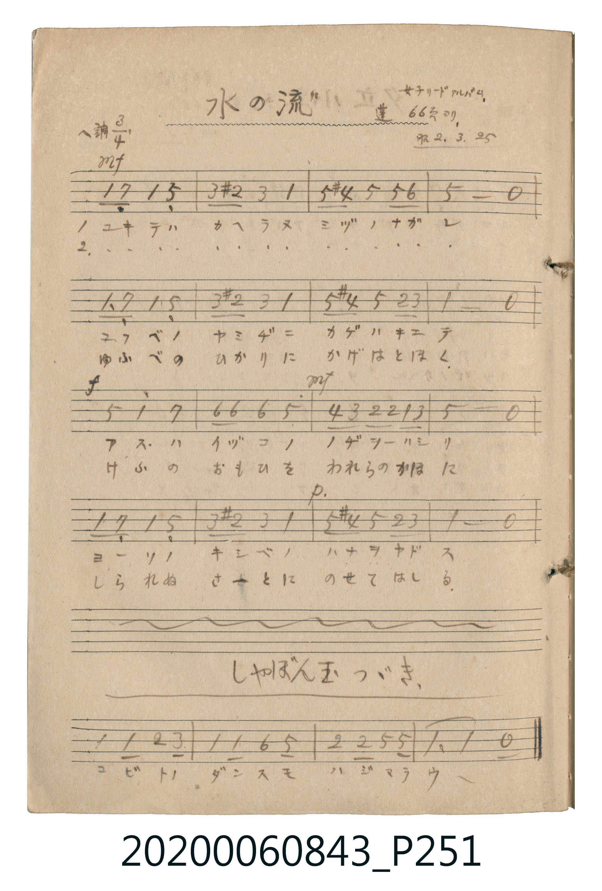
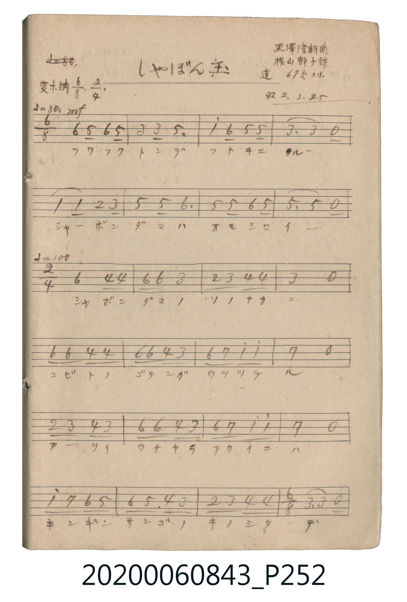

# しゃぼん玉（肥皂泡）

> Re:Shōka 使用 AI 協助辨識與重建樂譜，可能會有錯誤。歡迎回報。

- **鋼琴伴奏版**：<br><audio controls src="shabondama.mp3"></audio>
- **NEUTRINO 歌聲合成版**：<br><audio controls src="shabondama_neutrino.mp3"></audio>

- 曲：黒澤隆朝
- 唱歌帖 P252 + P251下 (蓬 67頁ヨリ・昭 2. 3. 25)
- 詩：横山静子

## 說明


- 出處：唱歌帖 P252 + P251下 (蓬 67頁ヨリ- 昭 2. 3. 25)
- 出處：詩：横山静子
- 調性與拍號：調號 ?= E,，拍號 <6/8>，速度 != 120


## 歌詞

```text
（TMD 檔案未包含歌詞註解）
```

## ABC

<div class="abc-score" data-abc-src="shabondama.abc" aria-label="五線譜載入中"></div>

[下載 ABC 原始檔](shabondama.abc)

## TMD 檔案連結

- [主旋律 TMD 檔案](shabondama.tmd) [[在 TMD Studio 編輯](https://tmdlang.github.io/Tmd-TS/#tmd=s7IKdvYPcrWy4qpTUCpJTLdSSM7PyUlNLsnMz7MqzsjPTkzOyFeCS5bl55TmploBqXgDc4RwcX5pUXJqfEFieqpVgJGpEboM3KT4vPyS1KT8_GwMFRn5RYmZ8WB1xRmlCOmCovyy1LzEPKCS3MS80uLkosyCkvjk_IJKhJrUssyUVJCK4uTEvPiy1KLMtMzUFCRXpxYVg_0DcWZJUWIexBygIEJVflFJRn56UWJBRqVVRmZxSX5RZnJiTnx2Yl4iQlFJRirQ_wU5iUjWAxWmZ-ZZlSRmAp0P8kJ5YnxuYmZeTmIe0BFaWgqPG6c_bmp-3LjncdPk532d7_d0vGha-nxW07PNC9_v6VTQ0uJStFUwNDLgsrdVcNXhsjHTt7ADmf50ysZna3ue7pimAApUBW0QZfhkR7eCxovJaxTMzF8uaHzcvOJx86rHzbufzVirYKSnYKynYGSqCXbbs9mb3u-Z9XL3pGf7lryc1fZszlyw8IuVK4HCz1aserpx48u5M5-unaDExaWvpWBLLcCloKBgpxCt6Ocf4hoL4WhpPe2bD3Tti83tL1Z0vehoB3rrxcp5T1tXPJvWrqUFDJCnG3qftXcqJIA8qpdVkJ6gAJQE6njWt_T5rh6wuCFEHOj_Z-u2Pm7oSUALVmAwL3ncNO9xY69OwuOGXmDIAv0JsV8X5IL2XS9mTgXZ3dXydP3qZ9OXPpszH2T3LGRL-zc_2dH1YvmkFytmgKxADj1geOqBDAaJIwcfMEDh4mjxglCPFDsQx3UAhZ5O6lEwUni6c4uCscKzOR1AOQWQs7paXrSvetzQBTTsxYQuSCJ4ObvtcUP38zUg4xWA5gN997ihCeG7Z929L2bOB_ruZcP8p7uWvdjb-ax_Nth3T7cvQ_HS0yWdj5tnv1i1XwGYzHQUjPRNwK58v2f2y2XTgCELssPwUcNkC4WnG_qfr2943rRLIQGcJIHKGhMezVypp2CrYGGglwCKNrDhT_uXPZvT-XTh9GdTdr5s7wWG7pOd3QqoSnuA7nm-bvrT2bOfdrS9nL_5-ZplT-fverZrmkICJPED1XQ-7e962jUb6H6FhNw0oMBskGMsgY4xMoa6BugxsIOqbYAOt6uFOQlojaEByIiOhGqQcQYGtSDzoCYYmUB1P5u2BzmJPZuzGm7q09nzQKaC_AnSCjXHCGZOz5Mdy15sR6TIF-2bn3b2ArnoSXPazie7pjzfPuvZmpZnnQ3AuAQ7wBTkB1iIEk67qFG7YOGLFU2ghNvZDUq7ffNfbOp5sWrVsxl9QHc-2TdXwTUlE1RaJeYoBOTnZCZXKjgqQDQBnQ5OAxDDFBQM9YDmQSNTAZhkXk7d_nz-WqCTni7tB6edxc-3TgA6_mUTyBpI8umbD7T02Zw1sESg8GxFEzCZAG1_vmjX094GYHQ-b1n4dNdUoD7k2AWa93TaOqh462q4OChsQTH2aOYqIAbToOTxtHcz0AYLLaAF4MRjpG2oDcTw0J8CCkcTYHRbALERiAEPz6f9S59u2AdOFhV6j3omVSgYxIOi8OXMlpe75yG7CeJBlDTYtQDiuCd7Jj5buwjsvp6nrRsVEkyBlis8behGdTvIMSCXmELtBuWZblAWf9y0_XHz4sfNe4DRB3aKIdAlhmB3YHEBupmzX3R0ARPhy56WF6uWAHMRJNOBkjgoVXUCdQEVAwPhacOk53vXQaINaC8oZHZ3PWvqfDZ1BzAhgJLG2jmQyIMnIQVQwaOlBQ4-WCbqaAfncnNYtgCXxk_2r3u2djF6iYisD1pqA21ZteTF1u3P17Y93dcDdC0wwwMdDE7WzauBQQAt4UCh0rj1ceOKZ9s6Hjd2PG7qhgQP0NXI3n2ydw5IJUhnH6zcBmdbuPuAqSFewThewQREwrIZJAECCzWI_oTHTYsUgOYD8SaFx01LoG4Axs-TXT3AwHs6Z_Kz3ROBhSkw8IBc5PJTAVQuA_MFIiOD86wZLHmBk_CLxXOAeQoeOiiVEVg5VDUovoHV2uxNKGaAPdjwuHnz46adj5sXQbwJyVpA5wMTi4KhgpmCKSS5dPZCnTy3HZ6zQMlux95nM5ueNux5umQWsDJ72tsFTgGgFAmsPZ-3LgdqBMYHLMiARsYDXQUMMFAZaaQADEJTkA0Kz7dufLKjAZLpn87rBsXG4jnA4g_oYIi9QL3gTAjPvmAn1gCdqAt2pi7QoBpwGQl2sgIk2QGd-mRvH1A7MM-BnDRxD7BCh1QpCkCFQE1Ald1Tn62cDyxKn29b-6ynERJQCgmuj2auNQGWkCAaqApY-z1v2QYKgPnzkeIJElmPm6c-bl4PJRuAQdoBCtXmdjAbKAhMZmsfN60Ac0FpEaoLnjub54DUg2SBaN7j5n4QuwnYgloEVrMWzF2CoRFNFzChApXtBTGaux43rQZLdcO0AN0zGewwiLItj5vbwFG_Bsxd9ri5BYyANTrIkTBdi8DO2wSyHaoM2IoAumQlmAt03mqww7rBuvphutaCTV4HdV7TVjAXaCPEaqBsH8gLTfvButqxuxAlZYIMf9y0A-xNiNVAl4BDg_KmIRQoaOlzcQVnJCbl56Uk5iZaBWQm5uU71BjUVIOsUQDVAmBGjUJ1blotNMVB0x2wqaQLxKZAUhfIM4wDUsBkiCQJgQYKNWAzfGpASQYoAEwvSCyQaAeYvRmI26GmweQ7QAELYjWtAIuuRjEW6jZQdtAF5jCQc2qgLgA5EmQQggdyFcSx6K4CpyywKDB5QZ0CsqwBzJ4HxP0wZzWtAosBC7im7WDWWrDoEkxn2RiaQQMP2kJSgLWHoK6GuFAXWKZDMEQEhGFhVwP1E7IamJwBTA0WXyD7AxKYMJ-AyD646cB8AxcB5h5wMIMCGKSjG8MeJGeDMKazQTyQ8yAi5kAMThNgogbMx-FwkCuB2QBMQpICyEUgmS1gXhvcL8CcC5VZBhZrQSJBqpCTCIbLkQMT4U6KXL4IKgSq6kCuA6UDhOsawSRIDJiBoTIgHZBQhqiGhDTI3ZA0hsXdYGeAHAFJxTBnQtKyCdThGCkF4Uhw_oEG3zo4GySzFc4DyW1BCniIHnDCgCT0pv0IJ8GLBWgrHZKygS10qINR8j60soLlTpSqCyxqBC8zIPkYo8yAlAkw4xDJBZFYEEkcWIY07QSzFsEDFViGwhP_Snj0ICyq5eLStVNAlIIKQJ4yFwA)]
- [鋼琴伴奏 TMD 檔案](shabondama_piano.tmd) [[在 TMD Studio 編輯](https://tmdlang.github.io/Tmd-TS/#tmd=s7IKdvYPcrWy4qpTUCpJTLdSSM7PyUlNLsnMz7MqzsjPTkzOyFeCS5bl55TmploBqXgDc4RwcX5pUXJqfEFieqpVgJGpEboM3KT4vPyS1KT8_GwMFRn5RYmZ8WB1xRmlCOmCovyy1LzEPKCS3MS80uLkosyCkvjk_IJKhJrUssyUVJCK4uTEvPiy1KLMtMzUFCRXpxYVg_0DcWZJUWIexBygIEJVflFJRn56UWJBRqVVRmZxSX5RZnJiTnx2Yl4iQlFiEVBzempual6JVUFmYl5-fGJycn5uQWJeJkgMobAkA6jIqiAnEcmdQBPTM_OsShIzgf4E-bU8MT43MTMvJzEP6FotLYXHjdMfNzU_btzzuGny877O93s6XjQtfT6r6dnmhe_3dCpoaXEp2ioYGhlw2dsquOpw2ZjpW9iBTH86ZeOztT1Pd0xTAIW-gjaIMnyyo1tB48XkNQpm5i8XND5uXvG4edXj5t3PZqxVMNJTMNZTMDLVBLvt2exN7_fMerl70rN9S17Oans2Zy5Y-MXKlUDhZytWPd248eXcmU_XTlDi4vLMKynKtwoA-TzIw6HGoKaaSwEIbCy07MCMGoXqgloFQ21jBV0FY21TBRNtMyirRsE8XtsIyDECciAKDBRquGpRzPTBbqZhPFC1roIJiAKyaxRM4yEiYAmoMcEZiUn5eSmJuYkQs7C7LjetVgHkJFMoWaMAdiqQBTIPaFUckDIDc2GSEAiyBWSGT43C4-apQIHHzeuRWCDRDjB7MxC3Q02DyXcoPG5aC2I1rQCLrkYxFuZLsAAoiIxBXoQ7EmQQggdyFcSx6K5q2v64eTFY9HHzHKhTQJY1gNnzgLgf5qymVWCxRSBNYNZasOgSTGfZGJpBA6_axkjfxK5WoVrR1tDAoBbqaIgDgXEDxRARcKRDZWqgXkJWA5MzgKnB4glkb0DCEuYRENkHN_1x0164yOPmLnAog8IXpKMbwx4kZ4MwprNBPJDzICLmQAxOEmACmIZxOxzkysfNk8EkJCWAXASS2QLmtcH98rhpDVRmGVisBYkEqUJOIRguRw5MhDspcvkiqNDj5k1g14GSAcJ1jWASJPa4eSVUBqQDEsoQ1ZCQBrkbksSwuBvsDJAjIIkY5kxIUjaBOhwjpSAcCc4-0OBbB2eDZLbCeSC5LUgBD9EDThiQdN60H-EkeKlQDS5HIQnbCJ6wUXI-OG8awvMmhAfLjeBCDV5iQHIxRokBKRFgxiFSCyKtIFI4sARp2glmLYKH6eOmHfC0vxIeOwiLsBSAuApoUBGIKJeRS2hIsQwiQXxI9jLWBsccSBlEEFkpRDHCq6CSWRsSAtDSHiQPMgSmE2IdxGBUMUQlAbUbzoSZTqgsgpkNshWUeiAkyCaI-SAS5m5w-kM4EVQtgRRDSLAzsJdR6KbhsgdiEMRomIypNjj9QwIUSgFDDCyKzSYs7kM1kHpWQWMZogARHyBNyDyIZTCrUNwHDDGQM6AUNMLwZzGMNARLPWAKJQEhSyAnF6gTwBRQA8iNYAopIUIZODIJjhYHrKmBaHKAmxqgdgecAbIdxDZBFURViMgZcHFI4wXVUCz2oLd2jGA64dkBEbpYcwPYBRAS4lTjeBgFLLQgbCgFTADxwIADyyFcDFWMZgRcC4gEuQhuJjYz0O0hyxA0h0BoaBDDrYAFLXFJDz2ScEcPxGKoCNAuUGqDqQJysUU4MJ255qVk5qXjKYixu6s6F9h8RiRwaB5AT9JIhT6yPVjTMnZ7YD6CeAMp4aIYrmunAG6cKwAZiIwD4kGsBbGUuQA)]

## 分析

```text
================================================================================
📊 TMD Song Profile: [ しゃぼん玉（肥皂泡） ]
================================================================================
⏱  Duration:       0:37 (37.5s), 28 measures total
🎼 Key & Tempo:    首調基準 E,, != 120.0 BPM, <6/8>
   - 分析範圍：      由實際發聲的音符與和弦推測調性；播放脈絡另行呈現
🎤 人聲音域:    D#4 (MIDI 63) – D#5 (MIDI 75) [跨度: 12 個半音 / 1.0 個八度, 難度: easy]
   - 最低音:  D#4 in [Shabondama #1 @ m.5, 0:06]
   - 最高音: D#5 in [Shabondama #1 @ m.3, 0:03]
   - 適合: soprano, mezzo-soprano, contralto, tenor, baritone, bass
🏛  結構:      Shabondama (37.5s)
⚡ 編曲密度:        Peak 1 軌道同時演奏
🗝  調性診斷：       D# 調性不明確（純淨自然大調，未偵測到可信轉調）
   - 風格氣質:    純淨自然大調（陽光明朗、易唱易記，無明顯調外色彩）
   - 轉調歷程:    全曲維持單一推測調性（未偵測到可信轉調）
   - 核心骨幹音:  A#, C, G, D#, G#
   - 調性數值:    D# 調性不明確 [相關度: 0.83, 穩定度: Ambiguous, 自然音純度: 100.0%]
   - 候選調性 (K-S): D# 大調 (0.83), C 小調 (0.80), G 小調 (0.70)
   - 五度圈歷程:   -3
   - 各段落調性細節:
     • [Shabondama #1]: D# 調性不明確 (r: 0.83, 自然音純度: 100.0%)

  [ 五度圈游移軌跡 ]
               C  
         F            G  
      Bb               D  
     [Eb]*              A  
         Ab           E  
            Db       B  
               F# 
     (* = active key center)

  [ 十二半音累積音高分佈 ]
     C  : ████████████████████████  20.3%
     C# :                            0.0%
     D  : ██████                     5.5%
     D# : ███████████████████       16.4%
     E  :                            0.0%
     F  : █████████                  7.8%
     F# :                            0.0%
     G  : ████████████████████████  20.3%
     G# : ██████████                 9.0%
     A  :                            0.0%
     A# : ████████████████████████  20.7%
     B  :                            0.0%
--------------------------------------------------------------------------------
Assignment 軌道音域：
  - Piano         : D#4 – D#5 (12 個半音 / 1.0 個八度, 86 個音符)
================================================================================
```


## 原書掃描頁






