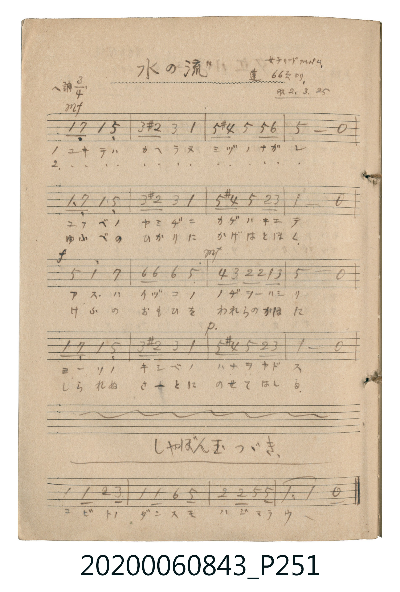
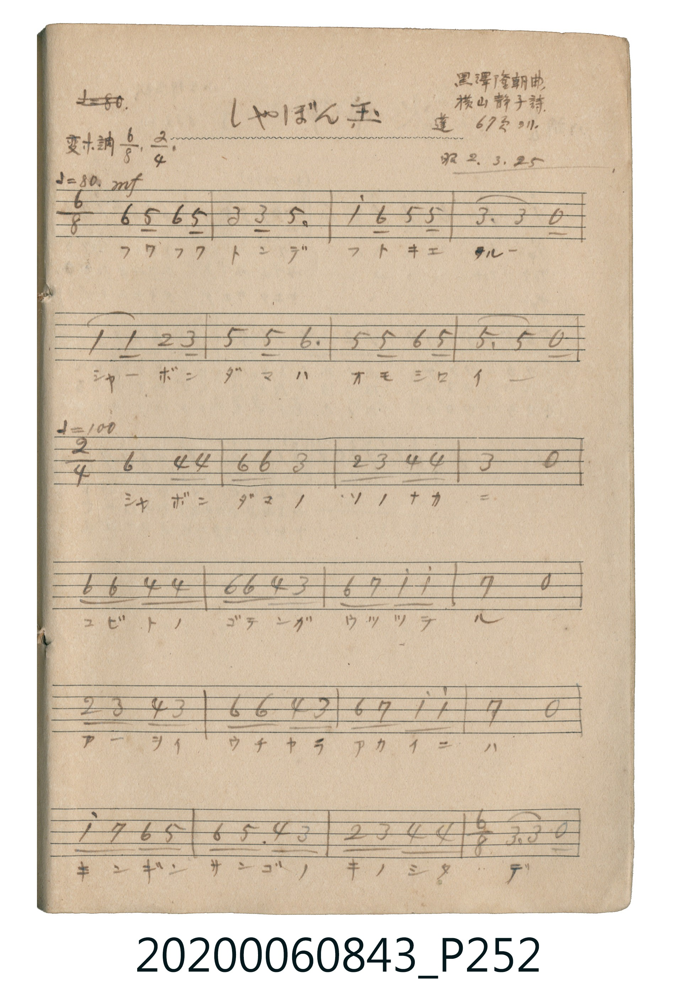

# しゃぼん玉 (肥皂泡)

> Re:Shōka 使用 AI 協助辨識與重建樂譜，可能會有錯誤。歡迎回報。

- **鋼琴伴奏版**：<br><audio controls src="shabondama.mp3"></audio>

- 曲：黒澤隆朝
- 詞：横山静子
- 公學校唱歌帳 補遺 — 蓬 67頁ヨリ

## 說明


- 出處：公學校唱歌帳 補遺 — 蓬 67頁ヨリ
- 調性與拍號：調號 ?= E,，拍號 <2/4>，速度 != 92


## 歌詞

```text
6/8 section represented as compound duple triplets in 2/4
2/4 section
6/8 closing section (continued on P251 bottom)
```

## ABC

<div class="abc-score" data-abc-src="shabondama.abc" aria-label="五線譜載入中"></div>

[下載 ABC 原始檔](shabondama.abc)

## TMD 檔案連結

- [主旋律 TMD 檔案](shabondama.tmd) [[在 TMD Studio 編輯](https://tmdlang.github.io/Tmd-TS/#tmd=s7IKdvYPcrWy4qpTUCpJTLdSSM7PyUlNLsnMz7MqzsjPTkzOyFeCS5bl55TmploBqXgDc4RwcX5pUXJqfEFieqpVgJGpEboM3KT4vPyS1KT8_GwMFRn5RYmZ8WB1xRmlCOmCovyy1LzEPKCS3MS80uLkosyCkvjk_IJKhJrUssyUVJCK1JTMkvyizMQcJBenFhWD_QJxYklRYh7EDKAgQhVQU3pmnlVJYibQBSBXlCfG5yZm5uUk5qUocWlpKTxunP64qflx457HTZOf93UqaLxoWvp8VtOzzQs1FbS0uBRtFSyNuOxtFVx1uGyM9E3sQCY_bV3zdO2OZwsWPp2y8dnanqc7Niu8WDznZeMuhUcNUxReTF6jYGb-ckHj4-YVj5tXgd3ybPam93tmvdw96dm-JS9ntT2bMxcs_GLlPKDwsxWrnm7c-HLuzKdrJyhxcelrKdhSC3ApKCiY6VsoFEMiXqEotaAotTg1ryQ1RSGxGJgkcgvyS_NSFFJKC3JSFUqAwZeTWlKskJmnAPQrSDOQgmmGmZWck1-cmZcON1MjOT-vJDOvFGgkkAdMJYYKSfklJfm5miAdlPsBChS09Lm4gjMSk_LzUhJzE63C8pMTcxxqDGqqQdYo2Fho2YEZNQrVuWm1ChpmCqYKZpqqGrq6mgoapgq6CrpQTo2ChrGCMZyLLmcYp2CGLAmURtaIUAvmGMDkwHYDo67cSuFx81QgXo9EdwDxZiBuh4oB-U1rgXgFkL0aiPsUtEDegzhfw1DBEGGJEZJTgXLI7gF6EcXlaHIoDkf2JJiD1eFN2x83Lwa65XHzHKiLG4B4HhD3AyVXAelFIEVAGuT6JciuBrnFBAhBLDOQm4EskNshYuCgAolh2oZpVx9Qai-Ebu4CskEh1I1skxmSTSZAs0EscwVgxAFRDZCFzS6QBZOhUQGyYAuQboNY3LQGiJcB2S1A3AwVX42wEOINiDXEWwgMqeZN4FCCGN4IxEB280qIHMhXIDmgz0ChC7cMaKI50HRTsB2QaFMwgcYVyGJEmBKZGEEJDezLdVB6K5QGhQAoJEDyIBoYrU37wYmU2MSIImcWr2AajyxrBHQrrnwE1IeQA3GwOx0t0sApBOT0nZCUCE6VO6CpBhSuyyBOr-Xi0rVTQJQVCkCeMhcA)]
- [鋼琴伴奏 TMD 檔案](shabondama_piano.tmd) [[在 TMD Studio 編輯](https://tmdlang.github.io/Tmd-TS/#tmd=s7IKdvYPcrWy4tLSUnjcOP1xU_Pjxj2PmyY_7-tU0HjRtPT5rKZnmxdqKmgEZCbm5Ss4Jifn5xYk5mXmpuaVaCpoaXEp2ipYGnHZ2yq46nDZGOmb2HHVKSg9bV3zdO2OZwsWPp2y8dnanqc7Niu8WDznZeMuhUcNUxReTF6jYGb-ckHj4-YVj5tXKYF0PJu96f2eWS93T3q2b8nLWW3P5swFC79YOQ8o_GzFqqcbN76cO_Pp2glKXFzBGYlJ-XkpibmJVmH5yYk5DjUGNdVcCkBgY6FlB2bUKFTnptUqaJgpmCqYaapq6OoCvWCqoKugC-XUKGgYKxjDuehyhnEKZsiSQGlkjQi1YI4BTA5st76WQrmVwuPmqUC8HonuAOLNQNwOFQPym9YC8QogezUQ9yloKWjpQ52vYahgiLDECMmpQDlk9wC9iOJyNDkUhyN7EszB6vCm7Y-bFwPd8rh5DtTFDUA8D4j7gZKrgPQikCIgDXL9EmRXg9xiAoQglhnIzUAWyO0QMXBQgcQwbcO0qw8otRdCN3cB2aAQ6ka2yQzJJhOg2SCWuQIw4oCoBsjCZhfIgsnQqABZsAVIt0EsbloDxMuA7BYgboaKr0ZYCPEGxBriLQSGVPMmcChBDG8EYiC7eSVEDuQrkBzQZ6DQhVsGNNEcaLop2A5ItCmYQOMKZDEiTIlMjKCEBvblOii9FUqDQgAUEiB5EA2M1qb94ERKbGJEkTOLVzCNR5Y1AroVVz4C6kPIgTjYnY4WaeAUAnL6TkhKBKfKHdBUAwrXZRCn16IUFODiK8gDT1Fhog1MsdqmCkAaHpxALmqxoG2sAMKIAEdXYawNjDuQUShKwMpQjUH2OpiL6nlQbo3XNgSGJpCAqzSP1zZCcQDYRlTzwR5BcxMWFWhOMkLxCJSL7iSIyUbaJmAMzNBgc8wgLgLlAZjzEEqAQqjZHqEL0xwQD6QdImKqDcwDoOAEEzVgPqpJKPYhNJJjFDjeQMKwsIH4FhbBIPOggQExFYtXqRutWJRhZC6wPjCBEnHgyEMzCbngh_ARDsOSU3yQc4oJPKcYxoMQgjZB5WOqAipA8E3jQR5AqANKguXNgGIgDCzX4kEIGBvxIARTB5JDU4hgoSqFGUBYJUgMxIX7AagP7DjcnkH1BIhrAAk9z7ySonwsRQwi4KoLahWiDWMVok1jgbxos1wg0wTIRNONO9iBEQ9yMzgcQJpc81Iy89Lx2wkq1kC2RBsBrQPaCrQb5AYM_ThsBVoFDkug1eDwAOrStVMAu1YByEAkGRAPYh6IpcwFAA)]

## 分析

```text
================================================================================
📊 TMD Song Profile: [ しゃぼん玉 肥皂泡 ]
================================================================================
⏱  Duration:       0:36 (36.5s), 28 measures total
🎼 Key & Tempo:    首調基準 E,, != 92.0 BPM, <2/4>
   - 分析範圍：      由實際發聲的音符與和弦推測調性；播放脈絡另行呈現
🎤 人聲音域:    A#3 (MIDI 58) – D#5 (MIDI 75) [跨度: 17 個半音 / 1.4 個八度, 難度: challenging]
   - 最低音:  A#3 in [Shabondama #1 @ m.26, 0:33]
   - 最高音: D#5 in [Shabondama #1 @ m.3, 0:02]
   - 適合: soprano, mezzo-soprano, contralto, tenor, baritone, bass
🏛  結構:      Shabondama (36.5s)
⚡ 編曲密度:        Peak 1 軌道同時演奏
🗝  調性診斷：       D# 調性不明確（純淨自然大調，未偵測到可信轉調）
   - 風格氣質:    純淨自然大調（陽光明朗、易唱易記，無明顯調外色彩）
   - 轉調歷程:    全曲維持單一推測調性（未偵測到可信轉調）
   - 核心骨幹音:  G, A#, C, D#, G#
   - 調性數值:    D# 調性不明確 [相關度: 0.80, 穩定度: Ambiguous, 自然音純度: 100.0%]
   - 候選調性 (K-S): D# 大調 (0.80), C 小調 (0.78), G 小調 (0.73)
   - 五度圈歷程:   -3
   - 各段落調性細節:
     • [Shabondama #1]: D# 調性不明確 (r: 0.80, 自然音純度: 100.0%)

  [ 五度圈游移軌跡 ]
               C  
         F            G  
      Bb               D  
     [Eb]*              A  
         Ab           E  
            Db       B  
               F# 
     (* = active key center)

  [ 十二半音累積音高分佈 ]
     C  : █████████████████████     19.4%
     C# :                            0.0%
     D  : ████████                   6.8%
     D# : ████████████████          14.5%
     E  :                            0.0%
     F  : ███████                    6.1%
     F# :                            0.0%
     G  : ████████████████████████  21.6%
     G# : ████████████              11.1%
     A  :                            0.0%
     A# : ███████████████████████   20.5%
     B  :                            0.0%
--------------------------------------------------------------------------------
Assignment 軌道音域：
  - Vocal         : A#3 – D#5 (17 個半音 / 1.4 個八度, 91 個音符)
================================================================================
```


## 原書掃描頁






